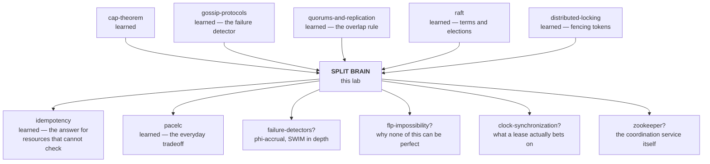

# Split Brain

### When two machines both believe they are in charge

---

**What this lab is.** A teaching document, an interactive simulator
(`visualization.html`), and a set of pencil-and-paper exercises. There is no code to
run and nothing to install. Every number quoted in this document comes from the
simulator on this page, and the simulator's rules are printed at the bottom of it so
you can check that the numbers mean what I say they mean.

**Where you are in the sequence.** This lab sits downstream of several you have
already done. It is the one that finally names, on its own terms, a thing that
appeared as a footnote in four of them:

- the [cap-theorem](../cap-theorem/) lab listed "split-brain" as a key term and never
  opened it,
- the [raft](../raft/) lab measured two leaders coexisting *routinely* and told you
  Raft does not prevent it,
- the [distributed-locking](../distributed-locking/) lab measured `overlapTicks > 0`
  on every single run, even with every defence switched on,
- the [redis](../redis/) lab watched 500 acknowledged writes vanish at a failover.

Four labs, four sightings, no lesson. This is the lesson.

---

## Table of contents

| | Stage | Depth layer |
|---|---|---|
| 1 | [Why this exists](#1-why-this-exists) | Beginner |
| 2 | [The problem, as a story](#2-the-problem-as-a-story) | Beginner |
| 3 | [The obvious fix](#3-the-obvious-fix) | Beginner |
| 4 | [Where the obvious fix breaks](#4-where-the-obvious-fix-breaks) | Beginner |
| 5 | [What we actually need to guarantee](#5-what-we-actually-need-to-guarantee) | Beginner |
| 6 | [The key idea](#6-the-key-idea) | Beginner |
| 7 | [The vocabulary, now that you have earned it](#7-the-vocabulary-now-that-you-have-earned-it) | Beginner |
| 8 | [Two mental models, and where the nice one lies to you](#8-two-mental-models-and-where-the-nice-one-lies-to-you) | Beginner |
| 9 | [Go and break it yourself](#9-go-and-break-it-yourself) | Beginner |
| 10 | [The mechanism, built one failure at a time](#10-the-mechanism-built-one-failure-at-a-time) | Intermediate |
| 11 | [The failure scenarios in full](#11-the-failure-scenarios-in-full) | Engineering |
| 12 | [What is guaranteed, what is not, and what it cost](#12-what-is-guaranteed-what-is-not-and-what-it-cost) | Engineering |
| 13 | [Production](#13-production) | Production |
| 14 | [Exercises](#14-exercises) | — |
| 15 | [Where this sits, and what to learn next](#15-where-this-sits-and-what-to-learn-next) | — |
| 16 | [Glossary](#16-glossary) | — |

---

## 1. Why this exists

You run a service on more than one machine so that it survives one machine dying.
For that to work, the machines must agree on which of them is currently doing the
job — otherwise two of them do it at once.

Two machines doing the job at once is not merely wasteful. It is the specific way
distributed systems produce results that are *wrong* rather than merely *late*. Two
machines both convinced they are the one in charge of an account balance will both
debit it. Two machines both convinced they own a payment batch will both submit it.
Two database servers both accepting writes will build two different versions of
history, and when they are reconnected somebody has to decide which version is real
— which means somebody has to decide whose data to throw away.

That last sentence is the whole cost. Almost every other distributed-systems failure
is recoverable by waiting: the slow node catches up, the queue drains, the retry
succeeds. This one is not. When two machines have both acted, there is no amount of
subsequent agreement that un-acts either of them.

---

## 2. The problem, as a story

A single stretch of railway track runs between two towns. One track, both
directions. There is a signal box at each end — call them the London box and the
Manchester box — and the two signalmen are connected by one telephone line.

The rule is simple and absolute: **only one train may be on the section at a time.**
So before letting a train in, the signalman at one end telephones the other and
asks. If the other end says the section is clear, the train goes. That is the entire
protocol, and for decades it worked.

One afternoon the London signalman picks up the telephone and hears nothing.

He now has to answer a question he has no way of answering. Two things produce
exactly this silence:

1. The Manchester box has burned down. Nobody is there. If he waits for permission he
   will never get it, and he will stop every train on the line for no reason.
2. The telephone line is down. The Manchester box is fine, staffed, and at this
   moment its signalman is picking up his own dead telephone and having exactly this
   same thought.

From where he is standing, these are the same event. **Silence is the only evidence
he has, and it has two meanings that demand opposite responses.** Wait, and case 1
costs him the whole day's service. Proceed, and case 2 puts two trains on one track
travelling towards each other.

You have met this exact undecidability before. The [gossip-protocols](../gossip-protocols/)
lab put it in one line: *death and slowness are indistinguishable from outside.* This
is the same fact wearing a different hat, and this lab is about what it costs when
the thing you get wrong is **who is in charge**, rather than merely who is alive.

> **A note on the history, flagged because I have not verified it here.** The railway
> industry learned this the expensive way, in Britain, in the nineteenth century — the
> Thorpe collision of 1874 on a single-track line near Norwich is the usual example,
> caused by a confusion at one end about whether an order had actually been sent, and
> around two dozen people died. I am recalling that from background reading rather
> than from a source I checked while writing this, so treat the date and the details
> as approximate and look them up before you repeat them anywhere that matters. The
> part that *is* load-bearing for this lab, and which I am confident about, is the
> fix the industry adopted, which we will come back to in stage 6 and which turns out
> to be the same idea your distributed database uses.

---

## 3. The obvious fix

Turn the signalmen into servers. Every server sends a short "still here" message to
the others on a timer — that message is called a **heartbeat**, and its *absence* is
the only failure signal anyone gets. If a server has heard nothing from the one in
charge for longer than some limit, it concludes that server is gone and takes over.

This is not a strawman. It is roughly what a great many production systems actually
do, and it is the default behaviour you get from a naive high-availability setup: a
virtual IP address that moves to whichever machine notices the other has stopped
answering, a cron job that promotes a replica, a lock in a cache with an expiry.

It is also completely reasonable on its face. The only way a server can learn
anything about another server is by receiving messages from it. Absence of messages
is the only failure signal available. Acting on that signal is the only way to
recover from a real failure at all.

> **🔮 Predict.** Five servers, three in London and two in Manchester, running exactly
> this rule. The cable between the two cities is cut. Nothing else fails: every
> server is healthy, every disk is fine, both cities have power. What is the state of
> the system sixty seconds later?
>
> <details><summary>Reveal</summary>
>
> Two servers are in charge, and both are accepting writes to the same database.
>
> Manchester's servers hear nothing from London. Their rule says: take over. So they
> take over. They are not malfunctioning — they are following the rule correctly, on
> the only evidence available to them. London, meanwhile, has noticed nothing at all,
> because its leader is still alive and still leading.
>
> The measured result from the simulator, over 400 ticks: **2 servers in charge, 148
> writes accepted by the database, 68 of them from a server that had already been
> superseded.** Sixty-eight overwrites of newer data, with no error message anywhere.
>
> The critical detail is that Manchester has no way to know it is the smaller side.
> It can count the servers it can reach. It cannot count the servers that exist.
> </details>

---

## 4. Where the obvious fix breaks

Let us do that failure slowly, by hand, because the shape of it is the whole subject.

The starting state. Five servers: `S1 S2 S3` in London, `S4 S5` in Manchester. `S1`
is in charge. Every server knows it. The London app writes through `S1`; the
Manchester app writes through `S5`, which forwards to `S1`.

```
t=0     S1 in charge.  Everyone agrees.  Database has served writes from S1.
t=40    The cable is cut.  Nothing else changes.
        London still sees: S1 leading, S2 and S3 following.  All fine.
        Manchester sees: silence.
t=80    S4 has now heard nothing for longer than its limit.
        S4 takes over.  It tells S5, which accepts.
        Manchester now has a leader.  London still has a leader.
t=85    The Manchester app writes.  S4 accepts it and sends it to the database.
        The London app writes.  S1 accepts it and sends it to the database.
        The database accepts both.  It has no idea anything is wrong.
t=90+   Both continue.  Every write from one erases the effect of the other.
```

Nothing in that trace is a bug. Every server applied its rules correctly to the
evidence in front of it. The database applied *its* rule correctly too: somebody who
was allowed to write, wrote.

This condition — **two or more nodes simultaneously believing they hold an exclusive
role, and acting on that belief** — is called **split brain**. The name is
unflattering and accurate: one system, one job, two independent minds issuing orders,
neither aware of the other.

Three things about it are worth fixing in your head straight away, because each one
is a place where people's intuition is wrong.

**It is not caused by the network.** It is caused by a decision made under
uncertainty. The network breaking into pieces that cannot reach each other — a
**partition** — merely supplies the uncertainty. In stage 11 you will watch split
brain happen with a perfectly healthy network and every cable intact.

**It is not a bug you can fix by being more careful.** No amount of care lets a
server distinguish a dead peer from an unreachable one, because there is no
observation that distinguishes them. This is a limit, not an oversight. It is the
same limit that produces the [cap-theorem](../cap-theorem/) lab's choice: on a
partition you either refuse to answer or you risk answering wrongly, and both of
those are decisions you make in advance, not discoveries you make at the time.

**The two leaders are not the damage.** This is the one that matters most, and we
will spend the rest of the lab on it.

---

## 5. What we actually need to guarantee

Here is the trap. The obvious goal is:

> *At most one server believes it is in charge.*

This goal is **impossible**, and chasing it is why people build fragile systems.

You cannot control what a machine believes. A machine's belief is a variable in its
own memory, formed from messages it has received. A machine that has been unplugged
from the network still holds its old belief perfectly intact; a machine frozen
mid-execution wakes up with its old belief unchanged. No message you send can reach a
machine you cannot reach, and the machines you need to correct are exactly the ones
you cannot reach. That is what made them a problem in the first place.

So drop it. Here is the goal that is actually achievable:

> **At most one authority's actions may ever take effect on the shared resource, and
> once a newer authority has acted, nothing from an older one may act again.**

Read that twice, because four things in it are load-bearing.

- It is about **effects**, not beliefs. Believe whatever you like; the question is
  whether your write lands.
- It is about the **shared resource** — the database, the disk, the payment gateway.
  Not about the cluster's internal opinion of itself.
- It is **ordered**: authorities form a sequence, and the sequence only goes forward.
  This is what makes it checkable with arithmetic.
- It says **at most one**, not exactly one. Sometimes the honest answer is that
  nobody may act, and the service is down. That is a correct outcome, not a failure of
  the design.

The [distributed-locking](../distributed-locking/) lab reached the same place from a
different direction and named it: *at-most-one-effect-lineage, not at-most-one-holder.*
If that phrase meant nothing at the time, it should mean something now. It is the
same requirement, stated for locks instead of leaders.

---

## 6. The key idea

You cannot stop a machine from believing it is in charge.

You can stop its writes from counting.

So move the decision out of the machines' heads and put it at the thing being
protected. The shared resource keeps one number: the identity of the newest authority
whose work it has accepted. Every write arrives carrying the identity of the
authority that issued it. Anything older than the number is refused.

That is it. That is the entire idea, and everything in the rest of this lab is either
a way to produce that number reliably, or a story about what happens to systems that
do not have one.

And this is where the railway comes back. The answer the railways settled on was not
a better telephone and not a better rule. It was a **physical brass token**. One
token per section of track. You may not enter the section without holding it. It
cannot be in two places, so two trains cannot both be authorised, *no matter what
either signalman believes, and no matter what the telephone is doing.* The
signalmen's beliefs stopped being safety-critical the moment the authority became an
object that the track itself could check.

Your distributed system cannot pass a brass object around. It passes a number
instead, and the resource checks it. Same idea, one abstraction thinner.

---

## 7. The vocabulary, now that you have earned it

Each of these has been demonstrated above before being named. Minor terms are defined
where they first appear later in the document; these are the load-bearing ones.

### Split brain

- **In plain words:** two parts of one system both think they are the one in charge,
  and both act on it.
- **Technically:** two or more nodes simultaneously hold a role the system's design
  says is exclusive — leader, primary, lock holder, coordinator — and issue
  side effects under it.
- **Why the term exists:** to name the *state of belief*, separately from its cause
  and separately from its damage. Those are three different things and people use one
  word for all three, which is why conversations about it go badly.
- **Concrete:** at `t=85` in the trace above, `S1` and `S4` are both leaders. That is
  split brain. Whether it has hurt anything yet is a different question.
- **Connects to:** the [raft](../raft/) lab's blunt correction — *"Raft guarantees one
  leader" is false; "one leader per term, and only the newest can commit" is true.*

### Partition

- **In plain words:** the network has broken into pieces that cannot talk to each
  other.
- **Technically:** a set of nodes is partitioned when messages between two subsets are
  not delivered, while nodes within each subset can still communicate.
- **Why the term exists:** it names a *cause*. This lab's whole discipline is keeping
  cause, belief, divergence and loss in separate boxes.
- **Concrete:** at `t=40`, `{S1,S2,S3}` and `{S4,S5}` become two partitions.
- **Connects to:** the P in [cap-theorem](../cap-theorem/). Note that a partition is
  neither necessary nor sufficient for split brain: stage 11 has split brain with no
  partition, and stage 11 also has a partition with no split brain.

### Failure detector

- **In plain words:** the part of the system that decides whether another machine is
  dead.
- **Technically:** a component that converts observed silence into a verdict about
  liveness. It is *unreliable* by construction: it can report a live node as dead
  (a false positive) and a dead node as live (a slow detection).
- **Why the term exists:** to make the fallibility explicit and give it a name you can
  argue about, instead of burying a timeout in a config file and calling the result
  truth.
- **Concrete:** "I have heard nothing from `S1` for 40 ticks, therefore `S1` is dead."
  A false positive of exactly this kind is the trigger for most real split brains.
- **Connects to:** the [gossip-protocols](../gossip-protocols/) lab measured the whole
  dial — `suspectAfter=1` spots a crash in 3.6 rounds but falsely accuses 98% of the
  cluster during a 4-round pause; `suspectAfter=5` never falsely accuses and takes 7.9
  rounds. There is no setting that is good at both columns, and that lab's headline
  finding is worth re-reading: at 90% packet loss with *zero* crashed processes, a
  100-node cluster wrote off 100% of its own members. **The spreading is robust; the
  judging is fragile.**

### Epoch (also: term, generation, fencing token, revision, incarnation)

- **In plain words:** a number that goes up by one every time leadership changes, so
  you can tell whose orders are newer.
- **Technically:** a monotonically increasing integer attached to a period of
  authority. It is a logical clock: it says nothing about real time and everything
  about order.
- **Why the term exists:** because "who is the leader" is not answerable from inside a
  partition, but "is this order newer than the last one I obeyed" is answerable by one
  integer comparison, with no timing assumptions whatsoever.
- **Concrete:** `S1` leads in epoch 1. The cut happens. `S4` wins an election and
  leads in epoch 2. A write arrives at the database carrying epoch 1 after the
  database has already served epoch 2 — refused, because 1 < 2.
- **Connects to:** you have now met this object under six names across five labs. It
  is Raft's **term**, Paxos's **proposal number**, ZooKeeper's **zxid**, etcd's
  **mod_revision**, Chubby's **sequencer**, gossip's **incarnation number**, and the
  [distributed-locking](../distributed-locking/) lab's **fencing token**. The
  [optimistic-vs-pessimistic-locking](../optimistic-vs-pessimistic-locking/) lab's
  unification applies here too: a fencing check *is* a conditional write, with the
  version column minted by whoever grants leadership.

### Quorum

- **One-line refresher, since you have a whole lab on this:** a majority, and the only
  property that matters is that any two majorities of the same set share at least one
  member, so they cannot both act without at least one node knowing about both.
- **The new fact this lab adds, and it is a big one:** a quorum rule governs **winning
  an election**. It says nothing whatsoever about **keeping the job**. A leader
  elected legitimately last week, now stranded alone on the wrong side of a cut cable,
  still believes it is the leader and nothing in the quorum rule tells it otherwise.
  You will measure this in stage 10 and it surprises most people.

### Lease

- **In plain words:** authority with an expiry date on it.
- **Technically:** a grant of a role valid until a wall-clock deadline, which must be
  renewed against a majority to be extended. A holder that cannot renew must stand
  itself down when the deadline passes.
- **Why the term exists:** to convert "I have not heard that I lost my job" into "my
  job has expired", which is a statement a stranded node can evaluate alone.
- **Concrete:** `S4`'s lease runs to `t=180`. At `t=140` the cable is cut. `S4` cannot
  renew. At `t=180` it stands down without anyone telling it to.
- **The catch, and it is the same one as always:** a lease is a bet on clocks. It
  assumes the holder's clock advances at roughly the same rate as everyone else's and
  that the holder is actually *executing* to notice the deadline. A process frozen for
  longer than its lease notices nothing.

### Fencing (two different things, both called fencing)

This one causes real confusion between communities, so learn both:

- **Fencing token** (distributed-systems usage): the epoch check described above. The
  resource refuses stale work. Nothing is killed.
- **Fencing / STONITH** (high-availability-cluster usage, from *Shoot The Other Node
  In The Head*): physically powering off or isolating the suspected-dead machine —
  cutting its power via a management controller, or telling the storage array to stop
  accepting its writes. It converts "I believe you are dead" into "you are dead".
- **Why both exist:** they solve the same problem for different resources. If the
  resource can check a number, use a token. If it cannot — a raw shared disk, a
  virtual IP, an industrial controller — you have no option but to make the other
  machine stop existing.

### Divergence

- **In plain words:** two copies of the data that disagree, and neither is obviously
  wrong.
- **Technically:** two histories that share a prefix and then differ, both containing
  writes that were acknowledged to a client.
- **Why the term exists:** because it is the *damage*, as distinct from split brain
  which is the *belief*. Split brain with no divergence costs you nothing. Divergence
  is what somebody has to clean up, by hand, choosing whose data to discard.
- **Connects to:** the [pacelc](../pacelc/) lab's PA/EC corner, where a database
  accepts writes on both sides of a partition and then discards the losing branch at
  heal — MongoDB writing it to a rollback file and moving on.

### Witness (also: arbiter, tiebreaker)

- **In plain words:** a small extra voter that stores no data and can never be in
  charge, whose only job is to make the total number odd.
- **Why it exists:** two sites split evenly cannot produce a majority on either side.
  A third voter, in a third place, guarantees that at most one side can.
- **The trap:** the *placement* is the whole trick. A witness in one of the two main
  sites is not a tiebreaker; it is a rule that says that site always wins.

---

## 8. Two mental models, and where the nice one lies to you

### The simple model: the single-track railway

One track. Two signal boxes. One telephone. One brass token, and no train may enter
the section without physically holding it.

The token, not the telephone, is what makes the system safe. The telephone is how the
signalmen *coordinate*; the token is what makes miscoordination *harmless*. If the
telephone fails, the worst outcome is that no train runs — because the token is
sitting in one box and the other box cannot conjure one up.

### The engineering model

Three separate objects that people habitually merge into one:

1. **The belief set.** Which nodes currently think they hold the role. This is
   distributed, unsynchronised, and frequently wrong. You cannot control it.
2. **The authority lineage.** A totally ordered sequence of epochs, each with at most
   one holder. Produced by an election rule (usually a majority vote). It exists as a
   fact about the system even though no single node can observe it.
3. **The effect gate.** A check *at the resource* that admits work only from the
   newest authority it has seen. This is the only place where correctness is actually
   enforced.

Safety is a property of (3). Availability is a property of (2). (1) is noise.

### Mapping

| Railway | Distributed system |
|---|---|
| The single-track section | The shared resource (database, disk, account, gateway) |
| Signal box | Node / server |
| Signalman's belief that he may proceed | The node's `role = leader` variable |
| The telephone line | The network |
| Silence on the telephone | Failure detector input — dead or unreachable, indistinguishable |
| "I'll assume he's gone and let the train through" | Taking over on timeout |
| The brass token | The epoch / fencing token |
| The section physically requiring the token | The resource checking the token on every write |
| Only one token exists | Epochs are issued by a majority, so at most one per epoch |
| Two trains on the track | Two authorities' effects interleaved on one resource |

### Where the analogy breaks

Three places, and each one is the reason a real system needs something the railway
does not.

**1. The token is physical there and a number here.** A brass token cannot be forged,
duplicated, or replayed; the laws of physics enforce the invariant for free. A number
enforces nothing by itself — it only works if the resource *actively checks it on
every operation*. Send a perfectly correct token to a resource that does not check,
and you have exactly as much protection as sending nothing. This is not a quibble; it
is the single most important practical caveat in this lab, and stage 11 measures it.

**2. The railway has out-of-band evidence.** A signalman can walk down the line, look
out of the window, send a runner, telephone a third station. He has senses beyond the
one channel. A server has exactly one way to learn anything about another server, and
when that fails it is blind. This is why real systems add *indirect probes* — "can
anyone else reach `S4`?" — a trick the [gossip-protocols](../gossip-protocols/) lab
measured: heartbeat-via-anyone never notices a single cut cable, direct-evidence-only
buries 9.7 of 20 healthy peers, and indirect probing fixes both.

**3. The railway has two parties and one resource.** That means it has no notion of a
majority — with two parties there is no majority to be had. Real clusters have *N*
parties, which is what makes voting available as a tool at all, and it is why the
answer to "how do I make a two-node cluster safe?" is very often "add a third
machine", which sounds like a dodge and is in fact the entire answer.

---

## 9. Go and break it yourself

Open **[`visualization.html`](visualization.html)** — or the published version,
**[Two Signal Boxes](https://claude.ai/code/artifact/0bb7695b-3ce1-4465-b700-56b9e26eec0a)**
— before reading further. Everything from here on is easier
after you have watched it once.

**The two numbers on the right are the point of the whole page.**

- *Servers that believe they are in charge* — this one is allowed to go up. It is
  cheap. It happens constantly in correct systems.
- *Writes accepted from a stale authority* — this one is the damage. It is what you
  are actually defending against.

A good design lets the first number reach two and holds the second at zero. If you
take one thing from this lab, take that sentence.

**Run these three, in this order, before anything else:**

1. **Scenario 1** — the cable is cut with no defences on. Watch both numbers climb.
   This is the disaster in its natural state.
2. **Scenario 3** — the same cut, with majority quorum switched on, but with the
   server that was *already* in charge — the **incumbent** — on the *minority* side.
   Most people expect quorum to save them here. It does not, and understanding why is
   stage 10.
3. **Scenario 9** — a leader freezes on a perfectly healthy network with fencing
   switched on. Two servers end up believing they are in charge and **zero** writes
   are damaged. Look at the hollow squares in the ledger: each one is a disaster that
   did not happen.

The four defences on the page are independent switches, not a ladder. That is
deliberate, and it matters: you cannot see what any one of them is worth until you
can turn the others off. Real systems ship them in every combination — etcd's
`mod_revision` is a fencing token with no lease anywhere near it.

---

> ### ✅ Checkpoint — you now have the BEGINNER MODEL
>
> You can explain what split brain is, why it cannot be prevented by trying harder,
> and why the interesting question is about effects rather than beliefs. You could
> hold your end of a conversation about it.
>
> What the next layer adds: the actual mechanism, built one defence at a time, with
> each defence introduced *after* you have watched the previous one fail. This is
> where you find out that the defence most people reach for first — majority quorum —
> is not sufficient on its own, and exactly what it is missing.

---

## 10. The mechanism, built one failure at a time

We will build the design in five versions. Each version is what a competent engineer
would try next, and each one is broken by a measured result before the next appears.

Every number in this section comes from the simulator, run for 400 ticks with five
servers, three in London and two in Manchester, at a write every 5 ticks. "Damaged"
means a write the database accepted from an authority older than one it had already
served — a real overwrite of newer data.

### v1 — Take over when the other side goes quiet

The rule from stage 3. No votes, no expiry, no tokens.

| | |
|---|---|
| Servers in charge after the cut | **2** |
| Writes accepted | 148 |
| **Damaged** | **68** |

Broken, and we knew it would be. On to the fix everyone reaches for.

### v2 — Require a majority to take charge

A server may only become leader with votes from more than half of *all* servers, not
half of the ones it can reach. This is the [quorums-and-replication](../quorums-and-replication/)
lab's overlap rule doing its job: two majorities of five must share a member, so two
servers cannot both be elected in the same epoch.

Run it with the cable cut and the existing leader `S1` in London, the majority side:

| | |
|---|---|
| Servers in charge | **1** |
| Writes accepted | 79 (down from 158 on a healthy cluster) |
| **Damaged** | **0** |

Excellent. Manchester's `S4` campaigns and campaigns — its epoch climbs to 8 over the
run — and never wins, because it can only ever reach two votes and needs three. The
Manchester app is refused service. London carries on.

Note *what did the work* there, because it is the genuinely elegant part: nobody told
`S4` it had lost. There is nobody who *could* tell it. It worked out its own defeat,
alone, from a vote count it could compute locally. Majority quorum is the one rule a
partitioned node can apply correctly using only information it already has.

> **🔮 Predict, and this is the important one.** Same five servers, same cut, majority
> quorum still switched on. The only change: the server that was *already* in charge
> before the cut, `S4`, sits in **Manchester** — the minority side. What happens?
>
> <details><summary>Reveal</summary>
>
> | | |
> |---|---|
> | Servers in charge | **2** |
> | Writes accepted | 147 |
> | **Damaged** | **68** |
>
> Identical damage to having no defence at all.
>
> `S4` was elected legitimately, long ago, with a proper majority. Now the cable is
> cut. Nothing happens to `S4`. It receives no messages, and *not receiving a message
> is not a resignation letter.* It carries on leading, and the Manchester app carries
> on writing through it perfectly happily.
>
> Meanwhile London has three servers, correctly forms a majority, and elects its own
> leader in a higher epoch. Both write.
>
> **A quorum rule is a rule about winning an election. There is nothing in it about
> keeping the job.** Every server obeyed the rule. The rule was not enough.
> </details>

That is the crack in v2, and it points at exactly what is missing: nothing in the
system makes authority *stop by itself*.

### v3 — Make authority expire

Give leadership a deadline. A leader must keep renewing its position against a
majority; if it cannot, it stands itself down when the deadline passes. And
symmetrically, a newly elected leader waits out the old lease before it touches
anything, so that whatever the old leader still believes, its time has provably run
out.

Same setup as the prediction above — quorum on, lease on, incumbent stranded in
Manchester:

| | |
|---|---|
| Servers in charge | **1** |
| Writes accepted | 68 |
| **Damaged** | **0** |

`S4` stands itself down. Nobody tells it to; it simply cannot renew, so it stops.

This is real, and it is what most production leader-election systems do. But look at
what it cost and what it assumes.

**The cost:** 68 writes served, against 79 under v2 and 158 on a healthy cluster.
There is a mandatory dead window on every failover — the new leader is elected and
then deliberately does nothing while the old lease drains. You have bought safety
with unavailability, and the bigger the lease, the more you buy of each.

**The assumption, which is the dangerous part:** a lease is a bet that the holder's
clock advances at the same rate as everyone else's, *and that the holder is actually
executing to notice the deadline.* Both halves of that can fail. A virtual machine
suspended and resumed comes back with a clock that jumped. A process in a long
garbage-collection pause is not executing at all, so it cannot notice anything, and —
this is the sharp bit — **it cannot heartbeat either, which is precisely why its
lease expired.** The mechanism that is supposed to stop it is disabled by the same
event that makes stopping it necessary.

Let us do exactly that.

#### The hand trace that breaks v3

Five servers. Perfectly healthy network — nothing is cut, no cable is touched, both
cities have full connectivity throughout. Silence limit 40 ticks. `S1` is in charge,
the London app writes through it.

```
t=0..29   Normal.  S1 leads in epoch 1.  Writes flow.  All five agree.

t=30      S1 freezes.  A garbage collection pause, or the hypervisor suspending
          the VM.  S1 is NOT crashed and the network is NOT broken.  S1 has
          simply stopped executing.  It sends nothing, receives nothing,
          notices nothing.

t=70      S2 has heard nothing for 40 ticks.  Its failure detector says S1 is
          dead.  This verdict is WRONG, and there is no observation available
          to S2 that would tell it so.
          S2 becomes a candidate in epoch 2 and asks for votes.

t=73      S3, S4, S5 grant votes — epoch 2 is newer than the epoch 1 they hold.
          S2 has 4 of 5.  S2 is now the leader in epoch 2.  Legitimately.
          The cluster is, at this moment, entirely correct.

t=75..99  S2 serves writes.  The database's newest served authority is epoch 2.

t=100     S1 wakes up.
          Here is the crucial fact: NOTHING tells S1 that time has passed.
          A process resuming from a GC pause does not get an interrupt saying
          "you were gone for 70 ticks and lost your job".  Its `role` variable
          still says leader.  Its `epoch` variable still says 1.

t=100     The London app's write arrives at S1.  S1 is the leader, as far as
          S1 is concerned, so it accepts it and sends it to the database.
          The database accepts it.  It carries epoch 1.  The database had
          already served epoch 2.
          ---> DAMAGE.  A superseded leader has overwritten newer data.

t=105     Same again.

t=107     S2's next heartbeat reaches S1.  S1 sees epoch 2 > epoch 1 and
          stands down instantly.  The split brain is over.
```

Measured over the full run: **2 damaged writes.**

Two things to take from that trace, and the second is more important than the first.

**First:** there was no partition. Not a single cable was cut. Split brain is not a
network phenomenon — it is a *decision-under-uncertainty* phenomenon, and a frozen
process supplies exactly the same uncertainty as a broken cable.

**Second, and be honest about this:** what happened between `t=100` and `t=107` was a
**race**. `S1`'s stale write and `S2`'s heartbeat were both in flight, and the write
won by seven ticks. Run it with different timing and sometimes the heartbeat wins and
nothing bad happens at all.

That is not reassuring — it is the problem. A defence that works most of the time is a
defence you cannot reason about. You cannot write down what your system guarantees,
you cannot test it (the bad case does not reproduce), and you find out which way the
race went from a customer. In production this race is decided in milliseconds you do
not control, on a network you do not own.

We need a rule with no timing in it at all.

### v4 — Check the token at the resource

Every write carries the epoch of the authority that issued it. The database keeps one
number: the highest epoch it has served. Anything lower is refused.

Run the *identical* freeze — same 70-tick freeze, same 40-tick limit, same healthy
network:

| | v3 (lease) | v4 (fencing) |
|---|---|---|
| Servers believing they are in charge | 1 | **2** |
| Writes accepted | 118 | 133 |
| Writes refused | 0 | **2** |
| **Damaged** | **0** | **0** |

Look carefully at that table, because it is the thesis of the lab in four rows.

**Fencing did not prevent split brain.** Two servers still believed they were in
charge — the left number went to two, and it always will. What fencing did was make
the belief **inert**. `S1`'s write arrived carrying epoch 1 at a database that had
already served epoch 2, and bounced. `S1` went on believing it was the leader right
up until its next heartbeat; it was simply no longer able to do anything about it.

And now the part that surprises people: **fencing served more writes than the lease
did** — 133 against 118 — while giving the same zero damage. The same pattern holds
on the partition test: quorum-plus-fencing accepted 79 writes with 68 refusals and
zero damage, against quorum-plus-lease's 68 accepted. The lease buys safety by making
everybody wait. Fencing buys safety by letting everybody proceed and refusing the ones
that turn out to be stale.

The reason is worth stating precisely, and it is the sentence the
[distributed-locking](../distributed-locking/) lab arrived at too:

> **Safety by arithmetic, liveness by timeout — never the reverse.**

The token check has *zero* timing assumptions. It does not care about clock drift,
GC pauses, VM suspension, network delay, or how long a packet sat in a queue. It is
one integer comparison, and it is correct under every possible schedule. The timeout
is still there — you still need one to decide *when to try* a takeover, because
slow-versus-dead is undecidable and something has to break the tie. But the timeout is
now only deciding how fast you recover, not whether you are correct.

Both are still worth having together, for different reasons: fencing is what makes it
*safe*, and a lease is what stops a stranded leader from serving stale *reads* and
burning capacity forever.

### v5 — What to do when the resource cannot check

Now switch off the database's ability to check tokens, and change nothing else. The
tokens are still generated, still correct, still attached to every write. There is
simply nobody comparing them.

| | fencing, checking resource | fencing, non-checking resource |
|---|---|---|
| Writes refused | 2 | **0** |
| **Damaged** | **0** | **2** |

All the protection is gone. Every bit of it.

This is not a contrived setting. It is the everyday situation for an enormous
proportion of real side effects:

- a payment gateway that takes a charge request and charges the card,
- an SMTP server that takes an email and sends it,
- a third-party API with no conditional-update support,
- a raw block device shared between two machines,
- a physical actuator.

None of these vote. None of these have any idea a cluster exists. And that leads to
the sentence that generalises everything above:

> **A quorum protects the voters. Anything that is not a voter gets no protection from
> consensus at all, unless it independently refuses stale work.**

Your five servers can agree perfectly about who is in charge. The payment gateway was
not in the room, was not asked, and will cheerfully charge the card twice.

For those resources you have exactly three options, and you will use all three:

1. **Make the effect idempotent.** Attach a client-generated key to the *operation*,
   and have the receiver deduplicate on it. Then a duplicate from a superseded
   leader still acting — a **zombie** — costs nothing, because the second attempt is
   recognised as the first. This is the
   [idempotency](../idempotency/) lab's entire subject, and this is why it matters
   here.
2. **Make the machine stop existing.** STONITH: power it off through a management
   controller, or have the storage array refuse its writes. This is what
   high-availability clusters do when the resource is a raw disk, because there is
   nothing else available. It has its own failure mode, which is stage 11.
3. **Reconcile afterwards.** Accept that duplicates happen, detect them later, and
   correct. Slow, human, and often the only honest answer.

---

> ### ✅ Checkpoint — you now have the INTERMEDIATE MODEL
>
> You can name the four defences, say what each one is for, and — more importantly —
> say what each one is *not* for: quorum governs elections and not incumbency; a lease
> is a bet on clocks; fencing makes the loser harmless rather than absent; and none of
> it reaches a resource that does not check.
>
> What the next layer adds: the failure modes as a systematic catalogue, including the
> three that catch experienced engineers — the asymmetric partition, the fence race,
> and the operator override.

---

## 11. The failure scenarios in full

Each of these is reproducible in the simulator. For each: how to create it, what
happens, why, which guarantee survives, which one does not, and how it shows up in
production.

### 11.1 Clean partition, incumbent on the majority side

**Create:** 5 servers 3|2, quorum on, cut the site link, leader in London.
**Watch:** scenario 2. **Result:** 1 leader, 0 damaged, 79 writes served.

London continues. Manchester's `S4` campaigns, its epoch climbing to 8 over 400
ticks, and never wins. Manchester's app gets errors.

**Guarantee kept:** correctness — there is one authority and no divergence.
**Guarantee lost:** availability for the minority side, completely.
**In production:** this is the healthy, designed-for case, and it is what CP systems
look like when they work. The alarm you want is not "a partition happened" but
**"elections per minute"** — the [raft](../raft/) lab identified that as the one Raft
alarm, and this is why: a node campaigning in a loop is invisible in a latency graph
and obvious in an election counter.

### 11.2 Clean partition, incumbent on the minority side

**Create:** the same, but start the leader in Manchester (scenario 3).
**Result with quorum alone:** 2 leaders, **68 damaged**. **With a lease added:** 1
leader, 0 damaged.

Covered in stage 10. The failure is that quorum has nothing to say about an existing
leader, so authority must be given an independent way to expire.

**Guarantee kept (quorum only):** none that matters — the cluster's internal election
history stays consistent, and the data does not.
**In production:** this is why every real leader-election implementation has *both* a
quorum for elections and a lease or its equivalent. If you are ever reviewing a
home-grown leader election, this is the first thing to look for, and it is the most
commonly missing piece.

### 11.3 Even split — 2 | 2

**Create:** 4 servers, 2|2, quorum and lease on, cut the link (scenario 4).
**Result:** **0 leaders**, 9 writes served in 400 ticks, 0 damaged.

Three votes are needed. Neither side can find more than two. Both campaign forever
and the old leader's lease drains with nobody to renew against. Four healthy servers,
total outage.

**Guarantee kept:** safety, perfectly.
**Guarantee lost:** availability, everywhere, for everyone.
**In production:** this is why an even node count is a trap. Four servers tolerate
exactly one failure, the same as three, while giving you one extra machine that can
fail — strictly worse. Six tolerate two, same as five. **The rule is: always an odd
number of voters.**

### 11.4 The witness, placed correctly

**Create:** 2 London + 2 Manchester + 1 witness in Bristol, then take Manchester
fully offline (scenario 5).
**Result:** 1 leader in London, 0 damaged, 79 writes served.

London's two plus Bristol's one is three of five. Manchester's two is not.

**In production:** MongoDB calls it an arbiter, SQL Server calls it a file-share
witness, Galera calls it `garbd`, Patroni relies on the DCS quorum itself. All the
same idea. The placement rule: **the witness must be able to fail independently of
both main sites**, which in practice means a third availability zone or region. A
witness in one of the two main sites is not a tiebreaker — it is a declaration that
that site always wins.

### 11.5 The non-transitive partition — the one nobody draws

**Create:** the same witness cluster, but cut *only* the London–Manchester link, so
Bristol can still reach both sides (scenario 6).
**Result:** epochs climb to 6 over 400 ticks against 1 on a healthy cluster; writes
served drop to 42 from 158; **0 damaged**.

This is not a clean break into two halves. It is the shape where A cannot reach B
while both can still reach C — and it is common in real networks, produced by a
single failed link, an asymmetric routing change, or a firewall rule applied to one
direction.

Bristol will vote for whoever asks with a higher number. So London bids and wins,
then Manchester bids higher and unseats it, then London bids higher again, forever.
Nothing is broken and no rule is violated. The cluster simply cannot settle, and it
spends its capacity on elections instead of work.

**Guarantee kept:** safety, entirely. **Guarantee lost:** liveness, badly, with no
error anywhere that says so.
**In production:** this is precisely why Raft has **pre-vote**. A candidate first asks
"*would* you vote for me?" without raising anybody's epoch; a node that cannot
actually win therefore stops disrupting the ones that can. If you are running a
consensus system, check that pre-vote is enabled — etcd and modern Raft
implementations have it. The symptom to alarm on is, again, elections per minute.

### 11.6 The one-way partition

**Create:** cut the site link, tick "cut only one direction".
**Result:** 0 damaged with fencing on.

A node whose outbound messages are delivered but whose inbound are not is a
particularly nasty object: it looks alive to everyone else while believing everyone
else is dead.

**In production:** this is the "gray failure" family — a partially failed link, an
overloaded NIC dropping in one direction, a security group edited on one side. The
defence is the same indirect-probing trick from the
[gossip-protocols](../gossip-protocols/) lab: never ask "is `S4` up?", which is
unanswerable, but "can *anyone* reach `S4`?", which is not.

### 11.7 The frozen process — split brain with no network fault

**Create:** freeze the leader for 70 ticks with a 40-tick limit, nothing cut
(scenarios 9–11).

| Defence | Damaged |
|---|---|
| quorum only | 2 |
| quorum + lease | 0 |
| quorum + fencing | 0 (and 2 actively refused) |
| fencing, but the resource cannot check | 2 |

Covered in stage 10. The important framing: **the cause was not the network.** Real
sources are stop-the-world garbage collection, a VM suspended for live migration,
`SIGSTOP`, a machine swapping, a disk stall making an `fsync` take thirty seconds, or
simple CPU starvation on a noisy host.

**In production:** the [redis](../redis/) lab measured the same class of event from
another angle — one `KEYS` command over 200k keys took innocent `GET`s on other
connections from p99 1,011 µs to 191,661 µs, a 190× collapse, with safety fully
intact and liveness gone. That is a 190-millisecond stall on a healthy server doing
nothing wrong. If your failure detector's limit is anywhere near that, you have a
split brain waiting for a busy afternoon.

### 11.8 The zombie's in-flight write

**Create:** hard to stage deliberately; it is the general case of 11.7.

A leader validates that it is still the leader, and *then* sends a write. Between
those two instructions the world can move: the write can sit in a queue, the leader
can be paused, the lease can expire. The write lands after the leader has lost
authority, carrying credentials that were valid when it left.

The [distributed-locking](../distributed-locking/) lab hit exactly this and it was
the most invisible failure in that lab: a pause *shorter* than the TTL still lost an
update, because **the hold includes the write's travel time**. Its fix generalises
here: **fence reads too.** A read presents its token and raises the resource's floor,
so older in-flight writes bounce. Chubby checks sequencers on every request, not just
writes, for this reason.

**The general principle:** a defensive check before acting cannot protect you, because
the gap between the check and the act is unbounded. The check must be *at the point of
effect*, performed by the thing being affected, atomically with the effect.

### 11.9 The fence race — both machines shoot each other

**Create:** turn on "shoot the loser" with no quorum requirement, then cut the link.

Both sides conclude the other is dead. Both issue a power-off. If both succeed, the
entire cluster is down — a total outage manufactured by the safety mechanism. If the
fencing path itself runs over the broken network, neither succeeds and you have split
brain *plus* two machines convinced they have just killed each other.

There is a worse variant. Each machine reboots the other; the rebooted one comes up,
concludes the first is dead, and shoots back. A pair of servers can ping-pong
indefinitely.

**In production:** this is a well-known problem in Pacemaker/Corosync clusters, and
the standard mitigations are exactly what you would now predict: **gate fencing behind
quorum** so only a majority side is permitted to shoot, and add a **randomised or
asymmetric delay** before firing so that in a genuine two-way race one side reliably
wins. If that sounds familiar, it is the same trick as Raft's randomised election
timeouts, which the [raft](../raft/) lab measured: identical timeouts gave term 40 in
6000 ticks and *never* a leader; randomised ones elected in 155/174/332 ticks
(min/p50/max) over 200 cold starts. Randomisation does not prevent the collision — it
makes it self-correcting.

### 11.10 The operator override — the most expensive one

**Create:** cut the link, then press "Force Manchester to act alone" while London is
still healthy (scenario 11).
**Result:** 2 leaders, 20+ damaged, both clusters internally consistent and certain.

Every runbook has this button. It exists for a real reason: when a site genuinely
burns down, the survivors cannot reach a majority and someone must manually grant
them the right to proceed. Without it, a real disaster is unrecoverable.

The problem is that the button cannot tell whether the other site is dead or merely
unreachable — and neither can the person pressing it, because they are looking at the
same silence. It does not talk to London; it *cannot*, that is the whole situation.
It only changes what Manchester requires of itself. London carries on with a perfectly
valid majority, having noticed nothing.

**No consensus protocol defends against this**, because it is not a bug in the
protocol. It is a human removing the protocol.

**In production:** treat this as a physically dangerous operation.
- Require the operator to state, in the runbook and in writing, *how they know* the
  other site is down — a specific out-of-band observation, not an inference from the
  same silence the cluster is looking at.
- Prefer procedures that **fence the other side first** and only then grant quorum:
  revoke its storage access, drop its BGP session, shut its VMs down through the
  hypervisor API. Make the assumption true before you rely on it.
- Instrument it. An override should page somebody, not appear in a log.

### 11.11 Healing — what happens when the cable comes back

**Create:** cut the link with no defences, run, then set the cut back to "nothing cut"
(the simulator lets you do this mid-run).
**Result:** two leaders become one within a few ticks.

The moment messages flow, the leader with the lower epoch hears from a higher one and
stands down at once. Notice that no timer was involved — one server simply answered
another. **Most split brains end in milliseconds, not at the end of a lease.**

But healing the *belief* is trivial and healing the *data* is not. The writes that
both leaders accepted during the split are still there, interleaved, and one branch
has to be discarded. The cluster returns to health while the damage remains.

**In production:** this is where MongoDB writes a **rollback file** — the losing
branch's documents, dumped to disk as BSON under the data directory, and then the
node moves on. Those writes were acknowledged to clients. Almost nobody ever reads
those files. The [pacelc](../pacelc/) lab put this system in the PA/EC corner for
exactly this reason: it pays the worst everyday latency bill *and* discards
acknowledged writes at heal.

---

> ### ✅ Checkpoint — you now have the ENGINEERING MODEL
>
> You can enumerate the failure modes, say which guarantee each one bends, and reason
> about a design you have never seen by asking: what is the failure detector, what
> produces the epoch, and does the resource check it?
>
> What the next layer adds: the named systems, what each one actually implements,
> what to monitor, and what this lab deliberately left out.

---

## 12. What is guaranteed, what is not, and what it cost

### The invariants, stated precisely

**I1 — Election safety.** At most one node is elected per epoch.
*Why it holds:* election requires a majority, any two majorities of the same set
intersect, and a node votes at most once per epoch. So two winners in one epoch would
require some node to have voted twice.
*What it does NOT say:* anything about how many nodes are *acting* as leader at any
moment. Leaders from different epochs coexist freely. This is the gap that everything
else in the lab exists to fill.

**I2 — Effect ordering.** If the resource has accepted a write from epoch *e*, it
will never subsequently accept one from any epoch < *e*.
*Why it holds:* the resource keeps a monotonic floor and compares. Pure arithmetic,
no timing.
*Requires:* that the resource actually performs the check, atomically with the write.
This is an assumption about the *resource*, not about your cluster, and it is the one
most often false.

**I3 — Liveness under a majority.** If a majority of nodes can communicate with each
other and with the resource, and the network is eventually stable for long enough,
some node will be elected and will make progress.
*Why "eventually stable":* under continuous partition or continuous election churn
(11.5) no progress is guaranteed. This is not a defect of the design; FLP says no
deterministic protocol can guarantee both safety and liveness in an asynchronous
system with faults. You keep safety unconditionally and buy liveness with timing
assumptions.

### What is explicitly NOT guaranteed

- **That only one node believes it is the leader.** Never. Not achievable. Stop
  designing as though it were.
- **That an acknowledged write survives.** A write acknowledged by a leader that is
  later superseded may be discarded. "The server said OK" and "this is durable" are
  different statements, separated by the replication policy — the
  [quorums-and-replication](../quorums-and-replication/) lab's `acks=all` +
  `min.insync.replicas` finding is the same point from the storage side.
- **That the minority side gets an error.** It may get a confident, cheerful,
  completely stale success. The [pacelc](../pacelc/) lab's whole else-clause is this:
  *someone waits — the writer, the reader, or nobody; and if nobody waits, somebody
  gets stale.*
- **Protection for any resource that does not check tokens.** Zero. Not reduced —
  zero.
- **Anything under Byzantine faults.** Everything here assumes nodes crash, freeze, or
  are unreachable. A node that lies about its epoch defeats all of it.

### What it cost

| Bought | Paid with |
|---|---|
| No two leaders elected in one epoch | Progress requires a majority: below that, the service is down by design |
| A stranded leader stops on its own (lease) | A mandatory dead window on every failover; a bet on clocks; fewer writes served (68 vs 79 measured) |
| Stale effects refused (fencing) | The resource must be able to check, and every operation costs one comparison |
| A tiebreaker for two sites (witness) | One more machine, and a placement constraint that is easy to get wrong |
| Certainty that a peer is dead (STONITH) | A new failure mode where both sides shoot, and a dependency on the fencing path |

### Safety and liveness are independent here

The [raft](../raft/) lab proved this both ways with measurement — safety never
degraded at any message-loss rate including 90%, while liveness degraded smoothly and
then collapsed (30/30 commits at 30% loss, 7/30 at 50%, 0/30 at 70%). The same
separation holds throughout this lab and it is a useful diagnostic habit: when
something goes wrong, ask *first* which of the two you lost. A cluster that has
stopped serving is usually working correctly. A cluster that is serving happily may
be the one destroying your data.

---

## 13. Production

### From this lab's toy to the real thing

| This lab | Real implementation | Production architecture |
|---|---|---|
| A leader variable per node | Raft or Paxos leader with a persisted term | etcd, ZooKeeper, Consul as a dedicated coordination cluster |
| The epoch number | Raft term / ZK zxid / etcd revision | Persisted to disk before use, so a restart cannot reissue it |
| The resource's floor check | A conditional write | `etcdctl txn` on `mod_revision`; a `WHERE version = ?` clause; an `If-Match` header |
| "The cable is cut" | A partition, a gray failure, a bad deploy | Multi-AZ with a witness in a third AZ |
| The freeze button | GC pause, VM migration, disk stall | JVM pause monitors, `jHiccup`, hypervisor migration alarms |
| The operator override | `--force-new-cluster`, `rs.reconfig({force:true})` | A break-glass procedure with an explicit out-of-band check |

### What specific systems actually do

**etcd** — Raft, and the piece to know is that `mod_revision` is a fencing token you
already have. A transaction of the form "compare `mod_revision` of key K to R, and if
equal, put" is a fenced write with no extra machinery. Leader election via `Campaign`
on a lease. Enable pre-vote (11.5).

**ZooKeeper** — ZAB, and `zxid` is the epoch. The classic recipe is an ephemeral
sequential node: the lowest sequence number is the leader, and the session's ephemeral
node disappears when the session expires. Critically, the znode version is what you
present to the resource: **the ephemeral node vanishing is not, on its own, fencing** —
your side effects still need to carry and check the version.

**Consul** — Raft plus sessions; a session invalidates on health-check failure,
releasing the lock key. Same caveat as ZooKeeper: releasing the lock does not stop
work already in flight.

**Redis Sentinel / Cluster** — replication is asynchronous, so writes acknowledged by
the old master and not yet replicated are lost when it is demoted. The
[redis](../redis/) lab measured this directly: **500 acknowledged writes, 500 lost.**
`min-replicas-to-write` and `min-replicas-max-lag` narrow the window and cannot close
it. And from the [distributed-locking](../distributed-locking/) lab: `SET k v NX PX`
is an *efficiency* lock, not a correctness one — a pause longer than the TTL puts two
holders in the critical section, and Redlock's five servers do not help because the
client's pause did not ask them. Redisson's `RLock` has TTL and watchdog renewal and
**no fencing token**.

**MongoDB** — replica sets with a majority-elected primary, plus arbiters as
witnesses. Writes not replicated before a failover are rolled back into files under
the data directory (11.11). Since 5.0 the default write concern is `majority`, which
is what makes acknowledged writes actually survive a failover; if you have an older
deployment or have overridden it, check.

**Elasticsearch** — the canonical cautionary tale. Before 7.0, you had to set
`discovery.zen.minimum_master_nodes` to `(master_eligible / 2) + 1` **by hand**, and
setting it wrong — or forgetting to update it when adding nodes — produced split brain
and real data loss. Enough people got it wrong that 7.0 replaced the whole discovery
layer with a coordination subsystem that computes quorums itself, and **removed the
setting**. The lesson generalises: *a safety parameter a human must compute correctly
is a safety parameter that will be wrong.*

**Kafka** — the controller has an epoch, and partition leaders have a **leader epoch**
(KIP-101), added specifically because followers could otherwise diverge from a leader's
log after an unclean failover. `unclean.leader.election.enable=false` is the default
and means: do not promote a replica that was out of the in-sync set, even if the
alternative is unavailability. That is the CP choice made explicit in a config flag.
The transactional producer fences zombies with a **producer epoch** — the same
mechanism a third time.

**Kubernetes** — controllers elect via a `Lease` object in `coordination.k8s.io`,
using optimistic concurrency on `resourceVersion`. Note what this gives you and what
it does not: it gives you a lease, and it does not give you fencing on your
controller's side effects. If your controller calls an external API, a paused leader
can still make that call after losing the lease. Your side effects need to be
idempotent regardless.

**Patroni** (PostgreSQL HA) — the leader key lives in etcd/Consul/ZooKeeper with a
TTL, and this one gets the hard part right: an optional **hardware watchdog** on the
leader machine, so a node that fails to renew is rebooted by its own watchdog timer.
That is self-fencing, and it is the correct answer for a resource (a Postgres data
directory) that cannot check tokens itself.

**Pacemaker / Corosync** — the high-availability-cluster world, where "fencing" means
STONITH. Quorum-gated fencing, `no-quorum-policy`, `two_node` with `wait_for_all`, and
`pcmk_delay_max` to avoid the fence race (11.9). If you ever wondered why HA-cluster
people are so insistent about configuring STONITH before anything else: their shared
resource is usually a raw disk, which cannot check a token, so shooting the other node
is the *only* mechanism available to them.

### A real incident worth knowing

GitHub's October 2018 outage is the canonical published example of the healing problem
(11.11). From their public post-mortem: a roughly 43-second loss of connectivity
between the US East Coast network hub and the primary East Coast data centre caused
their MySQL orchestration to fail the cluster over to the West Coast. Writes had been
accepted on the East Coast during those seconds and had not replicated west. Once the
West Coast cluster began taking writes, the two histories had diverged — and because
neither could be discarded without losing real customer data, they could not simply
fail back. The site ran degraded for over 24 hours while the two sets of writes were
reconciled.

Forty-three seconds of network trouble, more than a day of consequences. That ratio is
the thing to remember: **the partition is brief and the divergence is permanent.**

*(I am recounting this from the public write-up as I remember it. The shape and the
lesson are right; check the specific figures before quoting them.)*

### What to monitor

Ranked by how much they tell you per unit of noise:

1. **Leader elections per minute.** The single best split-brain signal. A healthy
   cluster elects approximately never. Election churn is always a *timing* problem,
   never a correctness one — but it is the timing problem that precedes the
   correctness one.
2. **Epoch / term number over time.** Should be a flat line with occasional steps. A
   ramp means 11.5 — someone is campaigning and cannot win.
3. **Fenced-write rejections.** Every rejection is a disaster that did not happen.
   Non-zero is *good news* about your fencing and *bad news* about your stability;
   both are worth knowing.
4. **Time since last successful leader renewal**, per node. Catches a stranded leader
   before its lease expires.
5. **GC pause and process-stall duration**, compared against your failure-detector
   limit. If your p99 pause is within an order of magnitude of your timeout, you have
   scheduled a split brain.
6. **Quorum size versus reachable voters**, per node. Nodes disagreeing about this is
   the earliest possible warning.
7. **Alarms on the override being used at all.**

### Tuning, and the one inequality

The [raft](../raft/) lab measured the constraint and it holds for every design here:

```
broadcastTime  ≪  electionTimeout  ≪  MTBF
```

Measured there: heartbeats stayed stable up to an interval of 140 against a 150–300
tick election timeout, and burned **48 terms per 10,000 ticks** at 200. etcd ships
roughly a 10× ratio. Too tight and you get false failovers on every GC pause; too
loose and real failures take minutes to detect. The honest framing is that you are
choosing where on the availability curve to sit, not finding a correct value.

### What this lab deliberately left out

- **Log replication and repair.** The simulator's election has no log-completeness
  check, so it cannot show how a new leader recovers entries. That is the
  [raft](../raft/) lab, which measured it: a follower six entries behind costs six
  rejections, a follower with five *wrong* entries costs zero.
- **Persistence of the epoch.** Ours lives in memory. In reality it must be on disk
  before use — the [distributed-locking](../distributed-locking/) lab planted exactly
  this bug and measured the result: a restart reset the counter to zero, and
  legitimate writers were fenced off until it climbed back. Safety kept, availability
  lost.
- **Membership changes.** Adding or removing a voter changes what "majority" means,
  and doing it naively creates a window where two different majorities exist. Real
  systems use joint consensus or single-server changes.
- **Byzantine faults.** A node that lies about its epoch defeats everything here.
- **Client-side behaviour in full.** Our apps do one redirect hop. Real clients cache
  leader identity, and a client holding a stale leader address is its own source of
  writes to a zombie.
- **Message loss and reordering.** The simulator delivers reliably; only the faults
  you press exist. Real networks supply their own.

---

> ### ✅ Checkpoint — you now have the PRODUCTION MODEL
>
> You can look at a real system's configuration and ask the three questions that
> matter: *What is the failure detector and how wrong can it be? What produces the
> epoch and is it durable? Does the resource check it?* If the answer to the third is
> no, you know exactly how much protection the first two are giving your data, and it
> is none.

---

## 14. Exercises

See **[EXERCISES.md](EXERCISES.md)**, with worked answers in
**[SOLUTIONS.md](SOLUTIONS.md)**. Eight rungs, from "explain it in your own words" to
"design the payments control plane for three regions". Attempt them before opening
the solutions; rungs 3 through 6 are all checkable against the simulator, which is the
point of having one.

---

## 15. Where this sits, and what to learn next



### Commonly confused with this — the one sentence that separates each

- **Split brain vs. network partition.** The partition is a *cause*; split brain is a
  *state of belief*. You can have either without the other.
- **Split brain vs. divergence.** Split brain is two minds; divergence is two
  histories. Split brain with fencing produces no divergence, which is the whole
  achievement.
- **Split brain vs. data loss.** Divergence becomes loss only when somebody discards a
  branch. That is a separate, later, usually manual event.
- **Fencing token vs. STONITH.** Both are called fencing. One refuses stale work at
  the resource; the other kills the machine. You need the second only when the first
  is impossible.
- **Quorum vs. consensus.** The [quorums-and-replication](../quorums-and-replication/)
  lab's distinction still applies and is worth repeating: *a consensus quorum decides;
  a read/write quorum merely intersects.* Split brain is a consensus problem.
- **Leader election vs. distributed locking.** The same primitive at different time
  scales — a lock held for a long time with an identity attached. Everything in the
  [distributed-locking](../distributed-locking/) lab applies here directly.

### Suggested next commands

```
/learn flp-impossibility      # why no protocol can guarantee both safety and liveness
/learn failure-detectors      # phi-accrual and SWIM in depth: the component this lab treated as a black box
/learn clock-synchronization  # NTP, PTP, TrueTime — what a lease is actually betting on
/learn zookeeper              # the coordination service, its recipes, and its sharp edges
/learn kafka                  # leader epochs, ISR, and unclean leader election in a real system
```

---

## 16. Glossary

In order of first appearance.

| Term | Plain meaning |
|---|---|
| **Split brain** | Two or more nodes simultaneously believe they hold an exclusive role, and act on it. |
| **Failure detector** | The component that turns silence into a verdict about whether a node is dead. Unreliable by construction. |
| **Partition** | The network has broken so that two groups of nodes cannot reach each other. A *cause*, not the condition itself. |
| **Heartbeat** | A periodic "still here" message. Its absence is the only failure signal available. |
| **Takeover / failover** | A node assuming a role it believes has been vacated. |
| **Epoch** | A number incremented on each change of authority, used to order who is newer. Also called term, generation, revision, incarnation. |
| **Quorum** | A majority of all voters. Any two majorities share a member, which is why two cannot act independently. |
| **Incumbent** | The node that already holds the role, as opposed to a candidate seeking it. |
| **Lease** | Authority with an expiry, which must be renewed against a majority to continue. |
| **Fencing token** | An epoch presented with every operation, which the resource compares against the newest it has served. |
| **Effect gate** | The check at the resource that admits only work from the newest authority. The only place safety is really enforced. |
| **STONITH** | *Shoot The Other Node In The Head* — physically powering off or isolating a suspected-dead machine. |
| **Divergence** | Two histories that shared a prefix and then differed, both containing acknowledged writes. The damage. |
| **Zombie / stale leader** | A node still acting as leader after being superseded. |
| **Witness / arbiter** | A voter that holds no data and cannot lead, whose only job is to make the voter count odd. |
| **Non-transitive partition** | A cannot reach B, but both can reach C. The partition shape nobody draws, and a cause of endless elections. |
| **Pre-vote** | Asking "would you vote for me?" without raising anyone's epoch, so a node that cannot win stops disrupting those that can. |
| **Fence race / death match** | Both sides fence each other simultaneously, killing the whole cluster or ping-ponging reboots. |
| **Rollback file** | The losing branch's writes, dumped to disk at heal and then forgotten. MongoDB's name for it. |
| **Gray failure** | A partial failure — one-way link loss, extreme slowness — that looks healthy to some observers and dead to others. |
| **Idempotency key** | A client-supplied identifier on an operation that lets the receiver recognise and discard a duplicate. The defence for resources that cannot check tokens. |
| **Safety** | Nothing bad ever happens. Here: no stale authority's effect ever lands. |
| **Liveness** | Something good eventually happens. Here: some leader is eventually elected and serves. |
| **Split vote** | An election in which no candidate reaches a majority, so the epoch is wasted and everyone tries again. |
| **Break-glass override** | A manual instruction to a minority to proceed without a majority. Necessary, and the most dangerous button you own. |
