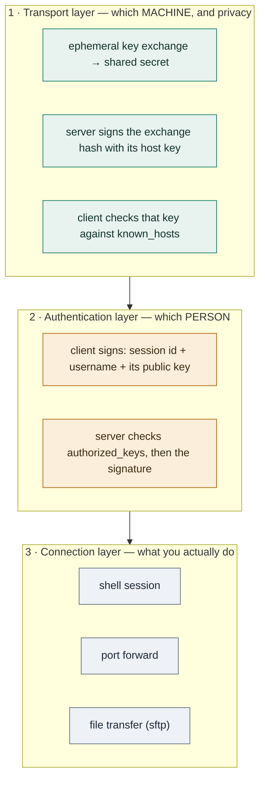
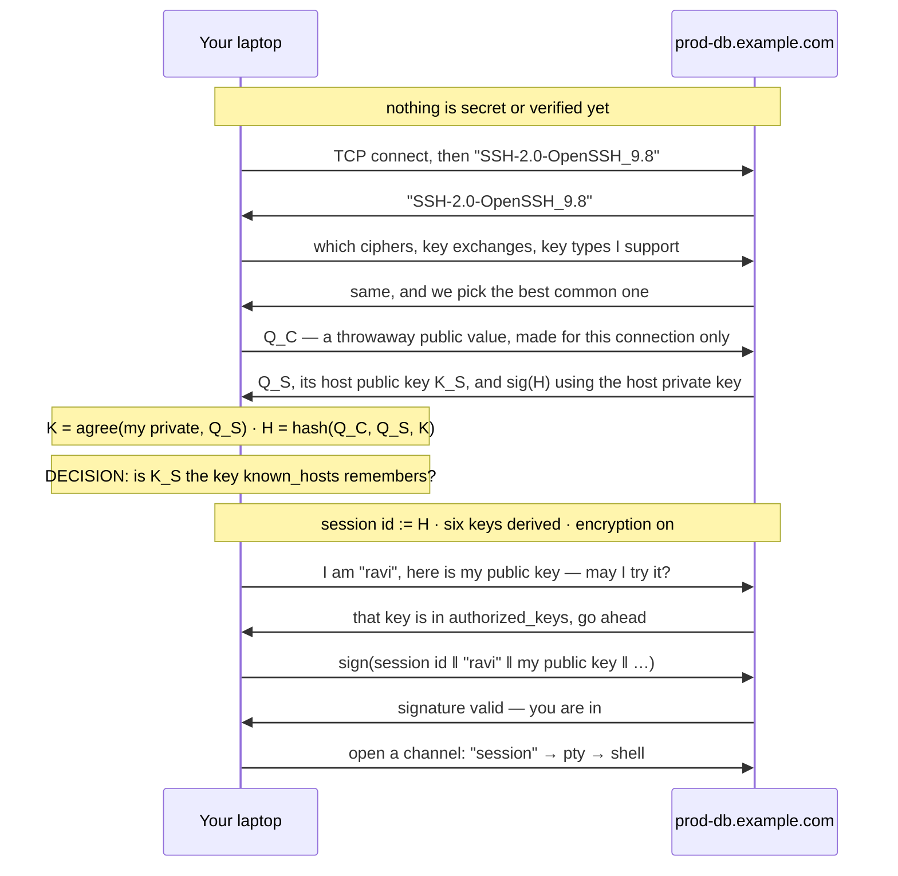
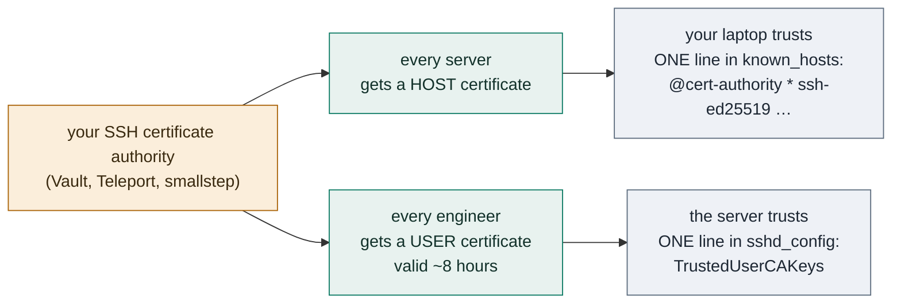
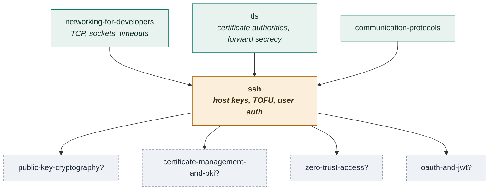

# SSH — how two strangers on a hostile network end up trusting each other

**A lab.** Read this file top to bottom. It tells one continuous story: a
problem appears, the obvious fix is tried, it breaks, and the breakage forces
the next idea. By the end, every strange detail of SSH should feel like the
scar of a failure you watched happen.

Everything runnable here has been run. Where a number appears, it came out of
a real execution on this machine.

| | |
|---|---|
| **Interactive** | [The Host Key Decision](https://claude.ai/code/artifact/f8828744-6598-405c-a6c8-cb33b5fb55ce) — put an interceptor on the wire, and watch how your laptop decides whether the machine answering is the one you meant |
| **Crypto core** | `java SshLab.java` — 7 experiments, JDK primitives only |
| **The real thing** | `./ssh-real.sh` — 8 scenarios against a real `sshd` |
| **Debug puzzle** | `java BrokenAuth.java` |
| **Practice** | [EXERCISES.md](EXERCISES.md) · [SOLUTIONS.md](SOLUTIONS.md) |

**Depth layers.** `BEGINNER MODEL` (stages 1–9) → `INTERMEDIATE MODEL`
(stage 10) → `ENGINEERING MODEL` (stages 11–14) → `PRODUCTION MODEL`
(stage 15). Each transition has a checkpoint telling you what you can now do.

**What you already know that this builds on.** You finished the
[tls](../tls/) lab, so you know that agreeing a secret with a stranger is easy
and knowing *who* the stranger is, is the hard part; that TLS solves it by
pre-trusting certificate authorities who vouch for servers you've never met;
and that forward secrecy means a stolen key cannot decrypt yesterday's
recording. SSH faces the identical problem and answers it in a completely
different way. That difference is the most interesting thing in this lab.

---

## 1. WHY — what goes wrong if nobody solves this

You have a computer in a data centre and you are sitting in a café. You need
to type commands on it. The words you type — and the results that come back —
travel through the café's wifi, the café's internet provider, several networks
you have never heard of, and finally the data centre's network. Every one of
those is a machine owned by somebody else.

Before this problem was solved, the standard tool was `telnet`, and it sent
everything as ordinary readable text. Your password was ordinary readable
text. Anyone running a network anywhere on that path could read it, save it,
and use it later. In 1995 a researcher at a Finnish university found exactly
that happening on his own network, and wrote SSH in response.

The stakes: SSH is the tool by which humans and deployment pipelines get
administrative control of servers. If it fails, the attacker does not get to
read one message — they get to *become you* on the machine.

## 2. THE PROBLEM — told with people

Alice is in Delhi. She needs to send instructions to a warehouse in Chennai
that only she is allowed to give: *ship the gold*. She has never visited the
warehouse and has never met the manager.

She writes a letter and hands it to a courier. The courier passes it to
another courier, who passes it to a van driver, who passes it to a local
runner. Four strangers hold the letter.

Three separate things can go wrong, and it is worth keeping them apart,
because the rest of this lab is about how differently each one is solved.

1. **Somebody reads it.** A courier opens the envelope and learns the
   instruction.
2. **Somebody changes it.** A courier rewrites "ship the gold to warehouse 4"
   as "ship the gold to my house".
3. **Somebody impersonates the warehouse.** A courier never delivers the
   letter at all. He writes back on warehouse letterhead saying *received,
   send more*. Alice is now in a conversation with a stranger and does not
   know it.

## 3. THE NAIVE SOLUTION — put it in a locked box

Obvious fix: Alice puts the letter in a box with a padlock. Couriers carry the
box. Nobody can read or change what is inside.

This kills problems 1 and 2 completely. It is also, in software, a solved
matter: encryption is mature, fast and free.

But it raises an immediate question. A padlock needs a key, and the warehouse
needs it in order to open the box. Alice has never met the warehouse manager,
so she cannot hand him one. Sending the key with the box is obviously absurd.

There is a real mathematical answer to this, and you have already seen it in
the TLS lab: **key exchange**. Alice and the warehouse can shout numbers at
each other in public, in front of everybody, and each end up holding the same
secret number that nobody listening can work out.

> **🔮 Predict:** Alice and the warehouse do a public key exchange, agree a
> secret, and encrypt everything from then on. Which of the three problems
> above are now solved?
>
> <details><summary>Reveal</summary>
>
> Problems 1 and 2 are solved — *with respect to whoever she exchanged keys
> with*. Problem 3 is completely untouched, and the encryption actively makes
> it harder to notice, because everything now looks secure. Stage 4 shows why.
> </details>

Experiment 2 in `SshLab.java` runs this exchange for real:

```
  client -> server   Q_C = abcba80117346e15a4ef1c14...  (public, 32 bytes)
  server -> client   Q_S = 38616f604b3fceb81982d4f4...  (public, 32 bytes)

  client computes K = 0187c3d014652de8bbb86c00888c233a...
  server computes K = 0187c3d014652de8bbb86c00888c233a...
  same secret?      true

  Eve saw Q_C and Q_S. She has no private half, so the best she can do
  is bring her own keypair and compute a secret with it:
    Eve computes    K = 9f086da1ac7f4f966389579c086abbbc...
    matches theirs?   false   <- she is locked out
```

## 4. THE FAILURE — the courier answers the phone

Here is what a courier does about that clever key exchange.

He does it twice.

He does one key exchange with Alice, pretending to be the warehouse. He does
another key exchange with the warehouse, pretending to be Alice. Now he holds
two secrets: one he shares with Alice, one he shares with the warehouse. Every
message Alice sends, he unlocks, reads, re-locks, and forwards.

Both ends see a perfectly healthy encrypted conversation. There is no error,
no warning, and no delay. Experiment 3 does exactly this:

```
  client encrypts and sends: 36a622e35c38fd1441ffcc598bbc0cb4d074dc8e...
  Mallory decrypts it as:    "cat /home/ravi/.aws/credentials"   <-- plaintext
  Mallory re-encrypts to the server, which reads: "cat /home/ravi/.aws/credentials"
```

**The deeper problem is now visible.** Encryption answers "can anyone else
read this?". It never answers "who am I talking to?". Those are separate
questions, and only the second one is hard.

## 5. THE REAL REQUIREMENT

Stated plainly, we need three things, and they are independent:

1. **The client must be sure which machine it reached** — before it sends
   anything useful.
2. **The server must be sure which person is connecting** — and the proof must
   not be reusable anywhere else.
3. **Today's stolen key must not unlock yesterday's recording.**

Requirement 1 is the one this whole lab circles around. Requirements 2 and 3
turn out to have clean answers once 1 is settled.

## 6. THE KEY IDEA

Two sentences.

> Give every server a long-lived key pair that stays with the machine for its
> whole life. Use it not to encrypt anything, but only to **sign** a summary of
> the key exchange that just happened — which proves that the machine holding
> that key is the same machine you exchanged secrets with.

And then the part that makes SSH different from everything else:

> Have the client decide whether that long-lived key is the right one **by
> remembering what it saw last time**.

No certificate authority. No third party. The client's only source of truth is
its own past.

## 7. TERMINOLOGY — now you have earned these

Six terms carry this entire lab. Learn these properly and the rest is detail.

### host key
- **Plain meaning:** the server's permanent name badge.
- **Technical meaning:** a key pair generated once when a machine is built,
  stored in `/etc/ssh/ssh_host_ed25519_key` (private) and `.pub` (public). The
  private half never leaves the machine and is used only to sign.
- **Why the term exists:** to separate it from your *user* key. Both are SSH
  keys, both are Ed25519, both live in files — and they answer opposite
  questions. The host key answers "which machine is this?". Your user key
  answers "which person is this?". Confusing them is the single most common
  source of SSH confusion.
- **Example:** `SHA256:xhd1+pkCJTaolmvmKbOu7AEklrDjGapafL4tD5XUav0`
- **Connects to:** in TLS this role is played by the server's certificate —
  but a certificate comes with a *vouching signature from someone else*. A
  host key comes with nothing at all. It is naked.

### fingerprint
- **Plain meaning:** a short nickname for a key that is safe to read aloud.
- **Technical meaning:** SHA-256 of the public key blob, base64-encoded.
- **Why the term exists:** a key is 68 characters of base64 and nobody can
  compare that by eye. A fingerprint is 43 characters and you can. Crucially
  it is not a *separate* identity — experiment 1 proves the fingerprint is
  computed from nothing but the key itself, so comparing fingerprints is
  exactly as strong as comparing keys.
- **Example:** experiment 1 builds a key in Java, writes it out, and asks the
  real `ssh-keygen` binary what it thinks:
  ```
  ours          SHA256:vtqVBIOAz5W7fEY6IG5XgFLoRyXoTpZbtqGy348sVgo
  ssh-keygen    SHA256:vtqVBIOAz5W7fEY6IG5XgFLoRyXoTpZbtqGy348sVgo
  MATCH: true
  ```

### `known_hosts`
- **Plain meaning:** your laptop's private address book of servers it has met.
- **Technical meaning:** `~/.ssh/known_hosts`, one line per host: the host
  name and port, the key type, and the full public key.
- **Why the term exists:** it is the *entire* trust policy of SSH, and it is a
  file you own and can edit. There is nothing else. When people say "SSH is
  decentralised", this file is what they mean.
- **Example:** one real line, from `ssh-real.sh` scenario 1:
  ```
  [127.0.0.1]:2222 ssh-ed25519 AAAAC3NzaC1lZDI1NTE5AAAAIApxgo5ltUSdqOJIG8HCQcERm93FRWOPKsI2CpDkwhWA
  ```
- **Connects to:** it plays the role of TLS's trust store — with one enormous
  difference. A trust store is filled in advance, by someone else, with
  authorities. `known_hosts` is filled by you, as you go, with individual
  machines.

### trust on first use (TOFU)
- **Plain meaning:** "I have no idea who you are, so I will assume you are who
  you claim, write it down, and hold you to it forever."
- **Technical meaning:** the policy of accepting an unknown host key without
  verification, recording it, and refusing any future key that differs.
- **Why the term exists:** to name honestly what is happening at the prompt
  everyone clicks through. The name says the protection starts at the *second*
  use. The first use is unprotected, and no amount of cryptography changes
  that.
- **Example:** experiment 4 runs the same three connections twice — once where
  the first connection was honest, once where an attacker was present — and
  the second run is the one worth staring at.
- **Connects to:** this is precisely the problem certificate authorities exist
  to solve, and precisely the complexity SSH refuses to take on by default.

### `authorized_keys`
- **Plain meaning:** the guest list on the server's door.
- **Technical meaning:** `~/.ssh/authorized_keys` in the *target user's* home
  directory on the *server*. One public key per line. Being in this file is
  what "having access" means.
- **Why the term exists:** to mark the direction. `known_hosts` is on your
  laptop and lists servers. `authorized_keys` is on the server and lists
  people. They are mirror images and are constantly confused.
- **Example:** if this file does not contain your key, you get
  `Permission denied (publickey)` — the same message you get when your
  *private* key file has wrong permissions, for a completely different reason.
  Scenarios 5 and 6 of `ssh-real.sh` produce both, and show how to tell them
  apart.

### session identifier
- **Plain meaning:** a unique serial number for this one connection.
- **Technical meaning:** the exchange hash `H` from the first key exchange —
  a SHA-256 over both sides' public values and the shared secret. Unique per
  connection because the ephemeral keys are fresh each time.
- **Why the term exists:** because of what it is used for. When you prove your
  identity, you sign the session identifier *along with* your username. That
  binds your proof to this one connection, so a hostile server cannot take
  your signature and use it to log in somewhere else as you.
- **Example:** experiment 5 removes it and runs the replay:
  ```
  --- design v1: sign only 'I am ravi, let me in' ---
    prod accepts the replayed signature? true   <-- she is in
  --- design v2: sign the session id too (this is what SSH does) ---
    prod accepts the replayed signature? false  <-- refused
    a genuine login to prod still works?  true
  ```

Terms you already have from the TLS lab and can use unchanged: *key exchange*,
*ephemeral*, *forward secrecy*, *handshake*. Terms introduced later,
where the story needs them: *channel*, *agent*, *agent forwarding*, *port
forwarding*, *bastion*, *SSH certificate*, *principal*.

## 8. TWO MENTAL MODELS

### The simple model: recognising a voice on the phone

You ring a colleague's desk phone. Someone picks up. You have never met them
in person, but you have spoken to them a dozen times, and you **recognise the
voice**. Then, because the request is sensitive, they ask you a question only
you could answer — and they ask a *different* question every time, so that a
recording of last week's call is worthless.

### The engineering model

SSH is three layers stacked inside one TCP connection.



Each layer refuses to start until the one below it succeeded. That ordering is
a security property, not an implementation detail: **your username and your
key are never offered until the machine has been identified.**

### Mapping the two

| Phone call | SSH | Where it lives |
|---|---|---|
| their voice | the host key | `/etc/ssh/ssh_host_ed25519_key` on the server |
| your memory of the voice | `known_hosts` | `~/.ssh/known_hosts` on your laptop |
| the very first call, before you knew the voice | trust on first use | the `yes/no` prompt |
| "that doesn't sound like you" | `REMOTE HOST IDENTIFICATION HAS CHANGED` | the client aborts |
| the question only you can answer | public-key authentication | your private key signs |
| a different question every call | the session identifier in the signature | RFC 4252 §7 |
| the guest list of who may give orders | `authorized_keys` | the server, per user |

### Where the analogy breaks

Four places, and each one matters:

1. **A voice can be imitated; a key cannot be guessed.** Key comparison is
   exact and binary — 43 characters either match or they don't. There is no
   "sounds about right". This makes SSH *stronger* than the analogy.
2. **You cannot phone the front desk to check a voice, but you can check a
   fingerprint out of band** — from the server build ticket, the cloud
   console, or a colleague. This is the one move that closes TOFU's hole, and
   the analogy hides it.
3. **Recognising a voice is passive; `known_hosts` is a file you can edit.**
   You can delete the entry, which throws the protection away — and that is
   exactly what people do when the alarm fires (scenario 4).
4. **The phone call has one conversation; an SSH connection carries many.**
   The single connection multiplexes independent *channels* — your shell, a
   file copy, and three port forwards at once — all under one handshake.

---

> ### ✅ CHECKPOINT — end of the BEGINNER MODEL
> You can now explain what SSH is for, why encryption alone does not achieve
> it, what a host key is, and why the `known_hosts` file is the whole trust
> decision. That is enough to reason about the warning messages you will see.
>
> **Next (stage 10):** how the handshake actually runs, message by message,
> with real values — and the two places where the first design a smart person
> would write turns out to be broken.

---

## 9. VISUALIZATION — go and play with it now

**[▶ The Host Key Decision](https://claude.ai/code/artifact/f8828744-6598-405c-a6c8-cb33b5fb55ce)**

Do this before reading stage 10. Three controls, and every combination has a
different ending:

- **who is on the wire** — the real server, or someone intercepting
- **what your laptop remembers** — nothing, the real key, or an attacker's key
- **what you do at the prompt** — type `yes`, or check the fingerprint first

Press the three story buttons in order. The third one, *"the one nobody
notices"*, is the point of the whole page: a fully encrypted, warning-free,
completely compromised session. Then fill in all eight rows of the table at
the bottom.

**What to watch for:** the *step* at which each run dies. Every successful
defence happens before authentication starts.

## 10. THE ACTUAL MECHANISM

Here is the whole handshake. Read it once for shape; the three subsections
after it explain why three of these steps are not what you would have designed.



Concrete values, from one real run (they differ every run, because the
throwaway keys are new each time):

```
Q_C  = abcba80117346e15a4ef1c14…       32 bytes, public, discarded at logout
Q_S  = 38616f604b3fceb81982d4f4…       32 bytes, public, discarded at logout
K    = 0187c3d014652de8bbb86c00…       identical on both sides, never sent
K_S  = SHA256:xhd1+pkCJTaolmvmKbOu7AEklrDjGapafL4tD5XUav0   (the host key)
H    = the session id for this connection
```

Six keys come out of that one secret, not one:

```
key 'C'  9b4165ffd0cd85aa378c7dca…   (encryption key, client to server)
key 'D'  51b24ebb3904b67b52004e9d…   (encryption key, server to client)
key 'E'  95288e9101b9bc5480889e46…   (integrity key, client to server)
key 'F'  4eda4ac3e8b9e41c928f1602…   (integrity key, server to client)
```

Each direction gets its own encryption key and its own integrity key, so a key
captured for one purpose is useless for the others.

### Refinement 1 — why the host key only signs, and never encrypts

**The version you would write first.** The server has a long-lived key pair.
The client generates a random session key, encrypts it with the server's
public key, and sends it. Simple, one round trip, and obviously correct: only
the server can decrypt it. This was genuinely how SSH-1 worked.

> **🔮 Predict:** An attacker records this encrypted traffic today and cannot
> read it. A year later the server is decommissioned badly and its private
> host key leaks. What can she read now?
>
> <details><summary>Reveal</summary>
>
> Everything. Every session she ever recorded, going back years. The session
> key was encrypted *to* the host key, so the host key unlocks it — and the
> host key is the one key on the machine that never changes. Experiment 6
> does this for real and prints the recovered command.
> </details>

```
=== one year later: the server is compromised and its private host
    key is stolen. Eve opens her archive. ===
design A: unwraps the session key 13ed4c52a0bf7d537aa3084f...
          and reads: "psql -h prod -c 'select * from payments limit 1'"
design B: the host key never touched the session key. The two
          ephemeral private halves were discarded at the end of the
          connection and exist nowhere. Eve holds 76 bytes of noise.
```

**The fix.** The session key is agreed by a fresh, throwaway key exchange, and
the host key is used *only to sign the transcript*. It proves identity and
unlocks nothing. That is why the host key can sit on a machine for a decade
without becoming a liability for past traffic. You met this property as
**forward secrecy** in the TLS lab; the mechanism is identical.

### Refinement 2 — why your signature covers the session identifier

**The version you would write first.** The client signs "I am ravi, here is my
public key". The server verifies against `authorized_keys`. Clean.

> **🔮 Predict:** You `ssh` into a shared build box that a colleague
> administers. What can that box's root user do with the signature you just
> sent it?
>
> <details><summary>Reveal</summary>
>
> Take it, connect to the production database server, and present your
> signature as their own. It is a valid signature by your key over the words
> "I am ravi" — and those words are true no matter which server reads them.
> </details>

**The fix.** The signed blob starts with the session identifier — a value
derived from *this* connection's key exchange, which the attacker cannot
reproduce on a different connection. Experiment 5 runs both designs; the
replay succeeds against v1 and fails against v2, while an honest login still
works.

This is why it is safe to `ssh` from your laptop into a machine you do not
fully trust: the machine learns nothing it can reuse.

### Refinement 3 — why there is a prompt at all

**The version you would write first.** The server signs the transcript, the
client verifies the signature, done. It is cryptographically valid.

Experiment 3 shows what that buys you:

```
  So Mallory signs with a host key of her OWN. That signature is
  mathematically valid:
    verify(Mallory host key, H_as_client_saw_it) = true   <- valid!
```

**The problem is not the signature. It is that no signature can tell you which
key was supposed to sign.** Something outside the connection has to answer
that. TLS's answer: a certificate authority you trusted in advance. SSH's
default answer: your own `known_hosts` file — and on the very first
connection, that file is empty, so it asks you.

**The fix, and its honest limitation.** TOFU protects connection two onwards.
Connection one is protected only if a human compares the fingerprint against
something that did not come down the wire. Stage 15 shows how production
environments remove the prompt entirely.

---

> ### ✅ CHECKPOINT — end of the INTERMEDIATE MODEL
> You can now walk the handshake message by message, say what each message is
> for, and explain why three of its details exist by naming the attack each one
> stops.
>
> **Next (stages 11–14):** what happens when things go wrong — every failure
> created, watched, and tied to the guarantee it bends.

---

## 11. FAILURE SCENARIOS

Each of these is reproducible. `./ssh-real.sh` runs them against a real
`sshd`; the visualization lets you watch the first three.

### F1 — The host key changed
**Create it:** `ssh-real.sh` scenario 3 restarts the server with a different
host key. **Watch:** the `REMOTE HOST IDENTIFICATION HAS CHANGED` banner.
**What happened:** the key offered does not match `known_hosts`.
**Why:** either someone is intercepting, or the server was rebuilt, or you are
hitting a different machine behind the same load-balanced name. **Response:**
the client aborts before sending your username or offering your key.
**Intact:** your credentials — nothing usable reached the other end.
**Lost:** availability; you cannot log in until a human decides.
**In production:** overwhelmingly this is a rebuild, which is exactly why the
alarm gets ignored. The correct move is to fetch the expected fingerprint from
somewhere else — the cloud console's instance screen, the build pipeline log,
a colleague — and compare before touching `known_hosts`.

### F2 — The alarm fires on an innocent server
**Create it:** in the visualization, set the wire to *the real server* and the
memory to *the attacker's key*. **What happened:** identical banner, opposite
cause. **Why this matters:** the alarm tells you the key changed. It does not
and cannot tell you that you are under attack. Anyone who reasons "the warning
appeared, so I am being attacked" has the logic backwards, and anyone who
reasons "it is always a rebuild" will eventually be wrong once.

### F3 — Intercepted on the first ever connection
**Create it:** visualization → *someone intercepting* + *nothing remembered* +
*type yes blindly*. **What happened:** you are fully compromised and the screen
is clean. **Response:** none — SSH performed correctly; it had nothing to
check against. **Lost:** everything, silently. Worse, your laptop has now
pinned the attacker's key, so when she leaves, the *honest* server triggers F1.
**In production:** this is precisely why SSH certificates exist (stage 15).

> **🔮 Predict:** The next two failures produce the *identical* client
> message: `Permission denied (publickey)`. One is caused entirely on your
> laptop, the other entirely on the server. Before reading on — what single
> piece of evidence would let you tell them apart in under a minute?
>
> <details><summary>Reveal</summary>
>
> A key fingerprint, seen in two places. Run `ssh-keygen -lf ~/.ssh/id_ed25519.pub`
> to get yours, then look for it in the server's log. If it appears there, your
> key travelled and the server rejected it → `authorized_keys`. If it does not,
> your client never sent it → a local problem, usually permissions. With no
> server access, `ssh -v` and the line `Offering public key` answers the same
> question from your side.
> </details>

### F4 — `Permission denied (publickey)` because of file permissions
**Create it:** `ssh-real.sh` scenario 5 (`chmod 644` on the private key).
**Watch:**
```
Permissions 0644 for '…/id_ravi' are too open.
This private key will be ignored.
ravi@127.0.0.1: Permission denied (publickey,keyboard-interactive).
```
**Why:** the client refuses to use a key other users on your machine could
read. **The trap:** the last line blames authentication, and people go and
edit `authorized_keys` on the server. The cause is three lines higher, on your
own laptop. The server was never involved.
**In production:** the server-side twin is `StrictModes` — `sshd` ignores
`authorized_keys` if the home directory or `.ssh` is group-writable, and logs
it. Same class of bug, other end of the wire.

### F5 — `Permission denied (publickey)` because the key is not authorized
**Create it:** `ssh-real.sh` scenario 6 (empty `authorized_keys`).
**Watch:** the *identical* client message, and then the server log:
```
Failed publickey for ravi from 127.0.0.1 port 59417 ssh2: ED25519 SHA256:vAX2lrlLwqgjAWsFb/TmngpKvc8eh8hpBUannuOmD/U
```
**The diagnostic that separates F4 from F5:** compare that fingerprint with
`ssh-keygen -lf ~/.ssh/id_ed25519.pub`. If it appears in the server log at
all, your key reached the server and the server said no — so the problem is
`authorized_keys`. If nothing appears, the key never left your laptop — so the
problem is local. Without the server log, use `ssh -v` and look for
`Offering public key`.

### F6 — A stolen private key
**Create it:** copy `id_ravi` to another machine and use it. It works
instantly, because a private key with no passphrase is a bearer token.
**Response:** none. There is nothing to detect; the login is genuine by every
measure SSH has. **Intact:** nothing. **In production:** this is why
passphrases exist, and why they are made bearable by `ssh-agent` — a process
that holds your unlocked key in memory and signs on request, so you type the
passphrase once per day rather than once per connection. It is also why hardware-backed keys (`ed25519-sk`,
Secure Enclave) are strictly better — the key physically cannot be copied —
and why short-lived certificates beat long-lived keys.

### F7 — Agent forwarding hijack
**Create it:** `ssh -A` into a host someone else has root on.
**What happened:** you exposed a unix socket on that host that signs anything
on request, for as long as your session lasts. **Why:** the agent's whole
protocol is "sign this blob"; it has no way to ask *what for*.
**Intact:** your private key itself never moves. **Lost:** everything the key
grants, for the duration. **In production:** use `ProxyJump` (`ssh -J
bastion target`). A *bastion* — or jump host — is the one machine reachable
from outside, through which all access to a private network is funnelled.
`ProxyJump` tunnels a *new, separate* connection through it, so the bastion
carries your encrypted traffic without ever being able to use your key.

### F8 — Traffic analysis
**Create it:** experiment 7. **What happened:** ciphertext lengths vary with
command length, and interactive shells send one packet per keystroke.
```
    "ls"                                   -> ciphertext  30 bytes
    "sudo systemctl restart payments-api"  -> ciphertext  63 bytes
```
**Lost:** confidentiality of *metadata* — command lengths, password lengths,
typing rhythm (Song, Wagner & Tian, USENIX 2001). **Intact:** the content
itself. **In production:** this is a real reason to prefer key authentication
over typing passwords into an interactive session.

## 12. CORRECTNESS — what is and is not guaranteed

**Guaranteed, provided `known_hosts` holds the right key:**
- Confidentiality and integrity of everything after the handshake. Modified
  packets are detected, not silently mangled.
- The peer holds the private half of the host key you already trusted.
- Forward secrecy: today's stolen host key does not decrypt yesterday's
  recorded session.
- Your authentication signature is worthless on any other connection.
- Nothing about you — username, key, or signature — is sent before the machine
  is identified.

**Explicitly NOT guaranteed:**
- **That the key in `known_hosts` is the right one.** The entire chain rests on
  this, and by default it rests on a decision a human made in one second,
  possibly years ago. Everything else is arithmetic; this is trust.
- **Anything about the first connection**, unless a human verified the
  fingerprint out of band.
- **Metadata privacy.** Sizes and timings leak (F8).
- **Safety against a compromised server.** If the machine you log into is
  owned, SSH delivered you correctly to a hostile host. Your key survives
  (refinement 2); your session does not.
- **That an alarm means an attack.** F1 and F2 produce the same screen.

**Traded away to get this:**
- **Scale.** With TLS you trust ~150 authorities and can then verify millions
  of servers. With SSH you must acquire trust in *every individual machine*,
  one at a time. For three servers this is simpler than TLS. For three thousand
  ephemeral containers it collapses — which is what stage 15 is about.
- **Revocation.** Removing a line from `authorized_keys` on 400 machines is
  400 operations, and nothing tells you when one is missed.

## 13. THE CODE

Six small Java files, no dependencies, no build tool.

```
Wire.java        SSH's on-the-wire encoding, key blobs, fingerprints, signing
Kex.java         key exchange, the exchange hash, key derivation
Crypto.java      AES-GCM seal/open — the record layer, in two methods
KnownHosts.java  the entire trust policy, in about ten lines
Auth.java        the blob a client signs to prove who it is
SshLab.java      the seven experiments
```

The load-bearing lines, in order of importance:

**`Auth.blob` — the one field that stops replay.**
```java
byte[] head = sessionId == null ? new byte[0] : Wire.string(sessionId);
```
Passing `null` builds the broken v1 design. Everything else in the method is
bookkeeping; this line is the security property.

**`Kex.exchangeHash` — why a man in the middle cannot hide.**
```java
return Wire.sha256(Wire.cat(Wire.string(qc), Wire.string(qs), Wire.string(k)));
```
Both public halves go in. Mallory must present her own public half to the
client, so the client's `H` differs from the server's, and the real server's
signature cannot verify against it.

**`KnownHosts.check` — the whole trust decision.** Three branches: unknown
(ask a human, verify nothing), match (proceed silently), mismatch (refuse).
There is no fourth branch, and no third party anywhere in the file.

**`Kex.ephemeral` — forward secrecy in one word.** A fresh key pair per
connection, discarded at the end. If these were long-lived, experiment 6's
design B would fail exactly like design A.

## 14. EXPERIMENTS

Run these in order. Each is framed as a question first — commit to an answer
before running.

**`java SshLab.java`** — the crypto core.

| # | Question to answer first | What you should see |
|---|---|---|
| 1 | Is a "key" a special object, or just bytes? | Java builds a key; the real `ssh-keygen` computes the same fingerprint |
| 2 | Can two strangers agree a secret in public? | Identical `K` on both sides; Eve locked out |
| 3 | Does encryption tell you who you are talking to? | Mallory prints your plaintext |
| 4 | Does TOFU protect you? | Yes — from connection two. Story B is the one to read twice |
| 5 | Why does SSH sign the session id? | Remove it and watch the replay succeed |
| 6 | Does a stolen host key expose old sessions? | Design A yes, design B no |
| 7 | What leaks despite encryption? | Command lengths, keystroke counts |

**`./ssh-real.sh`** — the real OpenSSH client and server.

It builds a throwaway world in `./lab`, runs `sshd` on `127.0.0.1:2222`, and
kills it on exit. **It never reads or writes your real `~/.ssh`** — every
command passes explicit `-F /dev/null`, `UserKnownHostsFile`, and
`IdentitiesOnly`, and the agent socket is pinned inside `./lab`.

| # | Question to answer first | What you should see |
|---|---|---|
| 1 | What does accepting a host key actually write? | One line in `known_hosts`, matching the server's key |
| 2 | How do you know verification happened? | Silence. No output at all |
| 3 | What does the client send once the key is wrong? | Nothing — it aborts before authentication |
| 4 | Does `ssh-keygen -R` fix the problem? | It gets you in — to the impostor |
| 5 | Whose fault is `Permission denied` here? | Yours; the key was never used |
| 6 | And here? | The server's list; read the `sshd` log |
| 7 | How many things can one connection carry? | A shell and a port forward at once |
| 8 | What does the agent actually hold? | A socket that signs on demand |

**`java BrokenAuth.java`** — a planted bug in a hand-written SSH-style login.
It passes its happy-path test and lets a total stranger in. Exercise 6.

---

> ### ✅ CHECKPOINT — end of the ENGINEERING MODEL
> You can now diagnose SSH failures by mechanism rather than by guessing:
> separate the two `Permission denied` causes, explain what the host key alarm
> does and does not prove, and say which guarantee each failure bends.
>
> **Next (stage 15):** what changes when there are three thousand servers
> instead of three.

---

## 15. PRODUCTION — from this lab to three thousand servers

### The chain

**Toy (this lab)** → `KnownHosts.java`, one map in memory, one host.
**Real (your laptop)** → OpenSSH, `~/.ssh/known_hosts`, `~/.ssh/config`,
`ssh-agent`. Same design, real files.
**Production** → the thing that changes is not the cryptography. It is where
trust comes from.

### The one big change: certificates instead of TOFU

TOFU does not survive autoscaling. If servers are created and destroyed hourly
and named by IP, every connection is a first connection, every engineer is
trained to type `yes` reflexively, and the protection is gone in practice while
looking present on paper.

The fix is to bring back the idea you already know from TLS — **delegate trust
in advance** — but with an authority you run yourself.



What this buys, point by point against the failures in stage 11:

- **F3 disappears.** Your laptop trusts the CA, so a brand-new server is
  verified on the *first* connection. No prompt, ever. A prompt now means
  something is genuinely wrong.
- **F1's false alarms disappear.** A rebuilt server gets a new host key and a
  new certificate from the same CA, and verifies silently.
- **F6 shrinks from permanent to hours.** A user certificate expires. A stolen
  laptop key is useless tomorrow morning. Issue certificates after SSO and you
  have tied SSH access to your identity provider — deactivate the account and
  access ends everywhere at once.
- **Revocation becomes possible.** You revoke at the CA, not by editing
  `authorized_keys` on 400 machines.

A user certificate also carries *principals* (which usernames it may log in
as), a validity window, and extensions (whether port forwarding or agent
forwarding are permitted at all) — policy that `authorized_keys` cannot
express well.

### The operational surface

**Config file first.** Almost everything painful about SSH is fixed by
`~/.ssh/config`, and most engineers never write one:

```
Host prod-*
  User deploy
  IdentityFile ~/.ssh/id_ed25519_prod
  IdentitiesOnly yes          # stop offering every key you own to every server
  ProxyJump bastion.example.com
  ControlMaster auto          # reuse one connection for many sessions
  ControlPath ~/.ssh/cm-%r@%h:%p
  ControlPersist 10m
```

`ControlMaster` matters more than it looks: it removes the handshake from
every subsequent connection to the same host, which you know from the
networking lab is the expensive part.

**What an on-call engineer actually looks at.** `journalctl -u ssh` or
`/var/log/auth.log`, for three lines: `Accepted publickey for … SHA256:…`
(who got in, with which key), `Failed publickey for …` (the fingerprint that
was rejected — the F5 diagnostic), and `Connection closed by … [preauth]`
(gave up before authenticating; usually a scanner). The volume of the last one
on a public-facing box is startling and mostly harmless.

**Hardening, in rough order of value:** `PasswordAuthentication no` (removes
brute-forcing entirely), `PermitRootLogin no`, `AllowGroups ssh-users`,
`MaxAuthTries 3`, and forced commands in `authorized_keys`
(`command="/usr/local/bin/backup-only",no-port-forwarding,no-agent-forwarding
ssh-ed25519 …`) for automation accounts that must never get a shell.

> **🔮 Predict:** Your CI pipeline needs to `git push` over SSH to a host it
> has never contacted. Someone suggests adding
> `ssh-keyscan github.com >> ~/.ssh/known_hosts` to the build script. It works,
> and the build goes green. What did it actually establish?
>
> <details><summary>Reveal</summary>
>
> Nothing. It asked the network "what key should I trust?" and wrote down the
> answer — which is the TOFU weakness (F3), automated and run fresh on every
> single build, so it never even gets TOFU's second-connection protection.
> Whoever controls the pipeline's network path controls the answer. The fix is
> to commit the known-good fingerprint into your pipeline config, where a
> change to it is a reviewable diff.
> </details>

**One trap worth naming.** CI pipelines commonly run
`ssh-keyscan github.com >> ~/.ssh/known_hosts`. That is not verification — it
asks the network what key to trust, which is the thing TOFU was already weak
about, automated. Pin the published fingerprint in your pipeline config
instead.

### What this lab deliberately leaves out

| Omitted here | What real SSH does |
|---|---|
| Packet framing | The Binary Packet Protocol: length, padding, payload, MAC — with padding chosen to blur message sizes |
| Algorithm negotiation | `KEXINIT` lists on both sides; the chosen names are hashed into `H`, which is what stops an attacker downgrading you to weak crypto |
| Rekeying | New key exchange every ~1 GB or 1 hour (`RekeyLimit`), bounding how much data one key protects |
| Host key rotation | `UpdateHostKeys yes` lets a server publish new host keys over the already-trusted connection, so rotation stops causing F1 |
| Hashed `known_hosts` | `HashKnownHosts yes` stores host names hashed, so stealing the file does not hand over your inventory of servers |
| Other auth methods | keyboard-interactive, PAM, GSSAPI/Kerberos, FIDO2 (`ed25519-sk`) |
| Subsystems | `sftp`, `scp`, and `rsync -e ssh` all ride the connection layer as channels |
| Privilege separation | `sshd` splits into a sandboxed unprivileged process handling pre-auth network data, so a parser bug does not mean instant root |

### Real implementations worth knowing

**OpenSSH** — effectively the standard; read its `-v`, `-vv`, `-vvv` output,
which narrates the whole handshake. **libssh / Apache MINA SSHD** — embeddable;
MINA SSHD is the Java one, and is what you would reach for to add SSH or SFTP
to a Spring Boot service. **Teleport / HashiCorp Vault SSH / smallstep** — the
certificate-authority layer described above. **Tailscale SSH** — replaces the
trust decision with a network identity layer entirely.

---

> ### ✅ CHECKPOINT — end of the PRODUCTION MODEL
> You can now explain why TOFU is right for three servers and wrong for three
> thousand, describe what an SSH certificate authority changes, and name the
> operational controls that matter. You are ready to read RFC 4251–4254 and
> `man sshd_config` without translation.

## 16. EXERCISES

[EXERCISES.md](EXERCISES.md) — eight rungs, from "explain it in your own
words" to "design SSH access for 3,000 hosts and 200 engineers". Answers in
[SOLUTIONS.md](SOLUTIONS.md); try first.

## 17. KNOWLEDGE MAP & WHAT TO LEARN NEXT



**Commonly confused — the one sentence that separates each pair:**

- **SSH vs TLS.** Same cryptography, opposite trust models: TLS asks an
  authority you trusted in advance, SSH asks your own memory of last time.
- **Host key vs user key.** The host key says *which machine*; your user key
  says *which person*. Different files, different directions, same algorithm.
- **`known_hosts` vs `authorized_keys`.** `known_hosts` is on your laptop and
  lists machines you trust; `authorized_keys` is on the server and lists people
  it lets in.
- **`ssh-agent` vs a password manager.** The agent never reveals the key; it
  signs on request. That is why forwarding it is dangerous and copying it is
  not the risk you would expect.
- **Port forwarding vs a VPN.** A forward exposes one TCP port through one
  authenticated connection; a VPN puts you on the network.
- **`ssh-keyscan` vs verification.** `ssh-keyscan` asks the network what to
  trust. It is convenience, not security.

**Next, in the order I would take them:**

- `/learn public-key-cryptography` — you have now used signatures, key
  exchange and hashing three labs running without opening any of them. This is
  the box under all three.
- `/learn certificate-management-and-pki` — already flagged by the TLS lab, and
  stage 15 makes it twice as relevant: issuance, rotation, revocation, and the
  expiry outage.
- `/learn zero-trust-access` — where stage 15 leads: identity-aware proxies,
  short-lived credentials, and why the bastion host is disappearing.
- `/learn oauth-and-jwt` — SSH certificates bind machine access to a human
  identity; OAuth is how that human identity is established in the first place.

## 18. GLOSSARY

In order of first appearance.

| Term | One line |
|---|---|
| key exchange | A public conversation that leaves both sides holding the same secret number. |
| host key | The server's permanent identity key pair; signs, never encrypts. |
| fingerprint | SHA-256 of a public key, base64 — a short form safe to compare by eye. |
| `known_hosts` | Your laptop's record of which host key belongs to which server name. |
| trust on first use (TOFU) | Accept an unknown key, write it down, refuse any change later. Protects from connection two onward. |
| `authorized_keys` | The list on the server of public keys allowed to log in as a given user. |
| public-key authentication | Proving identity by signing a challenge, so no secret ever crosses the wire. |
| session identifier | The first exchange hash; unique per connection, and signed during login so proofs cannot be replayed. |
| exchange hash (`H`) | A hash over both public values and the shared secret; what the host key signs. |
| ephemeral key | A key pair made for one connection and discarded — the source of forward secrecy. |
| forward secrecy | A stolen long-term key cannot decrypt previously recorded sessions. |
| AEAD | Encryption that also detects tampering, in one operation. |
| transport / authentication / connection layer | The three layers of SSH: which machine, which person, what you actually do. |
| channel | One independent stream inside a connection — a shell, a forward, a file transfer. |
| multiplexing | Running many channels over one authenticated connection. |
| port forwarding | Carrying a TCP port through the SSH connection (`-L` local, `-R` remote, `-D` SOCKS). |
| `ssh-agent` | A process holding your unlocked private keys that signs on request but never reveals them. |
| agent forwarding (`-A`) | Exposing your agent's socket on a remote host — convenient, and equivalent to lending your key to that host's root. |
| `ProxyJump` (`-J`) | Tunnelling a separate connection through a bastion, without exposing your agent. |
| bastion / jump host | The single reachable machine through which access to a private network is funnelled. |
| `StrictModes` | The server's refusal to read `authorized_keys` when the home directory permissions are too loose. |
| SSH certificate | A host or user key signed by a CA you run, carrying validity, principals and permitted extensions. |
| principal | The identity a user certificate is allowed to log in as. |
| `ControlMaster` | Reusing one authenticated connection for later sessions, skipping the handshake. |
| rekeying | Periodically redoing the key exchange to limit how much data one key protects. |
| Binary Packet Protocol | SSH's framing: length, padding, payload, MAC. |
