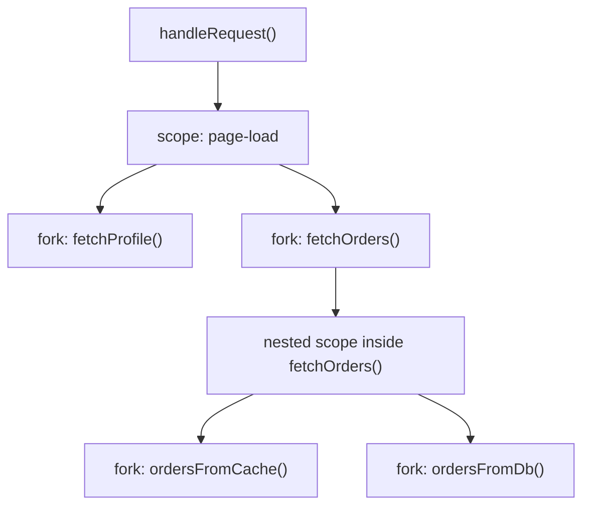
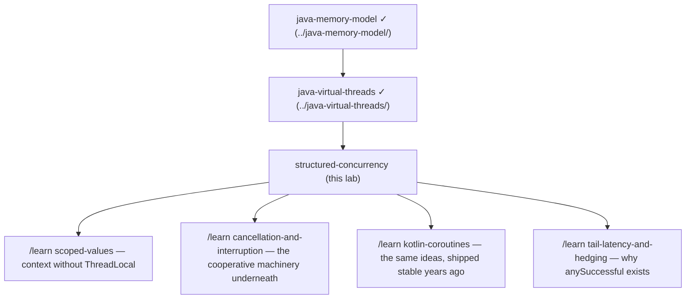

# Structured Concurrency — a learning lab

*From "never heard of it" to reading JEP 505 comfortably. Everything runs on
this machine (JDK 25, where this API is a **preview feature**) via
`./run.sh`. All quoted numbers and error messages are real output from these
demos. Builds directly on the [java-virtual-threads](../java-virtual-threads/)
lab — virtual threads made tasks cheap; this is the discipline for managing
the thousands you now create.*

---

## 1. Why does this exist?

When a piece of code starts several concurrent subtasks, today's tools let
those subtasks simply... float away. The code that started them can return,
fail, or be cancelled, and the subtasks keep running — unowned, unsupervised,
invisible. Structured concurrency exists to give concurrent code the same
guarantee sequential code has always had: **when a function returns, all the
work it started is finished.** Nothing leaks, no error is lost, cancelling
the parent cancels the children.

## 2. The problem, as a story

Your manager asks you and a colleague to each prepare half of a customer
presentation by Friday. On Wednesday the customer cancels the deal. Your
manager hears about it, shrugs, and moves on — but **nobody tells your
colleague**, who works late nights on a presentation for a meeting that will
never happen. In the other direction: on Friday your half is missing — you'd
hit a blocker on Tuesday — but the manager only finds out at the deadline,
because *nothing connected your failure to the person waiting on it*.

The pain in both directions is the same missing thing: no standing
relationship between the person who started the work and the people doing it.
Handing out work is easy; **owning** it — being told promptly when a part
fails, calling the others home when the goal disappears, never going home
until everyone is accounted for — is what's missing.

## 3. The naive solution

Start the subtasks with the tools Java has had for years, then collect
results:

```java
Future<String> profile = executor.submit(this::fetchProfile);   // 500 ms
Future<String> orders  = executor.submit(this::fetchOrders);    // fails at 50 ms
return combine(profile.get(), orders.get());
```

Two tasks, run concurrently, results collected. Looks fine.

## 4. Why that fails — the orphan

Run `./run.sh orphan` and watch the timestamps (real output):

```
[   0 ms] handleRequest(): calling fetchProfileAndOrders()...
[  70 ms] handleRequest(): FAILED with 'orders service is down' — returning 500 to the client.
[  70 ms] handleRequest(): done. The request is over. Nothing should be running for it.
[ 517 ms]    >>> ORPHAN: profile fetch finished — but nobody is listening anymore!
```

`orders.get()` threw at ~70 ms, so `profile.get()` — the only line that
waits for the profile task — **was never reached**. The request is dead, the
client got a 500, and the profile fetch is still out there: an **orphan**.
Multiply by a busy server and orphans are burning CPU, holding DB
connections, and writing side effects for requests that already failed. The
naive code has three structural holes:

- **A failure doesn't stop the siblings** (wasted work — or worse, if you
  awaited `profile.get()` *first*, you'd wait 500 ms before even noticing
  the 50 ms failure).
- **Cancelling the parent doesn't cancel the children** — interrupting the
  request thread does nothing to tasks it spawned.
- **Nothing in the code's shape says who owns whom.** A thread dump shows a
  flat pile of tasks; which request started which task is unrecoverable.

You can hand-fix each hole with try/finally, `cancel(true)` calls, and
bookkeeping — and every codebase fixes them differently, partially, and
wrongly. (The essay that named this problem — Nathaniel J. Smith's *"Notes
on structured concurrency, or: Go statement considered harmful"* — argues
these floating tasks are to concurrency what `goto` was to control flow.)

## 5. The key idea

**Confine every concurrent subtask's lifetime inside a code block, the way a
local variable's lifetime is confined.** Concurrency becomes a tree: a block
opens, forks children, joins them, and *cannot be left* — normally or by
exception — until every child is done or cancelled. Errors flow up the tree;
cancellation flows down it; the code's shape *is* the ownership chart.

## 6. The vocabulary

| Term | Plain-English meaning |
|---|---|
| **Scope** (`StructuredTaskScope`) | The code block that owns a family of subtasks. Opened in try-with-resources; children cannot outlive it. |
| **Owner** | The one thread that opened the scope. Only it may fork or join. |
| **Fork** | Start a child subtask (in its own virtual thread) belonging to this scope. |
| **Subtask** | A forked child: your `Callable` plus its state (`SUCCESS` / `FAILED` / `UNAVAILABLE`) and, after join, its result. |
| **Join** | The owner waits at this line for the outcome — as defined by the joiner. Mandatory: skipping it is an error. |
| **Joiner** | The scope's completion *policy*: what to wait for, what triggers cancellation, what `join()` returns. |
| **Cancellation** | The scope telling still-running subtasks "stop — you're no longer needed" (by interrupting their threads). |
| **Fail-fast** | The default policy: the first child failure immediately cancels all siblings. |
| **Close guarantee** | Leaving the scope's block (even via an exception) waits until no subtask is running. |
| **Structure violation** | Any use of the API that breaks the tree shape — caught with an exception, never allowed silently. |

## 7. The mental model

> **A scope is a stack frame that can hold several concurrent children.**
> Method calls form a tree that grows *down* (A calls B calls C); scopes let
> the tree also grow *sideways* (B forks B1, B2, B3 in parallel) — but it is
> still one tree with one rule: **a parent never returns while any child is
> alive.** Results and errors climb up the tree; cancellation cascades down
> it; the whole tree shares one deadline if you give it one.



Cancel `handleRequest()` and everything below dies with it — including the
grandchildren, because cancelling `fetchOrders()` exits its nested scope,
which cancels *its* children. That transitivity is what the naive version
can never give you.

## 8. See it move

- **Interactive simulator** — `visualization.html` in this directory
  (published copy: <https://claude.ai/code/artifact/ca4292ad-2632-4d25-b61d-2db64e044615>). Fork a family, click children
  to make them fail, switch the joiner policy, set a deadline, and toggle
  the "old world" mode to watch orphans leak. Start with its story buttons.
- **Demo 2** (`./run.sh failfast`) is the mechanism in 15 lines — watch a
  5-second subtask die 59 ms in.

## 9. The actual mechanism

The canonical shape (Demo 1, `./run.sh fanout` — runs in 132 ms, the max of
its children, not the sum):

```java
try (var scope = StructuredTaskScope.<String>open()) {        // 1. open
    Subtask<String> profile = scope.fork(() -> fetchProfile()); // 2. fork
    Subtask<String> orders  = scope.fork(() -> fetchOrders());  //    fork
    scope.join();                                             // 3. join — mandatory
    return combine(profile.get(), orders.get());              // 4. results, only now
}                                                             // 5. close guarantee
```

Step by step:

1. **`open()`** creates the scope; the current thread becomes its owner.
   Default policy: wait for all children to succeed, fail fast otherwise.
2. **`fork(callable)`** starts each child in a fresh **virtual thread**
   (this is why forking per-subtask is affordable — see the
   [java-virtual-threads](../java-virtual-threads/) lab) and returns the
   `Subtask` handle. It is *not* a `Future`: it has no blocking `get`-alone
   semantics, no `cancel()` — the scope manages all of that.
3. **`join()`** parks the owner until the policy is satisfied: all children
   succeeded, or one failed → all others cancelled → `FailedException`
   with the original failure as `getCause()`.
4. **`subtask.get()`** is legal only after a successful join.
5. **Close.** Leaving the block — *any* way — first waits until every child
   is finished. An exception thrown between fork and join still cancels and
   awaits every child before propagating.

**The rules are enforced, not advisory.** Each misuse gets an exception (all
verified on this JDK — these are the actual messages):

| You did | You get |
|---|---|
| `subtask.get()` before `join()` | `IllegalStateException: join not called` |
| `fork()` after `join()` | `IllegalStateException: Already joined or scope is closed` |
| left the block without `join()` | `IllegalStateException: Owner did not join after forking` |
| `fork()` from a non-owner thread | `WrongThreadException` |

**Choosing a policy — the five built-in joiners:**

| Joiner | Waits until | On child failure | `join()` returns |
|---|---|---|---|
| `awaitAllSuccessfulOrThrow()` *(the `open()` default)* | all succeed | cancel siblings, throw | nothing — use `subtask.get()` |
| `allSuccessfulOrThrow()` | all succeed | cancel siblings, throw | `Stream<Subtask<T>>` — for N homogeneous forks |
| `anySuccessfulResultOrThrow()` | **first success** | keep going; throw only if *all* fail | the winning result (losers cancelled) |
| `awaitAll()` | all finish, success *or* failure | nothing — no fail-fast | nothing — inspect each subtask yourself |
| `allUntil(predicate)` | your predicate says stop (or all done) | your call | `Stream<Subtask<T>>` |

Demo 3 (`./run.sh race`) uses `anySuccessfulResultOrThrow` to hedge across
two replicas: winner in 51 ms, the 300 ms loser cancelled — and shows the
all-fail case throwing `FailedException`.

**Configuration** — the second argument to `open`: 

```java
StructuredTaskScope.open(Joiner.<String>awaitAllSuccessfulOrThrow(),
        cfg -> cfg.withName("page-load")                 // shows up in thread dumps
                  .withTimeout(Duration.ofMillis(150))); // one deadline for the whole tree
```

Demo 4 (`./run.sh deadline`): the deadline fired at 155 ms, cancelled the
400 ms straggler, and `join()` threw `TimeoutException`.

## 10. Failure scenarios, walked through

**(a) A child fails (the default policy).** Demo 2's real sequence: orders
throws at 50 ms → scope interrupts profile's thread → profile's
`Thread.sleep` throws `InterruptedException` ("I was interrupted — my
sibling must have failed") → scope waits for it to actually finish →
`join()` throws `FailedException(cause="orders service is down")` → elapsed
59 ms, and the subtask handle reports state `UNAVAILABLE`. Two exceptions
existed (the failure, the interrupt); the policy keeps the one that matters
and attaches it as the cause.

**(b) The owner itself is interrupted** (your request got cancelled from
above): `join()` throws `InterruptedException`, and on the way out of the
block the scope cancels and awaits all children. Cancellation is transitive
down nested scopes — each level's close cancels the next.

**(c) Deadline hits** — §9's demo 4: *one* timeout governs the family; no
arithmetic distributing budgets across calls.

**(d) All replicas fail under `anySuccessful`** — `FailedException`
carrying one of the failures as cause (the others are recorded on their
subtask handles).

**(e) A subtask ignores interruption.** Cancellation is **cooperative**:
the scope *interrupts*; it cannot kill. A child that catches and swallows
`InterruptedException` and keeps looping — or blocks in a non-interruptible
call — delays the scope's exit indefinitely (the close guarantee holds: the
scope waits rather than leak). The discipline: treat interruption as "stop
now"; never swallow it. (Exercise D2 makes you feel this one.)

**(f) Side effects don't roll back.** Cancelled ≠ undone: a cancelled
subtask that already wrote a row leaves the row. Structured concurrency
scopes *lifetimes*, not *transactions* — pair it with idempotency or sagas
for effects.

## 11. What is guaranteed, and what is not

**The invariant** (this is the whole point): *when control leaves the
scope's block, zero subtasks of that scope are running* — on the success
path, the failure path, the timeout path, and the interrupted path alike.
The test `no_subtask_outlives_the_scope_even_on_failure` proves it: a
5-second subtask's `finally` has always run by the first line after the
block, even though a sibling blew the scope up milliseconds in.

Guaranteed on top of that: the first relevant failure is never lost (it's
the `FailedException` cause); cancellation reaches every descendant through
nested scopes; the parent-child structure is *visible* — thread dumps via
`jcmd <pid> Thread.dump_to_file -format=json` show scopes (with their
`withName` names) as a tree.

**Not guaranteed:** prompt termination (cancellation is cooperative — see
10e); rollback of side effects (10f); any result from cancelled subtasks
(state `UNAVAILABLE`, result gone); fairness between siblings. **Traded
away:** free-form lifetimes. Work that legitimately outlives a request — a
background refresher, a daemon — does not belong in a request's scope; give
it its own explicitly-owned lifecycle instead of laundering it through an
unrelated one.

## 12. The code in this lab

| File | What it proves |
|---|---|
| `src/OrphanLeak.java` | The disease: old-style fan-out leaks an orphan past the request's death. |
| `src/FanOut.java` | The canonical fork/join/combine shape; concurrent, no orphans possible. |
| `src/FailFast.java` | First failure cancels siblings: 5 s subtask dead in 59 ms, cause preserved. |
| `src/RaceReplicas.java` | `anySuccessful`: hedged requests in three lines; all-fail case throws. |
| `src/Deadline.java` | One `withTimeout` for the whole family. |
| `src/ScenarioTests.java` | 11 scenario tests: the invariant, all four enforcement rules, three joiners, ScopedValue flow. |

## 13. Run the experiments

```bash
./run.sh orphan     # the old world's leak, with timestamps
./run.sh fanout     # the canonical shape
./run.sh failfast   # sibling cancellation, measured
./run.sh race       # hedged replicas
./run.sh deadline   # scope-wide timeout
./run.sh test       # 11 scenario tests
./run.sh all
```

The preview flags (`--enable-preview --source 25`) are in `run.sh`; only
`orphan` runs without them, because the broken world needs no new API.

## 14. From this lab to production

- **Preview status — the honest caveat.** `StructuredTaskScope` is JEP 505,
  the *fifth* preview (JDK 25), and the API has churned: code from JDK 21–24
  tutorials uses `new StructuredTaskScope.ShutdownOnFailure()` /
  `ShutdownOnSuccess` — same concepts, old names. Don't ship
  `--enable-preview` in production or expose preview types in library APIs;
  do design new code so it migrates trivially (private fan-out helpers).
- **The discipline transfers even without the API**: always cancel siblings
  on failure, always propagate cancellation downward, never let a task
  outlive its purpose — enforced manually with executors today, by the
  scope tomorrow.
- **Cooperative cancellation hygiene** is what makes any of it work: honor
  `InterruptedException`, prefer interruptible blocking calls (JDBC drivers
  and HTTP clients vary!), keep cleanup in `finally`.
- **Where it shines**: request fan-out (the page that calls 5 services),
  hedged/tail-latency requests (see the joiner table), speculative work you
  want abandoned wholesale, per-request deadlines.
- **The ecosystem already thinks this way**: Kotlin coroutines
  (`coroutineScope` + automatic child cancellation), Python's `trio`
  "nurseries" and `asyncio.TaskGroup`, Go's `errgroup.WithContext` — Java is
  standardizing a pattern its neighbors validated.
- **Context propagation**: `ScopedValue` (JEP 506, final in 25) bindings
  flow into forks automatically (last scenario test) — request IDs and auth
  context without `ThreadLocal` leaks.

## 15. Exercises

See [`EXERCISES.md`](EXERCISES.md); answers in [`SOLUTIONS.md`](SOLUTIONS.md).
D2 (the uncancellable subtask) is the one that will save you a production
incident someday.

## 16. Structured concurrency vs. the neighbors

| | `StructuredTaskScope` | `CompletableFuture` | Kotlin `coroutineScope` | Go + `errgroup` |
|---|---|---|---|---|
| Lifetime bound to a block | **yes — enforced** | no | yes | yes (by convention) |
| Failure cancels siblings | yes (policy) | manual | yes | yes |
| Cancels via | interrupt | `cancel()` (no interrupt by default) | cooperative suspension | context cancellation |
| Composition style | blocking code on virtual threads | callback chains | suspending functions | blocking + channels |
| Status | preview | stable | stable | stable |

Choose `CompletableFuture` today for stable-API needs and event-driven
composition; reach for scopes when the shape is "fork some children, need
them all (or one), then continue" — which is most server code.

## 17. Where to go next



*Read next from the source: JEP 505 (structured concurrency), JEP 506
(scoped values), and Nathaniel J. Smith's "go statement considered harmful"
essay — the piece that started it all.*
