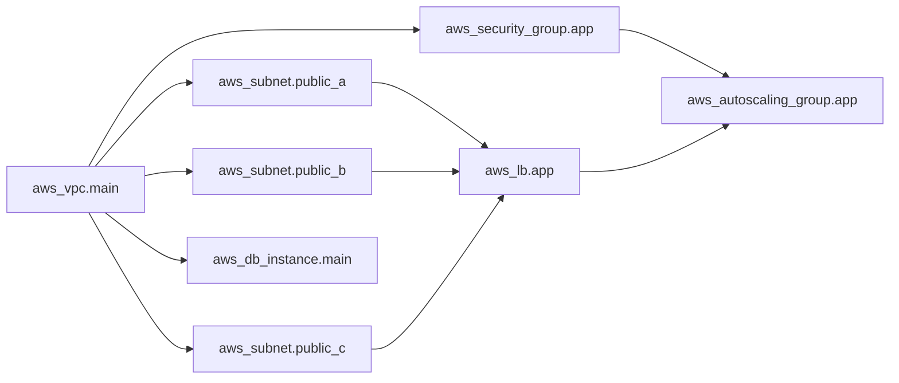
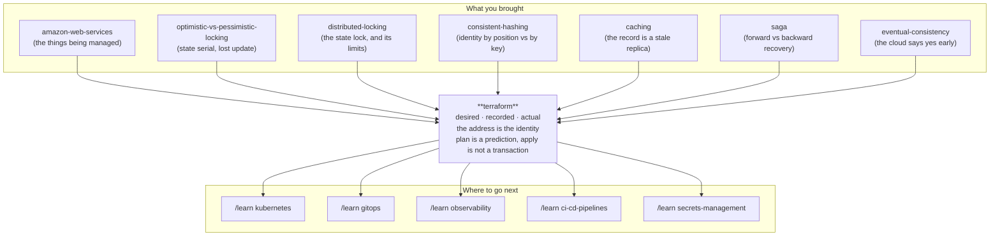

# Terraform — the ledger that knows what you own

> **A no-code lab.** Documents, diagrams, an interactive simulator, and
> exercises. Nothing here is executed. Configuration snippets are printed to be
> *read*, never run. Everything quantitative is arithmetic you can check by
> hand, a scenario you can play in `visualization.html`, or a measured result
> cited from one of your earlier labs. Terraform's own version-specific
> behaviour changes; anything I have not personally verified is flagged as
> documented-but-unverified.

---

## Before we start: the promise this lab is paying off

In the [amazon-web-services](../amazon-web-services/) lab, §13.2 made a claim
and did not defend it:

> *Your infrastructure code is your disaster recovery plan. If everything but
> state and identity is a template, a region loss is "apply the template
> elsewhere and restore the data". If it is 400 console clicks that one person
> half-remembers, a region loss is a rewrite under pressure.*

That was an assertion. This lab is the mechanism behind it — and the mechanism
turns out to be far more interesting than "write your infrastructure down".

Here is the thesis, and everything else in this document is a consequence of it:

> **Terraform is not a tool for creating infrastructure. It is a tool for
> maintaining a *mapping* — between names you chose and objects a cloud
> created. Nothing in the cloud knows that mapping, so Terraform writes it
> down. Every difficult thing about Terraform is a consequence of that written
> mapping being shared, going stale, and being the only thing in the world that
> knows what you own.**

You are well placed for this. Three of your existing labs turn out to be the
same problems wearing different clothes, and the lab will name them as they
arrive:

- the record Terraform keeps carries a **version counter**, and any change
  computed against an out-of-date copy of it is refused — which is
  [optimistic-vs-pessimistic-locking](../optimistic-vs-pessimistic-locking/)'s
  `WHERE version = ?`, living in a file;
- that record is a shared mutable thing two engineers can write at once, so it
  needs [distributed-locking](../distributed-locking/) — with the same limits
  that lab established;
- and Terraform offers two ways to say *"make several of these"*, one of which
  destroys and recreates resources that did not need to change. That is
  **exactly** the `hash(key) % n` versus consistent-hashing bug from
  [consistent-hashing](../consistent-hashing/) — identity derived from a
  positional property versus identity derived from a stable key. Same bug, same
  catastrophic remapping, and this time the things being remapped are your
  production databases.

That last one is stage 10.7 and it is the centrepiece.

---

## Where you are going

> **BEGINNER MODEL** (stages 1–9) → **INTERMEDIATE MODEL** (stage 10) →
> **ENGINEERING MODEL** (stages 11–12) → **PRODUCTION MODEL** (stage 13)

Stop after stage 9 and you will understand what Terraform is and why a state
file exists. Stop after stage 10 and you can read a plan and predict what an
apply will do. Stages 11–12 are what happens when it goes wrong at 4pm on a
Thursday. Stage 13 is how a team runs it without hurting itself.

---

# Stage 1 — WHY: the problem in one paragraph

You built something on a cloud by clicking. It works. Now you need it again —
in a second environment for testing, in a second region because the first one
had a bad day, or simply back the way it was before someone changed it. And
nobody can tell you what "it" is, because the only complete description of what
you built is *the thing itself*, sitting in a console, in a hundred screens you
visited once in a different order. **Infrastructure as code is the idea that
the description should exist somewhere other than inside the running system.**
Terraform is one way to do that, and the reason it is harder than it sounds is
the subject of this lab.

Concretely, if nobody solves this: your staging environment quietly stops
resembling production, so tests stop meaning anything; a change made at 2am to
fix an incident is never made anywhere else and is forgotten; the one person
who remembers why a setting is the way it is leaves; and the disaster recovery
plan says "rebuild in another region", which is a sentence, not a plan.

---

# Stage 2 — PROBLEM: Asha has to build it twice

*(No jargon in this stage. A ten-year-old could follow it.)*

**Asha** runs the engineering at **Marigold Pay**, the small payments company
from the last lab. Over three weeks she has built their system on AWS by
clicking: a private network, subnets in three zones, a load balancer, servers
that replace themselves, a database with a standby, storage for receipts, and
about forty permission rules. It works.

Then four things happen, in this order, and each one hurts more than the last.

**One: the second environment.** The team wants a staging copy to test against.
Asha starts clicking again. Three days later staging exists and is *almost* the
same — the load balancer timeout is different because she forgot, and one
permission is broader because it was easier. Six weeks later a change works in
staging and breaks in production, and it takes two days to find out why. The
difference was a setting nobody knew was different, because nowhere in the
world is there a list of the settings.

**Two: the change nobody can see.** At 2am during an incident, an engineer
widens a rule to let traffic through. It fixes the incident. It is never
written down, never reviewed, and never removed. It is now permanent, invisible
and load-bearing.

**Three: the person who left.** The engineer who set up the network leaves.
Nobody knows why one subnet has a strange address range. Nobody dares change
it. It becomes a thing the team works around rather than understands.

**Four: the plan that is a sentence.** The disaster recovery document says: *if
we lose the region, we rebuild in another one.* Asha reads it and realises that
"rebuild" means "three weeks of clicking, from memory, at the worst possible
moment, by whoever is awake".

All four are the same problem. **The description of the system exists only
inside the system.** You cannot diff it, review it, copy it, or rebuild from
it.

---

# Stage 3 — NAIVE SOLUTION: write the clicks down as a script

The obvious fix. Every click has a command-line equivalent, so Asha writes a
script: create the network, then the subnets, then the load balancer, then the
servers. Now the description lives in a file, in version control, where it can
be read and reviewed and run again.

This is a real approach and it was how everyone did it for years. It fixes
problems three and four *partially*: there is now a written description, and
"rebuild" means "run the script".

Before you read on, commit to a guess.

> **🔮 Predict:** Asha runs her script a second time — same file, same account,
> nothing changed. What happens?
> <details><summary>Reveal</summary>
>
> **She gets a second copy of everything.** A second network, six more subnets,
> another load balancer, another database.
>
> The script says *"create a load balancer"*. It does not say *"there should be
> one load balancer"*. Those are different sentences, and only the second one
> is safe to say twice.
>
> This is the same distinction as [idempotency](../idempotency/): an operation
> is safe to repeat only if repeating it lands you in the same state. "Create"
> is not that operation. And she cannot simply avoid running it twice, because
> **running it again is the entire point** — she wants to change one setting and
> have everything else stay as it is.
> </details>

---

# Stage 4 — FAILURE: three things the script cannot do

Asha does the obvious repair: before creating anything, check whether it is
already there. `if not exists, create`. This is where it gets interesting,
because each fix reveals a harder problem underneath.

**Problem 1: "already there" is not a question the cloud can answer.**

Check by *name*? Most cloud objects do not have a unique, immutable, queryable
name. An AWS load balancer has a name; a subnet has an ID that AWS chose
(`subnet-0a3f...`) and, at best, a `Name` tag that is neither unique nor
enforced. Two different teams can tag two different subnets `marigold-app-a`.
A tag can be edited by anyone. So "does `marigold-app-a` exist?" has no
reliable answer, and worse — if something *does* come back, Asha has no way to
know whether it is **the one her script made** or someone else's that happens
to share a name.

**Problem 2: the script cannot delete.**

Asha removes the "create a cache cluster" block from her script, because they
stopped using it. She runs the script. Nothing happens — the cache cluster is
still there, still running, still billed. Of course it is: the script is a list
of things to create, and she deleted a line from the list. **A file of
instructions has no memory of the instructions it used to contain.** To delete
something you must be able to compare *what the file says now* with *what the
file caused before*, and the file cannot compare itself to its own past.

**Problem 3: it cannot tell her what it is about to do.**

Asha wants to change the load balancer's timeout from 30 seconds to 60. She
edits the script and stands with her finger over the enter key, because the
only way to find out what the script will do is to let it do it. On a payments
system. On a Tuesday afternoon.

> **🔮 Predict:** All three problems have one shared root cause. Before reading
> stage 5, try to say it in one sentence.
> <details><summary>Reveal</summary>
>
> **The script describes actions, and Asha wants to describe an outcome — and
> to turn an outcome into the right actions, you must know which real objects
> in the cloud your previous outcomes produced.**
>
> Not "what exists" — the cloud can tell you that. **Which of what exists is
> yours, and which line of your file it came from.** That mapping is not
> recoverable from the cloud, because the cloud never knew about your file.
>
> Every one of the three problems is that missing mapping:
> - can't tell if it exists → can't map a config line to a real object;
> - can't delete → can't tell which real object a *removed* line used to own;
> - can't preview → can't compare against something you never recorded.
> </details>

---

# Stage 5 — THE REAL REQUIREMENT

Everything from here pursues five sentences. Asha needs a tool where:

1. **She describes the end state, not the steps.** "There should be one load
   balancer with a 60-second timeout", not "create a load balancer".
2. **Running it when everything already matches does nothing.** Not "does it
   again harmlessly" — does *nothing*, and says so.
3. **Removing a description removes the thing.** The tool must remember what
   its own past descriptions produced.
4. **It shows her exactly what will change, before anything changes**, in
   enough detail that a colleague can review it.
5. **It works for a team**, not for one laptop — several people, several
   changes, no lost work.

Requirement 3 is the one that forces the whole design, and requirement 5 is
where most of the pain in stages 11–12 lives.

---

# Stage 6 — KEY IDEA: write the mapping down

> **Keep a written record of which real cloud object each line of your
> description produced. Then "what should change?" becomes a comparison between
> three things instead of two: what you want, what you made last time, and what
> is actually out there now.**

That record is the whole invention. Everything else — the plan output, the
locking, the strange refactoring rules, the famous ways to destroy production
by accident — falls out of the fact that this record exists, is shared, and can
be wrong.

Two halves, and it is worth separating them:

- **The description** is a set of named blocks. Each says *what should exist*,
  and — crucially — each has a **name you chose**, which is stable even though
  the cloud's own identifier is not.
- **The record** maps each of your names to the cloud's identifier for the
  object it produced. `my name "app_load_balancer"` → `the thing AWS calls
  arn:aws:elasticloadbalancing:...:loadbalancer/app/marigold/6d0ecf831eec9f09`.

With those two, all five requirements become achievable, and one thing becomes
newly dangerous: **that record is now the only object in the universe that
knows the connection between your file and your production infrastructure.**
Lose it and you have not lost your configuration — you have lost your *claim*
on everything you built.

---

# Stage 7 — TERMINOLOGY: the nine words that carry the weight

Each of these was earned by something in stages 2–6.

## 7.1 Resource, and resource address

- **Plain meaning:** one block in your description, saying one thing should
  exist — and the name you refer to it by.
- **Technical meaning:** a **resource** is a declaration of one object managed
  by Terraform. Its **address** is the identifier *you* control, built from the
  resource type and the local name you gave it:
  `aws_lb.app`, `aws_subnet.private_a`, and — once resources are grouped into
  reusable bundles, which §7.8 gets to — nested ones like
  `module.network.aws_vpc.main`.
- **Why the terms exist:** because the cloud's identifier is chosen by the
  cloud, after creation, and is meaningless to you. You need a name that exists
  **before** the object does, is stable across changes, and can be written in a
  file a person reviews. The address is that name. **The address is the key of
  the whole system** — the record from §6 is keyed by it, and stage 10.7 is
  entirely about what happens when addresses move.
- **Concrete example:** a block named `aws_lb.app` produces a load balancer
  whose AWS identifier is `arn:...loadbalancer/app/marigold/6d0ecf83`. Tomorrow
  you change the timeout; the ARN stays, the address stays, and Terraform knows
  they are the same object because the record says so.
- **Connects to:** this is an identity problem, and identity problems are the
  spine of [consistent-hashing](../consistent-hashing/). Hold that thought.

Here is the shape of one resource block, printed to be read:

```hcl
resource "aws_lb" "app" {                 # address: aws_lb.app
  name               = "marigold-app"
  load_balancer_type = "application"
  subnets            = [aws_subnet.public_a.id,   # <- a reference
                        aws_subnet.public_b.id,
                        aws_subnet.public_c.id]
  idle_timeout       = 60
}
```

*(HCL, HashiCorp Configuration Language. You are not learning the syntax in
this lab — you are learning what the tool does with it. The one thing to notice
is the references to `aws_subnet.public_a.id`; §7.5 explains why they matter far
more than they look.)*

## 7.2 Provider

- **Plain meaning:** the plugin that knows how to talk to one particular system.
- **Technical meaning:** a separately-versioned binary implementing, for each
  resource type it supports, four operations — create, read, update, delete —
  plus a schema describing that type's arguments and which of them can be
  changed in place.
- **Why the term exists:** Terraform itself knows nothing about AWS. It is a
  general engine for reconciling a description against a record against
  reality; the AWS provider is what turns "there should be a load balancer" into
  API calls. This is why the same tool manages Cloudflare DNS, GitHub repos,
  Kubernetes objects and PostgreSQL roles.
- **The consequence that matters:** **idempotence is the provider's job, not
  Terraform's.** When you read in stage 12 that Terraform guarantees less than
  you assumed, most of the missing guarantees are missing here.

## 7.3 Desired state, recorded state, actual state

The three things being compared. Naming them separately is the single most
useful thing you can do for your own understanding, and Terraform's own
documentation does not always do it.

- **Desired state** — what your configuration files say should exist.
- **Recorded state** — the mapping from §6: what Terraform believes it created,
  including a full copy of each object's attributes as of the last time it
  looked. Lives in a file called the **state file**.
- **Actual state** — what is really in the cloud right now, discovered by
  asking the provider.

- **Why three and not two:** desired-vs-actual cannot tell you what to *delete*
  (nothing in the cloud says "this used to be in your config") and cannot tell
  you what is *yours*. Desired-vs-recorded tells you what you meant to change.
  Recorded-vs-actual tells you what changed behind your back. You need both
  comparisons, which means you need all three states.
- **Concrete example:** desired says `idle_timeout = 60`. Recorded says
  `idle_timeout = 30`. Actual says `idle_timeout = 30`. Conclusion: you asked
  for a change; nobody has interfered; do the update. Now change actual to
  `120` (someone edited it by hand) and the conclusion is different, and the
  plan will tell you so.
- **Connects to:** recorded state is a **cached replica** of the cloud, and it
  goes stale exactly the way [caching](../caching/) said replicas do. The
  refresh in §10.4 is cache revalidation.

## 7.4 Plan and apply

- **Plain meaning:** "tell me what you would do" and then "do it".
- **Technical meaning:** a **plan** is the computed difference between the three
  states, expressed as a set of actions per resource address — create, update
  in place, destroy, or *replace* (destroy then create). An **apply** executes a
  plan.
- **Why the separation exists:** requirement 4 — the ability to review a change
  before it happens. This is the single most valuable thing Terraform gives you
  over a script, and it is why a Terraform plan belongs in a pull request the
  way a code diff does.
- **Concrete example**, the four action symbols you will read for the rest of
  your career:

```text
  + create              a new object will be made
  ~ update in-place     an attribute changes; the object survives
  - destroy             the object goes away
-/+ replace             DESTROY and then CREATE  <-- read this one twice
```

  The fourth is the one that ends careers. `-/+` on `aws_db_instance.main`
  means your production database is about to be deleted and a new empty one
  created, because you changed an attribute the provider cannot change in
  place. §11 F6 is about exactly this.

## 7.5 The dependency graph

- **Plain meaning:** the order things have to be built in, worked out
  automatically.
- **Technical meaning:** Terraform builds a directed acyclic graph of resources
  where an edge exists because one resource's configuration **references
  another's attribute**. It then walks the graph, doing independent work in
  parallel (10 concurrent operations by default) and never starting a node
  before its dependencies finish.
- **Why the term exists — and this is the elegant part:** you never write the
  order. Look again at §7.1's block: `subnets = [aws_subnet.public_a.id, ...]`.
  That reference *is* the edge. The load balancer cannot be created before the
  subnets exist, because its own configuration cannot even be computed until
  their IDs are known. **The ordering is a consequence of the data flow**, which
  means it cannot drift out of sync with the code the way a hand-written
  ordering would.
- **Concrete example, with the shape of the graph:**



> **What to look at:** every arrow exists because the box on the right mentions
> the box on the left. `aws_subnet.public_a`, `public_b` and `public_c` have no
> arrows between them, so Terraform creates all three at the same time. Destroy
> runs the graph **backwards**, which is why `terraform destroy` removes the
> load balancer before the subnets.

- **The escape hatch, and why it is a smell:** `depends_on` lets you declare an
  edge by hand. It exists for dependencies that are real but invisible to the
  data flow — an IAM policy that must exist before a service can assume a role,
  where nothing in the second resource references the first. Every `depends_on`
  is a place the graph could not infer the truth.

## 7.6 Backend, and the state lock

- **Plain meaning:** where the record lives, and the thing that stops two people
  writing it at once.
- **Technical meaning:** a **backend** is the storage for the state file. The
  default is a local file, `terraform.tfstate`, next to your configuration. A
  **remote backend** puts it in shared storage (an S3 bucket, Terraform Cloud,
  a database) so a team shares one record. A **state lock** is a mutual-exclusion
  mechanism acquired for the duration of an apply.
- **Why these exist:** requirement 5. One laptop's file is not a team's record —
  and the moment it is shared, two applies at once become a lost-update problem
  on a mutable shared object.
- **Concrete example:** the classic AWS setup is an S3 bucket holding the state
  file, with versioning switched on, plus a lock. Historically the lock was a
  DynamoDB table with the state path as its partition key and a conditional
  write to claim it — which is precisely the conditional-write pattern from
  [optimistic-vs-pessimistic-locking](../optimistic-vs-pessimistic-locking/).
  Recent Terraform versions can hold the lock in S3 itself with a lock file,
  removing the separate table. *(Version-specific; check the current backend
  documentation rather than trusting a blog post — including this one.)*
- **Connects to:** everything [distributed-locking](../distributed-locking/)
  established applies here without modification, including its limits. §11 F2.

> **A naming collision, cleared up before it confuses you.** Terraform has two
> unrelated things called a lock. The **state lock** above is mutual exclusion
> during an apply. The **dependency lock file** — `.terraform.lock.hcl`,
> committed to git — pins exact provider versions and their checksums, like a
> `package-lock.json`. They share a word and nothing else.

## 7.7 Drift

- **Plain meaning:** reality quietly stopped matching your description.
- **Technical meaning:** a difference between **actual** state and **recorded**
  state, caused by something other than Terraform — a console click, another
  tool, an AWS-side default, an autoscaling event.
- **Why the term exists:** because it is a distinct failure from "someone
  changed the config". Config changes are intentional and reviewable; drift is
  neither, and it is invisible until the next plan — or, worse, until the next
  plan **silently reverts it**, undoing an emergency fix nobody wrote down.
- **Concrete example:** the 2am incident from stage 2. An engineer widens a
  security group rule by hand. Nothing happens for six weeks. Then someone
  applies an unrelated change and Terraform, doing exactly its job, narrows the
  rule back — because your description says it should be narrow. The incident
  returns, apparently caused by a change that had nothing to do with it.

## 7.8 Module

- **Plain meaning:** a reusable bundle of resources, called like a function.
- **Technical meaning:** a directory of configuration with declared inputs
  (variables) and outputs. The configuration you run is the **root module**;
  everything it calls is a child module. Addresses nest:
  `module.network.aws_subnet.private_a`.
- **Why the term exists:** so "a VPC with three subnets and the routing" is one
  thing you write once and instantiate for production and staging with
  different inputs — requirement 1 from stage 2's pain.
- **The sentence that matters more than the definition:** **the root module is
  the unit of state, and therefore the unit of blast radius.** One root module =
  one state file = one lock = one plan = one apply. Put everything your company
  owns in one root module and every change to anything locks and risks
  everything. §13.3.

## 7.9 `count` and `for_each`

- **Plain meaning:** the two ways to say "make several of these".
- **Technical meaning:** both create multiple instances of one resource block.
  They differ in **how the instances are addressed in the record**, and that is
  the only difference that matters:
  - `count = 3` produces `aws_subnet.private[0]`, `[1]`, `[2]` — keyed by
    **position in a list**.
  - `for_each = { a = ..., b = ..., c = ... }` produces
    `aws_subnet.private["a"]`, `["b"]`, `["c"]` — keyed by **a string you
    chose**.
- **Why the distinction exists:** it does not look like it should matter. It is
  the single most destructive detail in the tool, and §10.7 is the whole story.
  For now, hold this shape: one keys identity by *where a thing sits in a list*,
  the other keys it by *what the thing is*.
- **Connects to:** if that framing rings a bell, it should —
  [consistent-hashing](../consistent-hashing/) opened with the same bug, in
  which a key's location was a function of a *global property* (the machine
  count) rather than of the key itself.

> **CHECKPOINT — you have the vocabulary.**
> You can now read a Terraform plan's four symbols and say what a state file is
> for. What you cannot yet do is predict what a plan will *say* in a given
> situation. Next: two mental models, then the machinery that produces the plan.

---

# Stage 8 — MENTAL MODELS: the stock-take, and the reconciler

## 8.1 The simple model — a shop with a shopping list and a ledger

Imagine a shopkeeper, **Asha**, who stocks her shop from a supplier.

- She keeps a **shopping list** pinned to the wall: what the shop *should*
  stock. "Three shelves of rice. One freezer. A sign outside." This is the
  configuration.
- She keeps a **ledger** of what she has actually bought, with the supplier's
  order number next to each line: *"one freezer — supplier reference
  FRZ-88213"*. This is the state file, and the reference numbers matter,
  because the supplier only understands its own numbers, not her descriptions.
- Before ordering anything she does a **stock-take**: she walks the shop and
  checks that each ledger line's item is still there and still as recorded.
  This is the refresh.
- Then she compares three things — list, ledger, shelves — and writes a
  **to-do list**: buy this, return that, one shelf needs restocking. She reads
  it before she does any of it. This is the plan.
- Only then does she act, ticking the ledger as each thing is done.

The three-way comparison is what makes the model earn its keep, so make it
concrete:

| Shopping list says | Ledger says | Shelves say | What Asha concludes |
|---|---|---|---|
| one freezer | one freezer, FRZ-88213 | freezer there | nothing to do |
| one freezer | (nothing) | no freezer | buy one |
| (nothing) | one freezer, FRZ-88213 | freezer there | return FRZ-88213 |
| one freezer | one freezer, FRZ-88213 | no freezer | someone took it — buy again |
| big freezer | small freezer, FRZ-88213 | small freezer | upgrade FRZ-88213 |
| one freezer | one freezer, FRZ-88213 | **two** freezers | the second one is not hers, and she will not touch it |

That last row is the one that explains the entire existence of the ledger.
Without it she could not tell her freezer from somebody else's.

## 8.2 The engineering model — a reconciliation loop with a written key

Strip the shop away:

- Terraform is a **reconciler**. It computes `plan = f(desired, recorded,
  actual)` and then executes it. It is not a script runner and it has no
  concept of steps you wrote.
- The **address** is the primary key. The state file is, structurally, a
  keyed table: `address → (provider, cloud identifier, full attribute
  snapshot, dependencies)`. Everything Terraform can do rests on that key being
  stable.
- **Ordering is derived, not declared.** The graph comes from references; the
  walk is parallel where the graph permits.
- **The state file is a replica of the cloud** that is refreshed at plan time
  and written at apply time. Between those moments it is stale by definition.
- **An apply is not a transaction.** It is a DAG walk of independent operations
  against many separate systems that share no commit protocol. There is no
  rollback. §10.6.
- **The unit of concurrency, blast radius and locking is the root module**, not
  the resource.

## 8.3 Mapping the two

| Shop | Engineering | Why it matters |
|---|---|---|
| Shopping list on the wall | Configuration (`.tf` files) — desired state | Reviewable, diffable, in git |
| Ledger with supplier reference numbers | State file — recorded state | The only thing that knows which cloud object is yours |
| Supplier's order number | Cloud identifier (`subnet-0a3f…`, an ARN) | Chosen by the cloud, meaningless to you, mandatory for the API |
| Asha's own words for an item | Resource address (`aws_subnet.public_a`) | Chosen by you, stable, exists before the object does |
| Walking the shelves | Refresh — reading actual state | Costs time and API calls; can be skipped, at a price |
| The to-do list, read before acting | Plan | The reason this beats a script |
| Ticking the ledger as you go | State written incrementally during apply | Why a failed apply is not a clean slate |
| Someone else's freezer in your shop | An unmanaged resource | Terraform ignores what is not in its ledger |
| One ledger per shop | One state file per root module | The unit of blast radius |
| Only one person may hold the ledger | State lock | Two stock-takes at once corrupt the record |

## 8.4 Where the analogy breaks — four places, all of them expensive

**1. The ledger is not a passive record. It has authority.** If Asha's ledger
says she owns a freezer and the freezer is gone, she buys another — fine. But
if the ledger says she owns *nothing* while a freezer she paid for stands in
the shop, she will not claim it, will not maintain it, and will happily buy a
second one beside it. **Terraform manages exactly what is in the state file and
is blind to everything else.** Objects that fall out of state do not become
"unmanaged but fine" — they become invisible, unowned, un-deleted, and billed.
This is the failure mode behind the "bring an existing object under
management" problem (§11 F5) and behind the sinking feeling of a lost state
file (§11 F3).

**2. The shelves can change while she is walking them.** A stock-take assumes
a still shop. A cloud is a live multi-tenant system with other actors,
autoscaling, and its own eventual consistency: an API that returns success
before the object is fully visible is normal, not exceptional — you saw exactly
this shape in [eventual-consistency](../eventual-consistency/). So the "actual
state" Terraform reads is a **snapshot with a timestamp**, and the plan built
from it is a prediction that was true a moment ago. §11 F7 and F8.

**3. Ticking the ledger halfway through is a real outcome, not a bug.** If Asha
is interrupted after buying the freezer but before buying the shelves, the shop
is genuinely half-stocked and the ledger genuinely records one purchase. There
is no undo — she cannot un-buy a freezer by closing her eyes. **Terraform has
no rollback and does not pretend to.** Recovery is forward: fix the problem and
run it again. This is [saga](../saga/) without compensations — forward recovery
only — and it is a deliberate choice, not an omission. §10.6.

**4. The ledger contains the contents of the safe.** A shop ledger lists items.
The state file records **every attribute of every object, including sensitive
ones** — generated passwords, private keys, certificate bodies, connection
strings. Marking a variable `sensitive` hides it from *console output*; it does
not remove it from the file. Anyone who can read your state file can read your
database password. §11 F9. Nothing in the shop picture warns you about this,
and it is the most commonly missed fact in the entire tool.

> **CHECKPOINT — you have both models.**
> You can now explain to a colleague why Terraform needs a state file at all,
> which is the question most people get wrong. Next: watch the three states
> disagree, then the mechanism that resolves them.

---

# Stage 9 — VISUALIZATION: watch the three states disagree

Open **`visualization.html`**, or the published copy:
**https://claude.ai/code/artifact/78aeb612-6287-444c-9aa3-504bd9b7ed60**
It is a self-contained page; the local file works offline.

**What it shows.** Three columns, left to right: **Config** (what you want),
**State file** (what Terraform remembers), **Cloud** (what actually exists).
That is the §8.1 table, alive. Every resource appears as a row in each column
where it is known, and the colour of a row tells you whether the three agree.

**What to look at first.** The **verdict bar** at the top states, in one
sentence, what the next plan would say and why. Everything else on the page
exists to explain that sentence. Below the columns, the **plan output** renders
in the real `+ ~ - -/+` notation, so the thing you read on screen is the thing
you will read in a terminal.

**The controls:**

| Control | What it does | Which stage |
|---|---|---|
| **Add / remove / edit** a resource in Config | Changes desired state | §10.2 |
| **Someone clicks in the console** | Changes cloud without touching state — drift | §7.7, F1 |
| **Someone deletes it in the console** | Removes from cloud; state still claims it | F1 |
| **Plan** | Refresh, then compute the three-way diff | §10.4 |
| **Apply** | Walk the graph and execute, writing state as it goes | §10.5 |
| **Make apply fail at step N** | Partial apply — the thing with no rollback | §10.6, F4 |
| **Second engineer applies too** | Concurrent write to the shared record | F2 |
| **State lock: on / off** | Whether that concurrency is prevented | §7.6, F2 |
| **Delete the state file** | The record is gone; the infrastructure is not | F3 |
| **`count` ↔ `for_each`**, then remove a middle item | The centrepiece | §10.7, F5 |
| **Step ◀ / ▶, play, reset** | Move through an apply in either direction | everything |
| **Click any row** | Its three states side by side, and why they differ | everything |

**Run these three first, in this order.** Each asks you to predict before it
runs.

1. **"Nothing to do"** — plan with everything already matching. Thirty seconds,
   and it establishes what "converged" looks like so the later scenarios have a
   baseline.
2. **"The 2am fix"** — someone widens a rule by hand, then a colleague applies
   an unrelated change. Watch Terraform silently undo the fix. This is the one
   that changes how you think about drift.
3. **"Remove the middle one"** — five subnets under `count`, delete the second.
   Predict how many resources change before you run it. Then switch to
   `for_each` and do it again. If you only do one thing on this page, do this
   pair.

**The usually-hidden choices are controls here on purpose.** Whether the state
is locked, whether an apply fails halfway, and whether identity is positional
or keyed are normally invisible defaults in someone's repository. Each of them
decides whether an ordinary Tuesday is an incident, so each is a dial you turn.

---

# Stage 10 — THE ACTUAL MECHANISM

We build the reconciler the way you would build it: the simplest thing that
could work, then let each version break and let the breakage force the next
refinement. Every strange feature of real Terraform arrives here as the scar of
a failure you just watched.

## 10.1 One plan, worked by hand

Before the evolution, see the machine run once. Marigold's configuration has
four resources. Here are the three states, with real values.

**Desired state** (what the `.tf` files say):

```hcl
resource "aws_vpc" "main"        { cidr_block   = "10.0.0.0/16" }
resource "aws_subnet" "public_a" { vpc_id = aws_vpc.main.id, cidr_block = "10.0.1.0/24" }
resource "aws_lb" "app"          { subnets = [aws_subnet.public_a.id], idle_timeout = 60 }
resource "aws_db_instance" "main"{ instance_class = "db.r6g.large", multi_az = true }
```

**Recorded state** (the state file, from the last apply):

| Address | Cloud ID | Recorded attributes |
|---|---|---|
| `aws_vpc.main` | `vpc-0a1b2c3d` | `cidr_block = 10.0.0.0/16` |
| `aws_subnet.public_a` | `subnet-0e4f5a6b` | `cidr_block = 10.0.1.0/24` |
| `aws_lb.app` | `arn:…/app/marigold/6d0ecf83` | `idle_timeout = 30` |
| `aws_db_instance.main` | `marigold-prod-db` | `instance_class = db.t3.medium`, `multi_az = true` |

**Actual state** (what a refresh reads back from AWS): identical to recorded,
**except** `aws_subnet.public_a` now has `cidr_block = 10.0.9.0/24` — somebody
changed it in the console last week.

Now the comparison, one row at a time. This is the entire algorithm.

```
aws_vpc.main
  desired  10.0.0.0/16
  recorded 10.0.0.0/16
  actual   10.0.0.0/16
  -> all three agree                                     ACTION: none

aws_subnet.public_a
  desired  10.0.1.0/24
  recorded 10.0.1.0/24
  actual   10.0.9.0/24     <- recorded != actual, so this is DRIFT
  -> refresh overwrites recorded with actual (10.0.9.0/24),
     then desired(10.0.1.0/24) != recorded(10.0.9.0/24)
  -> provider says cidr_block cannot be changed in place
     ACTION: -/+ REPLACE  (destroy subnet-0e4f5a6b, create a new one)

aws_lb.app
  desired  idle_timeout 60
  recorded idle_timeout 30
  actual   idle_timeout 30      <- no drift; you changed the config
  -> provider says idle_timeout IS updatable in place
     ACTION: ~ update in-place

aws_db_instance.main
  desired  db.r6g.large
  recorded db.t3.medium
  actual   db.t3.medium
  -> provider says instance_class is updatable in place (with a restart)
     ACTION: ~ update in-place
```

And the plan Terraform prints, which you can now read as an output rather than
a mystery:

```text
Plan: 1 to add, 2 to change, 1 to destroy.

  ~ aws_lb.app
      ~ idle_timeout: 30 -> 60
  ~ aws_db_instance.main
      ~ instance_class: "db.t3.medium" -> "db.r6g.large"
-/+ aws_subnet.public_a  (forces replacement)
      ~ cidr_block: "10.0.9.0/24" -> "10.0.1.0/24"  # forces replacement
```

> **The three things to take from that trace.** First, drift did not produce a
> warning — it produced a *plan action*, silently, and the fix someone made in
> the console is about to be destroyed. Second, `-/+` appeared because of a
> **provider** decision (`cidr_block` is immutable in AWS), not a Terraform one
> — §7.2's sentence about the provider owning the semantics, made concrete.
> Third, the plan says `1 to add, 1 to destroy` for what is *one* resource, and
> that arithmetic surprises people in exactly the situations where it matters
> most.

Also notice what is **not** in the plan: the load balancer references the
subnet that is about to be replaced. In a real run, replacing the subnet also
disturbs everything attached to it — and whether Terraform destroys the old
subnet before or after creating the new one determines whether there is an
outage. That is `create_before_destroy`, and it arrives in §10.6.

## 10.2 Version 1 — compare the config to the cloud

The obvious reconciler. No record at all: read the config, read the cloud, diff
them.

For creation it works. Config says a load balancer named `marigold-app` should
exist; ask AWS for load balancers; none named that; create it. Run again;
found; do nothing. Requirement 2 satisfied, apparently.

> **🔮 Predict:** Two problems kill version 1 immediately, and one of them is
> the reason the state file exists at all. What are they?
> <details><summary>Reveal</summary>
>
> **Problem A — it cannot delete.** You remove the cache cluster block from your
> config. Version 1 compares config to cloud: the config does not mention a
> cache cluster, and the cloud has one. Should it be deleted? *Terraform cannot
> tell*, because "not in the config" is true of the cache cluster it created
> **and** of every other object in the account — the database another team owns,
> the bucket the CI system made, the VPC that came with the account. Without a
> record of what it made, "delete everything not in my config" is the most
> destructive command ever written.
>
> **Problem B — matching by name is a lie.** Version 1 has to find "the load
> balancer for `aws_lb.app`" by *some* attribute of the config, and every
> candidate is wrong: names are not unique across resource types or accounts,
> most resource types have no name at all, tags are mutable and unenforced, and
> if you *change* the name in your config, name-matching finds nothing and
> creates a second one rather than renaming the first.
>
> Both problems are the same missing thing: **a record of which cloud object
> each address produced.** That is the state file, and this is why it cannot be
> optimised away.
> </details>

## 10.3 Version 2 — write down what you made

Add the record. After creating an object, store `address → cloud ID +
attributes`. Now:

- **Create:** address in config, not in record → create, then record it.
- **Update:** in both, attributes differ → update.
- **Delete:** in record, **not** in config → destroy it, then remove the line.
  Safe now, because the record only ever contained things Terraform made.
- **Ignore:** in the cloud, not in the record → **not yours; never touched.**

That last rule is what makes Terraform usable in a real account alongside other
people, and it is the source of §8.4's first analogy break.

Version 2 satisfies requirements 1, 2 and 3. It is a genuinely working tool.

> **🔮 Predict:** Version 2 compares **config against the record** and never
> looks at the cloud. Marigold's on-call engineer widens a security group rule
> by hand at 2am to end an incident. A week later someone runs version 2 to
> change an unrelated load balancer timeout. What does the plan say, and what
> happens to the 2am fix?
> <details><summary>Reveal</summary>
>
> **The plan says `1 to change` — just the timeout. The 2am fix is not
> mentioned, and it is not reverted either.** Version 2 has no idea the rule was
> widened, because it never looked.
>
> That sounds like a lucky escape and it is the opposite. The record now says
> the rule is narrow; reality says it is wide; and **nobody will ever find out**
> until something makes them look. The record — the one artefact the team trusts
> to describe production — is quietly lying, and every plan computed from it is
> computed from a false premise.
>
> This is the stale-replica problem from [caching](../caching/) exactly: a
> cached copy whose source changed underneath it, serving confident wrong
> answers. And the fix is the same one that lab prescribed — **revalidate before
> you use it.**
> </details>

## 10.4 Version 3 — refresh first: the three-way diff

Before diffing, ask the provider to read the current state of every recorded
object and update the record to match. *Then* diff config against the refreshed
record. This is real Terraform's behaviour: a plan begins with a refresh.

Now the 2am fix appears in the plan — as a change back to the narrow rule.
Which is the correct behaviour and still surprises everyone, because the person
running the apply wanted to change a timeout and is now also reverting a
security fix they know nothing about. That is F1 in stage 11, and the operational
answer is in §13.5.

Three consequences of the refresh worth carrying:

- **A plan costs API calls proportional to your resource count.** A root module
  with 800 resources makes ~800 read calls per plan. This is why very large root
  modules become slow enough that people start skipping the refresh, and why
  §13.3's advice to split them is a performance argument as well as a blast-radius one.
- **`-refresh-only` exists**: update the record from reality and *tell me what
  changed*, without proposing to change anything back. This is the honest way
  to detect drift, and it is the basis of §13.5's drift detection.
- **`-refresh=false` also exists**, and skipping the refresh puts you back in
  version 2, with version 2's lie. Use it knowing that.

## 10.5 Version 4 — two engineers at once

Marigold now has four engineers, and the record lives in a shared bucket.

Asha and Ravi both plan at 14:32. Both read the same record. Asha's plan says
"change the timeout"; Ravi's says "add a subnet". Both apply.

```
14:32:00  Asha  reads record  (serial 41)
14:32:01  Ravi  reads record  (serial 41)
14:32:10  Asha  applies: timeout changed in AWS
14:32:14  Asha  writes record (serial 42, containing the new timeout)
14:32:20  Ravi  applies: subnet created in AWS
14:32:25  Ravi  writes record — built from serial 41, plus his subnet
                    -> the record now describes the OLD timeout and the new subnet
```

The load balancer's timeout really is 60 in AWS. The record says 30. Asha's
work has been erased from the record — not from the cloud. Next time anyone
plans, Terraform will helpfully offer to change the timeout back.

> **🔮 Predict:** You have seen this exact failure before, twice, in two
> different labs. Name the failure, and name the two mechanisms that fix it —
> one that Terraform actually uses for the file, and one it uses for saved
> plans.
> <details><summary>Reveal</summary>
>
> It is the **lost update** — read-modify-write on a shared mutable object with
> no concurrency control, from
> [optimistic-vs-pessimistic-locking](../optimistic-vs-pessimistic-locking/).
> Ravi's write was computed from a version that was no longer current, and SQL's
> version of this was that lab's central result.
>
> **The pessimistic fix, which is what Terraform actually does for the state
> file:** take a **lock** before the refresh and hold it until the record is
> written. Ravi's apply waits, or fails with `Error acquiring the state lock`
> naming Asha and when she started. Everything from
> [distributed-locking](../distributed-locking/) applies, including its limits —
> the lock is a lease with an owner recorded in it, a crashed apply leaves it
> held, and `force-unlock` is the manual override that exists precisely because
> slow and dead are indistinguishable from outside.
>
> **The optimistic fix, which Terraform uses for saved plans:** the state file
> carries a **serial** number that increments on every write, and a `lineage`
> identifying the state's history. A plan saved with `-out=tfplan` records the
> serial it was built against, and applying that saved plan when the serial has
> moved is refused as stale. That is `WHERE version = ?` — first-committer-wins
> — carrying proof-of-what-you-read, exactly as your locking lab described.
> *(Documented behaviour; I have not executed it in this lab.)*
>
> Both mechanisms exist because they answer different questions: the lock stops
> two applies overlapping, and the serial check stops **one** apply executing a
> decision made against a world that has since moved.
> </details>

## 10.6 Version 5 — the apply that stops halfway

Version 4 is safe against concurrency. Now watch it fail in the middle.

Marigold applies a change of 7 resources. The graph walk reaches resource 4 —
an RDS instance — and AWS returns an error, because the chosen instance class is
not available in that availability zone.

```
14:40:00  aws_vpc.main               no change
14:40:00  aws_subnet.public_a        CREATED   subnet-0f1e2d3c   -> recorded
14:40:02  aws_subnet.public_b        CREATED   subnet-0c4b5a69   -> recorded
14:40:03  aws_security_group.app     CREATED   sg-07d8e9f0       -> recorded
14:40:31  aws_db_instance.main       ERROR: InvalidParameterValue
14:40:31  apply halts. aws_lb.app, aws_autoscaling_group.app: never attempted.
```

> **🔮 Predict:** What is in the cloud, and what is in the record, one second
> after that error?
> <details><summary>Reveal</summary>
>
> **Three new objects exist in the cloud, and the record correctly lists all
> three.** Nothing is rolled back. Nothing is orphaned either — the record was
> written as each resource completed, which is the important half.
>
> **Terraform has no rollback, and this is a design choice rather than a gap.**
> Rolling back would mean destroying resources it just created — which for a
> database is data loss, and for a load balancer is an outage, in order to
> recover from a *partial success*. And a rollback can itself fail, leaving you
> somewhere worse than either end state.
>
> So the recovery model is **forward-only**: fix the configuration, run again,
> and the reconciler converges from wherever it actually is. This works only
> because of the property the whole tool is built on — **the desired state is
> absolute, not relative.** A script that says "create three subnets" cannot be
> re-run from the middle. A description that says "there should be three
> subnets" can be re-run from anywhere.
>
> You have met this trade before: [saga](../saga/) is a sequence of local
> transactions with **compensations** — backward recovery. Terraform is the same
> shape with the compensations deliberately removed and forward recovery in
> their place. And the reason it can get away with that is the reason sagas
> cannot: infrastructure operations are re-runnable to convergence, whereas
> "charge the customer" is not.
> </details>

Two refinements come from this failure, and both are `lifecycle` settings you
will meet in real code:

- **`create_before_destroy`** — for a replacement, make the new object *before*
  destroying the old one. Default is destroy-first, which for anything serving
  traffic is an outage window; and it is the default because create-first is
  impossible when a unique name or address is involved.
- **`prevent_destroy`** — refuse to plan any destroy of this resource at all.
  A blunt instrument, and exactly right on a production database. It is the
  §7.4 `-/+` catastrophe, stopped by a fence.

There is also **`ignore_changes`**, which tells Terraform to stop caring about
particular attributes — the correct answer when something outside Terraform
legitimately owns a value (an autoscaling group's `desired_capacity`, a tag
applied by a compliance system). Used well it is essential; used to silence a
confusing diff it hides drift permanently.

## 10.7 Version 6 — the day the address changed

Everything so far has treated the address as fixed. Here is what happens when
it is not, and it is the most destructive detail in the tool.

**The setup.** Marigold has five subnets, written the compact way:

```hcl
variable "subnet_cidrs" {
  default = ["10.0.1.0/24", "10.0.2.0/24", "10.0.3.0/24", "10.0.4.0/24", "10.0.5.0/24"]
}

resource "aws_subnet" "private" {
  count      = length(var.subnet_cidrs)
  cidr_block = var.subnet_cidrs[count.index]
}
```

The record therefore looks like this:

| Address | Cloud ID | cidr_block |
|---|---|---|
| `aws_subnet.private[0]` | `subnet-0aaa` | 10.0.1.0/24 |
| `aws_subnet.private[1]` | `subnet-0bbb` | 10.0.2.0/24 |
| `aws_subnet.private[2]` | `subnet-0ccc` | 10.0.3.0/24 |
| `aws_subnet.private[3]` | `subnet-0ddd` | 10.0.4.0/24 |
| `aws_subnet.private[4]` | `subnet-0eee` | 10.0.5.0/24 |

**The change.** The second range, `10.0.2.0/24`, is no longer needed. Someone
deletes it from the list, leaving four.

> **🔮 Predict:** How many of the five subnets does Terraform destroy, and how
> many does it create? Commit to two numbers before revealing.
> <details><summary>Reveal</summary>
>
> **It destroys 4 and creates 3.** One subnet is deleted because you asked; the
> other three are destroyed and recreated for no reason at all.
>
> Here is the arithmetic, and it is worth reading slowly:
>
> | Address | Record says | Config now says | Action |
> |---|---|---|---|
> | `private[0]` | 10.0.1.0/24 | 10.0.1.0/24 | none |
> | `private[1]` | 10.0.2.0/24 | **10.0.3.0/24** | -/+ replace |
> | `private[2]` | 10.0.3.0/24 | **10.0.4.0/24** | -/+ replace |
> | `private[3]` | 10.0.4.0/24 | **10.0.5.0/24** | -/+ replace |
> | `private[4]` | 10.0.5.0/24 | *(nothing)* | - destroy |
>
> Nothing is wrong with Terraform's reasoning. It is doing precisely what the
> record and the config say. The bug is **in the identity scheme**: with
> `count`, an object's address is its *position in a list*, so removing an
> element renumbers everything after it, and every renumbered address now points
> at an object whose attributes no longer match.
> </details>

**Now name the bug, because you have already met it.** From
[consistent-hashing](../consistent-hashing/):

> *The bug: `hash(key) % n` makes every key's location a function of a **global
> property** of the cluster, so changing the machine count changes almost every
> answer at once — measured at 100→101 machines, modulo moves 99.0% of keys
> where only 1.0% had to move.*

`count` is `% n`. The subnet's identity is a function of a global property (its
position in a list), so changing the list changes almost every identity at once.
Here: 4 of 5 objects disturbed where 1 had to be — **80% churn to do 20% of
work**, against that lab's 99% for modulo. Same bug, same shape, and this time
the things being destroyed and recreated are not cache entries. They are
subnets, and in the general case databases.

**The fix is the same fix, too:** make identity a function of the *thing*, not
of *where it sits*.

```hcl
variable "subnets" {
  default = {
    app_a = "10.0.1.0/24"
    app_b = "10.0.2.0/24"     # <- delete this line
    app_c = "10.0.3.0/24"
    app_d = "10.0.4.0/24"
    app_e = "10.0.5.0/24"
  }
}

resource "aws_subnet" "private" {
  for_each   = var.subnets
  cidr_block = each.value
}
```

Now the addresses are `aws_subnet.private["app_a"]`, `["app_b"]` and so on.
Delete `app_b` and the plan is:

```text
Plan: 0 to add, 0 to change, 1 to destroy.
  - aws_subnet.private["app_b"]
```

**One destroy. Nothing else moves.** That is the same guarantee consistent
hashing bought — the ring's **monotonicity**, where adding or removing a node
moves only the keys that must move and never shuffles the others sideways.
`for_each` is monotone under insertion and deletion; `count` is not.

**The rule, stated so it survives without the analogy:** *use `count` only when
the instances are genuinely interchangeable and the number is the only thing
that ever changes* (three identical NAT gateways; a resource that exists zero or
one times via `count = var.enabled ? 1 : 0`). **Use `for_each` whenever the
instances have identities** — which is nearly always, because "the subnet in
zone b" is an identity even when it looks like item 2 of a list.

**And when you get it wrong,** the repair is a `moved` block, which tells
Terraform that an address changed without the object changing:

```hcl
moved {
  from = aws_subnet.private[2]
  to   = aws_subnet.private["app_c"]
}
```

That is a *record edit*, not an infrastructure change: it rewrites the key in
the ledger so the same cloud object is now filed under a new name. The older,
imperative form is `terraform state mv`, run by hand; `moved` blocks are better
because they are reviewable, are applied by everyone automatically, and cannot
be forgotten by the colleague who pulls your branch.

## 10.8 The capstone: identity must be known before anything happens

One rule ties versions 1–6 together, and once you see it, several of
Terraform's most confusing error messages become obvious.

**The set of addresses must be fully known at plan time.** Not the attribute
values — those may be `(known after apply)`. The *addresses*. Because addresses
are the keys of the record, and a plan is a statement about keys.

This is why `for_each` over a value that depends on another resource's
not-yet-created attribute fails with the well-known:

```text
Error: Invalid for_each argument
The "for_each" value depends on resource attributes that cannot be determined
until apply.
```

People read that as a limitation. It is a **safety property**. If the set of
addresses were only discoverable during the apply, then a partially-failed apply
(§10.6) would leave Terraform unable to say what it owns, and the whole
forward-recovery model — which depends on the record being trustworthy after a
crash — would collapse.

Its sibling is the `(known after apply)` marker itself:

```text
  + aws_lb.app
      + arn         = (known after apply)
      + dns_name    = (known after apply)
      + idle_timeout = 60
```

A plan is a **prediction**, and any value the cloud generates cannot be
predicted. Everything downstream of an unknown is also unknown, so a plan
containing a new resource is systematically less informative than a plan that
only changes existing ones. This matters for review: `Plan: 12 to add` tells a
reviewer much less than `Plan: 0 to add, 1 to change` does, and reviewers should
be told so.

> **CHECKPOINT — you have the intermediate model.**
> You can read a plan, predict what an apply will do, explain why the state file
> is unavoidable, and — better than most people using Terraform daily — say
> exactly why `count` is dangerous and when it is not. Next: the failures, each
> tied to the guarantee it bends.

---

# Stage 11 — FAILURE SCENARIOS

Ten failures. For each: how to create it, where to watch it, what happens and
why, which guarantee survives, which is lost, and what a real team does. They
are ordered by how often you will actually meet them, which is not the order
tutorials use.

---

### F1 — Drift, and the plan that silently undoes an emergency fix

**Create:** simulator → *"The 2am fix"*, or click **Someone edits it in the
console** on the security group, then **Plan**.

**What happens.** The refresh (§10.4) reads the widened rule into the record.
The diff against config then proposes narrowing it back. The change appears in
the plan mixed in with whatever the person actually wanted to do — often as a
one-line `~` among twenty lines — and is applied without comment.

**Why.** Terraform is doing its job perfectly: the configuration is the desired
state, and reality no longer matches it. There is no notion of "this difference
is deliberate" unless somebody encodes one.

**Kept:** convergence — after the apply, reality matches the config, which is
the promise. **Lost:** the assumption, held by everyone who was not in the 2am
incident, that a change to a load balancer timeout only changes a load balancer
timeout.

**Production.** Three habits, in order of value. (1) **Read the whole plan**, and
make that a review rule: a plan touching resources unrelated to the pull
request's stated purpose is a blocked review, not a curiosity. (2) **Run
`-refresh-only` on a schedule** so drift is a daily report rather than a
surprise inside someone else's change. (3) **Close the loop on emergency
changes**: the incident is not resolved until the fix is in the configuration —
otherwise the next apply is a scheduled re-incident.

---

### F2 — Two applies at once

**Create:** simulator → set **State lock: off**, then **Second engineer applies
too**. Then repeat with the lock on.

**What happens without a lock.** The §10.5 timeline: a lost update on the
record. Reality holds both changes; the record holds one. Every future plan is
computed from a false premise, and the first symptom is usually a plan
proposing to "fix" something that was never broken. In the worse version the
two writes interleave in the file itself and the state is *corrupt* rather than
merely wrong.

**Why.** Read-modify-write on a shared mutable object, unguarded — the exact
mechanism from
[optimistic-vs-pessimistic-locking](../optimistic-vs-pessimistic-locking/).

**With a lock.** The second apply fails cleanly:
`Error acquiring the state lock`, naming who holds it and since when. Note the
shape — a *fast, loud* failure, which is the good kind.

**Kept:** with a lock, the record's correctness. **Lost:** without one, the
trustworthiness of the only artefact that knows what you own.

**Production.** A remote backend with locking is not optional for a team; it is
the first thing you set up. Turn on **versioning** on the bucket holding state,
so a corrupt write is recoverable rather than terminal. Know that
`force-unlock` exists for the crashed-apply case, and know why it is dangerous:
[distributed-locking](../distributed-locking/) established that slow and dead
are indistinguishable from outside, so force-unlocking a lock whose holder is
merely slow gives you two concurrent applies with your blessing.

---

### F3 — The state file is lost

**Create:** simulator → **Delete the state file**, then **Plan**.

**What happens.** The plan proposes to create *everything*, from scratch,
alongside the infrastructure that already exists and is still serving
production traffic. `Plan: 47 to add, 0 to change, 0 to destroy.`

**Why.** §8.4's first analogy break: Terraform manages what is in the record and
is blind to everything else. With an empty record there is nothing it owns, so
every config block is a thing that does not exist yet.

**Kept:** your infrastructure — nothing has been damaged, and this is worth
saying out loud because the panic suggests otherwise. Your configuration is
also intact. **Lost:** the mapping. You still own everything; you can no longer
*prove* it, and Terraform can no longer manage it.

**Production.** Prevention is cheap and total: remote state, bucket versioning,
and never `.gitignore`-ing the state into a laptop-only existence. Recovery is
`import` — see F5 — and it is measured in days for a large estate. This is the
failure that turns "we'll set up remote state later" into a decision with a
number attached.

---

### F4 — The apply that stopped halfway

**Create:** simulator → **Make apply fail at step N**, then step through it.

**What happens.** §10.6's timeline: some resources created and recorded, the
failing one absent, everything after it never attempted. `terraform apply` exits
non-zero with the provider's error.

**Why.** No transaction spans several independent cloud APIs, and Terraform does
not pretend otherwise. Forward recovery instead of rollback.

**Kept:** the record's accuracy — it lists exactly what was created, which is
what makes re-running safe. **Lost:** atomicity, which was never offered. A
partially-built environment can also be *worse than either endpoint*: a security
group that exists without the rules that were going to constrain it is briefly
more open than both the before and after states.

**Production.** Re-run after fixing, and expect that to be normal rather than
alarming. Two sharp edges: a resource whose creation succeeded but whose
provisioner failed is marked for replacement on the next run (modern Terraform
expresses this as `-replace=ADDRESS` rather than the older `taint` command); and
**an apply interrupted by a lost network connection or a killed CI job may not
have written its final state**, which is F2's corruption case arriving by a
different road — hence bucket versioning again. In CI, make applies
non-cancellable, or accept that cancelling one is an incident.

---

### F5 — Something exists that Terraform does not know about

**Create:** in the simulator, **Someone creates it in the console** — a resource
appears in the Cloud column with no row in State.

**What happens.** Nothing. Terraform ignores it forever. It is billed forever.
And if your configuration later describes something with the same name, the
apply fails with a provider error about a duplicate — which is the *lucky*
outcome, because the alternative for name-less resource types is a silent
second copy.

**Why.** §10.3's fourth rule: in the cloud, not in the record → not yours.

**Kept:** safety — Terraform will never destroy something it did not create,
which is exactly why the rule exists. **Lost:** completeness. Your configuration
is no longer a description of your infrastructure, only of the part of it
Terraform happens to manage, and the gap between those two is invisible.

**Production.** Bring it under management with an **`import` block**, which is
declarative and reviewable:

```hcl
import {
  to = aws_subnet.private["app_f"]
  id = "subnet-0f9e8d7c"
}
```

Run a plan: Terraform reads the real object, writes it into the record at that
address, and then shows you the difference between it and your configuration —
which is usually enlightening, because hand-made resources rarely match what
anyone would have written. *(The `import` block form is available in recent
Terraform; the older imperative `terraform import` command does the same job one
resource at a time.)* The strategic answer is to prevent the gap: deny console
write access in production and make Terraform the only path, which is §13.6.

---

### F6 — The one-character change that replaces the database

**Create:** simulator → edit an immutable attribute on the database row, then
**Plan**, and read the `-/+`.

**What happens.** A plan line reading `-/+ aws_db_instance.main (forces
replacement)`. If applied, the production database is destroyed and a new,
empty one is created. Terraform does not restore data, and there is no undo.

**Why.** The provider declares each attribute as updatable in place or not. Some
are genuinely immutable in the cloud API (a subnet's CIDR, an instance's
availability zone, many `name` fields). Changing one leaves the provider no
option but replacement, and the plan says so — in a line that looks much like
the other lines.

**Kept:** honesty. Terraform tells you, every time, in the plan, before doing
it. This failure is *always* preventable by reading. **Lost:** everything in the
resource, if you do not.

**Production.** `lifecycle { prevent_destroy = true }` on every stateful
production resource — the fence that turns a catastrophe into a failed plan.
Make `forces replacement` a searched-for string in code review and in CI:
a plan containing it on a stateful resource should require a second approver.
And when a replacement is genuinely intended, do it deliberately — snapshot
first, and consider `create_before_destroy` so there is a working object at
every moment.

---

### F7 — The plan was right and the apply still did something else

**Create:** hard to stage cleanly; the simulator approximates it with
**Someone edits it in the console** *between* a Plan and an Apply.

**What happens.** You reviewed a plan showing one change. Between the plan and
the apply — thirty seconds, or a lunch break, or a CI queue — reality moved.
The apply does something the reviewed plan did not describe.

**Why.** A plan is a prediction computed from a snapshot (§8.4's second break).
Terraform's protection is the optimistic check from §10.5: a **saved** plan
records the state serial it was built against and is refused if that serial has
moved. But that protects against *state* changing, not against the *cloud*
changing beneath an unchanged state.

**Kept:** the record's consistency, and — with a saved plan — the guarantee that
you are not applying a decision made against a superseded record. **Lost:** the
idea that a reviewed plan is a contract. It is a well-informed forecast.

**Production.** In CI, always `plan -out=tfplan` and apply *that artefact*,
never re-plan at apply time — otherwise the thing a human approved and the thing
that runs are two different computations. Keep the gap between plan and apply
short. And treat a large gap (an approval that sat for two days) as grounds to
re-plan and re-review.

---

### F8 — The cloud said yes before it meant it

**Create:** not simulated; it is a provider-level behaviour.

**What happens.** An apply creates a role and then, immediately, something that
references it — and fails, saying the role does not exist. Re-running succeeds
with no changes to anything.

**Why.** Cloud control planes are distributed systems with their own
propagation delay: an API returns success when the write is accepted, not when
it is visible everywhere. IAM is the classic offender. You met this precise
shape in [eventual-consistency](../eventual-consistency/); here it appears as a
flaky apply.

**Kept:** correctness on retry — the reconciler converges. **Lost:** the
assumption that an apply either works or is broken. Some applies simply need to
be run twice, and telling that apart from a real failure is a judgement call.

**Production.** Good providers implement retry-with-backoff internally, so this
is less common than it was. When it persists, the honest fix is a `depends_on`
that makes the ordering explicit rather than a sleep. Be suspicious of any
runbook step that says "if it fails, just run it again" without saying why —
that sentence hides both this failure and several worse ones.

---

### F9 — Your database password is in the state file

**Create:** not simulated. Click the database row in the simulator and read the
note.

**What happens.** Nothing, until someone reads the file. The state file contains
every attribute of every managed object, including generated passwords, private
keys and certificate bodies, in plain text.

**Why.** The record's job is to hold a full attribute snapshot so the next plan
can diff against it. It cannot diff against something it did not store.
`sensitive = true` suppresses a value in *console output*; it does not remove it
from the file.

**Kept:** the diff's correctness. **Lost:** any assumption that the state file is
merely metadata. It is a credential store that nobody labelled as one.

**Production.** Treat the state backend as a production secret store: encryption
at rest, a bucket policy tighter than the rest of your account, access logging,
and no state file in git, ever. Better still, avoid putting secrets in Terraform
at all — have Terraform create the *container* (a Secrets Manager entry, a KMS
key) and let something else populate it, so the value never enters the record.

---

### F10 — One root module for the whole company

**Create:** simulator → set the root module to include every resource, then
watch the lock and the plan time.

**What happens.** Every change to anything locks everything. A plan takes eight
minutes because it refreshes 900 resources. Two teams cannot ship at once. And
the blast radius of one bad apply — or one `terraform destroy` run in the wrong
directory — is the entire company.

**Why.** §7.8's sentence: the root module is the unit of state, lock, plan and
blast radius. Nothing else in Terraform is.

**Kept:** correctness — a giant root module is not *wrong*. **Lost:** team
throughput, plan speed, and any containment of mistakes.

**Production.** Split by rate of change and by blast radius: networking (changes
rarely, breaks everything) separate from applications (changes hourly, breaks
one thing) separate from data stores. Cross-module references become explicit
inputs — pass values in as variables from a pipeline, rather than reaching into
another module's state, which recreates the coupling you split to avoid. The
cost of splitting is real and is paid in plumbing; pay it anyway.

> **CHECKPOINT — the failure catalogue is complete.**
> You can take a Terraform repository and enumerate what happens to it under
> drift, concurrent applies, a lost record, a partial apply, unmanaged
> resources, an immutable-attribute change, a stale plan, provider eventual
> consistency, secret exposure, and an oversized blast radius. Next: what is
> actually guaranteed.

---

# Stage 12 — CORRECTNESS: what Terraform does and does not promise

## 12.1 The one real guarantee

> **If the record is accurate and the apply completes without error, then
> reality matches your configuration for every resource Terraform manages.**

Read the conditions, because all four do work:

- **"If the record is accurate"** — F3 and F5 are the ways it is not.
- **"If the apply completes"** — F4 is what a partial apply leaves you.
- **"reality matches your configuration"** — as understood by the provider. If
  the provider's schema does not model an attribute, Terraform cannot manage it
  and will not notice it changing.
- **"for every resource Terraform manages"** — which is exactly the set in the
  record, and nothing else in your account.

That is the whole promise, and it is worth a great deal. It is convergence, not
atomicity.

## 12.2 What is explicitly not guaranteed

| Not guaranteed | Consequence | Where you saw it |
|---|---|---|
| **Atomicity** | A failed apply leaves a partial world; there is no rollback | §10.6, F4 |
| **That the plan is what happens** | A plan is a prediction from a snapshot | §10.8, F7 |
| **Ordering beyond the graph** | Independent resources run in parallel, in an unspecified order | §7.5 |
| **Idempotence of provider operations** | That is the provider's responsibility, and providers have bugs | §7.2, F8 |
| **That the record matches reality** | Only true immediately after a successful refresh | §10.4, F1 |
| **Protection from your own destroy** | `terraform destroy` is a supported command | F6, F10 |
| **Secrecy of state contents** | Everything is stored in plain text | F9 |
| **That two runs of the same config produce identical infrastructure** | Provider defaults, cloud-generated values and AMI lookups drift over time | §13.4 |

That last row deserves a sentence of its own, because it is the most
frequently over-claimed property of infrastructure as code. **Terraform gives
you reproducible *descriptions*, not reproducible *infrastructure*.** Pin your
provider versions (that is what `.terraform.lock.hcl` is for) and pin your
inputs, and you narrow the gap a great deal — but a configuration that says
"the latest Ubuntu AMI" means something different this month than last, and
that is a property of the configuration, not a failure of the tool.

## 12.3 What was traded away

- **Speed, for reviewability.** Plan-then-apply is slower than clicking. That is
  the point; the slowness is where the review happens.
- **Expressiveness, for predictability.** HCL is deliberately not a general
  programming language. You cannot loop arbitrarily, cannot call out to
  anything, and must know your resource addresses before you run. §10.8 explains
  why the last one is a feature. When people find this constraining they reach
  for CDK or Pulumi, which trade it back — and inherit a different class of
  problem, where a plan depends on the behaviour of a program.
- **A single source of truth, for a *second* source of truth.** This is the deep
  trade and it is easy to miss. Before Terraform, the cloud was the only place
  the truth lived and you could not review it. After Terraform there are two
  places — the config and the record — plus the cloud, and **keeping three
  things in agreement is now a permanent job.** Every failure in stage 11 is a
  disagreement among those three. You did not remove a problem; you exchanged
  "I cannot see the truth" for "I must maintain the truth in three places", and
  that is a very good trade made with open eyes.
- **Cloud-native abstractions, for portability of *workflow*.** Terraform's
  model is the same for AWS, Cloudflare, GitHub and Datadog, which is enormous.
  It is not the same as being cloud-agnostic: a configuration full of `aws_*`
  resources does not become an Azure configuration, and anyone promising you
  otherwise is selling something.

## 12.4 The three invariants worth memorising

1. **Terraform manages exactly what is in the record.** Not what is in your
   config; not what is in your account. Everything in F3 and F5 follows.
2. **The address is the identity, so anything that moves an address moves an
   object.** `count` renumbering, module renames, and refactors all destroy and
   recreate unless you tell Terraform the address moved.
3. **A plan is a prediction and an apply is not a transaction.** Read the whole
   plan; expect to re-run.

> **CHECKPOINT — you have the engineering model.**
> You can state what Terraform guarantees, in one sentence with four
> qualifications, and defend each qualification with a failure. What remains is
> how a team runs this without hurting itself.

---

# Stage 13 — PRODUCTION

## 13.1 The bridge: from this lab to a real repository

| This lab | A real team |
|---|---|
| A state file on a laptop | Remote backend with locking, versioning and encryption |
| One root module | Several, split by rate of change and blast radius |
| `terraform apply` typed by a person | A pipeline: plan on pull request, apply on merge, from a saved plan |
| "Read the plan" | The plan posted as a PR comment, with rules about what blocks a merge |
| Everyone has admin | The pipeline has the credentials; humans have read access to production |
| One environment | Environments as separate root modules with separate state and separate accounts |
| Hoping for no drift | Scheduled `-refresh-only` runs producing a drift report |

## 13.2 What "your IaC is your disaster recovery plan" actually means

Now the AWS lab's assertion can be defended precisely, and also *qualified*,
which the original claim was not.

**What the configuration genuinely gives you:** every resource whose creation is
a pure function of your inputs can be recreated elsewhere by changing a region
variable and applying. Networks, subnets, security groups, load balancers,
scaling groups, roles, policies, DNS records. In the AWS lab's terms, that is
almost the whole diagram.

**What it does not give you, and this is the part the assertion skipped:**

1. **Data.** The configuration creates an *empty* database. Recovery is
   configuration **plus** a restored snapshot, and the restore is the long pole.
2. **State.** Your Terraform record describes objects in the region that just
   died. A second region needs its own state, which means the disaster recovery
   configuration must have been *structured* for two regions before the
   disaster — not adapted during it.
3. **Quotas.** Straight from the AWS lab's F4: quotas are per account per
   region. `terraform apply` in the recovery region will get partway through and
   start failing on limits nobody raised. A configuration that has never been
   applied in the recovery region is a hypothesis.
4. **Provider and module versions.** A configuration that has not been applied
   for a year may not apply at all, because the provider has moved. The
   dependency lock file is what makes this survivable.

**So the honest version of the claim:** *infrastructure as code converts
disaster recovery from an unbounded task into a bounded one, and the bound is
only real if you have measured it.* Which is the same conclusion the AWS lab
reached about RTO by a different road: an untested recovery is a wish.

## 13.3 Structuring the repository

The one decision that matters is **where the state boundaries go**, because
that is where locks, plans and blast radii go (§7.8, F10). A layout that works
for most teams:

```text
live/
  prod/
    network/      <- own state: VPC, subnets, routing. Changes monthly.
    data/         <- own state: RDS, S3. Changes rarely. prevent_destroy everywhere.
    services/     <- own state: ASGs, load balancers, ECS. Changes hourly.
  staging/
    network/  data/  services/
modules/
  network/        <- reusable, versioned, no provider or backend blocks inside
  service/
```

Three rules that come out of the lab rather than out of taste:

- **Split by rate of change**, so a fast-moving thing does not hold a lock
  against a slow-moving one, and a routine deploy cannot propose to touch your
  VPC.
- **Modules do not configure providers or backends.** A module is a function;
  the root module is the program. Mixing them makes a module unusable in any
  context but the one it was written for.
- **Pass values between layers explicitly** — as pipeline variables or via a
  parameter store — rather than reading another layer's state. Reaching into
  another state file recreates the coupling you split to remove, and it adds a
  read dependency on a file that layer's owners believe is private.

**On workspaces:** Terraform's `workspace` feature gives one configuration
several states. It is tempting for environments and is usually the wrong tool
for them, because production and staging then share a configuration, a
provider, a backend and often an account — so a mistake reaches both, and
environments cannot legitimately differ in shape. Workspaces suit short-lived
parallel copies of the *same* thing (per-developer sandboxes, per-branch
preview stacks). Directories suit environments.

## 13.4 The pipeline

The workflow that most teams converge on, and the reason for each step:

1. **Pull request opens.** CI runs `fmt -check`, `validate`, a linter
   (`tflint`) and a security scanner (`tfsec`/`checkov`).
2. **CI runs `terraform plan -out=tfplan`** with read-only credentials, and
   **posts the plan as a comment.** The plan is the diff being reviewed; the HCL
   change is only the cause of it.
3. **A human reads it.** Rules worth encoding: any `-/+ forces replacement` on a
   stateful resource needs a second approver; any resource touched that is
   unrelated to the PR's purpose is a blocking question (that is F1 arriving).
4. **On merge, CI applies the saved `tfplan`** — the artefact, not a fresh plan
   (F7). Credentials for apply live only in the pipeline.
5. **Nightly, a `-refresh-only` run** reports drift (F1).

The security scanners are worth more than they look: most of the AWS lab's F7
(over-broad IAM) is catchable by a static rule before it ever reaches an
account.

## 13.5 What you actually see when it goes wrong

The error messages, decoded — because recognising these is most of day-to-day
Terraform:

| What you see | What it means | Which failure |
|---|---|---|
| `Error acquiring the state lock` (names a holder and a time) | Someone else is applying, or a previous apply died holding it | F2 |
| `Saved plan is stale` | The record moved between plan and apply | F7, §10.5 |
| `Objects have changed outside of Terraform` | Drift, reported at the top of a plan | F1 |
| `-/+ … (forces replacement)` | An immutable attribute changed. **Stop and read.** | F6 |
| `Plan: 47 to add` on a system that exists | The record does not know about your infrastructure | F3, F5 |
| `already exists` from a provider | Something exists that the record does not know about | F5 |
| `for_each value depends on resource attributes…` | Addresses are not knowable at plan time | §10.8 |
| `(known after apply)` everywhere downstream | Normal for new resources; makes the plan less informative | §10.8 |
| Apply fails, succeeds on retry with no changes | Provider or cloud eventual consistency | F8 |

## 13.6 Operational habits that prevent whole classes of failure

- **Nobody has write access to production in the console.** This is the single
  most effective control, because it makes F1 and F5 structurally impossible
  rather than culturally discouraged. Break-glass access exists, is audited, and
  its use ends with a configuration change.
- **`prevent_destroy` on everything stateful**, from day one, not after the
  incident.
- **Bucket versioning on state**, so F2's corruption and F4's interrupted write
  are recoverable.
- **Pin everything**: provider versions in the lock file, module versions by tag,
  and AMIs by ID rather than "latest" where reproducibility matters.
- **`moved` blocks for every refactor**, so a rename never reaches an apply as a
  destroy.
- **Small, frequent applies.** A plan with four changes is reviewable; a plan
  with ninety is rubber-stamped, and every failure in stage 11 hides more easily
  in ninety.

## 13.7 The neighbours, honestly

- **CloudFormation** (and the CDK, which generates it) — AWS's own. Its state is
  managed *by AWS*, inside the service, which removes F2 and F3 entirely: no
  file to lose, no lock to run. In exchange it is AWS-only, its rollback
  behaviour can leave stacks in states that need manual rescue, and its
  iteration loop is slower. **If you are AWS-only and value never handling a
  state file, this is a real argument** and worth weighing rather than
  dismissing.
- **Pulumi / CDK for Terraform** — the same reconciler model, with a general
  programming language instead of HCL. You gain expressiveness and lose §12.3's
  predictability: your plan now depends on the behaviour of a program.
- **Kubernetes operators / Crossplane** — a *continuous* reconciler running in a
  cluster rather than one you invoke. The mechanism you learned here is the
  same three-state comparison; the difference is that it runs every few seconds
  forever, which makes F1 (drift) self-correcting and makes the "silently undoes
  the 2am fix" problem constant rather than occasional.
- **Ansible and friends** — configuration management, not infrastructure
  provisioning. Ansible is *mostly* stateless: it re-derives the current state
  from the machine each run instead of keeping a record, which works because a
  machine can be inspected in a way that "which of these 900 cloud objects are
  mine" cannot.

**And a licensing note you need, because it affects tool choice.** In August
2023 HashiCorp changed Terraform's licence from the open-source MPL to the
Business Source License. The community forked the last MPL version as
**OpenTofu**, now a Linux Foundation project, which remains largely a drop-in
alternative. IBM subsequently acquired HashiCorp. For most teams this is a
procurement question rather than a technical one, and the two tools' mechanisms
are the ones taught in this lab either way. *(Stated from public record;
verify the current licensing position before making a decision on it.)*

## 13.8 What this lab deliberately left out

- **HCL as a language** — expressions, functions, dynamic blocks, type
  constraints. This lab teaches the engine; the syntax is a reference lookup.
- **Writing a provider**, and the plugin protocol.
- **Terraform Cloud / Enterprise** — hosted state, policy as code (Sentinel/OPA),
  run pipelines.
- **Testing** — `terraform test`, Terratest, contract testing for modules.
- **The large-estate import problem** — tooling and strategy for bringing
  thousands of existing resources under management.
- **Multi-cloud and provider-specific depth** — the AWS lab covers what those
  resources actually *are*.

> **CHECKPOINT — production model reached.**
> You can structure a Terraform repository, defend where its state boundaries
> go, read the ten errors you will actually meet, and say precisely what
> "infrastructure as code is our DR plan" does and does not buy. What remains is
> practice.

---

# Stage 14 — EXERCISES

See **`EXERCISES.md`**, answers in **`SOLUTIONS.md`** — attempt first. Eight
rungs, from explaining why a state file must exist to designing the state
architecture for a multi-team, multi-region estate.

The three worth doing even if you skip the rest:

- **3.4** — predict the `count` renumbering numbers before running it. Being
  wrong here is the most instructive moment in the lab.
- **6.2** — a repository with a planted flaw that passes every review and
  destroys a database on an ordinary Tuesday.
- **8.1** — the state architecture design, where the interesting part is the
  boundary you refuse to cross.

---

# Stage 15 — KNOWLEDGE MAP & NEXT STEPS



**Commonly confused, with the sentence that separates them:**

- **Terraform vs Ansible** — Terraform provisions infrastructure and keeps a
  record of what it owns; Ansible configures machines and re-derives their state
  each run. The record is the difference, and it exists because you can inspect
  a machine but you cannot inspect "which of these cloud objects are mine".
- **Terraform vs CloudFormation** — same reconciler idea; CloudFormation's state
  is held by AWS inside the service, so there is no file to lose and no lock to
  run, at the cost of being AWS-only.
- **Declarative vs idempotent** — declarative means you describe the end state;
  idempotent means running twice is the same as running once. Terraform is
  declarative, which is *how* it achieves idempotence; a script can be made
  idempotent without being declarative, and it is much harder.
- **State lock vs `.terraform.lock.hcl`** — mutual exclusion during an apply
  versus pinned provider versions. Same word, unrelated things.
- **`count` vs `for_each`** — identity by position in a list versus identity by
  a stable key. The second one is almost always what you mean.
- **Drift vs a config change** — reality moved versus intent moved. A plan shows
  both in the same output, and telling them apart is a review skill.
- **`terraform destroy` vs removing a resource block** — the first destroys
  everything in the state; the second destroys one thing. Both are real
  destroys, and neither asks twice.
- **Terraform vs OpenTofu** — a licence fork of the same mechanism; everything
  in this lab applies to both.

**Suggested next commands, in the order that compounds best:**

- `/learn kubernetes` — the compute layer both this lab and the AWS lab left as
  a box, and its controllers are this lab's reconciler running continuously.
- `/learn gitops` — that continuous reconciler pointed at a git repository;
  it is this lab's model with the human removed from the apply, and it makes F1
  self-healing.
- `/learn ci-cd-pipelines` — §13.4 is a sketch; this makes it a practice.
- `/learn secrets-management` — F9 is a hole this lab could only point at.
- `/learn observability` — still outstanding from the AWS lab.
- `/learn kafka` — still the biggest unopened distributed-systems primitive,
  flagged since [consistent-hashing](../consistent-hashing/) and [redis](../redis/).

---

# Stage 16 — GLOSSARY

In order of first appearance.

| Term | One line |
|---|---|
| **Infrastructure as code** | Keeping the description of your infrastructure somewhere other than inside the running system |
| **Resource** | One declared block saying one object should exist |
| **Resource address** | The name *you* control (`aws_lb.app`) — the primary key of the whole system |
| **HCL** | HashiCorp Configuration Language, the syntax Terraform configurations are written in |
| **Provider** | The plugin that knows how to create, read, update and delete one system's resources |
| **Desired state** | What your configuration files say should exist |
| **Recorded state** | What Terraform believes it created, with each object's attributes — the state file |
| **Actual state** | What is really in the cloud right now, read via the provider |
| **State file** | The record itself; the only artefact that knows which cloud object is yours |
| **Plan** | The computed difference between the three states, as actions per address |
| **Apply** | Execution of a plan |
| **`+ ~ - -/+`** | create / update in place / destroy / **replace (destroy then create)** |
| **Dependency graph** | The DAG built from references between resources; it determines order and parallelism |
| **`depends_on`** | A hand-declared edge, for dependencies the data flow cannot see |
| **Backend** | Where the state file lives; remote backends make it shareable |
| **State lock** | Mutual exclusion held during an apply so two writes cannot interleave |
| **Dependency lock file** | `.terraform.lock.hcl` — pins provider versions. Unrelated to the state lock |
| **Serial / lineage** | The state's version counter and history id; the basis of the stale-plan check |
| **Drift** | Reality diverged from the record because something other than Terraform changed it |
| **Refresh** | Reading actual state into the record before diffing; `-refresh-only` reports it without acting |
| **Module** | A reusable directory of configuration with inputs and outputs |
| **Root module** | The configuration you actually run — the unit of state, lock, plan and blast radius |
| **`count`** | Multiple instances addressed by **position** (`[0]`, `[1]`) — renumbers on change |
| **`for_each`** | Multiple instances addressed by **stable key** (`["app_a"]`) — the safe default |
| **`moved` block** | Declares that an address changed without the object changing; a record edit |
| **`import` block** | Brings an existing cloud object under management at a chosen address |
| **`lifecycle`** | Per-resource overrides: `prevent_destroy`, `create_before_destroy`, `ignore_changes` |
| **`prevent_destroy`** | Refuses to plan a destroy of this resource — the fence against F6 |
| **`create_before_destroy`** | Make the replacement before removing the original, to avoid an outage window |
| **`ignore_changes`** | Stop diffing named attributes, for values something else legitimately owns |
| **Forces replacement** | The provider cannot change this attribute in place, so the object must be recreated |
| **`(known after apply)`** | A value the cloud generates, unknowable at plan time — makes plans partial predictions |
| **`-replace=ADDRESS`** | Force one resource to be recreated on the next apply (the modern form of `taint`) |
| **`force-unlock`** | Manually release a state lock — dangerous, because slow and dead look the same |
| **Workspace** | Several states for one configuration; suits sandboxes, not usually environments |
| **Data source** | A read-only lookup of something Terraform does not manage |
| **OpenTofu** | The Linux Foundation fork of Terraform created after the 2023 licence change |
