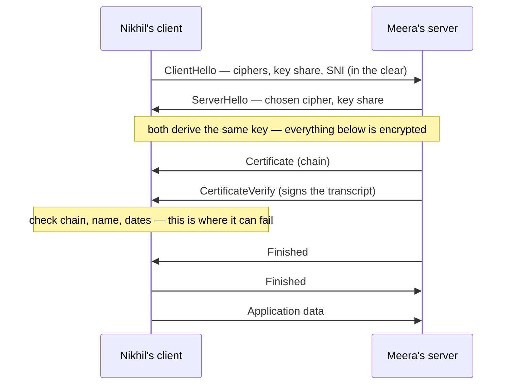
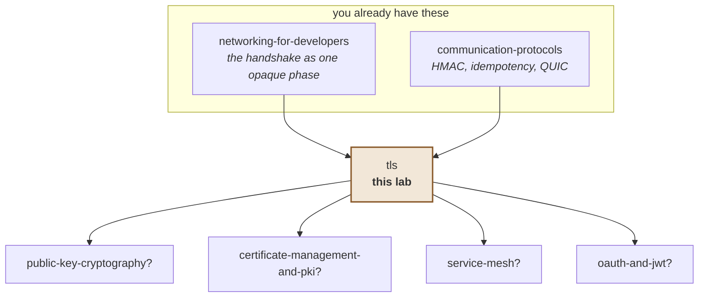

# TLS — how Nikhil sends a secret to a bank he has never met, and knows it is the bank

> **Tell a friend:** Nikhil wants to send a secret instruction to Meera at his
> bank, and every courier in between is a stranger who can read the letter or
> forge a reply on bank letterhead. Two strangers who have never met *can* agree
> on a secret code over a wire everyone can read; that turns out to be the easy
> half. The hard half is Nikhil proving he reached Meera and not Omar, a courier
> answering in her name. TLS solves it by letting a notary Nikhil already trusts
> vouch for the bank, in writing he can check by himself, before he sends a word.
> So the padlock in your browser only means "encrypted to whoever answered"; the
> notary's seal, checked against a list you chose in advance, is what says who
> answered.

Watch the two guarantees arrive separately in [`visualization.html`](visualization.html),
published as [The Padlock And The Seal](https://claude.ai/code/artifact/c9e77989-533d-463a-8f3e-3e7643cbc40f).
How this lab was built, and where it sits among your other labs, is in
[section 19](#19-about-this-lab) at the end.

---

# BEGINNER MODEL

## 1. Why does this problem exist at all?

> **In one breath:** Everything you send across a network passes through
> machines other people own. Each of them can read it, and each of them can
> change it. Worse, one of them can answer *as* the place you meant to reach.

Everything you send across a network passes through machines you do not own:
your router, your ISP, a dozen routers in between, whoever runs the coffee shop
wifi. By default every one of them can read what passes. And, this is the part
people forget, every one of them can **change** it.

Without a fix, passwords, card numbers and API tokens travel in plain text.
Worse, anyone in the middle can quietly pretend to be the server you meant to
reach. The cost of getting this wrong is not "slightly less privacy". It is
handing your credentials to someone else while your code reports complete
success.

Hold on to that last sentence. Your code reports success. Nothing throws. That
is the shape of every serious failure in this lab. It is why the story that
follows is about a *forged reply*, not a stolen letter.

## 2. Nikhil and the sealed envelope: who is he really talking to?

> **In one breath:** Nikhil has to send a secret to a bank clerk he has never
> met, through couriers he cannot trust. A stronger envelope stops them reading
> it. It does nothing if the courier is the one who answers.

Nikhil needs to send his bank a signed instruction. The person who should
receive it is Meera, a clerk at the bank's counter. Nikhil has never met Meera,
or anyone else at the bank. And every courier between his door and hers is a
stranger.

His first worry is obvious: **any courier could open the envelope and read it.**

His second worry is worse and less obvious. One of the couriers, call him Omar,
does not deliver the letter to Meera at all. Instead, Omar writes back on bank
letterhead, in a convincing hand, asking Nikhil to confirm his account number.
Nikhil replies. Omar now has everything.

Notice that a *stronger envelope* does nothing about Omar. Nikhil could seal
his letter in a steel box, and he would still be sealing it to the wrong
person. Privacy and knowing-who-you-are-talking-to are two different problems.
Solving one does not touch the other.

And there is a third problem hiding underneath. To use any kind of secret code
with Meera, the two of them need to agree on the code first. But every message
they could use to agree on it travels through the same untrusted couriers.
Through Omar.

Here is how far the lab goes, and what you can do after each layer. Stop at
any checkpoint and you still have something whole.

| Layer | Sections | After it you can… |
|---|---|---|
| **Beginner** | 1–9 | say why encryption alone is worthless, and what a certificate is for |
| **Intermediate** | 10 | walk a real handshake message by message, and say when each guarantee arrives |
| **Engineering** | 11–14 | diagnose eight failures, and state what TLS does and does not protect |
| **Production** | 15 | reason about mTLS, rotation, pinning, and what to monitor |

## 3. Why not just agree a password beforehand?

> **In one breath:** If Nikhil and Meera shared a password, they could scramble
> every letter with it. That is how secrets travelled for most of history. It
> only works if the two of them can meet first.

The obvious answer, and the naive solution: Nikhil and Meera agree on a shared
password in advance, and scramble every letter with it. Omar opens the envelope
and sees gibberish. Problem solved.

This is genuinely how secret communication worked for most of history. For two
parties who *can* meet in advance, it is fine. Spies did it with code books.
Banks did it with couriers they had vetted in person.

> **🔮 Predict:** *Nikhil has never met Meera. Could he just post her a
> password today, and use it from tomorrow?*
> <details><summary>Reveal</summary>
> No. The password travels through Omar, who copies it. From tomorrow, Omar
> reads every "scrambled" letter as easily as Meera does. If you said "post it
> in a sealed envelope", ask what seals that envelope. It would need a secret
> too, and you are back where you started. Section 6 has a trick that does not
> need a secret to travel at all.
> </details>

## 4. Why can't you meet a website in advance?

> **In one breath:** Two things break. You cannot agree the password, because
> everything you send is readable. And even if you could, ten million customers
> would need ten million passwords.

Two things break, and the second one breaks harder.

**You cannot agree on the password.** You have never met your bank's server.
To agree on a shared secret you must send *something*, and everything you send
is readable by the couriers. Whatever you use to establish the password, the
eavesdropper sees it too. So the eavesdropper can derive the same password.

**And it does not scale even if you could.** A bank with ten million customers
needs ten million pre-agreed passwords, distributed somehow, kept secret
forever. The web has billions of visitor–site pairs. There is no meeting.

| Fact | Number | What it means |
|---|---|---|
| Customers at one bank | ten million | ten million secrets to hand out and guard forever |
| Visitor–site pairs on the web | billions | there is no meeting, and there never can be one |

> **🔮 Predict:** *Suppose we somehow solved the first problem. Nikhil and
> whoever is at the other end can establish a shared secret key over a public
> wire, with no prior meeting. Are we done? Is the conversation now safe?*
>
> <details><summary>Reveal</summary>
>
> **No, and this is the single most important idea in the lab.**
>
> You have established a secret key *with whoever answered*. Nothing in that
> process said who that was. If Omar intercepted Nikhil's very first message and
> answered it himself, Nikhil has now established a perfectly secure, unbreakable
> channel. **To Omar.**
>
> If you said "yes, done", you are treating a locked door as proof of whose
> building it is on. Encryption without identity is a locked door on a building
> you cannot identify. You have privacy from everyone except the one person who
> matters.
>
> Experiment 3 in this lab does exactly this. It connects to an impostor with
> full TLS 1.3 encryption, cipher `TLS_AES_256_GCM_SHA384`, and hands over a
> password. The connection is flawless. It is also completely compromised, and
> nothing in the protocol complains.
> </details>

## 5. What do we actually need?

> **In one breath:** Three separate things: nobody reads it, nobody changes it,
> and Nikhil knows it is Meera *before* he writes a word. The third is the whole
> subject.

Three things, and they are separate. Engineers would call this list the real
requirement. Watch how each one maps onto Nikhil's worries from section 2.

| Need | In Nikhil's words | Engineers say |
|---|---|---|
| Nobody in the middle can read what we send | "no courier can open the envelope" | **Privacy** |
| Nobody in the middle can change it without us noticing | "no courier can rewrite my instruction" | **Integrity** |
| I can prove the other end is who I meant to reach, *before* I send anything | "it is Meera, not Omar, and I know it before I write" | **Identity** |

The first two turn out to be the easy ones. The third is the whole subject.

## 6. What is the key idea?

> **In one breath:** Strangers can build a shared secret by each sending a
> public half that only combines correctly with the other's private half. And
> identity comes from a notary Nikhil already trusts, who vouches for the bank
> in writing he can check.

Two ideas, and the second is the one people underestimate.

**First: two strangers *can* agree on a shared secret over a public wire.** Each
side sends a public value. Each combines the value it received with a private
value it never sends. Both arrive at the same secret. The eavesdropper, holding
only the two public values, cannot. Omar can copy every note that passes and
still not get the secret.

**Second: identity is solved by delegating trust in advance.** Nikhil cannot
know every bank clerk in the country. But he can decide, ahead of time, to
believe a small number of authorities. Say there is a notary, Asha, whose seal
Nikhil knows and can recognise. Asha can vouch, in writing Nikhil can verify,
for any number of clerks Nikhil has never seen. Meera included.

That is the whole trick. You cannot know every server. You can decide, ahead
of time, to believe a handful of authorities. They can vouch, in writing you
can check, for any number of servers you have never seen.

## 7. What do engineers call the things Nikhil just met?

> **In one breath:** Every word in this section names something that already
> happened in Nikhil's story. Here is each one, earned where it happened, then
> two small maps back to the story.

The terminology, in the order the story earned it. Each word is a thing Nikhil
already touched. The two tables at the end of the section map every word back
to where it happened.

### One key, or a pair of keys?

The password from section 3 was one key that both locks and unlocks. Engineers
call that a **symmetric key**. The real algorithm behind it is AES, and it is
fast.

The trick from section 6 used a pair instead. One half is shown to everyone.
The other half never leaves your hands. The two are mathematically linked: what
one does, only the other can undo. Engineers call that an **asymmetric
keypair**, made of a *public key* and a *private key*. The mathematics is slow.

Why does TLS need both? Because it uses them for different jobs. The slow
asymmetric mathematics runs once, during the opening conversation, to establish
trust and agree a key. The fast symmetric encryption then protects the actual
data. In experiment 1 the two sides agreed on a cipher whose name you will see
often in this lab, `TLS_AES_256_GCM_SHA384`. Read the middle of it: AES-256 is
the symmetric part, doing the real work.

### How do two strangers end up with the same secret?

The "each sends a public half" step from section 6 is called **key exchange**.
Each side generates a keypair, sends only the public half, and combines its own
private half with the other side's public half. Both arrive at the same value.
An observer holding both public halves cannot.

The term exists to name the step that solves section 4's *first* failure, the
one about agreeing a password. It is also there to separate that step from
*authentication*, which key exchange does not do. Omar can run a key exchange
with Nikhil just as well as Meera can. The certificates in this lab do their
key mathematics on an elliptic curve named `secp256r1`.

### What is the letter of introduction?

Asha's written vouching from section 6 is a **certificate**: a document saying
"this name belongs to the holder of this public key", signed by someone else.
Precisely, it is an X.509 structure that binds a public key to one or more
names, with a validity period, signed by an issuer.

The term exists to make identity *transferable*. Because the document is
signed, it can be handed to strangers and still be checked. Here is the one the
lab's good server, Meera's stand-in, presents. It lives in `pki/good.p12`.

| Field | Value in `pki/good.p12` | In words |
|---|---|---|
| subject | `CN=localhost` | "this letter is about the holder called localhost" |
| names | `DNS:localhost, IP:127.0.0.1` | the only two names the letter may be used for |
| valid | 2026-08-28 to 2027-08-28 | the dates between which the letter counts |
| issued by | `CN=TLS Lab Root CA` | the notary who signed it |

### Who is the notary, and what is the chain?

Asha is a **certificate authority**, usually shortened to CA: one of the small
set of organisations you decided in advance to believe. A CA holds a private
key and signs certificates.

The paperwork linking a server back to a CA is the **chain of trust**. It runs
from the server's certificate, up through any intermediate certificates, to a
**root** that is already on your list. The point is that you need to trust a
handful of authorities rather than millions of servers. This is the delegation
from section 6, made mechanical.

Experiment 1 prints the lab's chain. It has two entries: `[0] CN=localhost`,
issued by `[1] CN=TLS Lab Root CA`. The second one is self-signed, and it is in
our trust store. Which brings us to the trust store.

### Which notaries does Nikhil recognise?

The list of authorities Nikhil is willing to believe is his **trust store**. In
engineering terms it is a set of root certificates. Your operating system and
your JDK each ship one, containing roughly 150 commercial CAs. The JDK's is a
file called `cacerts`.

This list matters more than any other configuration in TLS. It is the *only*
thing deciding whose word you accept. Everything about identity reduces to this
list. Experiment 3 changes nothing except this list, and turns a rejected
impostor into a successful one.

| Trust store | What it holds | Where you meet it |
|---|---|---|
| your operating system's | ~150 commercial CAs | every browser and system tool |
| the JDK's, `cacerts` | ~150 commercial CAs, a separate copy | every Java program, unless told otherwise |
| the lab's `pki/truststore.p12` | one root, `CN=TLS Lab Root CA` | experiments 1, 2, 4, 5 and 6 |
| the lab's `pki/truststore-with-mitm.p12` | the same root, plus the interceptor's | experiment 3 |

### What is the opening conversation?

The negotiation that sets everything up is the **handshake**. In it the two
sides agree a version and a cipher, do the key exchange, present and verify
certificates, and check that nobody tampered with the negotiation itself.

You already paid for one. In the networking lab, the handshake to
cloudflare.com cost 46 ms on top of a 13 ms TCP connect. That is roughly one
extra round trip plus certificate work.

| Step, from the networking lab | Time | What it means |
|---|---|---|
| TCP connect to cloudflare.com | 13 ms | one round trip, no cryptography |
| TLS handshake on top | 46 ms | one more round trip, plus the certificate work |

### Is the letter about the bank Nikhil actually wrote to?

Asha's seal proves the letter is genuine. It does not prove the letter is about
*Meera*. Nikhil must also read the name on it. Engineers call that check
**hostname verification**: matching the name you connected to against the
certificate's Subject Alternative Name list, the SAN list for short.

Why is it a separate check, and separately forgettable? Because a valid
signature proves the certificate is genuine, not that it is genuine *for this
site*. Without this check, any certificate a trusted CA ever issued would work
for every site. Someone who legitimately owns `other.example` could impersonate
your bank.

The lab shows this with a certificate called `wronghost`. Ask it for
`localhost` and it is **rejected**: `No subject alternative DNS name matching
localhost found`. Ask the same certificate for `other.example` and it is
**accepted**. Nothing about the certificate changed. Only the name you
requested did.

In Java this check is opt-in on a raw socket. That is why it is the second most
common way to disable TLS security by accident. Failure 6 in section 11 is
that accident.

### What if Meera's key is stolen next year?

Suppose the bank's long-term key is stolen tomorrow. Can today's recorded
letters be read? The property that says *no* is **forward secrecy**.

It works because the session key comes from an *ephemeral* key exchange, one
whose keypairs are thrown away after the connection. The certificate's private
key never encrypts data. It only signs. The term exists because an attacker who
records everything now and steals a key later would otherwise decrypt years of
history in one go.

TLS 1.3 makes this mandatory: every cipher suite is ephemeral. In TLS 1.2 it
was optional, which is why you see `ECDHE` in the names of the good 1.2 suites.
Section 10 shows the design that lacked it, and what that costs.

### Two maps back to the story

Keys and secrets first.

| Engineers say | In Nikhil's story | Concrete in this lab | Where it happened |
|---|---|---|---|
| Symmetric key | the shared password | AES-256, inside `TLS_AES_256_GCM_SHA384` | section 3 |
| Asymmetric keypair | a public half shown, a private half kept | the `secp256r1` keys in every `.p12` | section 6 |
| Key exchange | each sends a public half, both get one secret | the key shares in the first two messages | section 6 |
| Forward secrecy | a stolen key cannot open old letters | mandatory in TLS 1.3; `ECDHE` in 1.2 | this section |
| Handshake | the opening conversation | 46 ms to cloudflare.com | this section |

Then the paperwork.

| Engineers say | In Nikhil's story | Concrete in this lab | Where it happened |
|---|---|---|---|
| Certificate | Asha's letter of introduction for Meera | `pki/good.p12`, subject `CN=localhost` | section 6 |
| Certificate authority, and the chain | Asha, and the paperwork back to her | `[0] CN=localhost`, issued by `[1] CN=TLS Lab Root CA` | section 6 |
| Trust store | the notaries Nikhil recognises | `cacerts`; `pki/truststore.p12` | this section |
| Hostname verification | is the letter about *this* bank? | `wronghost` rejected for `localhost`, accepted for `other.example` | this section |

## 8. What two pictures should you keep in your head?

> **In one breath:** The simple picture is a letter of introduction with a
> notary's seal. The engineering picture is the same thing with every step
> named. The story lies to you in three places, and each lie is a real failure.

Two mental models, one simple and one precise, and then the places where the
simple one lies.

**The simple picture: the notarised letter.** Nikhil does not know Meera. But
he knows Asha the notary, whose seal he can recognise and which is hard to
forge. Meera shows Nikhil a letter of introduction bearing Asha's seal, naming
the bank. Nikhil checks the seal. He checks that the letter names the bank he
actually wrote to. He checks the date on it. Then they talk.

**The engineering picture.** The same events, with the engineer's names, one
step per sentence. A negotiation produces a symmetric session key via ephemeral
key exchange. The server then proves control of a private key. The public half
of that key appears in a certificate. That certificate chains to a root in your
trust store. The name you requested is checked against that certificate's SAN
list. And the whole transcript is signed, so the negotiation itself cannot be
tampered with.

**The mapping.** Read the third column: it is what your Java code sees when
each row goes wrong.

| Notarised letter | TLS | Fails as |
|---|---|---|
| The notary, Asha | Certificate authority | — |
| Recognising the notary's seal | Chain builds to a root in your trust store | `SunCertPathBuilderException` |
| The letter of introduction | The server's certificate | — |
| It names the bank you wrote to | Hostname verification against SAN | `No subject alternative DNS name matching …` |
| The date on it | Validity period | `CertificateExpiredException` |
| Meera signs something in front of you | CertificateVerify | proves it holds the private key |
| Your list of recognised notaries | Trust store | the only thing that decides identity |
| Sealing the envelope | Symmetric encryption of application data | — |

> **🔮 Predict:** *Omar gets hold of a photocopy of Meera's letter of
> introduction, seal and all. Certificates are public; anyone can copy one. Can
> Omar now pass as the bank?*
> <details><summary>Reveal</summary>
> No. The letter is public. What Omar does not have is Meera's *private key*.
> The handshake makes the server sign something fresh, for this conversation
> only, and Omar cannot produce that signature. If you said "yes, he has the
> sealed letter", you are trusting paperwork. TLS trusts *possession*, and the
> first lie below is exactly this.
> </details>

**Where the story lies to you.** Carry these three corrections with it.

*A seal proves the letter's origin; a certificate proves nothing on its own.*
Anyone can copy a certificate. They are public, and your browser shows you
every one. What cannot be copied is the private key. That is why the handshake
makes the server sign something fresh. Possession, not paperwork, is the proof.
A notary analogy quietly skips this, and it is the step that stops replay.

*A notary can be phoned; a CA cannot.* Verification is entirely offline. You
check a signature with a key you already have. Nothing contacts the CA. This is
why a *revoked* certificate is so much harder to deal with than an expired one
(failure 7). Expiry is self-announcing. Revocation needs someone to be asked.

*There is no honest analogy for "you chose the notaries in advance, and someone
else may have added to that list."* Your trust store was populated by your OS
vendor, your JDK, and possibly your employer's laptop management. Anyone who
can add an entry can impersonate anything, undetectably. That is experiment 3.
It has no equivalent in the letter story, which is exactly why the analogy must
be retired before section 10.

## 9. Can you watch the two guarantees arrive separately?

> **In one breath:** The stepper has two lamps: one for "nobody can read this",
> one for "it is really the bank". Watch how far apart they light. Then move
> the trust list and watch the impostor get through.

Open **[The Padlock And The Seal](https://claude.ai/code/artifact/c9e77989-533d-463a-8f3e-3e7643cbc40f)**
(or `visualization.html`, which works offline). The two lamps at the top are
Nikhil's two worries from section 2: the envelope, and Omar.

What to do, in order:

1. **Press "Play it through" with everything at its defaults.** Watch only the
   two lamps at the top. They do **not** light together. Encryption arrives at
   step 2, identity at step 5. The gap between them is the whole lesson from
   section 4's prediction.
2. **Switch the server to "an impostor with its own certificate authority"**
   and play again. This is Omar with his own notary. Encryption still arrives.
   Identity turns red, and the connection dies before any data moves.
3. **Now tick "Interceptor Root CA" in the trust list.** Same impostor, same
   code, same everything. And it succeeds. You have just performed experiment
   3.
4. **Set the server to "a certificate for another name", then change the
   hostname control to `other.example`.** A rejection becomes an acceptance
   with nothing about the certificate changed. That is hostname verification,
   isolated.
5. **Set "Check the certificate at all?" to "trust everything"** with the
   impostor selected. Watch the identity lamp stay grey while the verdict
   claims success. That is `BrokenTrust.java`.

Three scenarios pause and ask you to predict first.

| Lamp | Lights at | What it means |
|---|---|---|
| "nobody else can read this" | step 2 | both sides hold the key; the envelope is sealed |
| "you are talking to who you think" | step 5 | Nikhil has checked Asha's seal, the name, and the date |

The stepper's identity lamp is really four checks in a fixed order. The
exercises refer to them by number.

| Check | The question the client asks | In the story |
|---|---|---|
| 1 | Does the chain reach an authority I already trust? | is this Asha's seal? |
| 2 | Is it issued for the name I asked for? | does it name Meera's bank? |
| 3 | Is it in date? | has the letter expired? |
| 4 | Does the server hold the matching private key? | is Meera signing in front of me, or is this a photocopy? |

---

> ### ✅ Checkpoint — end of the beginner model
>
> You can explain why encryption alone is nearly worthless, what a certificate
> is, and why your trust store is the most security-critical configuration in
> your system.
>
> Next: the handshake message by message, and why TLS 1.3 removed a round trip.

> **Say it back.** Without using the words *certificate*, *authority* or
> *trust store*, explain to a friend why Nikhil's steel box does not protect
> him from Omar, and what does.
> <details><summary>A good answer sounds like</summary>
> "The box only stops people reading the letter. If Omar is the one who
> answers, Nikhil locked the box to Omar. What protects him is a letter of
> introduction with a seal from a notary Nikhil already knows, naming the bank,
> dated, plus a fresh signature from the bank to prove it is not a photocopy."
> </details>

---

# INTERMEDIATE MODEL

## 10. What does the handshake actually do, message by message?

> **In one breath:** The first obvious design encrypted the session key with
> the bank's long-term key, so one stolen key would unlock years of recordings.
> The real handshake builds a throwaway key first, then proves identity inside
> the sealed envelope, in one round trip.

### Mechanism v1: the obvious design, and its fatal flaw

A first attempt, which is roughly what SSL looked like early on. Nikhil and
Meera, in four steps:

1. Nikhil says hello.
2. Meera sends her certificate, containing her public key.
3. Nikhil invents a random session key, encrypts it with Meera's public key,
   and sends it.
4. Only Meera can decrypt it. Both now share a key. Encrypt everything.

This works. It authenticates the server, because only the real key holder can
decrypt step 3. It establishes a shared secret. And it is simple.

> **🔮 Predict:** *Omar records this entire conversation today but cannot read
> it. Three years later, the bank's server is decommissioned and its private
> key leaks. What can Omar do with the recording?*
>
> <details><summary>Reveal</summary>
>
> **Decrypt all of it. Every session, retroactively.**
>
> In step 3 the session key was encrypted *with the server's long-term public
> key*. Anyone holding the matching private key can decrypt that message and
> recover the session key. Years later, for every conversation ever recorded.
>
> If you said "nothing, those sessions are over", you are picturing the key as
> something that dies with the connection. In v1 it does not. It was mailed,
> and the mail was kept.
>
> One key compromise retroactively breaks all past traffic. This is why v1 is
> gone. TLS 1.3 removed this key-exchange style entirely, and it is what
> **forward secrecy** means. The fix is that the session key must never travel,
> even encrypted. Instead both sides derive it from *ephemeral* keypairs thrown
> away when the connection ends. The certificate's private key then only ever
> **signs**, never encrypts. Stealing it lets you impersonate the server in
> future but not read the past.
> </details>

### Mechanism v2: ephemeral key exchange, and the handshake as it runs

Here is a real TLS 1.3 handshake. The third column is Nikhil's version of each
message. The last two columns are the ones that matter. They are why the
visualization has two lamps rather than one.

| # | Message | In Nikhil's words | Private yet? | Identity known? |
|---|---|---|---|---|
| 1 | **ClientHello**: versions, ciphers, my key share, the name I want | "here are the codes I speak, my public half, and I want the bank" | no | no |
| 2 | **ServerHello**: chosen version and cipher, my key share | "we will use this code; here is my public half" | **yes, from here** | no |
| 3 | **Certificate** (encrypted): my chain | Asha's letter of introduction, already inside the sealed envelope | yes | no |
| 4 | **CertificateVerify**: signature over the transcript | Meera signs, in fresh ink, everything said so far | yes | no |
| 5 | *client verifies the chain* | Nikhil checks the seal, the name, the date | yes | **yes, from here** |
| 6 | **Finished**, both ways: nobody tampered with the negotiation | "nobody changed a word of our conversation" | yes | yes |
| 7 | **Application data**: finally, your request | the instruction itself | yes | yes |

The message names are worth saying in words once each. ClientHello is the
client's opening note. ServerHello is the reply. Certificate is the chain of
letters of introduction. CertificateVerify is the fresh signature. Finished is
the check that nobody tampered.



Two things to take from that table.

**Steps 3 and 4 are already encrypted.** So an eavesdropper on TLS 1.3 cannot
even see which certificate the server presented. In TLS 1.2 they could. The
certificate went in the clear. That is a real privacy improvement, not just a
speed one.

**Step 4 is what makes step 3 mean anything.** A certificate is public; anyone
can copy one. The signature over the transcript is what proves this server
holds the matching private key *right now*, for *this* conversation. It is
Meera signing in front of Nikhil, which the photocopy in section 8 could never
do.

> **🔮 Predict:** *Omar sits on the wire and records everything. Which is the
> first message he cannot read?*
> <details><summary>Reveal</summary>
> Message 3, the Certificate. After message 2 both sides hold the key, so
> everything from 3 onwards is sealed. If you said "message 1, because it
> carries the key share", remember that a key share is the *public* half. It
> is designed to be seen. Omar holding both public halves still cannot build
> the secret.
> </details>

### Why is TLS 1.3 one round trip when 1.2 was two?

The saving comes from guessing. In TLS 1.2 the client had to learn which key
exchange the server chose before it could send its key material. That is a
full extra round trip. TLS 1.3 has the client **send a key share in its very
first message**, guessing the server will accept it. It nearly always does.

| Round trip time | What the guess saves per new connection | What it means |
|---|---|---|
| 16 ms, the figure timed in the networking lab | 16 ms | one whole round trip gone, every time |
| 250 ms, a far-away region | 250 ms | the same saving, now a quarter of a second |

**0-RTT** goes further. On a repeat visit, the client sends application data
*with* its first message, using a key from the previous session. That costs
nothing in round trips and buys a real problem. Failure 8 is that problem.

> **🔮 Predict:** *Every message from step 3 onwards is encrypted, including
> the certificate. So Omar sees nothing but noise after step 2. What can he
> still learn about your traffic?*
>
> <details><summary>Reveal</summary>
>
> **Who you are talking to. Because you told him in step 1.**
>
> The ClientHello carries the hostname in plain text, in a field called SNI,
> short for Server Name Indication. It has to. One IP address may serve
> thousands of sites, so the server must know which certificate to present
> *before* it can encrypt anything.
>
> If you said "nothing at all", you forgot the envelope has an address on the
> outside. Experiment 4 points a TLS client at a plain listener and reads its
> first 456 bytes. The hostname `payments.internal.example` appears in readable
> ASCII at **byte offset 153**.
>
> | What Omar reads | Where | What it means |
> |---|---|---|
> | `payments.internal.example` | byte 153 of the first 456 | the name of every service you talk to |
> | the IP address, the timing, the size of everything | the outside of every packet | that the conversation happened, when, and how big it was |
>
> TLS hides the *contents* of your conversation. It does not hide that the
> conversation happened, who it was with, when, or how big it was.
> </details>

---

> ### ✅ Checkpoint — end of the intermediate model
>
> You can walk a handshake message by message and say exactly when privacy and
> identity each begin, and why 1.3 is a round trip cheaper than 1.2.
>
> Next: the eight ways this fails, and what TLS does and does not guarantee.

> **Say it back.** In two sentences, say why there must be a moment in every
> handshake when Nikhil has a perfectly private channel to someone he has not
> yet identified.
> <details><summary>A good answer sounds like</summary>
> "The letter of introduction is sent inside the sealed envelope, so the
> envelope has to be sealed before Nikhil can read who he is talking to. That
> means the privacy lamp always lights first, and there is a gap until he has
> checked the seal."
> </details>

---

# ENGINEERING MODEL

## 11. What are the eight ways it fails, and how do you tell them apart?

> **In one breath:** Four failures are Nikhil correctly refusing a bad letter.
> Two are Nikhil accepting a bad one because someone changed his rules. Two are
> problems no lab can stage. All the paperwork ones throw the same exception,
> so the *cause* underneath it is the diagnosis.

Eight failure scenarios. All the certificate ones surface as
`SSLHandshakeException`, so the **cause chain**, the exception's chain of
underlying causes, is what tells them apart. Each has a different owner. The
stories come first; the comparison table at the end of the section holds the
shared facts.

### 1 — Untrusted issuer: a notary Nikhil does not recognise

Meera's letter arrives with a seal Nikhil has never seen. He refuses it. That
is the right answer, and it is the first thing to notice: every guarantee was
kept. The client refused correctly.

Run `java TlsLab.java 2` and look at case 2, a self-signed server. Your code
sees `SunCertPathBuilderException: unable to find valid certification path to
requested target`. In words: I tried to build a chain from this certificate to
something I trust, and there is no such path. Nothing in your trust store
signed this certificate.

The owner is usually **you**: a private CA that was never added to the trust
store, or a server that skipped its intermediate certificate. The tell is the
words "certification path". In production the most common cause is a missing
*intermediate*, not a missing root. The server was misconfigured to send only
its leaf.

### 2 — Hostname mismatch: a genuine letter about somebody else

The seal is real, the date is fine, and the letter names a different bank.
Nikhil refuses. Again, correctly.

Run `java TlsLab.java 2` and look at case 3. Your code sees `No subject
alternative DNS name matching localhost found.` The certificate is genuine,
correctly signed and in date, for a different name. The owner is whoever chose
the URL, or whoever requested the certificate's SAN list.

The identical certificate is **accepted** when you ask for `other.example`.
The tell is the words "no name matching" or "subject alternative".

### 3 — Expired: the date on the letter has passed

Nothing about trust or identity is wrong. A date passed. Run `java TlsLab.java
2` and look at case 4: `CertificateExpiredException: NotAfter: Fri Jul 24 …`.
The owner is the server team's renewal process.

In production this is the single most common TLS outage, and it is entirely
self-inflicted. It is also why ACME and Let's Encrypt automation exist.

Watch out for one trap. An expired certificate **also** fails path building,
and **also** mentions PKIX in its message. A diagnostic that tests for PKIX
first will misreport it as an untrusted issuer and send you to the wrong team.
The author of `TlsLab.verify()` made exactly that mistake while building it,
and the fix is a comment in the code.

### 4 — Clock skew: Nikhil's own calendar is wrong

Set your machine's clock forward two years. Every letter now looks expired.
Your code sees `CertificateExpiredException`, or
`CertificateNotYetValidException` if the clock is behind instead. Validity is
checked against *your* clock, so a wrong clock invalidates perfectly good
certificates.

> **🔮 Predict:** *Nikhil's letters from three different banks all start being
> refused on the same morning. Whose problem is it?*
> <details><summary>Reveal</summary>
> Nikhil's. Three banks do not let their letters expire on the same day. The
> tell for clock skew is that it fails on **every** TLS connection, to every
> host, all at once. If you said "the banks", check the scope first: one host
> is a certificate problem, every host at once is a client problem.
> </details>

In production this is classic on devices with dead batteries, fresh containers
with no NTP, and CI runners.

### 5 — The trust store is not what you think it is

Somebody added Omar's own notary to Nikhil's list of recognised seals. Now
Omar's letter passes every check. This is the one failure where Nikhil is
*wrong* and nothing tells him.

Run `java TlsLab.java 3`, the impostor experiment. With the interceptor's CA
trusted, an impostor gets a perfect TLS 1.3 connection and reads the password.
**No error, no warning, no clue.** Except the issuer name, which nothing
checks.

Why: trust is a list, and anyone who can write to that list can impersonate
anything. The guarantee lost is identity, completely and silently. Privacy is
*maintained*, which is what makes it so hard to notice. In production this is
exactly how corporate TLS inspection works. It is also what a compromised CA
gets you: the 2011 DigiNotar breach is the canonical case.

### 6 — Hostname verification silently switched off

Nikhil stops reading the name on the letter. Any genuine letter, about any
bank, now passes.

Delete `p.setEndpointIdentificationAlgorithm("HTTPS")` from
`TlsLab.connect()`. The `wronghost` certificate is now **accepted**. The chain
still verifies; only the name check is gone.

> **🔮 Predict:** *You delete that one line and re-run all four cases of
> experiment 2. How many verdicts change?*
> <details><summary>Reveal</summary>
> One. Only the wrong-name case flips to accepted. The self-signed case still
> fails path building and the expired case still fails on the date, because
> those are separate checks. If you said "all of them", you are picturing one
> big "is it valid?" switch. There are four checks, and this line owns exactly
> one of them.
> </details>

Why: on a raw `SSLSocket` in Java, hostname verification is **opt-in**.
`HttpsURLConnection` and `HttpClient` do it for you; a hand-rolled socket does
not. The guarantee lost: any certificate your trusted CAs ever issued now works
for any host. The tell is nothing. It fails open, the most dangerous kind of
default.

### 7 — Revoked, but still accepted

Asha announces that one of her letters was stolen and must not be honoured.
Nobody phones Asha, so nobody hears. This lab cannot stage this one; section
19 says why.

What happens: a certificate whose private key was stolen is revoked by its CA,
but clients keep accepting it. Verification is offline (section 8), and
revocation checking is frequently disabled, soft-failing, or unreachable.

Why: revocation lists, CRLs, are large. The alternative, OCSP, adds a network
call to every handshake. That call must not become an availability dependency,
so it usually soft-fails. The response in production is short-lived
certificates, 90 days, or hours in a mesh, rather than reliable revocation.
**Expiry is the revocation mechanism that actually works.**

### 8 — 0-RTT replay

Nikhil, in a hurry, puts his instruction in the very first envelope, sealed
with last week's key. Omar copies the envelope and posts it again. The bank
carries out the instruction twice. This lab cannot stage this one either.

What happens: TLS 1.3's 0-RTT lets a client send data with its first message.
An attacker who captures that data can **send it again**, and the server
cannot tell the difference. Why: the anti-replay protection of the full
handshake has not happened yet.

The response: only ever send *idempotent* requests in 0-RTT, requests that are
harmless to repeat. This is the same rule your
[communication-protocols](../communication-protocols/README.md) lab
established for retries, arriving from a completely different direction.

### The eight side by side

| # | Failure | See it yourself | What your code sees | Who owns the fix |
|---|---|---|---|---|
| 1 | Untrusted issuer | `java TlsLab.java 2`, case 2 | `SunCertPathBuilderException` | you: a missing CA or intermediate |
| 2 | Hostname mismatch | `java TlsLab.java 2`, case 3 | `No subject alternative DNS name matching localhost found.` | whoever chose the URL or the SAN list |
| 3 | Expired | `java TlsLab.java 2`, case 4 | `CertificateExpiredException` | the server team's renewal process |
| 4 | Clock skew | clock forward two years | the same, on every host at once | your machine's clock |
| 5 | Rogue trust store | `java TlsLab.java 3` | nothing; a clean connection | whoever controls the trust store |
| 6 | Name check off | delete the `HTTPS` line | nothing; it fails open | the code that built the socket |
| 7 | Revoked, still accepted | not stageable here | nothing | the CA, and short lifetimes |
| 8 | 0-RTT replay | not stageable here | nothing | your idempotency rules |

Read the fourth column top to bottom. Four failures are loud and correct. Four
are silent. The silent ones are the dangerous ones.

## 12. What does TLS actually promise Nikhil, and what does it not?

> **In one breath:** After a good handshake, nobody reads, nobody changes, and
> it really is the bank. TLS does not promise the bank is honest, that your
> notary list is honest, or that nobody can tell who you wrote to.

This is the correctness section: what TLS actually guarantees, and what it
does not.

**Guaranteed, once the handshake completes successfully.** Each row is one of
Nikhil's worries, answered.

| Guarantee | In Nikhil's words | What it means for your code |
|---|---|---|
| **Privacy** | no courier can read the letter | nobody on the path can read the application data |
| **Integrity** | no courier can rewrite it | tampering breaks the authentication tag and the connection fails |
| **Server identity** | it really is Meera | the server holds the private key for a certificate that chains to a root you trust, and that certificate covers the name you asked for |
| **Handshake integrity** | nobody edited the opening conversation | an attacker cannot force both sides down to a weak cipher |
| **Forward secrecy** (TLS 1.3, always) | a stolen key cannot open old letters | stealing the server's key tomorrow does not decrypt traffic recorded today |

**Not guaranteed, and each of these has burned somebody.**

| Not promised | Why it bites | Where you saw it |
|---|---|---|
| That the server is trustworthy | TLS proves identity, not virtue. A phishing site with a valid certificate for `paypa1.com` is cryptographically perfect | section 2's forged letterhead, done legally |
| That your trust store is honest | anyone who can add a root can impersonate anything | failure 5 |
| Client identity | the web's default is one-directional; only mTLS adds the other direction | experiment 6 |
| Who you talked to, from an observer's view | SNI is in the clear, as are IP addresses, timing and message sizes | experiment 4 |
| Anything before or after the connection | TLS protects bytes in flight. It says nothing about data at rest, or about what the server does with it | Meera's filing cabinet |
| That the certificate has not been revoked | nobody phones the notary | failure 7 |
| Protection from a compromised endpoint | if either end is owned, TLS faithfully encrypts the attacker's traffic | Omar sitting at Meera's desk |

**What was traded away.** Three things. Latency: an extra round trip on every
new connection, which is why the connection reuse from the networking lab
matters so much more with TLS than without. CPU on the handshake. And an
entire operational burden: certificates that must be issued, deployed, rotated
before expiry, and revoked. Failure 3 is the price of the whole scheme, paid
monthly, forever.

## 13. Where is the code, and which line is load-bearing?

> **In one breath:** One script builds Asha's notary and five identities for
> Meera's server. One Java file runs six experiments against them. One line in
> it is the difference between "genuine" and "genuine for this bank".

```bash
cd ~/Documents/Learning/tls
./certs.sh                # once — builds pki/ with keytool
java TlsLab.java          # all six experiments
java TlsLab.java 3        # just the impostor one
java BrokenTrust.java     # the planted bug
```

JDK 25, no build tool, no dependencies. `certs.sh` uses `keytool`, the JDK's
own tool. It is the same tool you would use to configure `server.ssl.key-store`
in a Spring Boot app.

| File | What it is |
|---|---|
| `certs.sh` | A private CA and five server identities: valid, wrong-name, expired, self-signed, impostor |
| `TlsServer.java` | A real TLS server; which identity it presents is just which keystore you hand it |
| `TlsLab.java` | The six experiments |
| `BrokenTrust.java` | One bug, for exercise 6 |

In the story, `certs.sh` is Asha's office. It creates her seal, then issues
five letters: a good one for Meera, one about another bank, one out of date,
one Meera wrote about herself with no notary at all, and one from Omar's own
notary.

**The load-bearing line in the whole lab** is in `TlsLab.connect()`:

```java
// THE INVARIANT: without this, the certificate is checked for a valid
// signature but never checked against the name you meant to reach — so
// any certificate our CA ever signed would be accepted for any host.
p.setEndpointIdentificationAlgorithm("HTTPS");
```

One line. It is Nikhil reading the name on the letter. Delete it and every
experiment still passes except the one that matters. That is failure 6.

**And the one that makes experiment 3 possible** is a single argument:

```java
SSLContext lax = TlsServer.context(null, "pki/truststore-with-mitm.p12");
```

Same client code, same protocol, same cipher. A different trust store, Omar's
notary added to Nikhil's list, and an impostor becomes acceptable.

## 14. What do the six experiments show?

> **In one breath:** One experiment shows the chain. One shows four rejections.
> One shows a perfect connection to Omar. One shows what Omar can still read.
> One shows what the handshake costs, and how easy it is to time it wrong. One
> shows the bank checking Nikhil back.

Predict first, then run. Each experiment is one scene from the story, and the
table at the end holds what each one prints.

**1 · What did they agree on?** Run `java TlsLab.java 1`. Nikhil and Meera
talk, and you get to see the terms they settled on: `TLSv1.3`, cipher
`TLS_AES_256_GCM_SHA384`, and a two-entry chain from `CN=localhost` up to
`CN=TLS Lab Root CA`. It proves the chain is the mechanism. The server is
trusted only because something you already trusted signed it.

**2 · Four ways to be rejected.** Run `java TlsLab.java 2`. Four letters arrive
at Nikhil's door: Meera's good one, one with no notary, one about another bank,
one out of date. You see: accepted; `SunCertPathBuilderException`; `No subject
alternative DNS name matching localhost found`; `CertificateExpiredException`.
One exception type, three different owners. The cause chain is the diagnosis.

**3 · Encryption is not authentication.** Run `java TlsLab.java 3`. Omar
answers with his own notary's letter. With our CA only, he is rejected. With
the interceptor's CA also trusted, he is **connected**, `TLSv1.3`,
`TLS_AES_256_GCM_SHA384`, password delivered to the impostor. The padlock
means "encrypted to whoever answered". Which of the two outcomes you get is
decided by the trust store alone.

**4 · What TLS does not hide.** Run `java TlsLab.java 4`. Omar reads the
outside of Nikhil's first envelope. The hostname `payments.internal.example`
sits in readable ASCII at byte offset **153** of the client's first 456 bytes.
SNI is unencrypted, so an observer can list every service you talk to without
decrypting anything.

**5 · What the handshake costs.** Run `java TlsLab.java 5`. How long does the
opening conversation take, and does remembering last time make it faster?

> **🔮 Predict:** *The experiment times a first handshake, then later
> handshakes on the same context (which can resume the session), then a
> brand-new context every time (which never can). On loopback, which is
> fastest?*
> <details><summary>Reveal</summary>
> They are all within a few hundred microseconds of each other, and the
> "never resumes" case happens to be the quickest. If you said "resumed, by a
> lot", you expected resumption to save CPU. It saves *round trips*, and on
> loopback a round trip costs nothing. The first, unwarmed version of this
> experiment did report a large speedup, and it was entirely JVM warmup.
> </details>

The numbers, after warming the JVM:

| Handshake | Time | What it means |
|---|---|---|
| first handshake | 5,858 µs | the baseline, on a warm JVM |
| later handshakes, same context | 5,897 µs | resumption possible; no faster on loopback |
| brand-new context every time, never resumes | 5,345 µs | no resumption at all, and the quickest |
| speedup reported by the unwarmed run | 8.6× | entirely JVM warmup, not TLS |

Two lessons, and the second is about measuring. Resumption saves round trips,
not CPU, so on loopback it shows nothing. And an unwarmed version of this
experiment reported an 8.6× speedup that was **entirely JVM warmup**, the same
trap as the networking lab's benchmark.

**6 · mTLS.** Run `java TlsLab.java 6`. This time Meera asks Nikhil for *his*
letter of introduction too. Without a client certificate: `Received fatal
alert: certificate_required`. With one: accepted, and the server knew the
caller was `CN=localhost,O=TLS Lab`. Identity can be established by the
transport itself, before any application code runs and with no shared secret
to leak.

| Experiment | Command | What you see | What it proves |
|---|---|---|---|
| 1 · What did they agree on? | `java TlsLab.java 1` | `TLSv1.3`, `TLS_AES_256_GCM_SHA384`, chain `CN=localhost` up to `CN=TLS Lab Root CA` | the chain is the mechanism |
| 2 · Four ways to be rejected | `java TlsLab.java 2` | accepted; path exception; no name matching; expired | one exception type, three owners |
| 3 · Encryption is not authentication | `java TlsLab.java 3` | rejected with our CA; connected with the interceptor's CA added | the trust store alone decides |
| 4 · What TLS does not hide | `java TlsLab.java 4` | `payments.internal.example` at byte 153 of 456 | SNI is in the clear |
| 5 · What the handshake costs | `java TlsLab.java 5` | 5,858 / 5,897 / 5,345 µs | resumption saves round trips, not CPU |
| 6 · mTLS | `java TlsLab.java 6` | `certificate_required`, then `CN=localhost,O=TLS Lab` | the transport can identify the caller |

---

> ### ✅ Checkpoint — end of the engineering model
>
> You can diagnose eight failures and state precisely what TLS does and does
> not promise.
>
> Next: what changes in a real system: rotation, mesh, pinning, and what an
> on-call engineer actually sees.

> **Say it back.** A colleague's Java service throws `SSLHandshakeException`.
> Before reading the cause chain, name the one question you ask first, and say
> what each answer tells you.
> <details><summary>A good answer sounds like</summary>
> "Does it fail for one host or for every host? One host means the letter is
> wrong: its notary, its name, or its date. Every host at once means Nikhil's
> own calendar or notary list is wrong. Then I read the cause chain to see
> which of the four checks refused."
> </details>

---

# PRODUCTION MODEL

## 15. What changes when Nikhil's bank is a real system?

> **In one breath:** A real system replaces Asha with a public notary, opens
> the sealed envelope at a load balancer rather than at Meera's desk, and
> spends most of its effort renewing letters before they expire.

### From this lab to a real deployment

**This lab** runs a JDK TLS client and server on loopback with a private CA.
Asha is `certs.sh`; Meera is `TlsServer.java`.

**A real deployment** replaces the private CA with a public one (via ACME) or
an internal PKI. It usually terminates TLS somewhere other than your
application: a load balancer, an ingress controller, or a service-mesh sidecar.
**That termination point is where the guarantees actually end.** Traffic
behind it may well be plaintext. In the story, the sealed envelope is opened at
the bank's front door, and the letter walks to Meera's desk unsealed.

**Production** is mostly certificate *lifecycle*: issuing, deploying, rotating
before expiry, and revoking. Failure 3 is not an edge case. It is the recurring
cost of the whole scheme.

### What does this lab leave out?

| Omitted | What real systems do |
|---|---|
| Automated issuance | ACME / Let's Encrypt, cert-manager, internal CAs |
| Intermediate certificates | Real chains have intermediates; forgetting to serve them is failure 1's top cause |
| Revocation | OCSP stapling, CRLs, and mostly short lifetimes instead |
| Certificate pinning | Pin to a key, not a certificate, and always keep a backup pin |
| TLS termination topology | Edge, sidecar, or end-to-end, each with a different threat model |
| Session tickets and 0-RTT | Real resumption, with the replay caveat of failure 8 |
| Certificate Transparency | Public logs that make mis-issued certificates detectable |
| Post-quantum key exchange | Hybrid schemes now shipping in browsers and some CDNs |

### What does mTLS buy a service mesh?

Experiment 6 is the whole idea behind "mTLS everywhere". Each service gets a
short-lived certificate, and every connection authenticates both ends at the
transport. Every service is both Nikhil and Meera at once. The identity
arrives **before any application code runs**, and there is no shared secret to
leak.

The cost is a certificate lifecycle for every workload. That is why this is
almost always a sidecar's job rather than your code's.

### What does an on-call engineer see?

Every row is one of the failures from section 11, as it looks at three in the
morning. The organising question is the one from the clock-skew prediction:
what is the scope?

| Symptom | Most likely | First check |
|---|---|---|
| `unable to find valid certification path` | Missing intermediate, or a private CA not in the trust store | `openssl s_client -connect host:443 -showcerts` |
| `No name matching` / `No subject alternative` | Wrong URL, or a SAN list that missed this name | Compare the URL against the cert's SANs |
| `CertificateExpiredException` on one host | Renewal did not happen | Check the expiry date and the renewal job |
| The same, on **every** host at once | Your clock, not their certificates | `date -u`, check NTP |
| Worked yesterday, fails in a new container | Trust store missing from the image | Compare `cacerts` between images |
| Works in `curl`, fails in Java | Different trust stores; Java has its own | Compare against the JDK's `cacerts` |
| Everything works but security is unhappy | Possibly failure 5 or 6 | Grep for empty `checkServerTrusted` |

### What should you monitor?

| Metric | Threshold or shape | Why |
|---|---|---|
| Days until expiry, for every certificate you serve *and* every one you depend on | alert at 30 days, page at 7 | this one metric prevents the most common TLS outage there is |
| Handshake failure rate, bucketed by cause | never one "TLS error" bucket | lumping them together destroys exactly the distinction section 11 is about |
| Handshake latency, and the full-versus-resumed ratio | a collapse in resumption | connection reuse broke, which is the previous lab's failure 6 |
| Protocol and cipher distribution | clients still negotiating TLS 1.0/1.1 | those are the ones that break when you disable the old versions |

What this lab could and could not stage, and how its numbers were taken, is in
[section 19](#19-about-this-lab).

> **Say it back.** Explain to a new on-call engineer, in plain words, why the
> padlock on a corporate laptop can be green while a proxy reads everything,
> and what single list decides it.
> <details><summary>A good answer sounds like</summary>
> "The laptop was told to recognise the company's own notary. So the proxy can
> write a letter of introduction for any bank, and the laptop believes it. The
> envelope is sealed, but sealed to the proxy. The trust store, the list of
> notaries the machine believes, is the only thing that decided that."
> </details>

---

## 16. Where are the exercises?

Ready to try it on Nikhil's behalf? `EXERCISES.md` has eight rungs, from
explaining the padlock to arguing against mTLS. Answers in `SOLUTIONS.md`.

---

## 17. Where does this sit, and what comes next?

> **In one breath:** Two labs lead here: the one that timed the handshake as a
> black box, and the one that taught signatures and idempotency. Four labs
> could follow, and the knowledge map shows them.

The knowledge map:



**Builds on.**

- **networking-for-developers.** That lab timed the TLS phase and taught you
  to read `SSLHandshakeException` as "not a connectivity problem". This one
  says *which* problem. Its connection-reuse lesson also lands harder here:
  reuse now saves a handshake with real cryptography in it.
- **communication-protocols.** You met HMAC signatures for webhooks. A
  certificate signature is the same idea with an asymmetric key and a third
  party vouching. Its idempotency rule reappears, unexpectedly, as the
  constraint on 0-RTT.

**Commonly confused.** Each pair below has tripped up a real engineer.

| Pair | The difference |
|---|---|
| Encryption vs authentication | The entire lab. Encryption hides content; authentication establishes who you are hiding it from |
| TLS vs HTTPS | HTTPS is HTTP carried over TLS. TLS also carries SMTP, gRPC and anything else |
| TLS vs SSL | SSL is the dead predecessor. Every version is broken and disabled; the word survives only in names like `SSLContext` |
| Certificate vs private key | The certificate is public and safe to hand out. The private key is the secret, and it never travels |
| Expired vs revoked | Expiry is a date passing, self-announcing and reliably enforced. Revocation needs someone to be told, and often nobody is |
| Encoding vs encryption | Base64 is not encryption. It is worth stating because it is a real and recurring confusion |

**Suggested next.**

```
/learn certificate-management-and-pki
/learn oauth-and-jwt
/learn service-mesh
```

The first is the operational half this lab deliberately compresses: issuance,
rotation, revocation, and the outage in failure 3. The second is the layer
above. Once TLS proves *machine* identity, Meera's server, OAuth and JWT are
how you carry *user* identity on top, Nikhil himself. The third makes
experiment 6 the default for everything.

---

## 18. Glossary

Which words did Nikhil's story earn, and what do they mean precisely? The
third column points back at the moment each one happened.

| Term | In one line | In the story |
|---|---|---|
| **Symmetric key** | One key that both encrypts and decrypts; fast, used for the data | the shared password of section 3 |
| **Asymmetric keypair** | A public and a private key, mathematically linked; slow, used in the handshake | the public half Nikhil shows, the private half he keeps |
| **Key exchange** | How two strangers derive the same secret without sending it | Nikhil and Meera each post a public half, section 6 |
| **Ephemeral** | A keypair thrown away after the connection; the basis of forward secrecy | the key Omar's recording can never recover |
| **Certificate** | A signed statement binding a public key to one or more names | Asha's letter of introduction for Meera |
| **X.509 / SAN** | The certificate format, and the list of names it is valid for | the shape of the letter, and the names written on it |
| **Certificate authority (CA)** | An organisation whose signature you have decided to believe | Asha |
| **Chain of trust** | Server certificate → intermediates → a root already in your trust store | the paperwork from Meera's letter back to Asha |
| **Trust store** | Your list of trusted roots; the only thing deciding identity | the notaries Nikhil recognises |
| **Handshake** | The opening negotiation: version, cipher, keys, certificate, verification | the opening conversation of section 10 |
| **ClientHello / ServerHello** | The first two messages; both travel in the clear | Nikhil's opening note and Meera's reply |
| **CertificateVerify** | The server signing the transcript to prove it holds the private key | Meera signing in fresh ink, in front of Nikhil |
| **Cipher suite** | The agreed set of algorithms, e.g. `TLS_AES_256_GCM_SHA384` | the code Nikhil and Meera settle on |
| **Hostname verification** | Checking the certificate covers the name you asked for; opt-in on raw Java sockets | Nikhil reading the name on the letter |
| **SNI** | The requested hostname, sent unencrypted so the server knows which certificate to serve | the address on the outside of the envelope |
| **Forward secrecy** | A stolen server key cannot decrypt previously recorded traffic | Omar's three-year-old recording stays unreadable |
| **Session resumption** | Reusing a prior session's secret to shorten a later handshake | Nikhil and Meera picking up where they left off |
| **0-RTT** | Sending data with the first message; fast, and replayable, so idempotent only | the instruction in the very first envelope, failure 8 |
| **mTLS** | Both ends present certificates; the transport authenticates the caller | Meera asking for Nikhil's letter too, experiment 6 |
| **Revocation (CRL / OCSP)** | Declaring a certificate invalid before it expires; unreliable in practice | Asha's recall notice that nobody hears, failure 7 |
| **Certificate pinning** | Accepting only a specific key, ignoring the trust store | Nikhil recognising Meera's handwriting, and nobody else's |

---

## 19. About this lab

What is this lab made of, where do its numbers come from, and what could it
not do? Everything about the lab itself lives here, so that Nikhil's story
above can run uninterrupted.

**What it is made of.** This README; `visualization.html`, a handshake stepper,
also published at
[claude.ai/code/artifact/c9e77989](https://claude.ai/code/artifact/c9e77989-533d-463a-8f3e-3e7643cbc40f);
`certs.sh` + `TlsLab.java` + `TlsServer.java`, six runnable experiments;
`BrokenTrust.java`, a planted bug; `EXERCISES.md`; `SOLUTIONS.md`.

**Nothing in this lab is simulated.** These are real handshakes between the
JDK's TLS client and the JDK's TLS server, using certificates `keytool`
actually issued. Every rejection in this document was produced by the same
code path that protects your production traffic. Timings vary between runs;
treat quoted milliseconds as one representative run.

**Where this sits relative to what you already know.** In the
[networking-for-developers](../networking-for-developers/README.md) lab you
measured the TLS handshake as **one opaque phase**: 46 ms to cloudflare.com on
top of a 13 ms TCP connect. You learned to recognise `SSLHandshakeException`
as *"the connection succeeded, so this is not a connectivity problem."* This
lab opens that box. It assumes you already have: TCP handshakes, round trips,
connection reuse, and the diagnostic habit of reading a failure by its symptom.
It does not reteach them.

**How the numbers were produced.** Every figure in sections 7, 10 and 14 came
from running the experiments on this machine. Both directions of the hostname
check were run, not inferred: the `wronghost` certificate was rejected when
asked for `localhost` and accepted when asked for `other.example`. The
experiment 5 timings are from a warmed JVM; the unwarmed run's 8.6× "speedup"
is reported so that you recognise the trap, not as a result. The SNI offset of
153 bytes in a 456-byte first message is what experiment 4 printed. Every
measurement is from one machine on one JDK. The ratios transfer; the
microseconds do not.

**Honest limits.** The certificates, the four checks, the exception text and
all six experiments are real and were executed. **Failures 7 and 8, revocation
and 0-RTT replay, are described but not reproduced.** Both need infrastructure
this lab does not have: a CA that publishes revocations, and a server that
accepts early data. The visualization's message sequence is faithful in
ordering and in when each guarantee arrives, but simplified: the key schedule,
extensions and the alert protocol are omitted.

**The four checks, by number.** The stepper and the exercises refer to the
identity checks as check 1 to 4. In order: the chain reaches a trusted
authority; the certificate is issued for the name asked for; it is in date;
the server holds the matching private key. `BrokenTrust.java` disables check 1
(and, because the same `TrustManager` runs the date check, effectively check
3). Removing the `HTTPS` line disables check 2.
