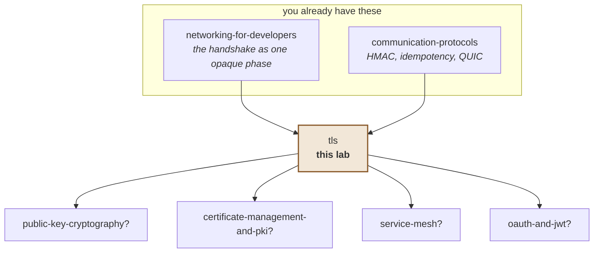

# TLS

**Two strangers who have never met agree on a secret, over a wire everyone can
read — and, harder, one of them proves who they are.**

> Lab contents: this README, `visualization.html` (a handshake stepper, also at
> [claude.ai/code/artifact/c9e77989](https://claude.ai/code/artifact/c9e77989-533d-463a-8f3e-3e7643cbc40f)),
> `certs.sh` + `TlsLab.java` + `TlsServer.java` (six runnable experiments),
> `BrokenTrust.java` (a planted bug), `EXERCISES.md`, `SOLUTIONS.md`.
>
> **Nothing in this lab is simulated.** These are real handshakes between the
> JDK's TLS client and the JDK's TLS server, using certificates `keytool`
> actually issued. Every rejection below was produced by the same code path that
> protects your production traffic. Timings vary between runs; treat quoted
> milliseconds as one representative run.

### Where this sits relative to what you already know

In the [networking-for-developers](../networking-for-developers/README.md) lab
you measured the TLS handshake as **one opaque phase** — 46 ms to
cloudflare.com on top of a 13 ms TCP connect — and you learned to recognise
`SSLHandshakeException` as *"the connection succeeded, so this is not a
connectivity problem."*

This lab opens that box. It assumes you already have: TCP handshakes, round
trips, connection reuse, and the diagnostic habit of reading a failure by its
symptom. It does not reteach them.

---

## Depth map

| Layer | Stages | You will be able to |
|---|---|---|
| **BEGINNER** | 1–9 | Say why encryption alone is worthless, and what a certificate is for |
| **INTERMEDIATE** | 10 | Walk a real handshake message by message, and say when each guarantee arrives |
| **ENGINEERING** | 11–14 | Diagnose eight failures, and state what TLS does and does not protect |
| **PRODUCTION** | 15 | Reason about mTLS, rotation, pinning, and what to monitor |

---

# BEGINNER MODEL

## 1. WHY — the problem this solves

Everything you send across a network passes through machines you do not own:
your router, your ISP, a dozen routers in between, whoever runs the coffee shop
wifi. By default every one of them can read it, and — this is the part people
forget — **change** it.

Without a fix, passwords, card numbers and API tokens travel in plain text, and
worse, anyone in the middle can quietly pretend to be the server you meant to
reach. The cost of getting this wrong is not "slightly less privacy". It is
handing your credentials to someone else while your code reports complete
success.

## 2. PROBLEM — Nikhil and the sealed envelope

Nikhil needs to send his bank a signed instruction. He has never met anyone at
the bank, and every courier between them is a stranger.

His first worry is obvious: **any courier could open the envelope and read it.**

His second worry is worse and less obvious. Suppose a courier does not deliver
the letter to the bank at all. Instead, the courier writes back on bank
letterhead, in a convincing hand, asking Nikhil to confirm his account number.
Nikhil replies. The courier now has everything.

Notice that a *stronger envelope* does nothing about the second problem. Nikhil
could seal his letter in a steel box, and he would still be sealing it to the
wrong person. Privacy and knowing-who-you-are-talking-to are two different
problems, and solving one does not touch the other.

And there is a third problem hiding underneath. To use any kind of secret code
with the bank, the two of them need to agree on the code first — but every
message they could use to agree on it travels through the same untrusted
couriers.

## 3. NAIVE SOLUTION — agree on a password beforehand

The obvious answer: Nikhil and the bank agree on a shared password in advance,
and scramble every letter with it. A courier sees gibberish. Problem solved.

This is genuinely how secret communication worked for most of history, and for
two parties who *can* meet in advance it is fine.

## 4. FAILURE — you cannot meet a website in advance

Two things break, and the second one breaks harder.

**You cannot agree on the password.** You have never met your bank's server. To
agree on a shared secret you must send *something*, and everything you send is
readable by the couriers. Whatever you use to establish the password, the
eavesdropper sees it too and can derive the same password.

**And it does not scale even if you could.** A bank with ten million customers
needs ten million pre-agreed passwords, distributed somehow, kept secret
forever. The web has billions of visitor–site pairs. There is no meeting.

> **🔮 Predict:** Suppose we somehow solved the first problem — the two sides can
> establish a shared secret key over a public wire, with no prior meeting. Are we
> done? Is the conversation now safe?
>
> <details><summary>Reveal</summary>
>
> **No, and this is the single most important idea in the lab.**
>
> You have established a secret key *with whoever answered*. Nothing in that
> process said who that was. If a courier intercepted your very first message and
> answered it themselves, you have now established a perfectly secure, unbreakable
> channel — **to the attacker**.
>
> Encryption without identity is a locked door on a building you cannot identify.
> You have privacy from everyone except the one person who matters.
>
> Experiment 3 in this lab does exactly this: it connects to an impostor with
> full TLS 1.3 encryption, `TLS_AES_256_GCM_SHA384`, and hands over a password.
> The connection is flawless. It is also completely compromised, and nothing in
> the protocol complains.
> </details>

## 5. THE REAL REQUIREMENT

Three things, and they are separate:

1. **Privacy** — nobody in the middle can read what we send.
2. **Integrity** — nobody in the middle can change it without us noticing.
3. **Identity** — I can prove the other end is who I meant to reach, *before* I
   send anything.

The first two turn out to be the easy ones. The third is the whole subject.

## 6. KEY IDEA

> Two ideas, and the second is the one people underestimate.
>
> **First:** two strangers *can* agree on a shared secret over a public wire, by
> each sending a public value that combines into the same secret while the
> eavesdropper's copy does not.
>
> **Second:** identity is solved by **delegating trust in advance.** You cannot
> know every server. But you can decide, ahead of time, to believe a small number
> of authorities — and they can vouch, in writing you can verify, for any number
> of servers you have never seen.

## 7. TERMINOLOGY

### Symmetric and asymmetric keys

- **Plain meaning:** one key that both locks and unlocks, versus a pair where one
  locks and only the other unlocks.
- **Technical meaning:** symmetric encryption (AES) uses the same key both ways
  and is fast. Asymmetric cryptography uses a mathematically linked *public* key
  and *private* key, and is slow.
- **Why the distinction exists:** because TLS uses both, for different jobs.
  The slow asymmetric maths runs once, during the handshake, to establish trust
  and agree a key. The fast symmetric encryption then protects the actual data.
- **Concrete, measured in experiment 1:** the agreed cipher was
  `TLS_AES_256_GCM_SHA384` — AES-256 is the symmetric part doing the real work.

### Key exchange

- **Plain meaning:** how two strangers end up holding the same secret without
  ever sending it.
- **Technical meaning:** each side generates a keypair, sends only the public
  half, and combines its own private half with the other's public half. Both
  arrive at the same value; an observer holding both public halves cannot.
- **Why the term exists:** to name the step that solves stage 4's first failure,
  and to separate it from *authentication*, which it does not do.
- **Concrete:** the certificates in this lab use `secp256r1`, an elliptic curve.

### Certificate

- **Plain meaning:** a document saying "this name belongs to the holder of this
  public key", signed by someone else.
- **Technical meaning:** an X.509 structure binding a public key to one or more
  names, with a validity period, signed by an issuer.
- **Why the term exists:** to make identity *transferable*. Because it is signed,
  a certificate can be handed to strangers and still be checked.
- **Concrete, from `pki/good.p12`:** subject `CN=localhost`, names
  `DNS:localhost, IP:127.0.0.1`, valid 2026-08-28 to 2027-08-28, issued by
  `CN=TLS Lab Root CA`.

### Certificate authority, and the chain of trust

- **Plain meaning:** the small set of organisations you decided in advance to
  believe, and the paperwork linking a server back to one of them.
- **Technical meaning:** a CA holds a private key and signs certificates. A chain
  runs from the server's certificate up through any intermediates to a **root**
  that is already in your trust store — the next entry defines that.
- **Why it exists:** so you need to trust a handful of authorities rather than
  millions of servers. This is the delegation from stage 6.
- **Concrete, from experiment 1:** `[0] CN=localhost` issued by
  `[1] CN=TLS Lab Root CA`, which is self-signed and in our trust store.

### Trust store

- **Plain meaning:** the list of authorities you are willing to believe.
- **Technical meaning:** a set of root certificates. Your OS and your JDK each
  ship one containing ~150 commercial CAs; `cacerts` is the JDK's.
- **Why it matters more than any other configuration in TLS:** it is the *only*
  thing deciding whose word you accept. Everything about identity reduces to
  this list. Experiment 3 changes nothing except this list, and turns a rejected
  impostor into a successful one.

### The handshake

- **Plain meaning:** the opening conversation that sets everything up.
- **Technical meaning:** the negotiation of version and cipher, the key exchange,
  the presentation and verification of certificates, and a check that nobody
  tampered with the negotiation itself.
- **Concrete cost, measured in the previous lab:** 46 ms to cloudflare.com on top
  of a 13 ms TCP connect — roughly one extra round trip plus certificate work.

### Hostname verification

- **Plain meaning:** checking that the certificate is for the site you asked for,
  not just that it is genuine.
- **Technical meaning:** matching the name you connected to against the
  certificate's Subject Alternative Name list.
- **Why it is a separate check, and separately forgettable:** a valid signature
  proves the certificate is genuine. It does not prove it is genuine *for this
  site*. Without this check, any certificate a trusted CA ever issued would work
  for every site — so someone who legitimately owns `other.example` could
  impersonate your bank.
- **Concrete, verified by running it:** the same `wronghost` certificate is
  **rejected** when you ask for `localhost` (`No subject alternative DNS name
  matching localhost found`) and **accepted** when you ask for `other.example`.
  Nothing about the certificate changed — only the name you requested.
- **In Java this is opt-in on a raw socket**, which is why it is the second most
  common way to disable TLS security by accident. See failure 6.

### Forward secrecy

- **Plain meaning:** if the server's long-term key is stolen tomorrow, today's
  recorded traffic still cannot be read.
- **Technical meaning:** the session key comes from an *ephemeral* key exchange
  discarded after the connection, so the certificate's private key never encrypts
  data — it only signs.
- **Why the term exists:** because an attacker who records everything now and
  steals a key later would otherwise decrypt years of history retroactively.
- **Concrete:** TLS 1.3 makes this mandatory — every suite is ephemeral. In TLS
  1.2 it was optional, which is why you see `ECDHE` in the good 1.2 suite names.

## 8. TWO MENTAL MODELS

### The simple model — the notarised letter

You do not know the bank. But you know a notary whose seal you can recognise, and
whose seal is hard to forge. The bank shows you a letter of introduction bearing
that notary's seal, naming the bank. You check the seal, check that the letter
names the bank you actually wrote to, and check the date on it. Then you talk.

### The engineering model

A negotiation that produces a symmetric session key via ephemeral key exchange,
followed by the server proving control of a private key whose public half appears
in a certificate that chains to a root in your trust store — with the name you
requested checked against that certificate's SAN list, and the whole transcript
signed so the negotiation itself cannot be tampered with.

### Mapping

| Notarised letter | TLS | Fails as |
|---|---|---|
| The notary | Certificate authority | — |
| Recognising the notary's seal | Chain builds to a root in your trust store | `SunCertPathBuilderException` |
| The letter of introduction | The server's certificate | — |
| It names the bank you wrote to | Hostname verification against SAN | `No subject alternative DNS name matching …` |
| The date on it | Validity period | `CertificateExpiredException` |
| Bank signs something in front of you | CertificateVerify | proves it holds the private key |
| Your list of recognised notaries | Trust store | the only thing that decides identity |
| Sealing the envelope | Symmetric encryption of application data | — |

### Where the analogy breaks

**A seal proves the letter's origin; a certificate proves nothing on its own.**
Anyone can copy a certificate — they are public, and your browser shows you every
one. What cannot be copied is the *private key*. That is why the handshake makes
the server sign something fresh: possession, not paperwork, is the proof. A
notary analogy quietly skips this and it is the step that stops replay.

**A notary can be phoned; a CA cannot.** Verification is entirely offline — you
check a signature with a key you already have. Nothing contacts the CA. This is
why a *revoked* certificate is so much harder to deal with than an expired one
(failure 7): expiry is self-announcing, revocation needs someone to be asked.

**There is no honest analogy for "you chose the notaries in advance, and someone
else may have added to that list."** Your trust store was populated by your OS
vendor, your JDK, and possibly your employer's laptop management. Anyone who can
add an entry can impersonate anything, undetectably. That is experiment 3, and it
has no equivalent in the letter story — which is exactly why the analogy must be
retired before stage 10.

## 9. VISUALIZATION — watch the two guarantees arrive separately

Open **[The Padlock And The Seal](https://claude.ai/code/artifact/c9e77989-533d-463a-8f3e-3e7643cbc40f)**
(or `visualization.html`, which works offline).

What to do, in order:

1. **Press "Play it through" with everything at its defaults.** Watch only the
   two lamps at the top. They do **not** light together — encryption arrives at
   step 2, identity at step 5. The gap between them is the whole lesson from
   stage 4's prediction.
2. **Switch the server to "an impostor with its own certificate authority"** and
   play again. Encryption still arrives. Identity turns red, and the connection
   dies before any data moves.
3. **Now tick "Interceptor Root CA" in the trust list.** Same impostor, same code,
   same everything — and it succeeds. You have just performed experiment 3.
4. **Set the server to "a certificate for another name", then change the hostname
   control to `other.example`.** A rejection becomes an acceptance with nothing
   about the certificate changed. That is hostname verification, isolated.
5. **Set "Check the certificate at all?" to "trust everything"** with the
   impostor selected. Watch the identity lamp stay grey while the verdict claims
   success. That is `BrokenTrust.java`.

Three scenarios pause and ask you to predict first.

---

> ### ✅ Checkpoint — end of the beginner model
>
> You can explain why encryption alone is nearly worthless, what a certificate
> is, and why your trust store is the most security-critical configuration in
> your system.
>
> Next: the handshake message by message, and why TLS 1.3 removed a round trip.

---

# INTERMEDIATE MODEL

## 10. THE ACTUAL MECHANISM

### Mechanism v1 — the obvious design, and its fatal flaw

A first attempt, which is roughly what SSL looked like early on:

1. Client says hello.
2. Server sends its certificate, containing its public key.
3. Client invents a random session key, encrypts it with the server's public key,
   and sends it.
4. Only the server can decrypt it. Both now share a key. Encrypt everything.

This works. It authenticates the server (only the real key holder can decrypt
step 3), it establishes a shared secret, and it is simple.

> **🔮 Predict:** An attacker records this entire conversation today but cannot
> read it. Three years later, the server is decommissioned and its private key
> leaks. What can the attacker do with the recording?
>
> <details><summary>Reveal</summary>
>
> **Decrypt all of it. Every session, retroactively.**
>
> In step 3 the session key was encrypted *with the server's long-term public
> key*. Anyone holding the matching private key can decrypt that message and
> recover the session key — years later, for every conversation ever recorded.
>
> One key compromise retroactively breaks all past traffic. This is why v1 is
> gone: TLS 1.3 removed this key-exchange style entirely, and it is what **forward
> secrecy** means. The fix is that the session key must never travel, even
> encrypted — instead both sides derive it from *ephemeral* keypairs thrown away
> when the connection ends. The certificate's private key then only ever
> **signs**, never encrypts, so stealing it lets you impersonate the server in
> future but not read the past.
> </details>

### Mechanism v2 — ephemeral key exchange, and the handshake as it runs

Here is a real TLS 1.3 handshake. Read the third column — it is the one that
matters, and it is why the visualization has two lamps rather than one.

| # | Message | Private yet? | Identity known? |
|---|---|---|---|
| 1 | **ClientHello** — versions, ciphers, my key share, the name I want | no | no |
| 2 | **ServerHello** — chosen version and cipher, my key share | **yes, from here** | no |
| 3 | **Certificate** (encrypted) — my chain | yes | no |
| 4 | **CertificateVerify** — signature over the transcript | yes | no |
| 5 | *client verifies the chain* | yes | **yes, from here** |
| 6 | **Finished** both ways — nobody tampered with the negotiation | yes | yes |
| 7 | **Application data** — finally, your request | yes | yes |


Two things to take from that table.

**Steps 3 and 4 are already encrypted.** So an eavesdropper on TLS 1.3 cannot
even see which certificate the server presented. In TLS 1.2 they could — the
certificate went in the clear. That is a real privacy improvement, not just a
speed one.

**Step 4 is what makes step 3 mean anything.** A certificate is public; anyone
can copy one. The signature over the transcript is what proves this server holds
the matching private key *right now*, for *this* conversation.

### Why TLS 1.3 is one round trip and 1.2 was two

The saving comes from guessing. In TLS 1.2 the client had to learn which key
exchange the server chose before it could send its key material — that is a full
extra round trip. TLS 1.3 has the client **send a key share in its very first
message**, guessing the server will accept it. It nearly always does.

At the 16 ms round trip measured in the networking lab, that guess saves 16 ms on
every new connection. At 250 ms, it saves 250 ms.

**0-RTT** goes further: on a repeat visit, the client sends application data
*with* its first message, using a key from the previous session. That costs
nothing in round trips and buys a real problem — see failure 8.

> **🔮 Predict:** Every message from step 3 onwards is encrypted, including the
> certificate. So a network observer sees nothing but noise after step 2. What can
> they still learn about your traffic?
>
> <details><summary>Reveal</summary>
>
> **Who you are talking to — because you told them in step 1.**
>
> The ClientHello carries the hostname in plain text, in a field called SNI. It
> has to: one IP address may serve thousands of sites, so the server must know
> which certificate to present *before* it can encrypt anything.
>
> Measured in experiment 4: pointing a TLS client at a plain listener and reading
> its first 456 bytes, the hostname `payments.internal.example` appears in
> readable ASCII at **byte offset 153**.
>
> They also see the IP address, the timing, and the size of everything. TLS hides
> the *contents* of your conversation. It does not hide that the conversation
> happened, who it was with, when, or how big it was.
> </details>

---

> ### ✅ Checkpoint — end of the intermediate model
>
> You can walk a handshake message by message and say exactly when privacy and
> identity each begin, and why 1.3 is a round trip cheaper than 1.2.
>
> Next: the eight ways this fails, and what TLS does and does not guarantee.

---

# ENGINEERING MODEL

## 11. FAILURE SCENARIOS

Eight failures. All the certificate ones surface as `SSLHandshakeException`, so
the **cause chain** is what tells them apart — and each has a different owner.

### 1 — Untrusted issuer

*Reproduce:* `java TlsLab.java 2`, case 2 (a self-signed server).
*Your code sees:* `SunCertPathBuilderException: unable to find valid
certification path to requested target`.
*Why:* nothing in your trust store signed this certificate.
*Owner:* usually **you** — a private CA that was never added to the trust store,
or a server that skipped its intermediate certificate.
*Guarantee kept:* everything. The client refused correctly.
*The tell:* the words "certification path".
*In production:* the most common cause is a missing *intermediate*, not a missing
root — the server was misconfigured to send only its leaf.

### 2 — Hostname mismatch

*Reproduce:* `java TlsLab.java 2`, case 3.
*Your code sees:* `No subject alternative DNS name matching localhost found.`
*Why:* the certificate is genuine, correctly signed and in date — for a different
name.
*Owner:* whoever chose the URL, or whoever requested the certificate's SAN list.
*Verified:* the identical certificate is **accepted** when you ask for
`other.example` — I ran both.
*The tell:* the words "no name matching" or "subject alternative".

### 3 — Expired

*Reproduce:* `java TlsLab.java 2`, case 4.
*Your code sees:* `CertificateExpiredException: NotAfter: Fri Jul 24 …`
*Why:* a date passed. Nothing about trust or identity is wrong.
*Owner:* the server team's renewal process.
*In production:* this is the single most common TLS outage, and it is entirely
self-inflicted. It is also why ACME/Let's Encrypt automation exists.
*Watch out:* an expired certificate **also** fails path building and **also**
mentions PKIX. A diagnostic that tests for PKIX first will misreport it as an
untrusted issuer and send you to the wrong team — I made exactly that mistake
while building `TlsLab.verify()`, and the fix is a comment in the code.

### 4 — Clock skew

*Reproduce:* set your machine's clock forward two years.
*Your code sees:* `CertificateExpiredException`, or
`CertificateNotYetValidException` if the clock is behind.
*Why:* validity is checked against *your* clock. A wrong clock invalidates
perfectly good certificates.
*The tell:* it fails on **every** TLS connection, to every host, all at once.
*In production:* classic on devices with dead batteries, fresh containers with no
NTP, and CI runners.

### 5 — The trust store is not what you think it is

*Reproduce:* `java TlsLab.java 3` — the impostor experiment.
*What happens:* with the interceptor's CA trusted, an impostor gets a perfect
TLS 1.3 connection and reads the password. **No error, no warning, no clue** —
except the issuer name, which nothing checks.
*Why:* trust is a list, and anyone who can write to that list can impersonate
anything.
*Guarantee lost:* identity, completely and silently. Privacy is *maintained* —
which is what makes it so hard to notice.
*In production:* this is exactly how corporate TLS inspection works, and it is
also what a compromised CA gets you. The 2011 DigiNotar breach is the canonical
case.

### 6 — Hostname verification silently switched off

*Reproduce:* delete `p.setEndpointIdentificationAlgorithm("HTTPS")` from
`TlsLab.connect()`.
*What happens:* the `wronghost` certificate is **accepted**. The chain still
verifies; only the name check is gone.
*Why:* on a raw `SSLSocket` in Java, hostname verification is **opt-in**.
`HttpsURLConnection` and `HttpClient` do it for you; a hand-rolled socket does
not.
*Guarantee lost:* any certificate your trusted CAs ever issued now works for any
host.
*The tell:* nothing. It fails open — the most dangerous kind of default.

### 7 — Revoked, but still accepted

*Reproduce:* not reproducible in this lab — **flagged as unrun**.
*What happens:* a certificate whose private key was stolen is revoked by its CA,
but clients keep accepting it, because verification is offline (stage 8) and
revocation checking is frequently disabled, soft-failing, or unreachable.
*Why:* CRLs are large and OCSP adds a network call to every handshake — one that
must not become an availability dependency, so it usually soft-fails.
*Response in production:* short-lived certificates (90 days, or hours in a mesh)
rather than reliable revocation. **Expiry is the revocation mechanism that
actually works.**

### 8 — 0-RTT replay

*Reproduce:* not reproducible here — **flagged as unrun**.
*What happens:* TLS 1.3's 0-RTT lets a client send data with its first message.
An attacker who captures that data can **send it again**, and the server cannot
tell the difference.
*Why:* the anti-replay protection of the full handshake has not happened yet.
*Response:* only ever send *idempotent* requests in 0-RTT. This is the same rule
your [communication-protocols](../communication-protocols/README.md) lab
established for retries, arriving from a completely different direction.

## 12. CORRECTNESS — what TLS actually guarantees

**Guaranteed, once the handshake completes successfully:**

- **Privacy** — nobody on the path can read the application data.
- **Integrity** — nobody can modify it undetected; tampering breaks the
  authentication tag and the connection fails.
- **Server identity** — the server holds the private key for a certificate that
  chains to a root you trust, and that certificate covers the name you asked for.
- **Handshake integrity** — the negotiation itself was not tampered with, so an
  attacker cannot force both sides down to a weak cipher.
- **Forward secrecy** (TLS 1.3, always) — stealing the server's key tomorrow does
  not decrypt traffic recorded today.

**Not guaranteed, and each of these has burned somebody:**

- **That the server is trustworthy.** TLS proves identity, not virtue. A phishing
  site with a valid certificate for `paypa1.com` is cryptographically perfect.
- **That your trust store is honest** (failure 5).
- **Client identity** — unless you use mTLS. The web's default is one-directional.
- **Who you talked to, from an observer's view** — SNI is in the clear
  (experiment 4), as are IP addresses, timing and message sizes.
- **Anything before or after the connection.** TLS protects bytes in flight. It
  says nothing about data at rest, or about what the server does with it.
- **That the certificate has not been revoked** (failure 7).
- **Protection from a compromised endpoint.** If either end is owned, TLS
  faithfully encrypts the attacker's traffic.

**What was traded away.** Latency (an extra round trip on every new connection —
which is why the connection reuse from the networking lab matters so much more
with TLS than without), CPU on the handshake, and an entire operational burden:
certificates that must be issued, deployed, rotated before expiry, and revoked.
Failure 3 is the price of the whole scheme, paid monthly, forever.

## 13. CODE

```bash
cd ~/Documents/Learning/tls
./certs.sh                # once — builds pki/ with keytool
java TlsLab.java          # all six experiments
java TlsLab.java 3        # just the impostor one
java BrokenTrust.java     # the planted bug
```

JDK 25, no build tool, no dependencies. `certs.sh` uses `keytool` — the JDK's own
tool, and the same one you would use to configure `server.ssl.key-store` in a
Spring Boot app.

| File | What it is |
|---|---|
| `certs.sh` | A private CA and five server identities: valid, wrong-name, expired, self-signed, impostor |
| `TlsServer.java` | A real TLS server; which identity it presents is just which keystore you hand it |
| `TlsLab.java` | The six experiments |
| `BrokenTrust.java` | One bug — exercise 6 |

**The load-bearing line in the whole lab** is in `TlsLab.connect()`:

```java
// THE INVARIANT: without this, the certificate is checked for a valid
// signature but never checked against the name you meant to reach — so
// any certificate our CA ever signed would be accepted for any host.
p.setEndpointIdentificationAlgorithm("HTTPS");
```

One line. Delete it and every experiment still passes except the one that
matters. That is failure 6.

**And the one that makes experiment 3 possible** is a single argument:

```java
SSLContext lax = TlsServer.context(null, "pki/truststore-with-mitm.p12");
```

Same client code, same protocol, same cipher. A different trust store, and an
impostor becomes acceptable.

## 14. EXPERIMENTS

Predict first, then run.

**1 · What did they agree on?** — `java TlsLab.java 1`
*Observed:* `TLSv1.3`, `TLS_AES_256_GCM_SHA384`, and a two-entry chain from
`CN=localhost` up to `CN=TLS Lab Root CA`.
*Proves:* the chain is the mechanism — the server is trusted only because
something you already trusted signed it.

**2 · Four ways to be rejected** — `java TlsLab.java 2`
*Observed:* accepted; `SunCertPathBuilderException`; `No subject alternative DNS
name matching localhost found`; `CertificateExpiredException`.
*Proves:* one exception type, three different owners. The cause chain is the
diagnosis.

**3 · Encryption is not authentication** — `java TlsLab.java 3`
*Observed:* with our CA only — rejected. With the interceptor's CA also trusted —
**connected**, `TLSv1.3`, `TLS_AES_256_GCM_SHA384`, password delivered to the
impostor.
*Proves:* the padlock means "encrypted to whoever answered". Which of the two
things you get is decided by the trust store alone.

**4 · What TLS does not hide** — `java TlsLab.java 4`
*Observed:* the hostname `payments.internal.example` in readable ASCII at byte
offset **153** of the client's first 456 bytes.
*Proves:* SNI is unencrypted, so an observer can list every service you talk to
without decrypting anything.

**5 · What the handshake costs** — `java TlsLab.java 5`
*Observed, after warming the JVM:* first handshake 5,858 µs; later handshakes on
the same context 5,897 µs; **a brand-new context every time — which can never
resume — 5,345 µs.**
*Proves:* two things, and the second is a lesson about measuring. Resumption
saves round trips, not CPU, so on loopback it shows nothing. And an unwarmed
version of this experiment reported an 8.6× speedup that was **entirely JVM
warmup** — the same trap as the networking lab's benchmark.

**6 · mTLS** — `java TlsLab.java 6`
*Observed:* without a client certificate, `Received fatal alert:
certificate_required`. With one, accepted, and the server knew the caller was
`CN=localhost,O=TLS Lab`.
*Proves:* identity can be established by the transport itself, before any
application code runs and with no shared secret to leak.

---

> ### ✅ Checkpoint — end of the engineering model
>
> You can diagnose eight failures and state precisely what TLS does and does not
> promise.
>
> Next: what changes in a real system — rotation, mesh, pinning, and what an
> on-call engineer actually sees.

---

# PRODUCTION MODEL

## 15. FROM THIS LAB TO A REAL SYSTEM

### The chain

**This lab** runs a JDK TLS client and server on loopback with a private CA.

**A real deployment** replaces the private CA with a public one (via ACME) or an
internal PKI, and usually terminates TLS somewhere other than your application —
a load balancer, an ingress controller, or a service-mesh sidecar. **That
termination point is where the guarantees actually end**, and traffic behind it
may well be plaintext.

**Production** is mostly certificate *lifecycle*: issuing, deploying, rotating
before expiry, and revoking. Failure 3 is not an edge case, it is the recurring
cost of the whole scheme.

### What this lab leaves out

| Omitted | What real systems do |
|---|---|
| Automated issuance | ACME / Let's Encrypt, cert-manager, internal CAs |
| Intermediate certificates | Real chains have intermediates; forgetting to serve them is failure 1's top cause |
| Revocation | OCSP stapling, CRLs — and mostly short lifetimes instead |
| Certificate pinning | Pin to a key, not a certificate, and always keep a backup pin |
| TLS termination topology | Edge, sidecar, or end-to-end — each with a different threat model |
| Session tickets and 0-RTT | Real resumption, with the replay caveat of failure 8 |
| Certificate Transparency | Public logs that make mis-issued certificates detectable |
| Post-quantum key exchange | Hybrid schemes now shipping in browsers and some CDNs |

### mTLS and the service mesh

Experiment 6 is the whole idea behind "mTLS everywhere": each service gets a
short-lived certificate, and every connection authenticates both ends at the
transport. The identity arrives **before any application code runs** and there is
no shared secret to leak.

The cost is a certificate lifecycle for every workload — which is why this is
almost always a sidecar's job rather than your code's.

### What an on-call engineer sees

| Symptom | Most likely | First check |
|---|---|---|
| `unable to find valid certification path` | Missing intermediate, or a private CA not in the trust store | `openssl s_client -connect host:443 -showcerts` |
| `No name matching` / `No subject alternative` | Wrong URL, or a SAN list that missed this name | Compare the URL against the cert's SANs |
| `CertificateExpiredException` on one host | Renewal did not happen | Check the expiry date and the renewal job |
| The same, on **every** host at once | Your clock, not their certificates | `date -u`, check NTP |
| Worked yesterday, fails in a new container | Trust store missing from the image | Compare `cacerts` between images |
| Works in `curl`, fails in Java | Different trust stores — Java has its own | Compare against the JDK's `cacerts` |
| Everything works but security is unhappy | Possibly failure 5 or 6 | Grep for empty `checkServerTrusted` |

### What to monitor

- **Days until expiry**, for every certificate you serve *and* every one you
  depend on. Alert at 30 days, page at 7. This one metric prevents the most
  common TLS outage there is.
- **Handshake failure rate, bucketed by cause.** Lumping them into "TLS error"
  destroys exactly the distinction stage 11 is about.
- **Handshake latency and the full-versus-resumed ratio.** A collapse in
  resumption means connection reuse broke — which is the previous lab's failure 6.
- **Protocol and cipher distribution.** Clients still negotiating TLS 1.0/1.1 are
  the ones that break when you disable them.

### Honest limits of this lab

The certificates, the four checks, the exception text and all six experiments are
real and were executed. **Failures 7 and 8 (revocation and 0-RTT replay) are
described but not reproduced** — both need infrastructure this lab does not have.
The visualization's message sequence is faithful in ordering and in when each
guarantee arrives, but simplified: key schedule, extensions and the alert protocol
are omitted. And every measurement is from one machine on one JDK — the ratios
transfer, the microseconds do not.

---

## 16. EXERCISES

`EXERCISES.md`, eight rungs. Answers in `SOLUTIONS.md`.

---

## 17. KNOWLEDGE MAP & NEXT STEPS



**Builds on.**

- **networking-for-developers** — that lab measured the TLS phase and taught you
  to read `SSLHandshakeException` as "not a connectivity problem". This one says
  *which* problem. Its connection-reuse lesson also lands harder here: reuse now
  saves a handshake with real cryptography in it.
- **communication-protocols** — you met HMAC signatures for webhooks; a
  certificate signature is the same idea with an asymmetric key and a third party
  vouching. Its idempotency rule reappears, unexpectedly, as the constraint on
  0-RTT.

**Commonly confused.**

- **Encryption vs authentication.** The entire lab. Encryption hides content;
  authentication establishes who you are hiding it from.
- **TLS vs HTTPS.** HTTPS is HTTP carried over TLS. TLS also carries SMTP, gRPC
  and anything else.
- **TLS vs SSL.** SSL is the dead predecessor. Every version is broken and
  disabled; the word survives only in names like `SSLContext`.
- **Certificate vs private key.** The certificate is public and safe to hand out.
  The private key is the secret, and it never travels.
- **Expired vs revoked.** Expiry is a date passing, self-announcing and reliably
  enforced. Revocation needs someone to be told, and often nobody is.
- **Encoding vs encryption.** Base64 is not encryption. It is worth stating
  because it is a real and recurring confusion.

**Suggested next.**

```
/learn certificate-management-and-pki
/learn oauth-and-jwt
/learn service-mesh
```

The first is the operational half this lab deliberately compresses — issuance,
rotation, revocation, and the outage in failure 3. The second is the layer above:
once TLS proves *machine* identity, OAuth and JWT are how you carry *user*
identity on top. The third makes experiment 6 the default for everything.

---

## 18. GLOSSARY

| Term | In one line |
|---|---|
| **Symmetric key** | One key that both encrypts and decrypts; fast, used for the data |
| **Asymmetric keypair** | A public and a private key, mathematically linked; slow, used in the handshake |
| **Key exchange** | How two strangers derive the same secret without sending it |
| **Ephemeral** | A keypair thrown away after the connection — the basis of forward secrecy |
| **Certificate** | A signed statement binding a public key to one or more names |
| **X.509 / SAN** | The certificate format, and the list of names it is valid for |
| **Certificate authority (CA)** | An organisation whose signature you have decided to believe |
| **Chain of trust** | Server certificate → intermediates → a root already in your trust store |
| **Trust store** | Your list of trusted roots; the only thing deciding identity |
| **Handshake** | The opening negotiation: version, cipher, keys, certificate, verification |
| **ClientHello / ServerHello** | The first two messages; both travel in the clear |
| **CertificateVerify** | The server signing the transcript to prove it holds the private key |
| **Cipher suite** | The agreed set of algorithms, e.g. `TLS_AES_256_GCM_SHA384` |
| **Hostname verification** | Checking the certificate covers the name you asked for; opt-in on raw Java sockets |
| **SNI** | The requested hostname, sent unencrypted so the server knows which certificate to serve |
| **Forward secrecy** | A stolen server key cannot decrypt previously recorded traffic |
| **Session resumption** | Reusing a prior session's secret to shorten a later handshake |
| **0-RTT** | Sending data with the first message; fast, and replayable — idempotent only |
| **mTLS** | Both ends present certificates; the transport authenticates the caller |
| **Revocation (CRL / OCSP)** | Declaring a certificate invalid before it expires; unreliable in practice |
| **Certificate pinning** | Accepting only a specific key, ignoring the trust store |
