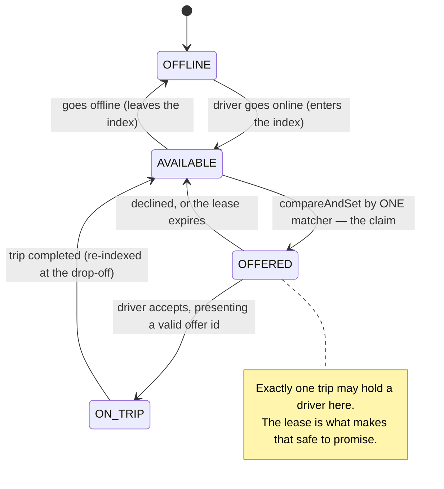
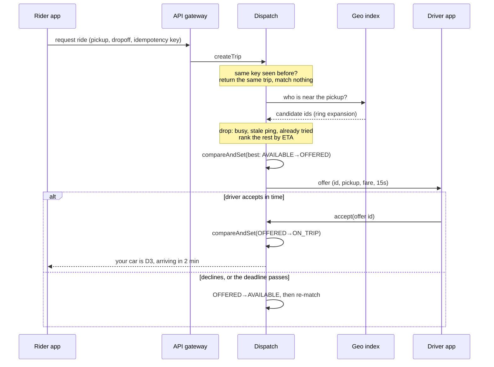
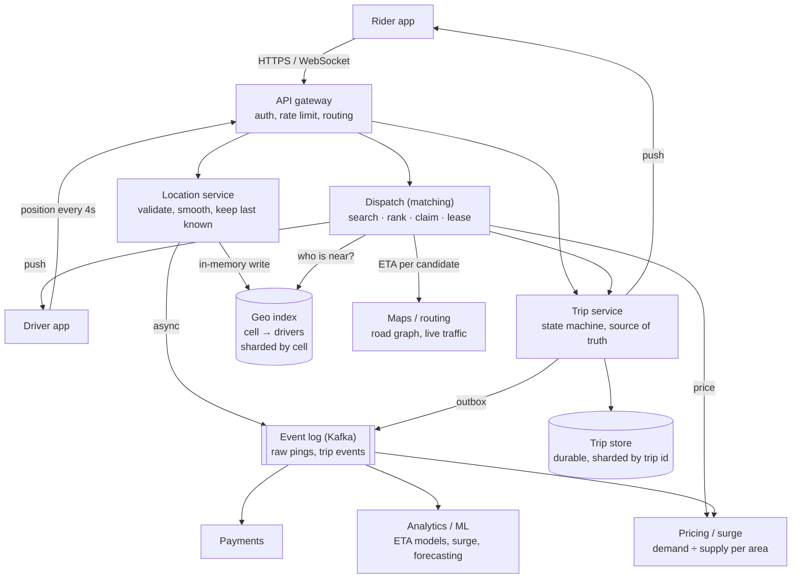
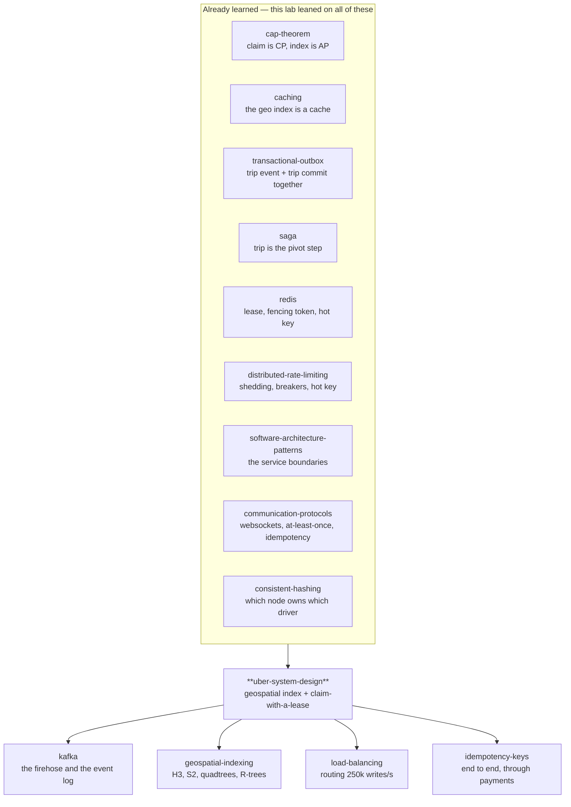

# High-level system design of Uber

> A lab about the one problem a ride-hailing company actually has: **matching a
> moving supply to a moving demand, in a few hundred milliseconds, without ever
> promising the same car to two people.**
>
> Everything else — payments, ratings, maps, receipts — is ordinary backend work
> you already know how to do. This lab spends its depth where the difficulty is.

**Run it:**

```bash
java src/Sim.java           # one narrated evening in Bengaluru
java src/Experiments.java   # six ways to break it, measured
java src/Tests.java         # 14 guarantees, asserted
```

**Play with it:** [`visualization.html`](visualization.html) — the Dispatch Console
(also published at <https://claude.ai/code/artifact/7c601922-ea5c-4d46-946a-79bf6a489ff0>).
Every rule the matcher follows is a switch you can flip, and each switch breaks
something specific.

**Depth layers in this document:**

| Layer | Stages | You will be able to |
|---|---|---|
| **Beginner model** | 1–9 | Explain in plain words why dispatch is hard and what the two core ideas are |
| **Intermediate model** | 10 | Walk the matching mechanism step by step, and say why each odd detail exists |
| **Engineering model** | 11–15 | Draw the whole system, reason about its failures, and defend its invariants |
| **Production model** | 16 | Say what the real thing does differently, and what you would put on a dashboard |

---

## 1. WHY — the problem, before any technology

You are standing outside a metro station at 9 p.m. Somewhere within two
kilometres of you there is a car with nobody in it, whose driver would very much
like to earn the fare. Neither of you can find the other.

That is the entire business. Not the app, not the map, not the payment — the
**finding**. Before this was solved, you phoned a taxi company, a person with a
paper map guessed who was closest, radioed them, and you waited twenty minutes
to discover the answer was wrong. Meanwhile drivers spent something like a third
to a half of their working hours driving around empty, looking for you.

If nobody solves this, three things go wrong at once and they are all the same
thing: riders wait too long, drivers earn too little per hour on the road, and
the number of cars a city needs to move the same number of people goes up.

---

## 2. THE PROBLEM — Radio Rani's evening

Meet **Rani**. She works at a taxi office with a paper map of the city on the
wall and a box of coloured pins. Every driver radios in when they move, and Rani
moves their pin. When the phone rings, she looks at the map, finds the pin
nearest the caller, and radios that driver.

With five cars this works beautifully. Rani is faster and kinder than any app.

Then the company grows to five hundred cars, and Rani's evening comes apart in
four separate ways:

1. **She cannot look at five hundred pins.** Finding the nearest pin to a caller
   means her eyes crossing the whole map, every call, while pins are moving.
2. **Two callers ring at once.** Rani, halfway through promising car 47 to the
   first caller, promises car 47 to the second as well. Both are told a car is
   coming. One of them is wrong, and neither of them knows which.
3. **A pin lies.** Driver 12 went home an hour ago without radioing. His pin is
   still on the map, still the nearest pin to somebody, still being sent to
   people who then wait for a car that does not exist.
4. **Car 47 never answers the radio.** Rani has mentally set it aside for the
   first caller, so nobody else can have it — and it stays set aside until Rani
   remembers, which she does not, because the phone is ringing.

Hold on to all four. Every serious idea in this lab is one of these four
problems, solved once, at a scale where you cannot solve it by paying attention.

**🔮 Predict:** *Rani buys a computer and types every driver's position into a
table. Which of the four problems does that fix?*

<details><summary>Reveal</summary>

**Problem 1 only, and only for a while.** A computer can scan five hundred rows
faster than Rani's eyes can cross a map. It fixes nothing else: it still has to
be told what to do when two callers arrive at the same instant (2), it still has
no idea that driver 12's row is a lie (3), and it will happily leave car 47 set
aside forever (4).

That is the shape of this whole subject. The scan is the problem people expect.
The other three are the problems that actually bite, and they get worse — not
better — when the system gets faster and more concurrent.
</details>

---

## 3. THE NAIVE SOLUTION — computerise Rani, exactly

Here is what any competent engineer writes first, and it is the right first
thing to write:

```
one table:  driver_id | latitude | longitude | is_free

when a ride is requested:
    best = null
    for every row in the table:                 # look at all of them
        if row.is_free and distance(row, rider) < distance(best, rider):
            best = row
    mark best.is_free = false                   # take it
    tell the rider about best
```

It is correct on a whiteboard. Every rider gets the nearest free car. It is
about fifteen lines. Ship it.

---

## 4. THE FAILURE — three cracks, measured

### Crack one: the loop

`java src/Experiments.java 1` builds a city with **100,000 drivers** and asks it
1,000 ride-request questions:

```
                        total     per request    drivers measured
  full scan        :   3370 ms       3.37 ms           100,000
```

(That command prints two more rows — the two fixes. They use ideas that have not
been introduced yet, so they are held back until §10. Timings vary by machine;
the ratios are the lesson.)

3.37 ms of pure computation per request, in one process, with the data already
in memory and no network anywhere. That is the *floor*, and a real request needs
to fetch those rows first.

But the read side is not even the expensive half. **The writes are.** A driver's
app reports its position every four seconds. A city with 1,000,000 drivers
online at peak is **250,000 position updates per second**, forever, whether or
not anybody is requesting a ride. Every one of them makes some row in that table
stale the moment it lands.

### Crack two: the pin lies

`java src/Experiments.java 4` takes 300 drivers, lets 100 of them go dark for two
minutes, then sends 200 ride requests:

```
  NO freshness rule:           offers sent to a dark driver : 65
  30 s freshness rule:         offers sent to a dark driver : 0   (3 requests found nobody)
```

Sixty-five riders out of two hundred were sent a car that is not where the
system says it is. Notice the shape of this failure: **no error is raised
anywhere**. The rider watches a stationary car icon, waits out the timeout,
cancels, and re-requests. It arrives on your dashboards as wait time and
cancellations, which look like a demand problem, not as an error rate.

### Crack three: "find the nearest, then take it"

`java src/Experiments.java 3` puts 200 riders on one corner, racing 8 threads for
200 cars — a taxi rank, a stadium gate, an airport queue:

```
  READ-THEN-WRITE:   riders told "your car is on the way" : 200
                     cars actually reserved               : 102
                     riders promised a car someone else has:  98

  COMPARE-AND-SET:   riders told "your car is on the way" : 200
                     cars actually reserved               : 200
                     riders promised a car someone else has:   0
```

**Roughly half of the riders were promised a car that belonged to somebody
else** — 98 in the run above, 100 in the next run; the exact count depends on
thread scheduling, and it is never small. Look at the naive code again — the bug is not in it. It checks
`is_free`, then it writes. The two lines are simply not one action, and another
request fits perfectly in the gap between them. A thread switch, a garbage
collection pause, or a network round trip to the database will all volunteer to
create that gap.

This is Rani promising car 47 twice, mechanised and running a thousand times a
second.

---

## 5. THE REAL REQUIREMENT

Strip away the technology and write down what actually has to be true:

1. **"Who is near here?" must be answerable in single-digit milliseconds**, while
   positions change hundreds of thousands of times per second.
2. **Each car is handed to at most one rider at a time** — even when two requests
   land in the same millisecond on two different machines.
3. **No car is ever stuck reserved.** Whatever step is waiting — a driver's
   thumb, a phone, a server — the reservation must release itself.
4. **A position is trusted only as long as it is fresh**, because a car that
   stopped reporting is not a car you can send.
5. **All of the above keeps holding while pieces fail**, because at this scale
   something is always failing.

Requirement 2 is the one that separates this from every "find nearby things"
tutorial you have read. Everything after this point is the pursuit of these five
sentences.

---

## 6. THE KEY IDEA

Two sentences. The rest of the lab is their consequences.

> **1. Stop searching for nearness — index by it.** Chop the map into fixed
> squares and keep a set of cars per square. "Who is near me?" stops being a scan
> over the city and becomes a lookup of a handful of keys.
>
> **2. A match is not a query result, it is a claim.** "The nearest free car" is
> a fact that stops being true the instant somebody else acts on it. So the
> match is not *computed and then applied* — it is **taken**, in one indivisible
> step that exactly one request can win, and it is taken **on a deadline** so
> nothing can hold it forever.

Idea 1 answers cracks one. Idea 2 answers crack three, and its deadline answers
Rani's problem 4. Freshness — a position as a fact with an expiry date — answers
crack two, and falls out of idea 2 once you see supply as something *leased*
rather than *stored*.

---

## 7. TERMINOLOGY — the words, now that you have felt the need for them

Ten load-bearing terms. Each one exists to make a distinction you have already
watched matter.

### supply, demand, marketplace

- **Plain meaning:** the cars, the riders, and the fact that neither is a
  database you control.
- **Technical meaning:** dispatch is a two-sided marketplace — the system does
  not own its inventory. A driver may decline, go offline, or accept a
  competitor's trip mid-thought.
- **Why the word exists:** to stop you modelling drivers as rows. A row does what
  you write to it. Supply does not.
- **Example:** the concert scene in `Sim.java` — 9 requests, 0 claimable cars.
  No amount of correct code creates a tenth car.
- **Connects to:** the `distributed-rate-limiting` lab's over-admission — both
  are about a scarce resource that several requesters reach for at once.

### geospatial index

- **Plain meaning:** a filing system where things are filed by *where they are*.
- **Technical meaning:** a data structure mapping a region of space to the set of
  entities in it, supporting O(1)-ish update and bounded-cost proximity queries.
- **Why the word exists:** an ordinary index answers "which rows have this
  value?" Nearness is not a value — two points can be close without sharing any
  column — so it needs its own structure.
- **Example:** `CellIndex` in this lab; a 500 m grid over Bengaluru.
- **Connects to:** [`btree-and-lsm`](../btree-and-lsm/) — same job (avoid the
  scan), different question (ordered ranges vs 2-D proximity).

### cell

- **Plain meaning:** one square of the map.
- **Technical meaning:** the unit of the index's key space; a driver belongs to
  exactly one cell at a time, and its id is the key under which that driver is
  filed.
- **Why the word exists:** to name the thing that turns a *continuous* question
  ("within 500 m") into a *discrete* one ("in these 9 keys"). That conversion is
  the entire trick.
- **Example:** cell `(25,155)` holds `{D1, D7, D9}`.
- **Connects to:** the hash slot in [`redis`](../redis/) Cluster and the ring
  position in [`consistent-hashing`](../consistent-hashing/) — same idea, a
  different space. A key's slot is fixed by hashing, a driver's cell is fixed by
  geography, and both exist so that a lookup is one hop. One difference matters:
  hash space is deliberately *uniform*, geography emphatically is not, which is
  why the hot cell (F4) has no equivalent of virtual nodes to save it.

### ring search (neighbour search)

- **Plain meaning:** look in your own square, then the ring of squares around it,
  then the next ring out.
- **Technical meaning:** expanding the cell query outward until either the search
  radius is covered or enough candidates are held.
- **Why the word exists:** because "look in the rider's own cell" is a bug with a
  reassuring appearance — measured below at 44.9% of requests finding nobody
  while a car sits across the line.
- **Example:** experiment 2.
- **Connects to:** nothing you have learned yet — this one is new.

### ETA (estimated time of arrival)

- **Plain meaning:** how many minutes until the car is actually here.
- **Technical meaning:** the ranking key for candidate drivers, computed from a
  road graph and live traffic — *not* from straight-line distance.
- **Why the word exists:** to separate the thing the rider experiences (time)
  from the thing the geometry gives you for free (distance). A car 200 m away
  across a river is not 200 m away.
- **Example:** in `Sim.java`, D2 is 292 m away and 122 s away; D4 is 430 m away
  and 57 s away. Rank by distance and the rider gets the car that arrives last.

### dispatch / matching

- **Plain meaning:** deciding which car goes to which rider.
- **Technical meaning:** the decision service — search, rank, offer, and the
  bookkeeping around it. Uber calls its version DISCO.
- **Why the word exists:** to separate the *decision* from the *state*. The
  index knows where cars are; dispatch decides what to do about it. Two
  different failure profiles, two different scaling stories.

### offer (a reservation with a deadline)

- **Plain meaning:** "this car is being held for you, briefly."
- **Technical meaning:** a lease over one driver, with an expiry, addressed by an
  id that later actions must present.
- **Why the word exists:** an assignment is permanent; an **offer** is not. The
  driver has not accepted yet, and might never — a state that a simple
  `is_free` boolean cannot represent, which is why Rani lost car 47.
- **Example:** `Offer[O4, trip=T1, driver=D3, expires=t+15s]`.
- **Connects to:** the **lease** and the **fencing token** from
  [`redis`](../redis/) §4 — an offer id fences a stale accept exactly the way a
  fencing token fences a stale lock holder.

### claim (compare-and-set)

- **Plain meaning:** taking something, in a way that fails loudly if somebody
  else took it first.
- **Technical meaning:** an atomic conditional state transition —
  `AVAILABLE → OFFERED`, applied only if the current state is still `AVAILABLE`,
  with the caller told whether it won.
- **Why the word exists:** to name the difference between *reading a fact* and
  *taking an action based on it*. Read-then-write has a gap; a claim has none.
- **Example:** `d.state.compareAndSet(AVAILABLE, OFFERED)` in `Dispatch.java` —
  measured above at 0 double-bookings vs 98.
- **Connects to:** [`java-memory-model`](../java-memory-model/) (the same CAS,
  one JVM) and [`redis`](../redis/)'s single-threaded `INCR` (the same
  indivisibility, bought differently). Also `two-phase-commit`: this is the
  *cheap* version of "reserve, then confirm" — one resource, so no coordinator.

### heartbeat, freshness (TTL)

- **Plain meaning:** the car keeps saying "still here"; if it stops, we stop
  believing its last position.
- **Technical meaning:** supply is modelled as a lease renewed by periodic
  location pings; a record older than the TTL is excluded from matching.
- **Why the word exists:** to replace "is this driver online?" (a question no
  distributed system can answer) with "did this driver report within the last
  30 seconds?" (a question every node can answer locally, from data it has).
- **Connects to:** the `caching` lab's TTL, and the `cap-theorem` lab's core
  point — you cannot distinguish "gone" from "slow", so you decide by clock.

### surge (dynamic pricing)

- **Plain meaning:** prices go up where too many people want cars at once.
- **Technical meaning:** a per-area multiplier derived from local demand/supply,
  applied to the fare — a **control signal** that reshapes both sides of the
  market, which happens to be delivered as a price.
- **Why the word exists:** because with a fixed price an under-supplied area has
  exactly one behaviour available to it — an unbounded queue — and a queue does
  not create cars.

---

## 8. TWO MENTAL MODELS

### The simple model: the pegboard

Rani retires and leaves behind a **pegboard**. The city map is drawn on it,
divided into 500-metre squares, and every square has a hook. Each car has a
wooden token; a car's token hangs on the hook for the square it is in. When a car
moves into a new square, its token moves hook to hook.

Now:

- **"Who is near me?"** — you look at the caller's hook, then the eight hooks
  around it, and outward until you have enough tokens. You never look at the
  whole board.
- **A match** — you physically *take the token off the hook*. You cannot take a
  token that is not there, so two clerks reaching for the same car is decided by
  whose hand arrives first, and the loser plainly sees an empty hook.
- **An offer** — the taken token goes in a small tray with a 15-second sand
  timer. When the timer runs out and nobody has confirmed, the token goes back
  on its hook. Automatically, whether or not anyone is watching.
- **A dark car** — every token must be re-stamped every 30 seconds. Unstamped
  tokens are ignored, even though they are still hanging there.

### The engineering model



- **State:** `cellId → Set<driverId>`, `driverId → (position, lastPing, state,
  offer)`, `tripId → (rider, pickup, state, driver)`.
- **Messages:** location ping, ride request, offer, accept/decline, expiry tick,
  trip events.
- **Invariants:** (i) a driver is in at most one cell; (ii) a driver is in
  `OFFERED` for at most one trip; (iii) every `OFFERED` has an expiry in the
  future or is reclaimed; (iv) a trip has at most one driver.

### Mapping the two

| Pegboard | Engineering | Why it matters |
|---|---|---|
| A hook per square | `cellId → Set<driverId>` | Makes "near" a key, not a scan |
| Moving a token between hooks | `index.update()` — leave one cell, join another | The hot write path; most pings move nothing |
| Taking the token off the hook | `compareAndSet(AVAILABLE, OFFERED)` | Exactly one taker; the loser is told |
| Empty hook | claim returns `false` | Losing is normal, not an error |
| Sand timer on the tray | offer TTL + `expireOffers()` | Nothing is held forever |
| Re-stamping tokens | heartbeat / ping TTL | A position is a fact with an expiry |
| Token back on its hook | `OFFERED → AVAILABLE` | Supply recovers without a human |

### Where the analogy breaks — read this before you trust the pegboard

1. **The board is not in one room.** A real index is spread across many machines,
   and "taking a token" is a network round trip. The atomicity therefore has to
   live *where the state lives* — in the store, or in a single owner process per
   driver — not in your service's memory. A `compareAndSet` on a local copy of a
   remote driver proves nothing at all.
2. **Tokens never lie; pins do.** A token on a hook is unarguably there. A
   driver's last position is a claim made by a phone on a mobile network, seconds
   ago, possibly out of order. Freshness rules exist because of this gap and the
   pegboard cannot show it to you.
3. **One clerk, versus hundreds.** The pegboard's safety is enforced by physics
   and one pair of hands. Ours has hundreds of concurrent matchers, which is why
   every safe step has to be *made* indivisible on purpose.
4. **Squares are not neighbourhoods.** A hook holds a fixed square. Real cities
   are wildly uneven — 6,399 cars in one 500-metre square at an airport in
   experiment 5, and zero in the next square over. The pegboard suggests
   uniformity that does not exist.

---

## 9. VISUALIZATION — go and break it yourself

Open [`visualization.html`](visualization.html)
(<https://claude.ai/code/artifact/7c601922-ea5c-4d46-946a-79bf6a489ff0>).

Twelve cars, one city, and every rule the matcher follows exposed as a switch.
What to do first, in this order:

1. Press **Request a ride** and read the verdict panel. Note *which* car was
   reserved and why the log says it beat a closer one.
2. Switch ranking to **Shortest straight line** and request again. A different
   car is chosen — the one that arrives later.
3. Switch searching to **Rider's own square**, then click the map to stand just
   past a boundary. Request. Watch the system confidently find nobody.
4. Run situation **3** with the reserving rule on *"Check it's free, then take
   it"*. Two riders, one car — and no error anywhere.
5. Click a car, press **loses signal**, then turn the freshness rule off and
   request next to it. You just dispatched a car that is not there.

The **Step back** button undoes one event at a time, so you can replay any
moment. Each situation asks you to guess before it runs; the guess is what makes
the answer stick.

> **CHECKPOINT — end of the beginner model.**
> You can now explain what dispatch is, why a scan and a read-then-write both
> fail, and what the two core ideas are. What is missing is the *mechanism*: how
> a real matcher goes from a tap to a reserved car, step by step, and why it
> carries several details that look strange until you watch them get invented.

---

## 10. THE ACTUAL MECHANISM — built the way it was actually invented

We will build the matcher the way a smart engineer builds it: the obvious
version first, then let each version break, then fix exactly what broke. Every
odd detail in the finished design is the scar of one of these breaks.

Throughout: the rider is at the Indiranagar metro station, and five cars are
online.

| car | straight-line distance | roads factor | driving time |
|---|---|---|---|
| D2 | 292 m | 3.5× (flyover) | 122 s |
| D4 | 430 m | 1.1× | 57 s |
| D1 | 632 m | 1.3× | 99 s |
| D3 | 1,140 m | 1.2× | 164 s |
| D5 | 2,997 m | 1.2× | 432 s |

### v1 — file cars by square, look in the rider's square

The index is `cell → set of cars`. A ping moves a car between two sets and
touches nothing else. A request reads one key.

It is fast, it demos beautifully, and it is wrong.

**🔮 Predict:** *The rider is 40 m from the edge of their square. The nearest car
is 150 m away, just across that edge. What does v1 return?*

<details><summary>Reveal</summary>

Nothing at all — or, if the square happens to hold some other car, a worse one.
Measured over 5,000 random requests against 5,000 drivers
(`java src/Experiments.java 2`):

```
  own cell only : 2,246 requests found NO driver at all (44.9%)
                    665 requests got a worse driver than the true nearest (13.3%)
                  average extra distance when wrong: 116 m, worst: 445 m
  ring search   : 0 disagreements with the full-scan oracle out of 1,000
```

Nearly half of all requests find nobody while cars sit one square away. And the
13.3% is the more dangerous number, because those requests **succeed**: they
return a car, no error is logged, and the rider simply waits longer forever.
Every cell boundary has this bug, and every point in a cell is near one.
</details>

### v2 — search the ring of neighbouring squares too

Cover the whole search circle: walk out `ceil(radius / cellSize)` rings and
distance-filter the results (a cell is a square, the query is a circle).

Correct — 0 disagreements with a full-scan oracle. But look at the cost in a
dense city: covering 3 km at 500 m cells is **169 squares**, and in a
100,000-driver city it hands the matcher **1,659 candidates per request** when
the matcher was only ever going to rank the best ten.

### v3 — widen ring by ring, and stop when you have enough

Start in the rider's own square. Widen one ring at a time. Stop as soon as you
hold enough candidates.

```
  full 3 km cover : 4 drivers found, 169 cells visited
  ring expansion  : 3 drivers found,   9 cells visited (stopped once it had 3)
```

At 100,000 drivers that is **0.01 ms per request versus 3.37 ms for the scan —
674× —** and, more importantly, the cost now tracks *how much supply is nearby*
rather than how big the city is.

The honest trade: stopping early can miss a car one ring further out that would
have arrived sooner. You are buying a bounded search cost with a small amount of
match quality. Downtown it stops at ring 0; on the outskirts it keeps widening.

### v4 — rank by arrival time, not by distance

v3 still sorts candidates by distance, and that sends the rider **D2: nearest at
292 m, and the slowest at 122 s.** The car that is 430 m away arrives 65 seconds
earlier.

Distance is free; time is what the rider experiences. Ranking by ETA needs a road
graph and live traffic — a genuinely separate service that this lab models with
a per-driver `roadFactor`. Test:
`nearest_by_eta_beats_nearest_by_distance`.

### v5 — offer, do not assign

v4 computes the best car and writes "taken". Two problems appear together:

- **Two requests both write it.** Around 98 of 200 riders promised somebody
  else's car (experiment 3; the count varies run to run, the half does not). The fix is that the write *is* the decision:
  `compareAndSet(AVAILABLE → OFFERED)`. Exactly one wins. Losing is normal — the
  loser re-ranks and takes the next candidate.
- **The driver has not agreed yet.** A driver may decline, or leave the phone in
  a pocket. So the taken state is not `BUSY`, it is `OFFERED`: a reservation
  belonging to one trip.

### v6 — put a deadline on the reservation

**🔮 Predict:** *A matcher makes an offer to D1 and the matcher process is killed
one millisecond later. What happens to D1?*

<details><summary>Reveal</summary>

With v5 as written: D1 stays `OFFERED` forever. It is invisible to every future
match, and no code path exists to release it — the only thing that knew about
the offer died. Do this a few thousand times a day and supply quietly bleeds
away.

The fix is not "make the matcher not crash". It is to make the reservation
**expire by itself**: an offer carries `expiresAt`, and a housekeeping tick
returns any expired offer to `AVAILABLE`.

Notice what you get for one mechanism: the *same* code path recovers from a
driver ignoring the popup, a phone with no signal, an app crash, and a dead
matcher. Whenever one deadline covers four unrelated failures, you have found
the right abstraction.
</details>

The offer also carries an **id**, and `accept` must present it. Without that, a
driver tapping a stale popup from a previous request — perfectly normal on a
patchy network — starts a trip that no longer exists. Test:
`an_offer_from_an_old_popup_cannot_start_a_trip`. This is the fencing token from
the [`redis`](../redis/) lab, in its natural habitat.

### v7 — one offer at a time, not a broadcast

The obvious way to fill a car fast is to show the request to all nearby drivers
and let the first tap win. It is also how you get every driver's phone buzzing
for every request, nine drivers driving toward a fare eight of them will lose,
and a race on every accept. Sequential offers with a short deadline give up a
little speed and buy predictability. (Real systems do sometimes broadcast, on
purpose, when supply is desperate — but as a deliberate degraded mode.)

### v8 — batch, if you can afford the seconds

Everything so far serves each request the instant it arrives. That is *locally*
optimal and *globally* leaves value on the table: an early rider takes the only
good car for a rider two seconds behind them.

`java src/Experiments.java 6`, 300 riders and 300 cars:

```
  greedy, in arrival order : mean pickup distance   4,080 m
  batched, shortest first  : mean pickup distance   3,555 m
  improvement              : 12.9%
```

Nobody made a mistake in the greedy run — every rider got the best car available
*at that instant*. The loss is structural. Waiting a few seconds and matching the
whole batch buys a choice the system cannot otherwise have, and costs every rider
those seconds. Both answers are honest; they differ in *whose* wait you are
minimising. (This lab's `Dispatch` is greedy; the batch version is
`Experiments.greedyVsBatch`, and exercise 8 asks you to argue the window size.)

### The finished request path



> **CHECKPOINT — end of the intermediate model.**
> You can now walk the mechanism and justify every part of it: ring expansion,
> ETA ranking, the claim, the lease, the offer id, sequential offers. Next we
> zoom out — the same decision, as a system of services with real numbers
> attached — and then break it on purpose.

---

## 11. THE WHOLE SYSTEM ON ONE PAGE

Everything so far has been one process. Here is the architecture the mechanism
implies, and the numbers that force it apart into services.

### Back-of-the-envelope (assumptions, clearly labelled)

These are round numbers chosen to be *plausible*, not reported figures — the
point is which numbers force which design decision.

| Quantity | Assumption | Consequence |
|---|---|---|
| Drivers online at peak | 1,000,000 | index holds ~1 M entries ≈ 100 MB — memory is not the problem |
| Location ping interval | 4 s | **250,000 writes/s**, constant, whether or not anyone rides |
| Ping payload | ~100 B | ~25 MB/s ingest; ~2 TB/day if kept raw |
| Trips per day | 25,000,000 | ~290/s average |
| Peak factor | ~5× | **~1,500 dispatch decisions/s** at peak |
| Offers per trip | ~1.5 (declines happen) | ~2,200 offers/s |
| Index query per dispatch | 1 | 1,500 reads/s against 250,000 writes/s |

The single most important line in that table is the last one: **the location
firehose is roughly 150× the dispatch rate.** That asymmetry decides the
architecture. The hot path must never write the ping to durable storage
synchronously, and the durable trip store must never sit behind the ping load.

### The services



Read it as four paths, not eleven boxes:

1. **The firehose (down the left).** Driver → gateway → location service →
   in-memory geo index, plus an asynchronous copy to the event log for
   everything that is not time-critical. Nothing on this path waits for a disk.
2. **The decision (the middle).** Rider → dispatch → index → maps → claim →
   trip. This is the millisecond-sensitive path and it touches as few durable
   stores as it can get away with.
3. **The record (down the right).** The trip is the thing that must survive
   everything, so it lives in a durable, sharded store — and everything
   downstream (payments, receipts, analytics) is fed from a log of trip events
   rather than by calling those services inline. That is the
   [`transactional-outbox`](../transactional-outbox/) pattern doing exactly the
   job it was invented for: the trip and its "trip completed" event commit
   together or not at all.
4. **The learning loop (bottom right).** Every event feeds models that produce
   the ETAs and the surge multipliers that the decision path consumes next
   minute. Yesterday's data is today's ranking.

### Why these boundaries and not others

- **Location is split from dispatch** because their loads differ by 150× and
  their durability needs are opposite. A ping is worthless in ten minutes; a trip
  is worth keeping for seven years.
- **The index is sharded by cell**, so a query for one area hits one shard and a
  driver's pings hit one shard. That is also its weakness — see the hot-cell
  failure below.
- **Dispatch owns the claim.** If two services could move a driver's state, the
  invariant would need distributed agreement. Instead the driver's state has
  exactly one owner, and "which node owns which driver?" is the ownership
  question from [`consistent-hashing`](../consistent-hashing/), applied to driver
  ids. Both answers from that lab are live options here: a **ring with gossip**
  (Uber's Ringpop is this, packaged) if the fleet of matcher nodes changes
  often and no coordinator exists, or **fixed slots published by a coordinator**
  (the Redis Cluster shape) if you want exact, hand-movable placement. The trade
  is the one that lab measured: coordination for control.
- **Trip state is not in the index.** The index is a fast, lossy, rebuildable
  cache of where things are; the trip store is the durable truth. Losing the
  whole index costs you 30 seconds of degraded matching while the pings refill
  it. Losing the trip store loses money.

That last point is the load-bearing one and it is worth saying in the vocabulary
of your earlier labs: **the geo index is a cache** (from
[`caching`](../caching/): a derived copy, cheap to rebuild, allowed to be
stale), and **the trip record is the source of truth**.

> **CHECKPOINT.** You can now draw the system and defend every boundary in it
> with a number. Next: what happens when each of these boxes fails — because at
> 250,000 writes per second, something always is.

---

## 12. FAILURE SCENARIOS

Nine failures that matter. For each: how to create it, where to watch it, what
happens and why, how the system responds, which guarantee survives, which one
bends, and how it shows up in production.

### F1 — a driver's phone goes dark

**Create:** `java src/Experiments.java 4`, or in the console: click a car →
*loses signal* → turn the freshness rule off → request nearby.
**What happens:** the last pin stays on the map and stays the nearest thing to
somebody. 65 of 200 requests were dispatched to a dark car.
**Why:** absence of a message is not a message. The system cannot distinguish
"parked with the app open" from "phone in a tunnel" from "went home".
**Response:** treat supply as a lease — a ping renews it, 30 seconds without one
excludes the driver from matching. `a_driver_who_stopped_pinging_is_not_dispatched`.
**Safety intact:** no double-booking; nobody is charged.
**Liveness bent:** 3 of 200 requests found nobody who would otherwise have been
"matched" (to a ghost). You traded fake matches for honest misses.
**In production:** it never appears as an error. It appears as rider-side wait
time, cancellation rate, and "driver never moved" complaints. Teams watch the
*stale-pin ratio* per area precisely because the symptom is so indirect.

### F2 — the matcher dies holding an offer

**Create:** conceptually, between `matchOnce` and `accept`. **Watch:** SCENE 5 of
`Sim.java`, which uses the same code path via the deadline.
**What happens:** with no deadline, the driver is stuck `OFFERED` forever and
disappears from supply.
**Why:** the only actor that knew about the reservation is gone.
**Response:** the lease expires; a housekeeping tick returns the driver to
`AVAILABLE` and re-matches the trip. `expired_offer_returns_the_driver_and_rematches_the_trip`.
**Safety intact:** the driver is never handed to two trips — expiry uses the same
`compareAndSet`.
**Liveness bent:** that rider waits up to the offer TTL longer.
**In production:** this is *why* the TTL is 10–20 seconds and not two minutes.
The TTL is a direct trade between "how long a crashed matcher strands a car" and
"how long a real driver gets to reach for their phone".

### F3 — the rider double-taps, or the network retries

**Create:** SCENE 8 of `Sim.java`; test `double_tapping_request_creates_one_trip`.
**What happens without a key:** two trips, two matches, two cars, two charges.
**Why:** every mobile network delivers *at least once*. A request that times out
client-side may well have succeeded server-side.
**Response:** the client generates an **idempotency key** per intent; the server
maps key → trip and returns the existing trip for a repeat.
**Safety intact:** one trip, one car, one fare.
**Nothing lost** — this one is free, which is why it should be in the first
version, not the fifth.
**In production:** the same key must cover the whole chain, including payments.
Straight out of [`communication-protocols`](../communication-protocols/) and
[`transactional-outbox`](../transactional-outbox/): at-least-once delivery plus
idempotent consumers.

### F4 — the hot cell (the airport at midnight, the stadium at full time)

**Create:** `java src/Experiments.java 5`.
**What happens:**

```
  fleet spread over the city : 112 us per query,     485 drivers measured per query
  fleet parked at one airport: 2,442 us per query, 20,000 drivers measured per query
  slowdown: 22x     drivers in the busiest 500 m cell: 6,399
```

(The slowdown lands between 15× and 25× depending on the machine; the driver
counts are exact.)

**Why:** the index narrows by *space*, and everybody is in the same space. The
grid did not break; it stopped narrowing. If the index is sharded by cell, one
shard now also carries all the traffic.
**Response:** cap the candidates returned per ring; sub-divide hot cells (a finer
resolution where density is high — exactly what H3's resolutions are for);
shard hot cells across replicas; and manage the *demand* side with surge.
**Safety intact:** every answer is still correct.
**Liveness bent:** latency at exactly the moment and place demand peaks.
**In production:** this is the classic hot-key/hot-partition shape you have met
in [`redis`](../redis/) and [`distributed-rate-limiting`](../distributed-rate-limiting/) —
the average is healthy and one key carries the world. Airports get dedicated
handling (virtual queues) as much for this reason as for the kerbside chaos.

### F5 — the location firehose falls behind

**Create:** not modelled in code (single process, no queue) — stated, not run.
**What happens:** the index lags reality by seconds or minutes. Every pin is
stale, but *none* of them is stale enough to trip the freshness rule if the lag
is inside the TTL. Matching keeps working and quietly gets worse: ETAs are wrong,
drivers get offers they have already driven away from.
**Why:** 250,000 writes/s has no slack. A GC pause, a redeploy or a slow shard
turns into a backlog immediately.
**Response:** never queue pings for durability on the hot path (drop instead of
lag — a lost ping is replaced in 4 seconds); shed load by lengthening the ping
interval under pressure; watch *ingest lag*, not just ingest rate.
**Safety intact:** no double-booking.
**Liveness and quality bent:** the whole matching quality degrades smoothly and
invisibly.
**In production:** location ingest is deliberately best-effort. The freshness TTL
must be larger than normal ingest lag or you will exclude your entire fleet
during a blip — a self-inflicted outage worth designing against explicitly.

### F6 — a network partition splits the dispatch cluster

**Create:** not modelled — stated.
**What happens:** two halves of the cluster can each see a subset of drivers. If
both halves may claim the same driver, you get F-crack-three at cluster scale:
two riders, one car, on two different machines.
**Why:** [`cap-theorem`](../cap-theorem/), unchanged.
**Response, and it is a split decision:**
- **The claim is CP.** A driver's state has exactly one owning node — driver id
  hashed onto the ring from [`consistent-hashing`](../consistent-hashing/). If
  that node is unreachable, that driver simply cannot be matched by anyone. Refusing to match is a mild failure; matching
  twice is a severe one.
- **The location index is AP.** A stale or partial view of where cars are yields
  a worse match, not a wrong one, so it stays available.
**Safety intact:** one car, one rider — bought by giving up availability *for
that driver*.
**Liveness lost:** the drivers owned by the unreachable node are unmatched until
ownership moves.
**In production:** this is why ownership rebalancing (a ring, gossip, and a
handover protocol) is a first-class part of the design, not an afterthought —
and note the disagreement window that lab measured: while membership propagates,
different nodes hold different views of who owns what, bounded at roughly 1/n of
the keyspace for a ring. During that window, two nodes must not both believe they
own the same driver —
and why the handover must not let two nodes believe they own the same driver at
once. Every ride-hailing dispatch system is, underneath, a membership problem.

### F7 — the payment fails after the ride is over

**Create:** not modelled — stated.
**What happens:** the trip is finished, the rider is standing on the pavement,
the card is declined.
**Why:** the money and the trip live in different systems, and the trip cannot
be "rolled back" — the rider has already been moved.
**Response:** the trip is the **pivot step** of a
[`saga`](../saga/): everything before it can be compensated, and once it is
complete the system may only move forward — retry the charge, fall back to
another payment method, or carry a debt on the account. Payment is driven off
the trip-completed event via the
[`transactional-outbox`](../transactional-outbox/), so "trip completed" and "a
payment will be attempted" commit together.
**Safety intact:** exactly one charge attempt lineage per trip (idempotency key
again).
**In production:** the interesting engineering here is *not* the retry, it is the
policy about what a rider with a failed payment may do next.

### F8 — location updates arrive out of order

**Create:** not modelled — stated.
**What happens:** a ping from 09:00:04 lands after one from 09:00:08, and the car
jumps backwards. If the index takes last-write-wins by arrival, a driver can
appear to teleport into a cell it left.
**Why:** mobile networks reorder; retries replay; phone clocks are not
trustworthy.
**Response:** carry a device timestamp *and* a monotonic sequence number per
driver, and drop any update that is older than the one already stored.
**Safety intact** (dispatch still claims correctly); **quality bent** (a stale
position is briefly authoritative).
**In production:** the same problem as an out-of-order event stream, so the same
answer: version the writes, and make the consumer idempotent — the projection
rule from [`cqrs`](../cqrs/).

### F9 — dispatch gets slow, so everyone retries

**Create:** not modelled — stated.
**What happens:** dispatch p99 rises; rider apps time out and retry; the retries
add load; dispatch gets slower. The system does not recover when the original
trigger goes away.
**Why:** a **metastable failure** — the retry load is now the cause.
**Response:** the whole toolkit from
[`software-architecture-patterns`](../software-architecture-patterns/) and
[`distributed-rate-limiting`](../distributed-rate-limiting/): bounded retries
with backoff and jitter, idempotency keys so retries are harmless, load shedding
at the gateway, circuit breakers around maps/pricing, and graceful degradation —
if the ETA service is down, fall back to distance ranking and say so, rather
than failing the request.
**Safety intact.** **Liveness:** deliberately sacrificed for a subset of requests
so the rest survive.
**In production:** the fallback ladder is written down in advance, per dependency,
because nobody invents one at 2 a.m.

---

## 13. CORRECTNESS — what is guaranteed, and what was traded for it

### Invariants (each enforced by a named line of code)

| # | Invariant | Enforced by | Test |
|---|---|---|---|
| I1 | A driver is filed under exactly one cell | `CellIndex.update` leaves the old cell before joining the new one | `a_moving_driver_changes_cells_and_stays_findable` |
| I2 | A driver is reserved for at most one trip at a time | `state.compareAndSet(AVAILABLE, OFFERED)` | `a_driver_is_offered_to_at_most_one_trip_under_concurrency` |
| I3 | No reservation is held forever | `Offer.expiresAtMs` + `expireOffers()` | `expired_offer_returns_the_driver_and_rematches_the_trip` |
| I4 | Only a current offer can start a trip | offer-id check in `accept` (a fencing token) | `an_offer_from_an_old_popup_cannot_start_a_trip` |
| I5 | One rider intent produces at most one trip | idempotency key → trip id | `double_tapping_request_creates_one_trip` |
| I6 | A trip is completed and charged once | `completeTrip` returns early if already `COMPLETED` | `completing_the_same_trip_twice_charges_once` |
| I7 | Only fresh supply is dispatched | ping-age check in `matchOnce` | `a_driver_who_stopped_pinging_is_not_dispatched` |

### Explicitly NOT guaranteed

- **Not the optimal match.** Greedy, per request, over an early-stopped candidate
  set. Experiment 6 measures the gap at ~13%, and that is against a *heuristic*
  batch matcher, not the true optimum.
- **Not a current position.** Every pin is up to one ping interval old *before*
  network delay. The freshness TTL bounds the lie; it does not remove it.
- **Not a real ETA.** `distance × roadFactor / speed` is a stand-in for a routing
  engine. It is honest about the *shape* (time ≠ distance) and useless as a
  number.
- **Not durable.** Everything here is in memory. A restart forgets every trip.
- **Not fair.** No driver-earnings balancing, no rider queue priority, no
  anti-starvation for drivers who keep declining.
- **Not multi-region, not sharded, not secured.**

### Safety versus liveness, stated plainly

- **Safety** ("nothing bad ever happens"): no car is promised to two riders; no
  double charge; no trip without a driver. Every one of these is preserved in
  *every* failure above, including the partition.
- **Liveness** ("something good eventually happens"): a rider eventually gets a
  car. This is what bends in every failure — the stale driver is skipped, the
  partitioned driver is unmatchable, the shed request is rejected.

That is the deal the whole design makes, and it is the same deal
[`cap-theorem`](../cap-theorem/) described: **when a car cannot be safely
claimed, refuse to match it rather than risk matching it twice.** A rider who
waits ten more seconds is annoyed. A rider whose car drives to someone else has
been lied to.

### Complexity

| Operation | Cost | Notes |
|---|---|---|
| location ping | O(1) | two set operations, usually zero (same cell) |
| ring search | O(cells visited + drivers in them) | independent of city size; degrades with density (F4) |
| ranking | O(k log k) | k = candidates kept, deliberately small |
| claim | O(1) | one CAS; contention is a retry, not a lock |
| expiry sweep | O(drivers with live offers) | in production, a timer wheel or sorted set, not a scan |

---

## 14. THE CODE — the lines that carry the meaning

Eleven small files, no build tool, no dependencies. The four that matter:

**[`src/CellIndex.java`](src/CellIndex.java) — the cheap write.**

```java
if (oldKey != null && oldKey == newKey) return;
```

That single line is why 250,000 pings/second is affordable. A driver who moved
20 m inside their cell changes *nothing*. Most pings take this branch.

**[`src/CellIndex.java`](src/CellIndex.java) — the bounded read.**

```java
for (int k = 0; k <= maxRing; k++) {
    collectRing(centre, k, maxRadiusM, out);
    if (out.size() >= minCandidates) break;      // enough is enough
}
```

The `break` is the whole v3 idea. Cost tracks nearby supply, not city size.

**[`src/Dispatch.java`](src/Dispatch.java) — the claim.**

```java
return d.state.compareAndSet(DriverState.AVAILABLE, DriverState.OFFERED);
```

The load-bearing line of the lab. Two threads that both read `AVAILABLE` cannot
both proceed. Its buggy twin sits directly above it, behind `unsafeClaim`, so you
can measure the difference rather than take my word for it.

**[`src/Dispatch.java`](src/Dispatch.java) — the lease.**

```java
if (o == null || d.state.get() != OFFERED || now <= o.expiresAtMs) continue;
if (d.state.compareAndSet(DriverState.OFFERED, DriverState.AVAILABLE)) { ... rematch ... }
```

Recovery for four different failures in one loop — and note it reclaims with a
CAS too, so expiry racing an accept cannot corrupt anything.

The remaining files: `Loc` (distance), `Driver`/`Trip`/`Offer`/`DriverState`/`TripState`
(the nouns), `Index`/`NaiveIndex` (the oracle to check against), `Sim` (the
narrated evening), `Experiments`, `Tests`.

---

## 15. EXPERIMENTS — predict, then run

Each one: the question, the command, what you should see, and why.

**1. How much does the index actually buy?**
`java src/Experiments.java 1` · *Predict a multiple before you run it.*
Expect ~5–6× for full-cover search and ~600× for early-stopping search, against
a full scan. Why the second is so much bigger: the full-cover version still
*returns* 1,659 candidates the matcher will never look at.

**2. Is "search my own square" good enough?**
`java src/Experiments.java 2` · *Predict the percentage of requests that find
nobody.* It is 44.9%. The lesson is not the size of the number, it is that the
other 13.3% succeed with a worse car and never tell you.

**3. Does the claim really matter, or is the race theoretical?**
`java src/Experiments.java 3` · *Predict how many of 200 riders get somebody
else's car.* Around 98 — about half, varying with scheduling. Then set `unsafeClaim = false` (the second half of the run) and
watch it become 0 with no lock anywhere.

**4. What does trusting an old pin cost?**
`java src/Experiments.java 4` · *Predict which is worse: 65 ghost dispatches or 3
honest "no cars found".*

**5. What happens at the airport?**
`java src/Experiments.java 5` · *Predict the slowdown when the whole fleet parks
in one cell.* 15–25×, with 6,399 drivers in the single busiest 500 m square.

**6. Is greedy matching leaving money on the table?**
`java src/Experiments.java 6` · *Predict the improvement from batching.* ~13% on
mean pickup distance — then argue with yourself about whether a few seconds of
delay for everyone is worth it.

**And the whole thing end to end:** `java src/Sim.java` — decline, expiry, stale
accept, ghost car, double-tap, surge, completion, in one narrated evening.

> **CHECKPOINT — end of the engineering model.**
> You can now defend the design under failure and state what it does and does not
> guarantee. What remains is the distance between this lab and the real thing.

---

## 16. PRODUCTION — from this lab to the real thing

### The chain: toy → real component → production architecture

| This lab | What a real system uses | Why the toy is not enough |
|---|---|---|
| `CellIndex`, a flat 500 m grid pinned to one latitude | **H3** (Uber's hexagonal grid) or **S2** (Google's spherical cells) | A flat grid cannot cover a globe; hexagons have uniform neighbour distance (a square's diagonal neighbour is 1.41× further than its edge neighbour); both offer multiple *resolutions*, so dense areas can be indexed finer than empty ones |
| One `ConcurrentHashMap` | A sharded, replicated in-memory service, one owner per key | 1 M drivers fit in memory on one box; 250 k writes/s with high availability do not fit in one *process* |
| "the matcher" | A dispatch service whose nodes own driver ids by [**consistent hashing**](../consistent-hashing/), with membership by gossip (Uber's Ringpop / DISCO) | The claim needs a single owner per driver; ownership must survive nodes joining and leaving |
| `roadFactor` | A routing engine over a live road graph, plus learned ETA models | Straight-line time is wrong exactly where cities are interesting: rivers, one-ways, flyovers |
| `AtomicReference` CAS | A conditional write in the store, or a single-writer actor per driver | A CAS on a local copy of remote state proves nothing |
| `expireOffers()` scanning all drivers | A timer wheel, or a sorted set keyed by expiry | You cannot scan a million drivers every tick |
| `events` list | Kafka: raw pings, trip events, everything downstream | Analytics, payments, ML and audit all need the same events, replayable |
| `trips` map | A durable sharded store (Uber published **Schemaless** over MySQL, later Docstore); Cassandra for high-write timelines | A trip is money and a legal record |
| `surgeAt()` | A streaming pipeline computing supply/demand per hex per minute, smoothed and capped | A raw ratio is jumpy, gameable, and occasionally absurd |
| `idempotency` map | Idempotency keys carried end-to-end, through payments | Retries exist at every layer, not just the first |

*(The named Uber components come from their published engineering talks and blog
posts. Treat them as "how a system like this has been built", not as a current
internal diagram — real architectures churn, and I have not verified today's.)*

### What this lab intentionally omits

Persistence and recovery · replication and leader election · geo-sharding and
request routing across cities and regions · driver–rider messaging and push
delivery · ETA/route computation · pooled rides (matching multiple riders to one
car — a genuinely harder optimisation) · driver incentives and earnings ·
ratings, safety and fraud · payments, wallets and refunds · privacy of location
data (this is some of the most sensitive data any consumer app holds) ·
authentication · rate limiting · deployment, canaries and rollbacks.

Each of those is a real system. None of them changes the dispatch mechanism —
which is exactly why it was worth isolating.

### What an on-call engineer actually watches

Not CPU. These:

| Signal | Why it is the one that matters |
|---|---|
| Dispatch **p99 latency** | The rider is staring at a spinner; the mean hides the airport |
| **Match rate** (requests that got a car) | The business metric that every failure above eventually degrades |
| **Offer acceptance rate** | Falls when ETAs are wrong, fares are wrong, or ghosts are being dispatched |
| **Time to first offer**, and **offers per trip** | Rising offers-per-trip means the matcher is picking badly |
| **Stale-pin ratio** per area | The only direct signal for F1; everything else is a downstream symptom |
| **Location ingest lag** (not rate) | Rate looks healthy while lag is minutes; see F5 |
| **Supply/demand ratio per hex** | The input to surge and the early warning for a hot cell |
| **Cancellation rate**, split by who cancelled | Where ghost dispatches and bad ETAs actually surface |

### The tradeoffs, gathered in one place

1. **Cell size.** Small cells = precise, many cells to visit, more index churn as
   drivers cross boundaries. Large cells = fewer lookups, more candidates to
   filter, worse hot-cell behaviour. There is no globally right answer, which is
   why multi-resolution grids exist.
2. **Search stop rule.** Stop early: fast and bounded, slightly worse matches.
   Cover fully: optimal within the radius, cost scales with area and density.
3. **Offer TTL.** Short: supply recovers fast from crashes, real drivers miss
   offers. Long: patient with drivers, strands cars when things break.
4. **Freshness TTL.** Short: no ghosts, but a network blip un-matches your fleet.
   Long: robust to blips, sends cars that are not there.
5. **Greedy vs batched.** Whose seconds are you spending — the rider in front of
   you, or the average rider?
6. **Consistency of the claim vs availability of the fleet.** Refusing to match a
   driver you cannot safely claim is the CP choice, made deliberately, on the one
   piece of state where duplication is unacceptable.

> **CHECKPOINT — production model.** You can now read a real ride-hailing
> architecture talk and know which parts are the dispatch core, which are the
> firehose, and which are ordinary backend plumbing wearing a map.

---

## 17. KNOWLEDGE MAP & WHAT TO LEARN NEXT



**Commonly confused with this, and the sentence that separates them:**

- **Dispatch vs. a job queue.** A queue hands work to whichever worker is free;
  dispatch must choose a *specific* driver, because which one it is decides the
  rider's wait.
- **Geospatial index vs. a normal database index.** A B-tree orders one
  dimension; nearness is two-dimensional and cannot be expressed as a range over
  a single column — the whole point of a cell id is that it fakes one.
- **Surge vs. rate limiting.** Rate limiting *rejects* excess demand; surge
  *reprices* it so some of it leaves voluntarily and more supply arrives.
- **Offer vs. assignment.** An offer is a lease the driver may refuse and time
  will revoke; an assignment is a fact.
- **Matching vs. routing.** Matching picks *who*; routing picks *which roads* —
  different services, and the second one feeds the first.

**Ready to type:**

```bash
/learn kafka                  # the firehose and the event log, twice referenced above
/learn geospatial-indexing    # H3, S2, quadtrees, R-trees — how the grid gets smart
/learn load-balancing         # how 250,000 writes/s find the right shard
/learn idempotency-keys       # the retry-safety story, end to end through payments
```

---

## 18. GLOSSARY

In order of first appearance.

| Term | In one line |
|---|---|
| **dispatch** | Deciding which car goes to which rider, and doing the bookkeeping around it. |
| **supply / demand** | The cars and the riders — neither of which the system owns or controls. |
| **marketplace** | A system whose inventory can say no; drivers decline, riders cancel. |
| **geospatial index** | A structure that files entities by where they are, so proximity is a lookup. |
| **cell** | One square (or hexagon) of the map; the key under which a driver is filed. |
| **ring search** | Widening the cell search outward one ring at a time from the rider's own cell. |
| **ETA** | Estimated time of arrival — the ranking key, computed from roads, not straight lines. |
| **offer** | A reservation of one driver for one trip, carrying an id and an expiry. |
| **lease** | A right that must be renewed to stay valid; both an offer and a driver's "I'm online". |
| **claim (compare-and-set)** | Taking a resource in one indivisible step that exactly one caller wins. |
| **heartbeat / ping** | The periodic location report that renews a driver's presence. |
| **freshness TTL** | The age past which a reported position stops being trusted. |
| **ghost driver** | A car whose pin is on the map and whose driver is not there. |
| **fencing (offer id)** | Requiring the current reservation's id, so a stale popup cannot act. |
| **idempotency key** | A client-generated id making a repeated request a no-op instead of a second trip. |
| **surge multiplier** | A local demand-over-supply price signal that reshapes both sides of the market. |
| **hot cell** | One cell holding a huge share of the fleet, so the index stops narrowing anything. |
| **firehose** | The constant, high-volume stream of location pings — 150× the dispatch rate here. |
| **batched matching** | Holding requests for a few seconds to match a whole group at once. |
| **pivot step** | The point in a saga after which you can only go forward — here, the completed trip. |
| **metastable failure** | A system kept down by the retries its own slowness caused. |
| **H3 / S2** | Production cell systems — hexagonal (Uber) and spherical (Google), multi-resolution. |
| **DISCO / Ringpop** | Uber's published dispatch system and its consistent-hashing membership library. |

---

## Files in this lab

```
README.md              this document
EXERCISES.md           eight rungs, from "explain it" to "design it for three cities"
SOLUTIONS.md           worked answers — try first
visualization.html     the Dispatch Console (also published as an artifact)
src/Loc.java           distance, and how wide a metre is in longitude
src/Driver.java        the driver, and the AtomicReference that carries the lab
src/DriverState.java   OFFLINE / AVAILABLE / OFFERED / ON_TRIP
src/Offer.java         a reservation with a deadline
src/Trip.java          the rider's side of the story
src/TripState.java     REQUESTED / MATCHED / IN_PROGRESS / COMPLETED / CANCELLED / NO_DRIVERS
src/Index.java         the interface both indexes implement
src/NaiveIndex.java    full scan — the correctness oracle
src/CellIndex.java     the grid: cheap writes, bounded reads, ring expansion
src/BrokenIndex.java   the same grid with one planted bug (exercise 6)
src/Dispatch.java      search, rank, claim, lease, idempotency, surge
src/Sim.java           one narrated evening in Indiranagar
src/Experiments.java   six measured failures
src/Tests.java         fourteen guarantees, asserted (`java src/Tests.java broken` for exercise 6)
```
