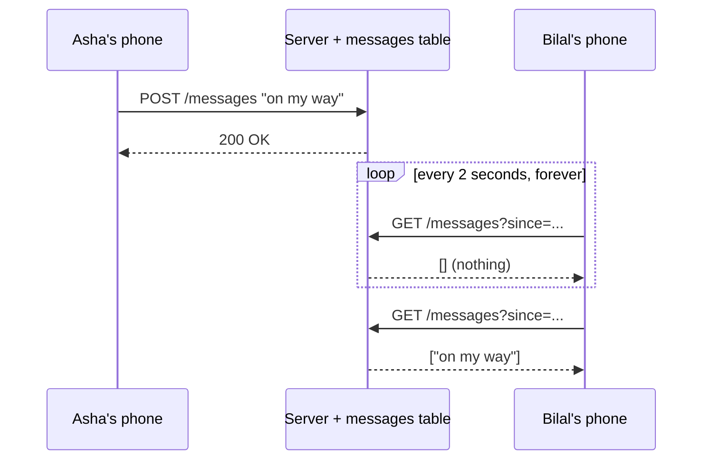
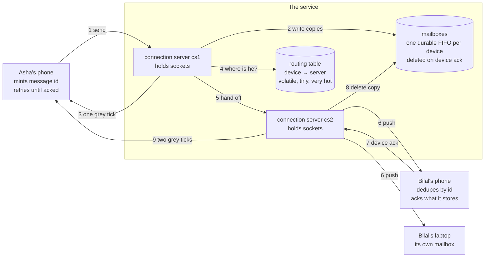
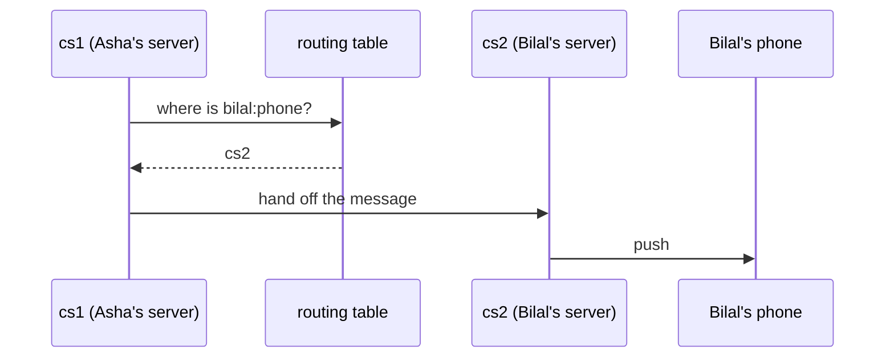
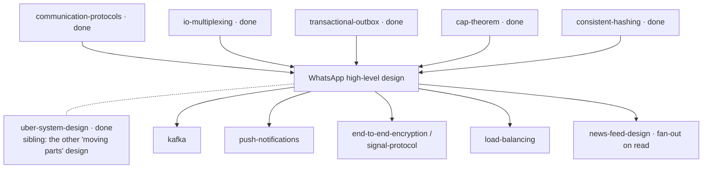

# High-level system design of WhatsApp

> **What this lab is.** A chat app looks like the simplest thing in the world:
> you type, they read. It is one of the hardest system design problems there
> is, and for a reason that is invisible from the outside — the person you are
> messaging is *usually not there*. This lab builds the delivery system from
> nothing, breaking each version until the real design is the only thing left
> standing.
>
> **Run it:**
> ```bash
> java src/Tests.java                        # 31 scenario checks
> java src/Experiments.java                  # list the failure experiments
> java src/Experiments.java trace offline crash partition dup group ordering storm capacity
> open visualization.html                    # or the published link below
> ```
>
> **Interactive simulator:** <https://claude.ai/code/artifact/bfde5919-ecab-45e9-a03a-e4c468e36d47>

---

## How deep this goes

| Layer | Stages | You will be able to… |
|---|---|---|
| **Beginner model** | 1–9 | explain why a chat app cannot just be a web app, and what the ticks really mean |
| **Intermediate model** | 10 | walk the delivery path packet by packet, and say why each odd detail exists |
| **Engineering model** | 11–14 | reason about crashes, partitions, duplicates and ordering, and run them |
| **Production model** | 15 | size the system, name what real WhatsApp does differently, and answer this in an interview |

Checkpoints between the layers tell you what you have earned and what comes next.

---

# 1 · WHY — the problem this exists to solve

Two people want to talk. One of them is on a train with no signal, one of them
has a phone that is asleep to save battery, and both of them expect that when
the message *does* arrive, it arrives exactly once, in the right order, and
that they can see whether it got there.

Nobody wants to think about any of this. That is the entire product: the
feeling that messages just work. If it goes wrong, the failures are the kind
users never forgive — a message that silently vanishes, a message that appears
twice, a "delivered" mark that was a lie, or a conversation whose lines are in
the wrong order so the argument reads backwards.

And it must do that for **billions of people at once**, most of whom are
holding a cheap phone on a bad network.

---

# 2 · PROBLEM — the story, with two named people

Asha is standing outside a restaurant. Bilal is on the Tube, four stops away,
with no signal at all. Asha types **"on my way"** and hits send.

Right now, at this exact moment, ask yourself the awkward question:

**Where does that message physically go?**

It cannot go to Bilal — Bilal is unreachable. It cannot stay only on Asha's
phone, because her battery might die, and because when Bilal surfaces she may
be underground herself. Somebody in the middle has to hold it.

That somebody is a **post office**. Not a library, not a database of your
conversations — a post office. It takes the letter, puts it in a pigeonhole
with Bilal's name on it, and hands it over the moment Bilal walks in. Once
Bilal has it, the post office throws its copy away, because it was never in the
business of keeping your letters.

Hold on to that picture. Everything in this lab is the post office learning,
the hard way, what it takes to never lose a letter and never hand one over
twice.

---

# 3 · NAIVE SOLUTION — the thing any web developer builds first

You already know how to build a web app. So build the obvious chat app:

- Asha's phone does `POST /messages` with the text.
- The server writes a row into a `messages` table.
- Bilal's phone asks, every two seconds: `GET /messages?since=...`
- Anything new comes back and gets drawn on screen.

This works. You can build it in an afternoon, and for a demo with four users it
is genuinely fine. The technique is called **polling**: the receiver repeatedly
asks "anything for me yet?".



> **🔮 Predict:** two billion phones, each polling every 2 seconds. Ignore
> everything else — how many requests per second does that alone create, and
> what does each one cost even when the answer is "nothing"?
>
> <details><summary>Reveal</summary>
>
> 2,000,000,000 ÷ 2 = **one billion requests per second**, and the answer to
> almost all of them is an empty list. Each one is a full network round trip
> that wakes the phone's radio, does a TLS handshake if the connection was not
> kept alive, hits your servers, queries a database, and returns nothing.
>
> For comparison, all of WhatsApp's actual message traffic is on the order of
> ~1.2 million messages per second. The polling for *no* messages would be
> roughly a thousand times more expensive than the messages themselves.
> </details>

---

# 4 · FAILURE — three separate things break, and the third one is the interesting one

**It breaks on cost.** You just did the arithmetic. The overwhelming majority
of the work is asking a question whose answer is "no".

**It breaks on battery and latency, and you cannot fix both.** Polling has one
knob, the interval, and it is a straight trade: poll every 2 seconds and the
phone's radio never sleeps (a real, measurable battery drain, and the reason
early chat apps were notorious); poll every 60 seconds to save the battery and
Asha's "on my way" arrives up to a minute late, which is not a messaging app.
There is no setting of this knob that is good. That is the sign the shape is
wrong, not the tuning.

**And it breaks on truth — this is the deep one.** Look again at that
sequence diagram and ask what Asha knows. She got `200 OK`. What does that
mean? It means a server took her message. It says *nothing* about whether Bilal
has it. And there is no way in this design for her to ever find out, because
information only flows when Bilal asks a question.

That third failure is not a performance problem you can optimise away. It is
missing information. The design has no channel over which the truth about
Bilal could ever travel back to Asha.

> You met the pull-versus-push distinction in the
> [communication-protocols](../communication-protocols/) lab, and the reason
> idle connections are cheap in the
> [io-multiplexing](../io-multiplexing/) lab. This is what that choice looks
> like when it is the whole product.

---

# 5 · THE REAL REQUIREMENT — what we actually have to guarantee

Write it down in plain words, because everything after this is the pursuit of
exactly this list:

1. **Never lose a message**, even if the recipient is unreachable for days, and
   even if any single machine dies at any moment.
2. **Never show a message twice**, even though the only honest promise a
   network can make is "I might deliver this more than once".
3. **Keep each conversation in order** — line 5 must not appear above line 4.
4. **Report the truth back to the sender**: stored, delivered to the device,
   read by the human — and never claim a stronger one than is true.
5. **Be fast when both people are online** (tens of milliseconds, not seconds)
   and **cheap when they are not** (an idle phone should cost almost nothing).
6. Do all of it while **the servers cannot read the messages**.

Notice what is *not* on the list: "store the user's chat history". WhatsApp
deliberately does not. That single omission changes the entire storage design,
and we will come back to it.

---

# 6 · KEY IDEA — the invention, in two sentences

**Turn the connection around.** Instead of the phone repeatedly asking the
server for news, the phone opens *one* connection and holds it open, and the
server writes down it the instant something arrives. An idle open connection
costs almost nothing; a question asked a billion times costs everything.

**Make the server a queue, not a database.** For every device there is a small
durable queue. A message is put into that queue *before* the sender is told
anything, and taken out *only* when that device confirms it has it. Delivery is
not "the server sent it" — delivery is "the queue emptied".

Everything else in this lab — the ticks, how repeats are discarded, ordering,
group delivery — falls out of those two sentences.

---

# 7 · TERMINOLOGY — the words, now that you have felt the need for them

Each of these names a distinction you have already run into. That is the only
reason to introduce a word.

### Persistent connection
- **Plain meaning:** the phone dials in once and stays on the line.
- **Technical meaning:** a long-lived TCP connection (in practice carrying a
  framed binary protocol, or WebSocket) held open for hours, over which either
  side may send at any time without a new request.
- **Why the word exists:** to distinguish it from the *request/response*
  connection of a normal web call, which exists only for the duration of one
  question. The difference is who is allowed to speak first: on a persistent
  connection, **the server can**.
- **Concrete:** Bilal's phone connects once when it unlocks and holds that
  connection for six hours, exchanging a few bytes of keepalive.
- **Connects to:** exactly the WebSocket/long-poll choice from
  [communication-protocols](../communication-protocols/), and the reason one
  machine can hold a million of them is the event loop from
  [io-multiplexing](../io-multiplexing/).

### Connection server
- **Plain meaning:** the machine holding the phone's open line.
- **Technical meaning:** a stateless-except-for-sockets process whose job is to
  own a very large number of live connections and move small packets between
  them. It stores nothing durable.
- **Why the word exists:** because this box is *not* an application server. Its
  scaling limit is memory-per-socket and file descriptors, not CPU per request,
  which makes it a completely different machine with different failure modes.
- **Concrete:** in this lab, `cs1`, `cs2`, `cs3`. In production, a fleet of a
  few hundred boxes each holding ~1M connections.

### Routing table (session registry)
- **Plain meaning:** "which server is Bilal's phone currently plugged into?"
- **Technical meaning:** a small, extremely hot, volatile key-value map from
  device → connection-server id, written on every connect and disconnect.
- **Why the word exists:** with one server, there is no question to ask. With
  ten thousand servers, delivering a message *starts* with this lookup, and the
  answer changes every time a phone changes network. It is a **session** store,
  not a user store — it describes right now, not who someone is.
- **Concrete:** `bilal:phone → cs2`. Thirty seconds later, after he walks out
  of the Tube onto wifi: `bilal:phone → cs7`.
- **Connects to:** it is a cache of a fact that is only true for a moment —
  which is why [caching](../caching/)'s staleness lessons apply, and why this
  lab's nastiest failure is a routing row that has become a lie.

### Mailbox (per-device queue)
- **Plain meaning:** the pigeonhole with your name on it.
- **Technical meaning:** a durable FIFO queue, one per **device**, holding
  messages that have been accepted from a sender but not yet confirmed by that
  device.
- **Why the word exists:** to separate *accepted* from *delivered*. Without a
  name for the in-between state, you cannot talk about what happens while Bilal
  is on the Tube.
- **Concrete:** while Bilal is underground, `mailbox[bilal:phone] = [m1, m2, m3]`.
- **Connects to:** it is the same shape as the outbox in
  [transactional-outbox](../transactional-outbox/) — write it durably first,
  deliver later, delete on confirmation.

### Acknowledgement (ack)
- **Plain meaning:** "got it".
- **Technical meaning:** a message sent back along the path confirming receipt
  at a specific point. There are **two different ones** in this system and
  confusing them is the classic bug: the *server ack* (the service has stored
  it) and the *device ack* (the recipient's phone has written it to its own
  disk).
- **Why the word exists:** because "sent" is meaningless on its own. An ack
  names *which* point in the path has taken responsibility.
- **Concrete:** Asha's one grey tick is a server ack. Her second grey tick is
  caused by a device ack.

### The ticks, stated precisely
| On screen | Caused by | What it actually proves |
|---|---|---|
| Clock ◷ | nothing yet | the message has not left Asha's phone |
| One grey ✓ | server ack | the service has it durably. Says **nothing** about Bilal |
| Two grey ✓✓ | device ack | a device of Bilal's physically holds it |
| Two blue ✓✓ | read receipt | a human opened the chat |

### At-least-once delivery
- **Plain meaning:** "I will keep trying until you confirm, so you may get it
  twice."
- **Technical meaning:** a delivery guarantee where the sender retries until
  acknowledged; loss of the *acknowledgement* is indistinguishable from loss of
  the *message*, so retries can duplicate.
- **Why the word exists:** to be honest that "exactly once" is not something a
  network can offer. It is only ever manufactured, at the edge, by the receiver.
- **Connects to:** the idempotent-consumer rule from
  [transactional-outbox](../transactional-outbox/). Here the consumer is a phone.

### Deduplication by message id
- **Plain meaning:** the phone remembers which letters it has already opened.
- **Technical meaning:** the receiving device keeps the set of message ids it
  has accepted and silently drops repeats.
- **Why it works:** because the id is **minted by the sending device**, never by
  a server. A retry therefore carries the same id and is provably the same
  message, not a new one.
- **Concrete:** `m1` arrives three times; the screen shows one line.

### Fan-out on write
- **Plain meaning:** the post office photocopies the letter once per recipient
  at the moment it is posted.
- **Technical meaning:** at send time, write one copy into each recipient
  device's mailbox, rather than storing one shared copy that readers come and
  fetch (which would be *fan-out on read*).
- **Why the word exists:** because the alternative is real and is what a
  forum or a Twitter timeline does. Chat chooses write-fan-out because each
  recipient needs independent delivery state — their own acks, their own
  offline queue, their own retries.
- **Concrete:** one message to a 256-person group = 255 mailbox writes
  (measured below).

### End-to-end encryption
- **Plain meaning:** the post office carries a sealed box it cannot open.
- **Technical meaning:** the message is encrypted on the sending device with
  keys only the recipient devices hold; servers route ciphertext and metadata.
- **Why the word exists:** to distinguish it from **transport encryption**
  (TLS), which protects each hop but leaves the server holding plaintext. You
  saw exactly that distinction in the [tls](../tls/) lab — TLS secures the
  wire, not the endpoint.

---

# 8 · MENTAL MODELS — carry two, and know where they disagree

### The simple model: the post office

A post office with a wall of pigeonholes. You hand in a letter; the clerk
photocopies it once per recipient, drops each copy in the right pigeonhole, and
hands you a receipt (**one tick**). When a recipient walks in and takes their
copy, they sign for it, the clerk shreds the office copy and posts you a note
saying it was collected (**two ticks**). If they open it in front of the clerk,
you get a second note (**blue ticks**).

### The engineering model



### Mapping the two

| Post office | Engineering | 
|---|---|
| the counter clerk | connection server |
| the receipt you get at the counter | server ack → one grey tick |
| pigeonhole with a name on it | per-device mailbox |
| photocopying per recipient | fan-out on write |
| signing for your post | device ack → two grey ticks |
| shredding the office copy | mailbox delete on ack |
| "which branch is this person registered at?" | routing table lookup |
| a sealed box the clerk cannot open | end-to-end encryption |

### Where the analogy breaks — read this, it matters

1. **A pigeonhole is per person; a mailbox is per _device_.** Bilal's phone and
   his laptop have separate queues and acknowledge separately. The post office
   has no equivalent, and this is not a detail — it is why "delivered" is
   ambiguous the moment someone has two devices.
2. **The clerk does not know which branch you are at until they look it up, and
   the answer expires constantly.** A real post office registration is stable
   for years. A routing row is valid for as long as a phone stays on one
   network — sometimes seconds. Almost every hard failure in this lab is a
   routing row that went stale.
3. **The post office never hands you the same letter twice.** The network does,
   routinely, and by design. Exactly-once is not something the middle can
   promise; it is reconstructed at the very end by the receiving phone.
4. **The clerk never posts anything on their own initiative.** Here, the server
   *pushes* — that reversal is the whole reason the design works at all.
5. **Real post offices keep records.** This one shreds every letter the moment
   it is collected, on purpose, and that is why the storage bill is small
   enough to be an afterthought.

---

# 9 · VISUALIZATION — go and play with it before you read the mechanism

**→ <https://claude.ai/code/artifact/bfde5919-ecab-45e9-a03a-e4c468e36d47>**
(also `visualization.html` in this folder; it works offline)

The page lays out exactly the diagram above: Asha on the left, the service in
the middle with its routing table and mailboxes visible as live tables, Bilal's
two devices on the right, and packets shown as chips travelling in the lanes
between them.

**Do these four things, in this order.** Each takes under a minute, and each
one is a stage of the mechanism below:

1. Press **Send a message**, then press **Step** repeatedly. Watch the mailbox
   table gain a row *before* Asha's tick appears, and lose it only when a
   device acknowledges. Read the sentence in the log at each step.
2. Press **Bilal's phone: online** to take it offline, send two messages, and
   watch them pile up in the mailbox while Asha stays at one grey tick. Bring
   him back and watch the catch-up.
3. Crash **cs2** from the dropdown while it holds Bilal's connection, then
   send. The routing row turns red and is labelled a lie. Nothing is lost.
4. Drag **drop** to 40%, send four messages, then set **drop** back to 0. Now
   do it again with the switch labelled **Mailbox sweeper** turned off. The
   second time, some messages never arrive — on a perfectly healthy network.
   What that switch is and why it has to exist is stage 10 v5 below; for now,
   just note that it changes the outcome.

Each of the four cards at the bottom asks you to **predict before it runs**.
Answer first — being wrong there is the point.

---

> ### ✅ Checkpoint — you now have the BEGINNER MODEL
> You can explain why a chat app cannot be a normal request/response web app,
> what each tick actually proves, and why the servers hold a queue rather than
> a chat history. **Next:** the delivery path packet by packet — and where the
> obvious version of it quietly loses your messages.

---

# 10 · ACTUAL MECHANISM — built version by version, each one broken by the next

We are going to build the delivery path the way you would actually build it:
the simplest thing that could work, then let a concrete failure force the next
piece. Every strange-looking detail in the final design is the scar of one of
these.

## v1 — one server, write straight to the socket

Both phones are connected to the same machine. Asha's message arrives; the
server looks up Bilal's socket in a hash map and writes to it. Done.

```java
// v1, roughly
Socket s = sockets.get("bilal:phone");
s.write(message);
```

This is a completely reasonable chat server, and it works up to the number of
users one machine can hold.

**It breaks the moment you need a second machine.** Asha is connected to `cs1`.
Bilal is connected to `cs2`. `cs1` looks in *its* socket map, finds nothing,
and concludes Bilal is offline — which is false.

**The refinement: a routing table.** Every connect writes one row
(`bilal:phone → cs2`); every disconnect deletes it. Delivery now starts with a
lookup, and if the answer is another server, the message is handed across.



> This tiny table is the busiest thing in the system, and the reason is
> counter-intuitive: it is written not when people *talk* but when people's
> *networks change*. A phone moving from mobile data to wifi rewrites a row
> without a single message being sent. In the `storm` experiment below, 50,000
> phones reconnecting produce 50,000 routing writes and only 150,000 message
> pushes — the connection churn is the load.

## v2 — the recipient is not online

Bilal is on the Tube. The lookup returns nothing. v1 has exactly one option:
throw the message away.

Obviously unacceptable — so the **mailbox** appears. If the lookup says
offline, the message waits in a durable per-device queue until that device
comes back and drains it.

> **🔮 Predict:** we now have a mailbox. When should the server write the
> message into it — before or after it tells Asha "stored"? Does it matter?
>
> <details><summary>Reveal</summary>
>
> It is the whole ballgame. **Write first, acknowledge second.**
>
> If you acknowledge first and the server dies before the write, Asha has a
> tick for a message that no longer exists anywhere except her own screen. She
> will never retry, because as far as she knows it was accepted. The message is
> lost, silently, and the UI actively lies about it.
>
> If you write first and the server dies before acknowledging, Asha simply
> never gets her tick, so she retries — and because the id was minted on her
> phone, the retry is recognisably the same message. The worst case is a
> duplicate, which the receiving device already knows how to throw away.
>
> **Rule: never acknowledge something you have not yet made durable.** In the
> code, `Server.onSend` does the mailbox writes and only then sends the ack —
> and the comment above it says exactly this.
> </details>

## v3 — the ack that lied

v2 pushes to Bilal's socket and, having done so, deletes the mailbox copy and
tells Asha "delivered". Two grey ticks.

**It breaks like this.** The push goes out. Bilal's phone receives the bytes —
and its battery dies before it writes anything to storage. Or the app is killed
by the OS. Or the phone loses signal mid-write. The mailbox copy is already
deleted, and Asha has been told it was delivered. When Bilal charges his phone,
the message does not exist.

**The refinement: two different acknowledgements.** "The server sent it" is not
an event worth telling anyone about. The event that matters is **the receiving
device confirming it has the message on its own disk**, and that confirmation
is what deletes the mailbox copy and what turns Asha's tick into two.

This is the single line in the whole design that the test
`mailboxCopy_survivesUntilTheDEVICEAcks_notWhenTheServerSends` exists to
protect. In the lab, kill the phone right after the push and the copy is still
there:

```
PASS  durability: the copy is STILL in the mailbox after the push
PASS  durability: nothing was deleted on send
```

## v4 — the duplicates you cannot avoid

Now the acknowledgement itself can be lost. The server pushed, the device
stored it, the device's ack died on the way back. The server waits, times out,
and pushes again.

There is no way out of this. A lost message and a lost acknowledgement look
identical to the sender, so any system that guarantees delivery *must* be
willing to deliver twice. This is **at-least-once**, and it is not a
compromise — it is the ceiling.

**The refinement: manufacture exactly-once at the very last step.** The
receiving device keeps the set of ids it has already accepted. A repeat is
dropped before it ever reaches the screen — but *still acknowledged*, or the
server would retry it forever.

```java
// Device.onDeliver -- the load-bearing four lines of the client
if (!seen.add(m.id())) {          // seen is a Set<String> of accepted ids
    duplicatesSuppressed++;
    ackTo(m);                     // ack anyway, or the server retries for ever
    return;                       // never reaches the screen
}
```

And this only works because of the earlier decision that **the sending device
mints the id**. If a server generated it, every retry would look like a
brand-new message and the deduplication set would be useless.

Forcing every packet to be delivered twice, ten messages sent:

```
messages typed by asha        : 10
copies that reached the device: 80
duplicates suppressed by id   : 70
messages shown to the human   : 10
```

Eighty copies reached the phone. Ten lines appeared.

## v5 — the bug this lab actually hit

Here is the version we had after v4: mailbox, device acks, retry timers,
deduplication. It looks complete. Run it on a network dropping 30% of packets
and this happens:

```
PASS  no-sweeper: 4 message(s) stranded even on a now-perfect network
PASS  no-sweeper: bilal saw only 16/20
```

Four messages out of twenty stuck in a mailbox forever, *after* the network was
restored to perfect, with both phones online the whole time. That was a real
bug in this lab, found by the test, not something invented to make a point.

> **🔮 Predict:** the retry timer fires every 500ms until the device
> acknowledges. Both phones are online. The network is now perfect. So why is
> anything stuck?
>
> <details><summary>Reveal</summary>
>
> **Because the retry timer lives on the wrong machine.**
>
> The push retry is created inside `deliverToSocket`, on the server that holds
> the recipient's connection. If the packet that dies is the *server-to-server
> hand-off* — `cs1 → cs2` — then `cs2` never learned a push was owed. No timer
> was ever created, on any machine. `cs1` has moved on. The message is sitting
> in a mailbox, perfectly safe and perfectly invisible.
>
> Every retry in the system was guarding a hop, and no retry was guarding *the
> thing that actually needs delivering*.
> </details>

**The refinement: the queue is the mechanism; the push is only an
optimisation.** Each connection server periodically re-scans the mailboxes of
every device it currently holds, and re-pushes anything still sitting there.

```java
// Server.startSweeper -- the box everyone forgets to draw on the whiteboard
for (String deviceId : sockets.keySet())
    for (var e : boxes.box(deviceId))
        if (!inFlight.contains(key(deviceId, e.msg().id())))
            deliverToSocket(deviceId, e.msg());     // try again, from the queue
```

With it on, same seed, same 30% loss:

```
PASS  lossy: all 20 messages eventually arrived (delivered=20/20)
PASS  lossy: none was shown twice (window=20)
PASS  lossy: the client had to suppress duplicates (14)
```

This is the most transferable idea in the lab. **Any design whose delivery
guarantee depends on a message being pushed successfully has a hole in it.**
The guarantee has to come from durable state that someone periodically
re-examines. Pushes make it fast; the scan makes it true.

## v6 — ordering, and the thing that quietly provides it

Bilal was offline for an hour. He reconnects and twelve messages arrive at
once. What keeps them in order?

Look at the design: no server sorts anything. There is no sequencer, no
timestamp comparison, no reordering buffer.

> **🔮 Predict:** with no sorting anywhere, where does per-conversation
> ordering actually come from?
>
> <details><summary>Reveal</summary>
>
> From two things, both free:
>
> 1. The mailbox is a **FIFO queue**, drained front to back.
> 2. Everything is delivered over **one connection**, and a TCP connection is a
>    byte stream — what is written first arrives first. Nothing can overtake.
>
> Take away either one and ordering is gone. The lab lets you take away the
> second: `java src/Experiments.java ordering`
>
> ```
> one ordered connection (real TCP): out-of-order arrivals = 0,
>     screen order = [1, 2, 3, 4, 5, 6, 7, 8, 9, 10, 11, 12]
> packets free to overtake       : out-of-order arrivals = 11,
>     screen order = [12, 2, 5, 1, 4, 7, 8, 6, 10, 11, 3, 9]
> ```
>
> This is why a device is **pinned to one connection** rather than having its
> packets load-balanced across servers, which would otherwise be the obvious
> thing to do. The ordering guarantee is a consequence of that pinning.
> </details>

Note carefully what is *not* guaranteed: any ordering **between** different
conversations. If Asha and Chen both message Bilal, the relative order of the
two chats is whatever the mailbox happened to receive. Nobody needs it, so
nobody pays for it — and that refusal is a large part of why the system scales.

## v7 — groups are not a new feature

A group message looks like it needs a new concept — a shared conversation
object everyone reads from. It does not. In the code, groups are the *same
loop* with a longer list:

```java
Set<String> targets = new HashSet<>();
for (String member : cluster.recipientsOf(m.toUser()))   // one person, or 256
    targets.addAll(reg.devicesOf(member));
```

One typed message becomes one mailbox copy per recipient device — **fan-out on
write**. Measured:

```
group of   5 : 1 typed message ->   4 mailbox writes,   22 network packets
group of 256 : 1 typed message -> 255 mailbox writes, 1244 network packets
```

**Why not one shared copy that everyone reads?** Because every recipient needs
their own delivery state: their own position in the queue, their own
acknowledgement, their own offline period, their own retries. A shared copy
would have to track all of that per member anyway — you would have rebuilt the
mailboxes, plus a coordination problem.

**The price is real and it is linear.** Every message to a 256-person group is
255 writes and 255 delivery state machines, paid on *every* message. This is
why group size is capped at all (a product constraint driven purely by
fan-out cost), and why a "broadcast to 100,000 people" feature is a completely
different system, not a bigger group.

**The encryption complication.** With end-to-end encryption, naively the sender
must encrypt the message separately for each recipient device — 255 encryptions
per message. Real WhatsApp avoids this with **sender keys**: the sender
generates one symmetric key per group, distributes it once (pairwise-encrypted,
so 255 encryptions *once*), then encrypts each subsequent message a single time
with that key. The server still fans out 255 copies of the same ciphertext.
*(This is the publicly documented Signal-protocol group design; I have not
implemented it here — the lab's `ciphertext` field is a stand-in.)*

## v8 — multi-device, and why "delivered" gets blurry

Bilal has a phone and a laptop. The change is smaller than you would expect,
because the mailbox was per-device from the start:

```
PASS  multi-device: bilal's phone got it
PASS  multi-device: bilal's laptop got it
PASS  multi-device: asha's OWN laptop got a copy too
PASS  multi-device: 3 mailbox copies were written for 1 typed message
```

Three copies for one typed message — and one of them goes back to *Asha's own
other device*, which is how her laptop shows the chat she typed on her phone.

The genuinely hard part is not delivery, it is **meaning**: what should two
grey ticks mean when Bilal has a phone, a laptop and a tablet? First device to
acknowledge? All of them? The phone specifically? Every product answers this
differently, and every answer is defensible; there is no correct one, because
the underlying reality — "some subset of his devices has it" — does not fit
into a two-tick UI. In this lab, the first device to acknowledge deletes the
copy that triggers the receipt.

With end-to-end encryption it gets harder still: each device has its own key
pair, so the sender must encrypt for *each device*, and adding a device is a
key-distribution event, not just a login.

---

> ### ✅ Checkpoint — you now have the INTERMEDIATE MODEL
> You can walk a message from a phone to a queue to another phone and back, and
> justify each step by the failure that forced it: routing tables because of
> the second server, mailboxes because of the Tube, device acks because of the
> dead battery, deduplication because of at-least-once, sweepers because of the
> lost hand-off, connection pinning because of ordering.
> **Next:** what happens when whole machines and networks fail, and exactly
> which promises survive.

---

# 11 · FAILURE SCENARIOS — each one created, watched, and explained

Every one of these is runnable. The pattern for each: **make it happen → watch
it → what broke → why → how the system responds → what still holds → what
temporarily does not → what production does about it.**

### F1 · The recipient is offline for a week

**Make it happen:** `java src/Experiments.java offline` · visualization: *Bilal's phone: online* toggle.

Asha sends twelve messages while Bilal's phone is off. All twelve land in his
mailbox; Asha sits at one grey tick each. When he reconnects, the catch-up
drains all twelve in order, each is acknowledged, each mailbox row is deleted,
and Asha's ticks all turn to two.

**Why nothing is lost:** the mailbox write happens before the sender is
acknowledged, so "accepted" and "durable" are the same instant.
**Guarantee kept:** no loss, no duplicates, per-conversation order.
**Guarantee lost:** latency. There is no bound on it, and there cannot be — the
recipient's phone is off.
**In production:** the queue is not infinite. WhatsApp publicly states
undelivered messages are held ~30 days and then dropped. That is a real,
user-visible loss boundary, chosen deliberately over unbounded storage.

### F2 · The connection server holding the socket crashes

**Make it happen:** `java src/Experiments.java crash` · visualization: *Crash cs2*.

```
bilal's socket lives on cs1; the registry says so too.
registry still points at cs1: cs1   <-- a lie
[   40ms] cs3 stored asha:phone-asha-bilal-1 into 1 mailbox(es)
[   68ms] LOST (node down) -> cs1
[   79ms] asha:phone got server-ack   [one grey tick]

bilal saw            : 0 messages
safe in the mailbox  : 1
asha's tick          : one grey tick   <-- honest
```

**What broke:** the sockets died with the machine, but the *routing rows
pointing at it did not*. For a window of time the table confidently returns a
dead address, and messages routed there evaporate.
**Why:** the routing table is updated by the server that owns the session. A
crashed server cannot clean up after itself. **A distributed registry always
lags reality by at least one failure-detection interval.**
**How it responds:** nothing is lost, because the mailbox copy is untouched.
When the session expires (heartbeat/lease timeout) and the phone reconnects
elsewhere, the catch-up delivers it.
**Kept:** durability, no duplicates, order. **Lost:** liveness for those users
for the length of the detection window — seconds to tens of seconds.
**In production:** sessions are leases with a TTL, refreshed by heartbeat, so
stale rows expire on their own — the identical mechanism the
[uber-system-design](../uber-system-design/) lab uses for a driver's position
and a ride offer, which is a good sign you are looking at a general tool rather
than a chat trick; clients reconnect aggressively with backoff;
and the whole design assumes connection servers are disposable, which is
precisely why they hold no durable state.

### F3 · The network splits in two

**Make it happen:** `java src/Experiments.java partition` · visualization: *Cut the network*.

Asha and `cs1` on one side, Bilal and `cs2` on the other. Asha's message is
stored and acknowledged (one grey tick); the hand-off to `cs2` is dropped; the
message waits. When the partition heals, the sweeper re-pushes and the ticks
complete.

**Why it is not a disaster:** because this system never needed both sides to
agree on anything. There is no consensus in the delivery path — no quorum, no
leader, no commit protocol. Each mailbox has exactly one owner.
**The [cap-theorem](../cap-theorem/) reading:** during a partition the system
stays **available** for writes (Asha can keep sending) and gives up
**timeliness**, not correctness. Compare that to the
[two-phase-commit](../two-phase-commit/) lab, where a partition at the wrong
moment blocks participants outright. Chat gets an easy ride here because the
guarantee it needs — "this queue eventually empties" — is not an agreement
between machines.
**Kept:** everything except promptness. **Lost:** delivery latency, and the
accuracy of presence ("last seen") on both sides.

### F4 · The same message is delivered twice

**Make it happen:** `java src/Experiments.java dup` · visualization: *duplicate* slider to 100%.

Eighty copies arrive, ten lines appear. **Why it happens:** a lost
acknowledgement is indistinguishable from a lost message, so retrying is the
only safe response and duplication is the cost.
**How it responds:** the receiving device drops ids it has already accepted —
and still acknowledges them, otherwise the server retries forever.
**Kept:** the user-visible exactly-once illusion. **Lost:** nothing, but the
work is real: those pushes cost bandwidth and battery.
**In production:** the same shape as an idempotent consumer in
[transactional-outbox](../transactional-outbox/); the difference is the
deduplication set lives on a phone with limited storage, so it is bounded — a
recent window of ids, not all history. A message duplicated *after* it falls
out of that window would show twice, which is why the window is generous.

### F5 · The push that nobody remembers to retry

**Make it happen:** the `withoutTheSweeper_...` test, or visualization: *Mailbox sweeper: off* + 40% drop.

Covered in v5 above: 4 of 20 messages stranded on a healthy network.
**Why:** the retry timer was created by the receiving server, and the packet
that died was the one that would have told it to create the timer.
**How it responds (after the fix):** a periodic sweep of every connected
device's mailbox.
**Kept, after the fix:** eventual delivery. **Before the fix:** silently lost,
with the sender showing one confident grey tick.
**In production:** every real messaging system has this box under some name —
a delivery sweeper, a retry scanner, a reconciliation job. If you sketch this
design in an interview without it, "what if the internal hand-off is lost?" is
the question that finds the hole.

### F6 · Fifty thousand phones reconnect at the same second

**Make it happen:** `java src/Experiments.java storm`

```
sockets per server (mean)  : 2500
mailbox reads triggered    : 50000
catch-up packets pushed    : 300000
registry writes in 1 second: 50000   <-- the registry, not the mailbox, is the hot spot
```

**What breaks:** not the message path — the *session* path. A data-centre
failover, a mobile network blip, or an app update makes a large population
reconnect simultaneously. Each reconnect is a routing-table write plus a
mailbox scan, and neither of those happened because anyone sent a message.
**Why it is dangerous:** it is self-amplifying. Overloaded servers time out,
clients reconnect harder, load rises. That is a **thundering herd**.
**How it responds:** exponential backoff with jitter on the client (the lab's
`Device.scheduleRetry` doubles its delay each attempt for exactly this reason),
and connection admission control on the server.
**In production:** clients spread reconnects over a randomised window;
load balancers shed connections rather than accepting and collapsing; capacity
is planned for the reconnect spike, not the steady state — the peak that sizes
your fleet is a failover, not a busy evening.

### F7 · Asha's phone never hears "stored"

**Make it happen:** the `droppedServerAck_...` test (35% drop on the uplink).

Asha retries with the same id. The server appends to the mailbox a second time
and pushes again. Bilal's phone recognises the id and drops it.
**Kept:** exactly-once on screen. **Lost:** a little storage and bandwidth,
briefly. **The subtle point:** a *server-side* deduplication check would save
that work, and real systems do keep a short-lived recent-id set per sender for
exactly this. It is an optimisation, not a correctness requirement — the
correctness lives on the phone.

### F8 · A large group during a big event

`group of 256 : 1 typed message -> 255 mailbox writes, 1244 network packets`

**What breaks:** nothing correctness-wise; the *cost* breaks. A busy 256-person
group generates two orders of magnitude more work than a one-to-one chat, and
it arrives in bursts (everyone replies to the same goal).
**How it responds:** the work is linear and parallel — each recipient's mailbox
is independent, so there is no lock and no shared hot row. This is the payoff
for fan-out on write.
**In production:** group size caps; rate limits per sender and per group (see
[distributed-rate-limiting](../distributed-rate-limiting/)); and separate
treatment for anything broadcast-shaped, because a "group" of 100,000 is a
different product with a different design.

### F9 · The message nobody ever collects

A phone is lost or the app uninstalled. Its mailbox grows and is never drained.
**How it responds:** time-based expiry (WhatsApp: ~30 days), after which the
message is dropped and the sender is simply never upgraded past one grey tick.
**The honest framing:** this is the one place the system deliberately loses
data. It is a bounded, well-understood loss, and it is what keeps storage from
being unbounded — which is the trade that makes the whole storage layer cheap.

### F10 · Someone "optimises" the connection layer

Suppose a well-meaning change load-balances a device's packets across several
connections for throughput.

```
packets free to overtake : out-of-order arrivals = 11,
    screen order = [12, 2, 5, 1, 4, 7, 8, 6, 10, 11, 3, 9]
```

**Why:** the ordering guarantee was never implemented anywhere — it was
inherited from having exactly one ordered stream. Remove the stream, lose the
guarantee, with no error and no test failing unless you wrote one.
**The lesson:** know which of your guarantees are *implemented* and which are
*inherited*. Inherited ones are the ones that vanish silently during a
refactor.

---

# 12 · CORRECTNESS — what is promised, what is not, what was sold to get it

### Invariants the design maintains

1. **Nothing is acknowledged before it is durable.** The mailbox write precedes
   the server ack. Consequence: a tick never over-promises.
2. **Nothing is deleted before the recipient device confirms it.** Consequence:
   any crash between push and confirmation costs a retry, never a message.
3. **Message identity belongs to the sending device.** Consequence: a retry is
   provably the same message, which is what makes deduplication possible at all.
4. **A device accepts each id at most once.** Consequence: at-least-once
   transport becomes exactly-once experience.
5. **A device's messages travel over exactly one ordered connection, drained
   from a FIFO queue.** Consequence: per-conversation order, for free.

### Guaranteed

- **Eventual delivery** to every registered device, as long as it reconnects
  within the retention window.
- **No duplicate ever shown to a human**, however many times the network
  delivers.
- **Per-conversation ordering** on each device.
- **Honest sender feedback** — each tick means something specific and is never
  reached early.
- **Availability during partitions** for accepting and queueing messages.

### Explicitly NOT guaranteed

- **Bounded delivery latency.** Impossible: the recipient may be off.
- **Ordering across different conversations.** Not needed, never paid for.
- **A single global order of all messages.** There is no such clock and no such
  need. (Contrast [paxos](../paxos/), where agreeing an order *is* the problem.)
- **Server-side history.** Once delivered, the service has nothing. Lose your
  phone without a backup and the messages are gone. That is a product promise,
  not a bug.
- **Delivery after the retention window.** ~30 days, then dropped.
- **Exactly-once at the transport layer.** Only at the screen.
- **Presence accuracy.** "Last seen" and "online" are best-effort, and during a
  partition they are simply wrong.

### What was traded away, and for what

| Given up | Bought |
|---|---|
| Server-side chat history | A tiny storage footprint, and a strong privacy claim |
| Global ordering | No coordination in the delivery path at all — no consensus, no leader |
| Bounded latency | Correctness under arbitrary offline periods |
| Transport-level exactly-once | A guarantee a network can actually keep |
| Unbounded queues | Predictable storage, at the cost of a real 30-day loss boundary |
| Cheap huge groups | Independent per-recipient delivery state |

**The through-line:** this system is fast and enormous precisely because it
refuses to agree on anything. Every mailbox has one owner, every message has
one identity chosen at the edge, and no two machines ever have to reach a
decision together. Compare the coordination cost you measured in
[two-phase-commit](../two-phase-commit/) and [paxos](../paxos/) — chat is the
design you get when you successfully *avoid* needing them.

---

# 13 · CODE — the lines that carry the design

Everything runs with no dependencies and no build tool (`java src/Tests.java`
compiles the directory in place — JDK 25).

| File | What it is |
|---|---|
| [`src/Msg.java`](src/Msg.java) | the message; note `id` is minted by the device and the payload is called `ciphertext` on purpose |
| [`src/Net.java`](src/Net.java) | a deterministic event-driven fake network: drop, duplicate, delay, partition, kill — every fault in the lab funnels through `Net.send` |
| [`src/Registry.java`](src/Registry.java) | the routing table, plus `leaveStaleEntriesFor` — the crash that leaves lies behind |
| [`src/MailboxStore.java`](src/MailboxStore.java) | per-device durable FIFO queues |
| [`src/Server.java`](src/Server.java) | connection server: fan-out, push, retry, the sweeper, ack handling |
| [`src/Device.java`](src/Device.java) | the phone: id minting, deduplication, acks, ticks, backoff |
| [`src/Cluster.java`](src/Cluster.java) | wiring, groups, stats |
| [`src/Tests.java`](src/Tests.java) | 31 scenario checks, readable as documentation |
| [`src/Experiments.java`](src/Experiments.java) | nine runnable failure experiments |

**The four load-bearing places**, all commented in the source with the
invariant they enforce:

1. **`Server.onSend`** — mailbox writes happen, *then* the sender ack. Reversing
   these two lines makes the ticks lie.
2. **`Server.onDeviceAck`** — the only place a mailbox row is deleted, and it is
   driven by the *device*, not by a successful send.
3. **`Device.onDeliver`** — `if (!seen.add(m.id()))` … then acknowledge anyway.
   Three lines that convert at-least-once into exactly-once.
4. **`Server.startSweeper`** — the periodic re-scan. The difference between
   `16/20` and `20/20` under packet loss.

What the code deliberately does **not** have: real sockets, real threads, real
persistence, encryption, authentication, media, presence, or a real database.
Each of those is called out in stage 15 with what production does instead.

---

# 14 · EXPERIMENTS — predict first, then run

```bash
java src/Experiments.java            # lists all nine
```

| # | Command | Predict before running |
|---|---|---|
| 1 | `trace` | How many network packets does one message and its read receipt cost, end to end? |
| 2 | `offline` | While Bilal is away, what does Asha see, and where do the messages live? |
| 3 | `crash` | The routing row still points at the dead server. Is the message lost? |
| 4 | `partition` | Which side can still make progress, and what does Asha's screen say? |
| 5 | `dup` | Every packet is delivered twice. How many lines appear on screen? |
| 6 | `group` | One message to 256 people — how many mailbox writes? How many packets? |
| 7 | `ordering` | Nothing sorts anything. What actually keeps a burst in order? |
| 8 | `storm` | 50,000 phones reconnect at once. Which subsystem is the hot spot? |
| 9 | `capacity` | At 100 billion messages a day, is this a storage problem or a connection problem? |

Answers, with the numbers, are in the stages above and in
[SOLUTIONS.md](SOLUTIONS.md). A worked example of #1:

```
[    0ms] asha:phone connected to cs3 (registry updated)
[    0ms] bilal:phone connected to cs1 (registry updated)
--- send ---
[   40ms] cs3 stored asha:phone-asha-bilal-1 into 1 mailbox(es)
[   79ms] asha:phone got server-ack   [one grey tick]
[  115ms] bilal:phone SHOWED message to the user
[  146ms] cs1 got device-ack -> mailbox copy deleted
[  209ms] asha:phone -> two grey ticks (device has it)
--- bilal opens the chat ---
[  916ms] asha:phone -> two blue ticks (human read it)

packets: sent=10 delivered=10 dropped=0 dup=0
mailbox: appends=1 deletes=1 stillQueued=0
```

Ten packets, and the mailbox row existed for 106 milliseconds.

---

> ### ✅ Checkpoint — you now have the ENGINEERING MODEL
> You can name the invariants, say which guarantees survive each failure, and
> run every one of them. **Next:** the numbers, what real WhatsApp does that
> this toy does not, and how to say all of this in an interview.

---

# 15 · PRODUCTION — from this toy to the real thing

## 15.1 The numbers first, because they decide the architecture

```bash
java src/Experiments.java capacity
```
```
users                                : 2,000,000,000
messages/day                         : 100,000,000,000
average messages/second              : 1,157,407
peak (x3)                            : 3,472,221/s
concurrently connected (1 in 4)      : 500,000,000
connection servers @ 1,000,000 sockets  : 500
undelivered queue, 1% of a day's mail: 200 GB
```

*(The 2 billion users and 100 billion messages/day figures are WhatsApp's own
public statements from around 2020 — the user number has since been reported
higher. The 1-in-4-online ratio and the 3× peak factor are my assumptions,
stated so you can argue with them. The 1M-sockets-per-box figure comes from
WhatsApp's published engineering talks about their FreeBSD/Erlang servers; I
have not measured it.)*

**Read what that table is telling you.** Half a billion simultaneous open
connections, and 200 GB of pending messages. The queue would fit on one
reasonably large machine. The connections would not fit on ten thousand.

So: **this is a connection problem wearing the costume of a database problem.**
The first thing you design is the layer that holds sockets. The storage layer
is small, because you throw everything away as soon as it is delivered. A
design that opens with "we shard the messages table across 500 nodes" has
already misread the question — and that is a genuinely common way to lose this
interview.

Two derived numbers worth having ready:
- **1.2M messages/second average, ~3.5M peak**, but the fan-out multiplier
  matters more than the message count: with groups, *deliveries* per second are
  several times higher than *messages* per second.
- **The reconnect rate sizes your fleet, not the message rate.** Phones change
  networks constantly; a data-centre failover reconnects a whole region at once
  (experiment 8).

## 15.2 The chain: toy → real implementation → production architecture

| This lab | Real implementation | Production reality |
|---|---|---|
| `Net` event loop | real TCP sockets with epoll/kqueue | see [io-multiplexing](../io-multiplexing/) — this is that lab, applied |
| `Server` object | a connection server process holding ~1M sockets | WhatsApp famously ran these on FreeBSD in **Erlang**, a runtime built for millions of cheap concurrent processes; reported ~1–2M connections per box |
| custom `Packet` types | a compact binary protocol | WhatsApp began from **XMPP** (via ejabberd) and evolved a compressed binary variant often called *FunXMPP*; the wire format is not the interesting part |
| `Registry` HashMap | a replicated in-memory session store with leases | Redis-like or purpose-built; every row is a lease refreshed by heartbeat, so crashes self-heal ([redis](../redis/)) |
| `MailboxStore` HashMap | a write-heavy, delete-heavy durable store | WhatsApp used Erlang's **Mnesia**; the workload shape (append, read once, delete, short lifetime) is a poor fit for a B-tree and a decent fit for an LSM — though the delete rate makes tombstones a real operational concern ([btree-and-lsm](../btree-and-lsm/)) |
| `Cluster.homeFor` = hash | a load balancer + client reconnect logic | which device lands on which server changes constantly, which is exactly why the registry exists rather than a formula |
| plaintext `ciphertext` field | the **Signal protocol** | E2E since 2016, with sender keys for groups |
| always-connected phones | **push notifications** | see below — the biggest single omission |

## 15.3 The thing this toy gets most wrong: phones cannot stay connected

The entire design above assumes a phone holds an open connection. On iOS, an
app in the background **cannot**. The OS suspends it, and the socket dies.

Real flow: when a message arrives for a device with no live connection, the
service sends a small notification through **APNs** (Apple) or **FCM**
(Google) — a single system-level connection the OS maintains on behalf of every
app. That wakes the app, which reconnects, and *then* the mailbox drains exactly
as in this lab.

Three consequences worth knowing:
1. There is a whole delivery path outside your control, with its own retries,
   rate limits, and failure modes.
2. With end-to-end encryption the notification cannot contain the message text
   — the server does not have it. The phone must wake and fetch.
3. It changes what "delivered" means: on iOS a message may be sitting in your
   mailbox with the phone perfectly online-but-suspended.

## 15.4 Everything else the toy leaves out

| Omitted here | What production does |
|---|---|
| **Persistence** | mailboxes are a `HashMap`; real ones are on disk, replicated, and fsynced before the sender ack |
| **Authentication** | phone-number registration, device identity keys, session establishment |
| **End-to-end encryption** | Signal protocol; per-device sessions; sender keys for groups; key-change notifications |
| **Media** | photos and videos never travel the message path: the client encrypts the blob, uploads it to a separate store, and sends a small pointer + key. Media is a CDN problem, not a messaging problem |
| **Presence / typing** | ephemeral, best-effort, never queued and never durable — the opposite policy from messages, deliberately |
| **Voice & video calls** | a completely separate path (peer-to-peer where possible, relayed otherwise); the messaging system is used only for signalling |
| **Backpressure** | a slow phone must not force a server to buffer without limit; real servers bound per-connection queues and shed |
| **Sharding of the queue store** | by device id, typically consistent hashing — this lab uses a plain modulo, which is exactly the bug [consistent-hashing](../consistent-hashing/) measures: 100→101 machines moves 99% of keys when 1% had to move |
| **Multi-datacentre** | users are homed near their region; mailboxes are regional; cross-region delivery is an extra hop and the main source of tail latency |
| **Retention & deletion** | ~30 day queue TTL; delete-for-everyone; disappearing messages |
| **Abuse, spam, rate limits** | per-sender and per-group limits ([distributed-rate-limiting](../distributed-rate-limiting/)) |
| **Backups** | the reason your history survives a lost phone is a *user-controlled cloud backup*, not the service |

## 15.5 What an on-call engineer actually watches

Not "messages per second". These:

- **Concurrent connections per server, and the reconnect rate.** A rising
  reconnect rate is the earliest signal of nearly every incident.
- **Mailbox depth and, more importantly, the _age_ of the oldest undelivered
  message.** Depth is normal (people are offline). Age climbing for
  *online* devices means delivery is broken.
- **Sweeper backlog** — how much work the periodic re-scan is finding. It
  should be near zero. If the sweeper is delivering a lot, pushes are failing.
- **Ack latency p99** from push to device ack, split by region.
- **Stale-session rate** — routing rows pointing at servers that no longer hold
  the socket. Spikes here mean failure detection is lagging.
- **Fan-out amplification** — deliveries per message. A sudden rise means group
  traffic is shifting and capacity maths changes.

**The pager you least want:** *"undelivered age p99 rising, connection count
flat"*. Flat connections rule out a mass disconnect; rising age with users
online means delivery itself is stuck — the F5 shape.

## 15.6 How the same problem is solved differently elsewhere

The single axis that separates these products is **does the server keep your
history?** — and everything else follows from it.

| System | Server keeps history? | Consequence |
|---|---|---|
| **WhatsApp** | No — deleted on delivery | Tiny storage; history tied to the device; strong privacy story; new device starts empty unless you restore a backup |
| **Signal** | No, and even less metadata | Same shape, stricter |
| **Messenger / Instagram DM** | Yes | Search, multi-device sync and web login are easy; storage and privacy costs are large |
| **Slack / Teams** | Yes, as the product | The message store *is* the value; search and retention are first-class; scale is per-workspace, not global |
| **Discord** | Yes, channel-shaped | Fan-out on **read** for big channels — thousands of readers pull from one shared log rather than each getting a copy. The opposite choice to chat's fan-out on write, and correct for their shape |

That last row is worth pausing on: fan-out on write versus read is not a right
answer, it is a function of the ratio between recipients and readers.

## 15.7 If this comes up in an interview

A 45-minute structure that follows this lab exactly:

1. **Requirements (5 min).** One-to-one and group text; delivery and read
   receipts; offline delivery; multi-device. Explicitly ask: *do we store
   history server-side?* — get that answered early, because it changes
   everything. Non-functional: billions of users, low latency when online,
   never lose or duplicate, ordering per conversation.
2. **Capacity (5 min).** Do the arithmetic above out loud and land the punch
   line: **connection-bound, not storage-bound**.
3. **High-level design (10 min).** Persistent connections → connection servers
   → routing table → per-device mailboxes → acks. Draw the nine-step diagram
   from stage 8.
4. **The delivery walk (10 min).** Sender-minted ids, store-before-ack,
   delete-on-device-ack, at-least-once + device dedup, ticks meaning exactly
   three different things.
5. **Deep dives (10 min)** — pick from: group fan-out and its cost; multi-device
   and what "delivered" means; the sweeper and why push alone is not a
   guarantee; ordering as an inherited property of one connection; reconnect
   storms.
6. **Failure & operations (5 min).** Server crash and stale sessions;
   partition; queue TTL; what you monitor.

Three things that make an answer stand out, all of them in this lab: saying
**store before you acknowledge** and explaining why; volunteering **the push is
not the guarantee, the queue is**; and being precise that **one grey tick says
nothing about the recipient**.

---

# 16 · EXERCISES

[EXERCISES.md](EXERCISES.md) — eight rungs from "explain it in your own words"
to "design it for three datacentres". Attempt before opening
[SOLUTIONS.md](SOLUTIONS.md); rungs 7 and 8 are design discussions, not
single answers.

---

# 17 · KNOWLEDGE MAP & NEXT STEPS



**Builds directly on what you already know:**
[communication-protocols](../communication-protocols/) (push vs pull,
WebSocket, framing — this lab is that choice made into a product),
[io-multiplexing](../io-multiplexing/) (how one box holds a million idle
sockets), [transactional-outbox](../transactional-outbox/) (the mailbox is an
outbox; the phone is an idempotent consumer),
[cap-theorem](../cap-theorem/) (partition behaviour, and why chat gets an easy
ride), [caching](../caching/) (the routing table is a cache of a fact that is
briefly true), [btree-and-lsm](../btree-and-lsm/) (the write-then-delete
workload shape), [tls](../tls/) (transport vs end-to-end encryption),
[distributed-rate-limiting](../distributed-rate-limiting/) (fan-out abuse),
[consistent-hashing](../consistent-hashing/) (how a device id maps to a shard of
the queue store, and why plain modulo is the wrong answer),
[two-phase-commit](../two-phase-commit/) + [paxos](../paxos/) (the coordination
this design proudly avoids).

**Closest sibling lab:** [uber-system-design](../uber-system-design/). Read them
together — they are the same genre with opposite hard parts. Uber's problem is
*claiming* a single moving resource before anyone else does, so its core is a
compare-and-set and a lease with a deadline. This lab's problem is *never losing*
a message aimed at someone who is not there, so its core is a durable queue and
an acknowledgement. Both end up at at-least-once plus an idempotent receiver,
both hit the same hot-key shape, and both put payment on a saga pivot — the
techniques rhyme, the pressure does not.

**Commonly confused with:**
- **Message queue (Kafka, RabbitMQ)** — a mailbox is a queue, but a *consumer*
  in Kafka reads at its own offset from a shared log; here every recipient gets
  their own private copy and the copy is destroyed on delivery.
- **Push notifications** — the OS-level wake-up path, *not* the delivery
  system. It tells a phone to come and get its mail; it does not carry it.
- **News-feed / timeline fan-out** — same words ("fan-out"), opposite default:
  feeds usually fan out on **read** for popular accounts because readers vastly
  outnumber writes. Chat fans out on write because each recipient needs private
  delivery state.
- **Presence** — a separate, deliberately unreliable subsystem. Never queue it.

**Suggested next lessons, in the order I would take them:**
```
/learn kafka                   # the shared-log model this design deliberately isn't
/learn push-notifications      # APNs/FCM: the missing half of mobile delivery
/learn load-balancing          # how a device picks a connection server
/learn news-feed-design        # fan-out on read, the mirror image of this lab
/learn end-to-end-encryption   # the sealed box: Signal protocol and sender keys
```

---

# 18 · GLOSSARY

In order of first appearance.

| Term | One line |
|---|---|
| **Polling** | the receiver repeatedly asks "anything new?" — simple, and hopeless at scale |
| **Persistent connection** | one long-lived connection held open so the *server* can speak first |
| **Connection server** | a machine whose job is holding a huge number of open connections; stores nothing durable |
| **Routing table / session registry** | device → which connection server currently holds its socket; tiny, volatile, extremely hot |
| **Session** | the fact that a specific device is connected right now, usually held as a lease with a TTL |
| **Mailbox** | a durable FIFO queue, one per device, of messages accepted but not yet confirmed |
| **Server ack** | "the service has stored it" — causes one grey tick |
| **Device ack** | "the recipient's device has it on disk" — deletes the mailbox copy, causes two grey ticks |
| **Read receipt** | "a human opened the chat" — blue ticks |
| **At-least-once** | retry until acknowledged, therefore possibly deliver twice; the best a network can promise |
| **Deduplication** | the receiver drops ids it has already accepted, turning at-least-once into exactly-once on screen |
| **Sender-minted id** | the message id is created by the sending device, which is what makes a retry recognisable |
| **Fan-out on write** | one stored copy per recipient device, written at send time |
| **Fan-out on read** | one shared copy that readers pull from — the opposite choice, right for feeds and big channels |
| **Delivery sweeper** | a periodic re-scan of mailboxes that re-pushes anything still queued; the actual delivery guarantee |
| **Catch-up / drain** | replaying a device's whole mailbox when it reconnects |
| **Stale session row** | a routing entry pointing at a server that no longer holds the socket — a lie the system must survive |
| **Thundering herd / reconnect storm** | a large population reconnecting simultaneously, self-amplifying under load |
| **Exponential backoff** | doubling the retry delay so clients do not synchronise into a storm |
| **Presence** | online / last-seen state; ephemeral and best-effort by design |
| **End-to-end encryption** | only the endpoint devices can read the content; servers route ciphertext |
| **Transport encryption (TLS)** | protects each hop; the server still sees plaintext — a different guarantee |
| **Sender key** | one symmetric group key distributed once, so group messages are encrypted once rather than per recipient |
| **Retention window** | how long an undelivered message is kept before being dropped (~30 days) |
| **Multi-device** | one user, several devices, each with its own mailbox, keys and acknowledgements |
