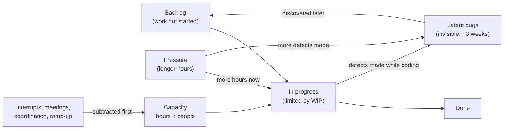
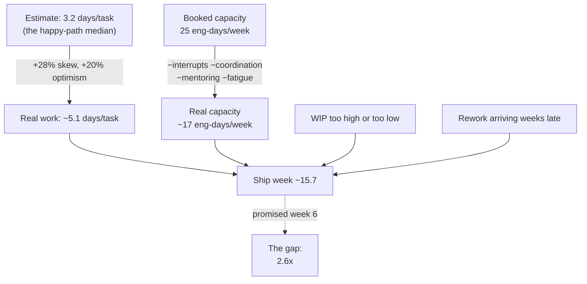
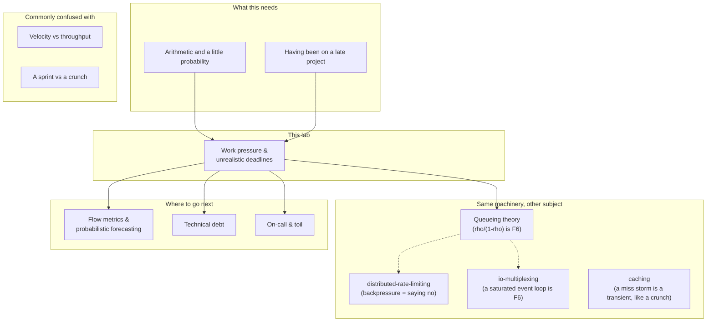

# Work Pressure and Unrealistic Deadlines

**A lab for a working engineer who has just been handed a date that does not fit.**

Most writing on this topic is advice: *communicate early, push back, set boundaries.*
That advice is correct and completely useless in the room, because the person across
the table also has advice, and theirs is *just get it done*. Advice loses to advice.

So this lab does something else. It builds a small, honest simulation of a team under
a deadline, and then runs the moves people actually make — work weekends, add
engineers, start everything at once, cut scope — and reports what each one does to the
ship date. By the end you will not be arguing about feelings. You will be arguing about
a range with the odds attached, and you will have run the numbers yourself.

Then, and only then, the last part of the lab covers the human half: what to say, to
whom, in what order, and what to do when the answer is still "do it anyway".

```
BEGINNER MODEL      §1-§9    why deadlines get missed, in plain words
INTERMEDIATE MODEL  §10      the five mechanisms, with numbers
ENGINEERING MODEL   §11-§14  failure modes, guarantees, runnable code
PRODUCTION MODEL    §15      the conversations, the scripts, and your own limits
```

**Everything numeric in this document was produced by running the code in `src/`.**
Where a claim is not backed by a run, it says so.

**What is in this lab**

| | |
|---|---|
| **README.md** | this document — the story, the mechanisms, the failure modes |
| **[PLAYBOOK.md](PLAYBOOK.md)** | what to actually say, in twelve situations. The part you will use on Monday. |
| **[visualization.html](https://claude.ai/code/artifact/29d16479-2b42-4dd0-bffc-9d1d8332ae7e)** | the simulator, with every lever exposed |
| **[EXERCISES.md](EXERCISES.md)** / **[SOLUTIONS.md](SOLUTIONS.md)** | eight rungs, answers measured not asserted |
| **`src/`** | the model. No dependencies: `java src/Tests.java` |

If you are in the middle of a bad week right now and want one thing: read §6, then
open PLAYBOOK.md item 2.

---

## §1 · WHY — what this is really about

You are asked how long something will take. You say six weeks. Somebody writes
"six weeks" on a slide, and from that moment on, six weeks is a promise that other
people have made plans around. Then the work turns out to be harder than it looked,
and now there is a gap between a real project and a public number.

That gap is where the damage happens, and almost none of it is the late date itself.

- **The product gets worse.** Under time pressure teams ship the same features with
  more defects. In this lab's model, a team on 60-hour weeks left **2.7× more bugs in
  the code** for users to find than the same team on 40-hour weeks.
- **The date slips anyway, silently.** People rarely announce a slip in week 3. They
  announce it in week 9, when there is no time left to do anything about it, having
  spent six weeks hoping.
- **Nobody learns anything.** The story becomes "the team was slow", so the next
  estimate gets the same treatment, and the next one.
- **It costs you personally.** Chronic deadline pressure is where good engineers burn
  out, get cynical, and leave — usually blaming themselves for a gap that arithmetic
  created before they wrote a line of code.

Here is the sentence this whole lab exists to earn:

> **In every simulation run in this lab, the project missed its date, and in none of
> them did anyone slack off.** Missing the date was not a behaviour problem. It was
> the plan meeting the world.

You cannot fix a plan by trying harder inside it. You fix it by changing what is in it,
and to do that you have to be able to show — not assert — what the plan actually
implies.

---

## §2 · PROBLEM — Saturday night in the kitchen

Forget software for a moment.

It is Saturday night at a restaurant with **five cooks**. Tickets come in from the
dining room. Each dish takes a cook a few minutes. The manager looks at the evening's
bookings, does some arithmetic — *forty tables, five cooks, we can do this* — and
promises every table their food within twenty minutes.

By 8pm the pass is covered in half-finished plates. Nobody is idle. Nobody is slow.
Everyone is moving faster than they were at 7pm. And the tickets are getting older.

Some things the manager's arithmetic did not include:

- A cook does not only cook. She answers the phone, shows the new kid where the stock
  is, and steps away when a customer sends something back.
- Some dishes take three times as long as expected, and nobody knows which ones until
  they start.
- A plate that goes out wrong comes back forty minutes later — and it comes back to
  the *front* of the queue, ahead of food nobody has started.
- When the manager shouts "faster", plates go out faster **and** more of them come
  back.

Every one of those is a real mechanism in a software project. And every one of them is
missing from the arithmetic that produced the promise.

**🔮 Predict:** *The manager sees the pass clogging up at 8pm and calls in two cooks
from the other branch. They walk in at 8:30. Does the kitchen catch up faster?*

<details><summary>Reveal</summary>

Not that night. The new cooks do not know where anything is, so for the first hour
they are asking questions — and every question is asked to somebody who was cooking.
The kitchen's output goes **down** first, then slowly up. By the time they are useful,
the rush is over.

You already believe this about kitchens. §11 shows the identical result for
engineers, measured: two engineers added in week 12 of this lab's project made it
finish **0.9 weeks later**. The same two people, hired in week 0, made it finish
**3.0 weeks earlier**. The hire was never the mistake. The timing was.
</details>

---

## §3 · NAIVE SOLUTION — the capacity spreadsheet

Here is how the promise gets made. This is a real shape of a real planning
conversation, and you can run it: `java src/BrokenPlan.java`.

```
  Scope        40 tasks x 3.2 days   = 128 engineer-days
  Capacity     5 engineers x 5 days  =  25 engineer-days/week
  Build        128 / 25              = 5.1 weeks
  Test & fix   fixed allowance       = 1.0 weeks
  Contingency  10%                   = 0.5 weeks
  ------------------------------------------------
  COMMITTED DATE                     = 7 weeks
```

(An **engineer-day** is one engineer's output for one working day. It is the unit
every capacity argument is conducted in, and getting from "5 engineers" to "25
engineer-days a week" is the first place a plan goes wrong — §10, Correction 2.)

Nobody in that room is stupid or lying. The engineers gave honest estimates. The
manager added a test phase *and* a contingency. Divide the work by the people, add a
bit for safety. It is the most reasonable thing in the world.

It is also wrong by about a factor of two, and it is wrong for reasons that have
nothing to do with anybody's effort.

---

## §4 · FAILURE — running the same project for real

`java src/Experiments.java estimate` runs that exact project forty times — same
scope, same five engineers, only luck differs.

```
Actual ship week, averaged over 40 simulated universes: 15.7 weeks (P10 13, P90 19)
Overrun vs the promise: 2.6x
```

Nobody was lazy. Every engineer worked every day. The work simply did not fit.

Where did the time go? The simulation tracks every paid hour:

```
And here is where the whole project's paid time actually went:
  building features                    224.9 engineer-days   57.4%
  fixing bugs the team made itself      20.9 engineer-days    5.3%
  support, meetings, interrupts         90.0 engineer-days   23.0%
  coordination between people           31.3 engineer-days    8.0%
  nobody had anything to pick up        24.4 engineer-days    6.2%
  TOTAL PAID FOR                       391.5 engineer-days
```

**Fifty-seven percent.** The spreadsheet assumed one hundred. That single number is
most of the gap, and it is not a moral failing — it is what the other 43% of a real
job looks like when you write it down.

Now turn the causes off one at a time. Each row is the same project with one
mechanism removed, so the "saved" column is what that mechanism was costing:

```
  world                                             weeks    saved
  everything on (reality)                            15.7        -
  no task-to-task variability (all tasks average)    15.3      0.3
  no interrupts (25% of capacity handed back)        12.0      3.7
  no defects, so no rework                           14.3      1.3
  no communication overhead                          14.5      1.1
  ALL of them off (pure coding time)                  9.6      6.1
```

(**Rework** is work you have to do a second time because the first version was wrong —
the team's own bugs coming back as new work. It gets a proper definition in §7.)

Look at the bottom row. In a fantasy world with **no interrupts, no bugs, no meetings
and no variation between tasks**, the project still takes **9.6 weeks** against a
5.1-week estimate. That remaining 4.5-week gap is pure optimism: the estimates
described the version of each task where nothing goes wrong.

This is the deeper problem, and it is worth stating carefully, because it is the thing
everybody gets backwards:

> The plan was not missed because reality intervened. **The plan was already wrong on
> day one.** Reality then made it worse.

---

## §5 · THE REAL REQUIREMENT — what we actually need

If a single date is a bet you lose, what should you be producing instead?

Not "a better date". A better date is still one number pretending to be certain about
work nobody has done yet. Watch what happens when the *only* thing that changes is
luck — same plan, same team, same forty tasks, only which tasks turn out nasty:

(Each row below is one run of the simulation. "Seed" is just the label for which
random draw of task durations that run used — same plan, different luck.)

```
seed 1000 -> 12.6      seed 1004 -> 14.8      seed 1008 -> 16.6
seed 1001 -> 17.4      seed 1005 -> 13.2      seed 1009 -> 13.8
seed 1002 -> 16.4      seed 1006 -> 13.8      seed 1010 -> 17.4
seed 1003 -> 18.6      seed 1007 -> 14.6      seed 1011 -> 16.6
```

**Week 12.6 to week 18.6 — a six-week spread with nothing changed but luck.** No
single number can be right about that. A number can only be right about it *with a
probability attached*.

So here is what we actually need to be able to produce, and everything after this
point is in pursuit of it:

1. **A range with probabilities**, from evidence, not from feelings:
   *"60 items left, this team's own last ten weeks, no new scope: week 12 is a coin
   flip, week 14 holds 85% of the time."*
2. **A menu of decisions with their real costs**, so the date is somebody's choice
   rather than your failure: *"week 10 at 85% needs 20 of the 60 items gone. Here are
   the 20 I would cut."*
3. **A way to keep the promise honest as the work reveals itself**, updated weekly,
   so nobody finds out in week 9.
4. **A sustainable version of you** at the end of it, because you will be asked again
   next quarter.

---

## §6 · KEY IDEA — the two sentences

Everything in this lab reduces to two sentences.

> **1. A date is not a fact about the work; it is a bet about the work. Say the odds
> out loud, or somebody else will assume they are 100%.**
>
> **2. There are only four levers — scope, time, people, quality — and under pressure
> exactly one of them moves quickly and honestly: scope.**

The second sentence is the one that changes your Monday. Time is what you are being
told to change. People arrive too slowly to help. Quality does not actually move — it
only *appears* to move, and gives the time back later with interest. What is left is
scope, which is why "what should we not build?" is the most senior question in the
room, and the one engineers ask least.

Both sentences are measured, not asserted, in §10 and §11.

---

## §7 · TERMINOLOGY — the words that let you argue precisely

Vague words lose arguments. These are the load-bearing ones; every term used later in
this document is defined here or at its first use, and all of them are collected in the
glossary in §18.

### Estimate · Forecast · Commitment
Three different things that get called "the date", and confusing them is how people
end up promising things they never meant to.

- **Estimate** — a guess about *one piece of work*, in isolation. "That endpoint is
  about three days." Honest, useful, and not a schedule.
- **Forecast** — a probability statement about *a whole body of work*, derived from
  evidence. "Week 14 holds 85% of the time." A forecast has an error bar by
  definition; a forecast without one is not a forecast.
- **Commitment** — a promise to other people, who then act on it. Marketing books the
  launch. Sales tells a customer.

*Why these words exist:* to stop the silent upgrade. Somebody asks for an estimate,
you give one, and it becomes a commitment on a slide without anybody deciding it
should. Naming the three lets you say the most useful sentence in project work: *"that
was an estimate, not a commitment — do you want me to turn it into a forecast?"*

*Example:* "about three days" (estimate) → "60 items left, P85 = week 14" (forecast) →
"we will ship the payments release on 12 October" (commitment).

### Point estimate · Distribution · Percentile (P50, P85)
A **point estimate** is a single number: "six weeks". A **distribution** is the full
set of outcomes with how often each happens — the histogram in §14. A **percentile**
picks a point on it: **P50** is the coin flip (half of outcomes land earlier), **P85**
is the date you make 85 times out of 100.

*Why they exist:* because a point estimate silently reports P50 *at best*, while
everyone hears P100. Measured in this lab: a team's own average velocity said week 12,
and week 12 came true **53%** of the time. P85 was week 14.

*Connection:* if you did the [cap-theorem](../cap-theorem/) or
[distributed-rate-limiting](../distributed-rate-limiting/) labs, this is the same move
as reporting p99 latency instead of an average. Nobody would accept "our average
response time is fine" as a statement about the worst case. A date is a latency number.

### The four levers
**Scope** (how much you build), **time** (when it is due), **people** (how many work
on it), **quality** (how carefully). Every deadline conversation is about these four
and nothing else. Fixing all four at once is not ambitious; it is arithmetic denial.

### Throughput · Cycle time · WIP · Little's Law
- **Throughput** — finished items per week. Measured, not estimated.
- **Cycle time** — how long one item takes from start to finished, *including all the
  waiting*.
- **WIP** (work in progress) — how many items are open at once.
- **Little's Law** — `cycle time = WIP / throughput`. Double the number of things you
  have on the go, and everything takes twice as long to come out, even though you are
  working just as hard.

*Why WIP has its own word:* because "started" and "finished" feel similar to a busy
team and are worlds apart to a business. Measured here: the same team with 40 tasks
open at once had **1.4 features working by week 6**; with 5 open it had **17.1**.

### Utilization
The fraction of capacity that is committed. **Not** a measure of how hard people work
— a measure of how little slack the system has. Waiting time grows with
`ρ / (1 − ρ)`, so it does not degrade gently; it goes off a cliff. Measured in §10:
at 80% busy a request takes 5× its own work time to come out; at 95% busy, **19×**.

### Rework · Escaped defect
**Rework** is work you have to do again because the first version was wrong. An
**escaped defect** is one you never found — production found it. Rework is the reason
pressure does not remove work, it *moves* work: a bug made in week 4 arrives as new
work in week 7, at the front of the queue.

### Scope creep
Work added after the plan was made. Not necessarily illegitimate — most of it is
genuinely needed. It is simply never subtracted from the date. Measured in §14: 1.5
extra items a week moved a P50 from week 12 to **week 18**. Creep was the single
largest term in that forecast — larger than everything else combined.

### Ramp-up time
How long a new person takes to reach full productivity, plus what they cost the people
teaching them. In this model: about six weeks to full speed, and a quarter of an
experienced engineer's day, every day, while it happens.

### Planning fallacy · Brooks's Law · Parkinson's Law · Student syndrome
Four named effects you can now put a number to:
- **Planning fallacy** — people estimate the version of a task where nothing goes
  wrong, even when they know from experience that something always does.
- **Brooks's Law** — "adding people to a late software project makes it later."
  Measured with a crossover point in §11: true from about week 8 of this 16-week
  project, false before it. The law is a warning, not a physics constant.
- **Parkinson's Law** — work expands to fill the time available. Early finishes are
  rarely reported, so the buffer you give each task is spent whether or not it was
  needed.
- **Student syndrome** — work starts at the last moment the buffer allows, which
  converts the buffer into a delay before anyone even begins.

---

## §8 · MENTAL MODELS — two pictures, and where the first one lies

### The simple model: Saturday night in the kitchen
Carry this one around. Five cooks, tickets arriving, a pass filling with half-finished
plates, food coming back to be redone, and a manager who thinks the problem is speed.

### The engineering model: a queue with a feedback loop
Precisely: a **queue of work items**, a **small number of servers** (engineers) whose
capacity is reduced by interrupts, coordination and fatigue, **service times drawn
from a right-skewed distribution** (they can run very late but never very early)
nobody can see in advance, and — the part that makes
it a machine rather than a pipe — **a feedback loop where the rate of work determines
the rate of future work**.



Follow the arrow from **Pressure**. It goes two places: a little more capacity now, and
more latent bugs that come back as new work later. That loop is why the project has a
*shape* rather than a speed, and why the intuitive fix is a loan rather than income.

### Mapping the two
| Kitchen | Project | In the code |
|---|---|---|
| A ticket | A task | `Task` |
| The cooks | The engineers | `Plan.teamSize` |
| Plates on the pass at once | WIP | `Plan.wipLimit` |
| Nobody knows which dish is nasty | Right-skewed durations | `Rand.lognormal` |
| Answering the phone, teaching the new kid | Interrupts, coordination, mentoring | `interruptFraction`, comm overhead, `MENTOR_DRAIN` |
| A plate sent back, jumping the queue | Rework preempting features | `Defect` → front of backlog |
| "Faster!" | Overtime | `hoursPerWeek` |
| Cooks slowing down at 1am | Fatigue | `energy` |
| The rush ending | The ship date | `Result.shipDay` |

### Where the analogy breaks — three places, and they all matter
1. **A kitchen has recipes; software does not.** A cook knows a risotto is 18 minutes
   because they have made 4,000. Most engineering tasks are done once, ever. This is
   why estimates are not just noisy but *biased* — and why "just estimate better" is
   not a plan.
2. **A kitchen resets at midnight.** Tomorrow starts clean. A project carries its
   debt forward: bugs made in week 4 are still arriving in week 9, and the code you
   rushed is code you will work in for years.
3. **A dish that comes back is obviously back.** A latent bug is invisible for weeks.
   Everything looks fine right up until the point where a third of the team is doing
   nothing but rework and the progress chart has been stuck at 90% for a month.

Where the analogy holds perfectly — and this is the part to keep — is the moment at
8pm when everyone is moving faster than an hour ago and the tickets are still getting
older. **That is what being on a doomed project feels like from the inside, and it is
the reason people blame themselves.**

---

## §9 · VISUALIZATION — run the project yourself

**→ [The Deadline Machine](https://claude.ai/code/artifact/29d16479-2b42-4dd0-bffc-9d1d8332ae7e)**
(also saved locally as `visualization.html` — it works offline, opened straight from
the file)

The page runs the same simulation as `src/Project.java`, using the same random number
generator, so a number you read there is a number this lab prints. (One difference in
presentation: the page averages 12 runs for its headline figure so it stays responsive;
this document quotes averages over 40.)

What to look at, in order:

1. **The dotted line against the green one.** This is a **burn-up chart** — finished
   work climbing towards the scope line, rather than a burn-down, so that a scope
   change is visible as the ceiling moving. The dotted line is the plan: a straight
   march to 40 features by the promised date. Green is what actually got finished.
   They separate in week 1 and never come back.
2. **"Where week N went".** The stacked bar under the chart splits that week's paid
   time into what became product and what did not. Step through the weeks and watch
   the teal segment shrink as new joiners arrive or fatigue accumulates.
3. **The luck slider.** Change nothing but which tasks turn out hard. The date moves
   by weeks. This is §5 made physical.
4. **The four "what could you do now" boxes.** Set the week, then read the four
   options. This is the meeting, with the answers already computed.
5. **The four predict-then-run questions at the bottom.** Commit to an answer before
   pressing. The explanations are the same ones in §11, so if you get one wrong you
   will meet it again with the numbers attached.

**Checkpoint — end of the BEGINNER MODEL.** You can now explain, to a non-engineer,
why a reasonable plan produced by reasonable people misses by 2× without anybody
underperforming, and why a date without a probability is not an answer. What you cannot
yet do is put a number on each mechanism, or say which intervention to reach for in
week 4 versus week 12. That is next.

---

## §10 · ACTUAL MECHANISM — the five things that eat a schedule

We will build the mechanism the way a careful person would, and let it break twice.

### Mechanism v1 — divide the work by the people

```
40 tasks × 3.2 days = 128 engineer-days ÷ 5 engineers ÷ 5 days = 5.1 weeks
```

This is the model in everyone's head, and it is not stupid: it is exactly right for
work that is fully known, fully parallel, and done by people who do nothing else.
Almost no engineering work is any of those things.

Five corrections turn it into the real thing. Each one is a separate mechanism with a
separate number, and — this matters — **they multiply, they do not add.**

### Correction 1 — an estimate is the median, and you pay the mean

Task durations are **right-skewed**: they cannot take less than zero time, but they can
take four times as long. When a person imagines a task, they imagine the typical case,
which is the **median**. What a schedule pays is the **average** — and for a skewed
distribution the average sits above the median, pulled up by the disasters.

`java src/Tests.java` measures it on this lab's distribution:

```
PASS summing_most_likely_estimates_understates_the_total
     median 4.0d but mean 5.12d (theory 5.11d) = 28% undercount
```

Every task is honestly estimated and every task is 28% short *on average*, before
anything goes wrong. Add the standard optimism (people picture the happy path — this
lab models it as 20%) and the estimate covers about 63% of the coding time.

> **A concrete case.** A task honestly estimated at 3.2 days. Eight times out of ten
> it lands between 2 and 6 days. One time in twenty it takes 14 — the API is
> undocumented, the staging environment is broken, the "small refactor" reaches into
> nine files. Nobody estimates the 14-day version, and nobody should. But *some* task
> in your forty will be it, and the schedule has no room for it.

### Correction 2 — capacity is not people × hours

The spreadsheet books 25 engineer-days a week from five engineers. Reality subtracts,
in this order, before anyone writes a line of code:

```
  5 engineers × 5 days                            = 25.0 engineer-days
  − new joiners not yet at full speed             (§11 F2)
  − mentoring the new joiners                     (0.25 day each, per day)
  − coordination between n people (2% each, each) = −2.0
  − support, meetings, incidents, reviews (25%)   = −5.8
  ------------------------------------------------------------
  what is actually available                      ≈ 17.3 engineer-days
```

The interrupt tax is the one people get wrong, and they get it wrong in a specific
way. `java src/Experiments.java interrupts`:

```
  unplanned work            ship week          vs 0%   1/(1-f) says
  0% of capacity                 12.0          1.00x          1.00x
  10% of capacity                13.2          1.10x          1.11x
  25% of capacity                15.7          1.31x          1.33x
  50% of capacity                23.1          1.93x          2.00x
```

**You divide by what is left; you do not subtract what is gone.** Giving a quarter of
the team's time to support is not a 25% delay, it is a 33% delay. Half is not half
again, it is double. Say this sentence in a planning meeting and watch a plan change.

### Correction 3 — quality is a loan, not a lever

Under pressure teams go faster by being less careful, and this genuinely works — for
a while. The catch is that a bug made in week 4 is invisible until week 7, and when it
appears it is *new work that jumps the queue ahead of features*.

`java src/Experiments.java overtime`:

```
  hours/week      ship week     vs 40h   escaped bugs      hours burnt
  40                   15.7          -              3             3132
  50                   15.4       -0.2              5             3855
  60                   16.4       +0.7              7             4914
  70                   17.3       +1.6             10             6055
```

Read the 60-hour row honestly, because the honest version is more useful than the
slogan. Crunch is **not** immediately useless:

```
  by week   features @40h  features @60h
  4                  11.8           16.0     <- crunch is 36% ahead
  8                  22.8           27.3     <- still ahead
  12                 34.1           35.8     <- lead nearly gone
  16                 39.4           39.3     <- crunch is now behind
```

For about twelve weeks the crunching team is genuinely ahead. Then two things catch
up: an hour of tired work is worth less than an hour of rested work, and the extra
bugs made in all those hours start arriving. It ships **0.7 weeks later**, with
**2.7× the bugs left in production**, having burnt **57% more hours**.

> **A two-week push before a real, immovable date is a legitimate engineering
> decision.** A quarter of 60-hour weeks is not a plan, it is a way of paying more for
> less. The lab lets you find the crossover yourself: it is around week 12–14 here,
> and it comes sooner the more defect-prone the work is.

### Correction 4 — starting is not finishing

Now the mechanism that is invisible in every capacity spreadsheet, because the
spreadsheet has no idea how many things are open at once.
`java src/Experiments.java wip`:

```
  WIP     ship week  shipped by wk 6    idle days  thrash days
  1            72.0              3.8        993.8          0.0
  2            36.5              7.2        381.6          0.0
  5            15.7             17.1         24.4          0.0
  8            16.8             15.1         26.1         24.8
  20           21.3              8.4         26.8        107.6
  40           26.3              1.4         26.8        195.6
```

A **U-curve**, and both walls hurt for different reasons. Below the team size people
sit idle waiting for something to pick up (993 wasted engineer-days at WIP 1). Above
it, everybody is on several things and pays a switching cost on each (195 wasted days
at WIP 40).

The right-hand wall is the one that gets teams killed, because it is what "everything
is a priority" *is*, mechanically. Look at the third column: at WIP 40, by week 6 the
team has **1.4 working features** out of 40. They have been busy for six weeks and have
nothing to show, nothing to hand over, nothing to demo, and — critically — **no way to
cut scope**, because every task is half-built and half-built work cannot be dropped.

### Correction 5 — the plan is a straight line and the work is not

Even with all four corrections, the last correction is the one from §5: none of this
is deterministic. The identical plan, run twelve times with nothing different but which
tasks turned out hard, ships between **week 12.6 and week 18.6**.

Which means the output of all this arithmetic is not a date. It is a distribution, and
the only honest way to report it is with a probability attached.

### Putting it together



**Checkpoint — end of the INTERMEDIATE MODEL.** You can now put a number on each of
the five mechanisms and explain which correction the plan in front of you is missing.
Next: what each of these looks like as a live failure, how to recognise it from the
inside, and what it costs.

---

## §11 · FAILURE SCENARIOS — the seven ways this actually goes wrong

Each one: how to reproduce it, what you see, why it happens, what it costs, what stays
true anyway, and how it shows up at work.

### F1 · The crunch spiral
**Reproduce:** `java src/Experiments.java overtime`, or the visualization with hours
set to 60.
**What happens:** output rises for two months, then falls below where it started.
Escaped bugs go from 3 to 7. Total hours burnt rise 57%.
**Why:** two loops running at once. Tired hours are worth less (this model floors an
hour's value at 60% of a rested one after sustained overtime), and rushed hours make
more defects, which arrive as queue-jumping rework three weeks later.
**What survives:** the work still gets done, and for short pushes crunch really is
faster.
**What is lost:** the *sustainability* of the pace, and quality — permanently, since
escaped defects are found by users.
**At work:** it shows up as a team that was heroic in Q1 and inexplicably slow in Q2,
usually diagnosed as a motivation problem. It is not. It is the bill.

**🔮 Predict:** *Your team crunches for eight weeks and ships. The next quarter's plan
assumes the same rate. What has actually happened?*

<details><summary>Reveal</summary>

Two things, and the second one is the career-relevant one.

Mechanically, you now have a quarter's worth of rework and escaped defects arriving
during the quarter that was planned at full speed, so the next project starts already
behind.

Organisationally — and this is the part nobody warns you about — **the crunch rate is
now the baseline.** Nobody who set the next plan saw the 60-hour weeks; they saw the
output. This is the ratchet, and it is why "we did it last time" is the most dangerous
sentence in this whole subject. The only defence is to make the cost visible *while it
is being paid*, not after: hours worked reported alongside features delivered, in the
same status update, every week.
</details>

### F2 · The late hire
**Reproduce:** `java src/Experiments.java people`.
**What happens:**

```
  intervention                        ship week   vs nothing  vs day-0 hire
  +2 engineers at week 0                   12.6         -3.0           +0.0
  +2 engineers at week 2                   14.4         -1.3           +1.8
  +2 engineers at week 4                   14.9         -0.8           +2.3
  +2 engineers at week 8                   15.9         +0.2           +3.3
  +2 engineers at week 12                  16.5         +0.9           +3.9
  +5 engineers at week 8                   16.3         +0.7              -
```

**Why:** a joiner takes about six weeks to reach full speed and costs an experienced
engineer a quarter of every day while it happens. Early, that investment has months to
repay. In week 12 of a 16-week project it never repays at all.
**What survives:** the hire is still right for the *next* project.
**What is lost:** the current date, plus some of the existing team's throughput.
**At work:** "we're getting you two more people" sounds like help and is usually a
substitute for the scope conversation nobody wants to have. The useful reply is not
"no" — it is *"yes, and they will help from about week N; for this date, what comes
out of scope?"*

There is a second, dumber trap hiding in the same place:

```
  5 engineers, 5 tasks open at once (baseline)       15.7
  7 engineers, still only 5 tasks open               16.4     <- WORSE
  7 engineers, 7 tasks open (planned from day 0)     12.6
```

Two extra engineers with no extra open work are worth **less than nothing** — they
add coordination cost and get idleness in return. Capacity you cannot break into
parallel work is not capacity.

### F3 · The WIP trap ("everything is a priority")
**Reproduce:** `java src/Experiments.java wip`, or set the visualization's WIP to 40.
**What happens:** ships in week 26 instead of 15.7, and by week 6 has **1.4** working
features instead of 17.1.
**Why:** capacity split across 40 tasks means every task creeps, plus a switching
penalty on each. Nothing crosses the finish line.
**What survives:** total work done per week is only moderately lower.
**What is lost:** everything *finished*, which is the only thing that counts — and
with it your ability to negotiate, because half-built work cannot be cut.
**At work:** this is the failure that feels the most like personal inadequacy. You
worked every day, you have 40 branches, and you cannot name one thing that is done.

### F4 · The interrupt tax
**Reproduce:** `java src/Experiments.java interrupts`.
**What happens:** 25% of capacity to support → 31% longer. 50% → 93% longer.
**Why:** `1/(1−f)`. You divide by what is left.
**What survives:** the support work, which was real work all along.
**What is lost:** the pretence that a team can be "80% on the project" and hit a plan
built at 100%.
**At work:** the most under-priced line in every plan. If your team carries the pager,
your usable capacity is not your headcount, and the fix is a number: *"we are the
on-call team; plan us at 3.5 engineers, not 5."*

### F5 · Scope creep
**Reproduce:** `java src/Experiments.java forecast`.
**What happens:** 60 items left, historical throughput ~5/week. With no additions, P50
is week 12. With **1.5 items a week** quietly added, P50 is **week 18**.
**Why:** creep subtracts from throughput permanently. Adding 1.5 against a throughput
of 5 is a 30% tax, so the remaining time divides by 0.7.
**What survives:** usually the new items really are needed.
**What is lost:** the date, silently, because nobody logs an addition as a slip.
**At work:** this is the single largest term in most real forecasts and the easiest to
fix: **every addition gets a date impact quoted at the moment it is added**, in the
same message. Not a refusal. A price tag.

### F6 · Utilization collapse
**Reproduce:** `java src/Experiments.java utilization`.
**What happens:**

```
  how busy           cycle time     Kingman est.
  50% busy                 1.99            2.00
  80% busy                 5.00            5.00
  90% busy                 9.84           10.00
  95% busy                19.28           20.00
  98% busy                57.95           50.00
```

**Why:** waiting grows as `ρ/(1−ρ)`. A team with no slack cannot absorb variation, so
every arrival waits behind the queue that the last surprise created. (The right-hand
column is **Kingman's formula**, the standard approximation for how long a queue makes
you wait. The simulation runs slightly worse than it at 98% because real service times
have a fat tail; the formula is the polite version.)
**What survives:** throughput. The team really is producing more per week at 95% than
at 50%.
**What is lost:** responsiveness, and therefore everything that depends on
responsiveness — code review latency, incident response, the ability to take on
anything unplanned.
**At work:** "we're all fully allocated" is not a status report, it is a diagnosis.
Fully allocated is precisely the state in which nothing moves. This is the number that
explains why your PR sat for three days on a team where everyone was busy.

### F7 · The silent slip (the human failure mode)
**Reproduce:** you cannot; the model has no morale. This one is observational and is
flagged as such.
**What happens:** the team knows in week 3. Nobody says anything until week 9.
**Why:** in week 3 the evidence is soft and the social cost of raising it is high; the
optimistic story is still *possible*, and each individual week's slip is small enough
to hope through. By week 9 the evidence is undeniable and it is far too late for the
only lever that works quickly — cutting scope, which §11/F5 and §10 both show pays
almost nothing when pulled late.
**What is lost:** every cheap option. The cost of a slip announced in week 3 is a
conversation. In week 9 it is a crisis.
**At work:** this is the failure mode *you personally control*, and it is the reason
§15 is mostly about a weekly rhythm rather than a heroic conversation. The forecast
goes out every week whether or not it has changed. When it moves, it moves in a
message that has been arriving every week for two months, so it lands as data rather
than as an alarm.

---

## §12 · WHAT YOU CAN AND CANNOT GUARANTEE

Pulling the whole thing together. This is the part to have straight before you walk
into the room.

### You can guarantee
- **A probability, from evidence.** "Week 14 holds 85% of the time, based on this
  team's last ten weeks." That is a claim you can defend line by line.
- **A rate, measured.** Throughput is a fact about the past. Nobody can argue with it,
  which is exactly why it is the strongest thing you can bring.
- **A menu.** "Week 10 at 85% needs 20 of these 60 items gone. Here are the 20 I would
  cut and what each costs." That converts your problem into somebody's decision.
- **A rhythm.** The forecast updates every week, so nobody is surprised.
- **Your own conduct.** You will say what you know when you know it, and then execute
  the decision that gets made.

### You cannot guarantee
- **A date at 100%.** Not for work nobody has done before. Anybody promising this is
  promising the P50 and hoping.
- **That effort closes an arithmetic gap.** Measured all through §10 and §11: it does
  not. It moves the cost, mostly into quality and mostly into the future.
- **That being right will win the argument.** Sometimes the date is genuinely
  immovable and the answer is still "do it anyway". §15 covers that case, because it
  is common and it is survivable.

### What you traded away to get the guarantee
Reporting a range instead of a date costs you something real, and it is worth naming
so it does not ambush you: **a range sounds less confident.** "Week 14" sounds like
someone in control; "week 12 to 16, 85% by 14" sounds like hedging to an audience not
used to it.

The trade is worth it, but only if you make the range *useful* rather than merely
honest. Two things do that: always bring the decision that shortens it, and never
report a range you would not defend to the day. A forecast that keeps sliding is worse
than a date, because it teaches people your numbers mean nothing.

### The invariants — the four things to hold in every deadline conversation
1. **Never let an estimate become a commitment silently.** Name the upgrade when it
   happens.
2. **Never report a date without a probability, and never report a probability without
   the evidence under it.**
3. **Never take work in without taking work out, or quoting the price.** Both are
   fine. Silence is not.
4. **Never let a slip be discovered.** It should be the fourth week in a row that the
   number has been in front of them.

**Checkpoint — end of the ENGINEERING MODEL's first half.** You can now name each
failure mode, reproduce it, and say what it costs. Next: the code that produced all of
it, so you can change the assumptions and argue with me.

---

## §13 · CODE — what is in the lab and how to read it

No dependencies, no build tool. JDK 25's source launcher compiles the directory:

```bash
cd work-pressure-and-deadlines

java src/Tests.java              # 17 scenario checks — every claim this doc makes
java src/Experiments.java        # all 8 experiments (a couple of seconds)
java src/Experiments.java wip    # one of them: estimate|overtime|people|scope|
                                 # wip|utilization|interrupts|forecast
java src/BrokenPlan.java         # a plan with four planted mistakes (Exercise 6)
```

| File | What it is |
|---|---|
| `Plan.java` | Every lever a manager can pull. Read this first — it is the whole argument in 40 fields. |
| `Project.java` | The simulator. Day by day: work out capacity, pull work in, spend it, make bugs. |
| `Task.java` `Defect.java` `Result.java` | The three nouns. |
| `Forecast.java` | Monte Carlo forecasting from a team's own throughput history. |
| `Queueing.java` | Why a busy team is a slow team (§11/F6). |
| `Rand.java` | mulberry32, deliberately — the visualization runs the identical generator. |
| `Tests.java` | Named after the claims: `overtime_is_ahead_early_and_behind_at_the_end`. |
| `Experiments.java` | The eight measurements quoted throughout this document. |
| `BrokenPlan.java` | A capacity spreadsheet with four planted mistakes. |

### The load-bearing lines

**Where the estimate goes wrong** — `Rand.lognormal` (`Rand.java`):

```java
double lognormal(double median, double sigma) {
    return median * Math.exp(sigma * gauss());
}
```

One line, and it is the whole of §10's Correction 1. The caller passes the **median**
— the value a person pictures when estimating. What the schedule pays is the mean,
`median × exp(σ²/2)`, which for σ = 0.7 is 28% higher. Nothing else in the model has
to be pessimistic for the plan to be wrong.

**Where capacity goes** (`Project.java`) — the subtractions, in order:

```java
double energy = ot > 0 ? Math.max(0.60, 1 - 0.03 * otWeeks * (ot / 20.0)) : 1.0;
// ... ramp-up per joiner ...
double mentor    = MENTOR_DRAIN * joinersInRamp * perPersonDays;
double afterComm = afterMentor * (1 - comm);      // 2% per other engineer
double capacity  = afterComm * (1 - interrupts);  // the 1/(1-f) tax
```

Each line is one of §10's corrections, and the order matters: they compose
multiplicatively, which is why four "small" 10% effects are not a 40% problem.

**Where pressure becomes future work** (`Project.java`) — the feedback loop:

```java
// Pressure does not remove work, it moves work into the future.
double qualityMult = 1 + (ot / 20.0) * (1 + 0.08 * otWeeks);
defectAcc += spent * p.defectsPerEngineerDay * qualityMult;
...
int disc = day + (int) Math.round(p.discoveryDelayDays * (0.5 + qa.next()));
```

Two properties do all the work here. Defects scale with *both* how much overtime and
*how long it has been going on* — that is the spiral. And they are discovered weeks
after they are made, which is why the burndown looks fine right up until it doesn't.

**Why rework hurts more than its size** (`Project.java`):

```java
// Rework preempts features: bugs jump the queue, which is exactly why a
// "code complete" project can sit at 95% done for a month.
backlog.add(0, new Task(nextTaskId++, d.reworkDays, true));
```

`add(0, …)` — the front of the queue. 20.9 engineer-days of rework in the baseline run
is only 5% of the budget, but it lands on the critical path at the worst moment.

**Fair comparisons** (`Project.java`): task durations are drawn from a stream seeded by
the world seed alone, so two plans compared under the same seed face an identical
universe of work. This is why the lab can say "the same project, with one decision
changed" and mean it. Comparing two plans on different random draws would measure
luck, not the decision.

### What the model deliberately does not have
Named, because a model's omissions are as load-bearing as its contents:
**dependencies between tasks** (real critical paths are worse than this — variance
compounds along a chain instead of averaging out), **people leaving**, **morale**,
**a task that turns out to be impossible**, **the one senior engineer everything
routes through**, and **learning** (a real team gets faster at its own codebase).
The overtime and ramp-up curves have the shape reported in published studies of
sustained overtime; the exact constants are this model's own. Treat every number as
the direction and rough size of an effect, not a prediction for your team.

---

## §14 · EXPERIMENTS — break it yourself

Predict first, then run. Each takes seconds.

### E1 · Where did the promise come from?
```bash
java src/Experiments.java estimate
```
**Predict:** in a world with no interrupts, no bugs, no meetings and no variability,
does the 5.1-week estimate come true?
**You will see:** 9.6 weeks. **Why:** the estimate was the median of the happy path;
even perfect execution pays the mean.

### E2 · Does crunch work?
```bash
java src/Experiments.java overtime
```
**Predict:** at what week does the 60-hour team fall behind the 40-hour team?
**You will see:** it leads for ~12 weeks, then loses. Ships 0.7 weeks later with 2.7×
the escaped bugs. **Why:** tired hours are worth less, and rushed hours make rework
that arrives later.

### E3 · The reinforcements
```bash
java src/Experiments.java people
```
**Predict:** which week is the break-even point for adding two engineers?
**You will see:** about week 8 in a 16-week project — roughly half way. **Why:** six
weeks of ramp-up plus a quarter of a mentor's day has to repay itself before the end.

### E4 · Cutting scope
```bash
java src/Experiments.java scope
```
**Predict:** cutting 40% in week 1 saves 5.1 weeks. How much does the same cut save in
week 12?
**You will see:** 0.7 weeks. **Why:** by week 12 you have already paid for most of it.
**The lesson is not "cut scope", it is "cut scope early or do not bother."**

### E5 · Everything at once
```bash
java src/Experiments.java wip
```
**Predict:** with 40 tasks open instead of 5, how many features work by week 6?
**You will see:** 1.4, against 17.1. **Why:** everything creeps, nothing crosses the
line, and half-built work cannot be cut.

### E6 · The busy team
```bash
java src/Experiments.java utilization
```
**Predict:** going from 80% to 95% allocated — how much slower does one request get?
**You will see:** 5× → 19×, nearly four times worse. **Why:** `ρ/(1−ρ)`.

### E7 · The support tax
```bash
java src/Experiments.java interrupts
```
**Predict:** the team gives 25% of its time to support. How much later does the
project ship?
**You will see:** 31% later, not 25%. **Why:** `1/(1−f)`.

### E8 · The forecast you take to the meeting
```bash
java src/Experiments.java forecast
```
This is the one to learn to do with your own team's numbers. It uses nothing but a
throughput history — items finished per week for the last ten weeks — and replays it
20,000 times.

```
Last 10 weeks the team finished: [4, 6, 3, 7, 5, 2, 6, 5, 4, 8]
There are 60 items left. The date already promised is week 10.

Average velocity says: 12.0 weeks. One number, no range, no scope creep.

  week  10 | #####                                      3.8%  <== the promised date
  week  11 | #######################                   17.8%
  week  12 | ########################################  31.3%
  week  13 | ###################################       27.4%
  week  14 | ##################                        14.2%
  week  15 | ######                                     4.4%

  P50 = week 12    P85 = week 14    P95 = week 15
  Chance of hitting the promised week 10: 4%
```

Then the two lines that change the conversation:

```
Now add the 1.5 items per week that keep getting 'just added':
  P50 = week 18    P85 = week 20     Chance of hitting week 10: 0%

How much scope must go to make week 10 an 85% bet (no creep)?
  60 items left -> P85 = week 14, chance of week 10 =   4%
  50 items left -> P85 = week 12, chance of week 10 =  54%
  40 items left -> P85 = week  9, chance of week 10 =  97%
```

**Twenty items out of sixty, and week 10 goes from a 4% bet to a 97% bet.** That is
the sentence. Not "we can't do it" — *"here is the exact size of the gap, and here is
what closes it."*

**Checkpoint — end of the ENGINEERING MODEL.** You can now produce a forecast, defend
it, and price any intervention someone proposes. What remains is the part that
actually decides how your week goes: what you say, to whom, and when.

---

## §15 · PRODUCTION — the conversations

Everything above is ammunition. This section is the weapon, and it is mostly not about
numbers.

**Paste-ready wording for every situation below is in [PLAYBOOK.md](PLAYBOOK.md).**

### 15.1 · First, work out which deadline you actually have

Four different things get called "an unrealistic deadline". They need four different
responses, and using the wrong one is why smart engineers lose these arguments.

| Type | How to recognise it | What works |
|---|---|---|
| **The anchor** | The date came from a round number, a quarter boundary, or someone's guess. Nobody can say what breaks if it moves. | Evidence. A forecast usually just moves it — this is the easy case and it is more common than engineers assume. |
| **The hard external date** | A regulation, a contract, a conference, a partner launch, a tax year. Real money or legal exposure attached. | The date genuinely will not move. **Do not argue about it.** Go straight to scope: what is the smallest thing that is legally/contractually enough on that date? |
| **Manufactured urgency** | Everything is urgent. There is always a new "critical" date. Last quarter's emergency shipped and nothing happened. | Evidence will not work, because the date was never the point. This is a management-practice problem; §15.7. |
| **The real business constraint** | Runway, a funding round, a competitor, a customer who will leave. Costly but genuine. | Full transparency both ways. This is where a two-week push is legitimate, *bounded and named as such*. |

**Ask the question that separates them:** *"What happens if this lands two weeks
later?"* An anchor produces vagueness. A hard date produces a specific, checkable
consequence. Manufactured urgency produces annoyance at the question — which is itself
the answer.

### 15.2 · The first response, on the day you are handed the date

Do not accept, and do not refuse. Both are traps: accepting makes it yours, refusing
makes you the obstacle. Convert it into a forecast, and buy a day or two to build one.

The move: *"Let me come back tomorrow with what fits and what doesn't."* Then bring
three things — the forecast with its probability, the gap in units of work, and a
menu of options with dates attached. Never a problem without options; never options
without dates.

The framing that does the work: **you are not asking permission, you are handing back
a decision that was always theirs.** "I can't do it in six weeks" is a statement about
you. "Six weeks fits 40 of these 60 items at 85% confidence; here are the 20 I would
drop, or here is what the other dates look like" is a statement about the work.

### 15.3 · The weekly rhythm — the thing that actually prevents the crisis

The single highest-value habit in this entire lab, and it is boring:

> **Send the same short forecast every week, whether or not it has changed.**

Four lines: what finished, current throughput, current forecast with its probability,
and anything that changed the forecast. Same format, same day, every week.

Why it works, mechanically: a slip announced in week 3 is a conversation with cheap
options (§10 shows cutting scope in week 1 saves 5.1 weeks and in week 12 saves 0.7).
A slip announced in week 9 is a crisis with no options left. The weekly note makes
week 3 the natural time to say it, because the number moving is *routine* rather than
an alarm — you have been sending it since week 1.

It also quietly solves the credibility problem. When the number moves in week 6, it is
the sixth in a series, not the first thing anyone has heard. Nobody can say they were
surprised, and nobody has to be blamed for surprising them.

### 15.4 · The three sentences that do most of the work

**When new work arrives mid-project** — never refuse, always price:
> *"Happy to take it. It's about four days, which moves the forecast from week 12 to
> week 13. Do you want it in, or do you want something else out?"*

This works because it is genuinely cooperative and completely non-negotiable at the
same time. You did not say no. You made the arithmetic visible and handed the choice
back. Do this every single time, including for small things — the whole damage of
scope creep (§11/F5: week 12 → week 18) is made of items that were individually too
small to mention.

**When the answer is "just work harder"**:
> *"We can push for two weeks before the date and that's real — it buys about X. As a
> way to close a six-week gap it doesn't work; here's what happened last time we tried
> it."*

Concede the true part first. Crunch *is* faster for short pushes (§10, Correction 3),
and pretending otherwise costs you the argument with anyone who has seen it work.

**When you are told to do it anyway** — and you will be:
> *"Understood — we'll go for the 30th and I'll push for it. So it's on the record: my
> forecast is week 14 at 85%, and the main risk is X. I'll send the forecast weekly
> and flag it the moment it moves."*

Say it once, in writing, without drama, then execute properly. This is not
covering yourself; it is the disagree-and-commit that makes you someone worth
listening to next time. The engineer who says "I told you so" in November was never
going to be believed in September either.

### 15.5 · Written, but not adversarial

Everything material goes in writing — but the *reason* matters, and it changes how you
write it. You are not building a case. You are building a shared memory, because in
week 9 nobody will remember week 3 the same way.

- Write it as a **summary for the group**, not a note to file: "Summarising where we
  landed so we're all working from the same picture."
- **Facts, forecast, decision, owner.** No adjectives. No "as I warned".
- Send it to **the person who made the decision**, cc the people affected by it.
- If the reply is verbal, summarise it in writing yourself: *"Confirming what we
  agreed…"*.

The test of a good escalation note: **the person you are escalating about would be
comfortable forwarding it.** If it would embarrass them, rewrite it.

### 15.6 · Handling the pressure itself

Everything above is about the project. This part is about you, and it is the part
engineers skip.

**Separate the two things that feel identical.** *"This plan will not fit"* is an
arithmetic problem and it is not yours to feel bad about. *"I am not good enough"* is
what an arithmetic gap feels like from the inside — especially in the WIP trap
(§11/F3), where you worked every day and finished nothing. Every simulation in this
lab missed the date, and there was nobody in them to blame. When the feeling arrives,
go and look at the forecast: it is usually the arithmetic, and the arithmetic is
public.

**Know the difference between a sprint and a lifestyle.** Two weeks of long hours
before a real date is a professional decision. A quarter of them is a system that has
decided your time is free. The signal is not the hours — it is the *recovery*: a real
sprint has a named end date and a slack week after it. If nobody has budgeted the
recovery, it was never a sprint.

**Watch the ratchet.** Heroics become the baseline (§11/F1). The defence is to make
the cost visible while it is being paid, not after — hours reported next to features,
every week, in the same note as the forecast. This is not complaining. It is the same
principle as the rest of the lab: put the real number where people can see it.

**Symptoms worth taking seriously**, because they are the ones that show up before you
notice: sleep going first, work leaking into the last hour before bed, dreading
Mondays specifically rather than generally, cynicism arriving where you used to be
curious, and small tasks starting to feel enormous. Two or more of those for a month
is data, not weakness.

**Protect the recovery like a deliverable.** After a real crunch, the next two weeks
run at reduced load — not because people deserve it, but because §11/F1's rework is
arriving in exactly those weeks and someone has to absorb it. Plan it in, out loud.

### 15.7 · When it does not work

Sometimes you do everything in this document and nothing changes: the forecasts are
ignored, the scope conversation never happens, every quarter is an emergency.

That is real, and it is worth naming honestly rather than concluding that you argued
badly. Some organisations run on manufactured urgency and are not, in the short term,
going to stop. What is still in your control:

- **Do the process anyway**, at low cost. The weekly forecast takes ten minutes and
  builds the only currency that matters: a record of being right early, repeatedly.
- **Find the person who can actually decide scope** and talk to them directly. Very
  often the pressure is being relayed by someone with no authority to relieve it.
- **Protect the floor, not the ceiling.** If you cannot control the hours, control the
  quality floor — tests, review, no unreviewed merges. Those are the things that make
  the *next* quarter survivable, and they are much harder to argue away than a date.
- **Set an honest time limit for yourself.** "If this is still the pattern in six
  months, I will move." Chronic deadline pressure with no lever is one of the few
  genuinely good reasons to change teams or companies, and treating that as a normal
  option — rather than a failure — is what stops the slow slide into cynicism.

### 15.8 · From the toy to the real thing

| This lab | Real teams | Real organisations |
|---|---|---|
| `Forecast.simulate` on made-up throughput | The same Monte Carlo on your Jira/Linear cycle-time export | Probabilistic forecasting, `#NoEstimates`, Troy Magennis's spreadsheets |
| `wipLimit` | A column limit on the board | Kanban, flow metrics, "stop starting, start finishing" |
| `interruptFraction` | A measured support tax per team | Explicit interrupt rotation; capacity planned at the measured number |
| Overtime → defects | The team's own defect rate under pressure | Published sustained-overtime studies; DORA change-failure rate |
| Utilization curve | Why your PR sat for three days | Slack (DeMarco); deliberate 80% allocation |
| Adding people late | Onboarding cost per hire | Brooks, *The Mythical Man-Month* |

**Worth reading next, in this order:** Vacanti, *Actionable Agile Metrics for
Predictability* (the forecasting method in E8, properly). DeMarco, *Slack* (why 100%
utilization is the mistake). Brooks, *The Mythical Man-Month*, chapter 2. Goldratt,
*Critical Chain* (buffers, Student syndrome). Kahneman on the planning fallacy in
*Thinking, Fast and Slow*.

**Checkpoint — end of the PRODUCTION MODEL.** You can now diagnose which kind of
deadline you have, produce a defensible forecast from your team's own history, price
any intervention, run a weekly rhythm that prevents week-9 crises, and recognise when
the problem is not solvable from your seat.

---

## §16 · EXERCISES

[EXERCISES.md](EXERCISES.md) — eight rungs, from "explain it in your own words" to
"design the plan for a 3-team, 2-quarter programme with a regulatory date".
Answers in [SOLUTIONS.md](SOLUTIONS.md); attempt first.

The four worth doing even if you skip the rest:

- **3.2** — predict which of four interventions wins in week 4, then run it. Most
  people get this wrong in a specific, revealing way.
- **4.1** — set every task to exactly its average duration and watch what happens to
  the date. The answer is smaller than almost anyone predicts, and it explains why
  "estimate better" is not the fix.
- **6** — `java src/BrokenPlan.java` has four planted mistakes. Find them before
  reading the answers; they are the four mistakes in most real capacity sheets.
- **8.1** — write the actual message. This is the only exercise that changes what
  happens on Monday.

---

## §17 · KNOWLEDGE MAP — where this sits



**Builds on your existing labs, in an unexpected way.** The four levers
(scope/time/people/quality) are the same shape of argument as
[cap-theorem](../cap-theorem/): a small set of properties you would like all of, where
the world forces a choice, and where the professional skill is *naming the trade
publicly* rather than pretending to escape it. The utilization curve in §11/F6 is the
same mathematics that makes a saturated event loop in [io-multiplexing](../io-multiplexing/)
collapse, and the same reason [distributed-rate-limiting](../distributed-rate-limiting/)
exists: **a queue with no slack does not degrade, it falls over.** Rate limiting is
backpressure implemented in code; saying "yes, and here is what comes out" is
backpressure implemented in a person.

**Commonly confused, with the one sentence that separates them:**
- **Velocity vs throughput** — velocity counts estimated points (a guess about a
  guess); throughput counts finished items (a fact). Forecast with throughput.
- **A sprint vs a crunch** — a sprint is a fixed-length planning window; a crunch is
  working beyond sustainable hours. Calling a crunch a sprint is how it becomes
  permanent.
- **Utilization vs productivity** — utilization is how committed capacity is;
  productivity is how much comes out. Past ~80% they move in opposite directions.
- **A deadline vs a target vs a milestone** — a deadline has a real consequence on the
  day; a target is a thing to aim at; a milestone is a checkpoint. Most "deadlines"
  are targets, and §15.1's question finds out which.
- **Estimate vs forecast vs commitment** — see §7. The most expensive confusion in
  this entire subject.

**Next:**
```
/learn queueing-theory        # Little's Law and Kingman properly - the machinery
                              # under F6, and under every saturated system you own
/learn technical-debt         # the quality loop of F1, as a long-run balance sheet
/learn on-call-and-toil       # where F4's interrupt tax actually comes from
/learn kafka                  # unrelated to this lab, and the next big systems gap
                              # in your map after consistent-hashing
```

---

## §18 · GLOSSARY

In order of appearance.

| Term | Plain meaning |
|---|---|
| **Estimate** | A guess about one piece of work, in isolation. Not a schedule. |
| **Commitment** | A promise other people plan around. |
| **Forecast** | A probability statement about a whole body of work, from evidence. Always has an error bar. |
| **Point estimate** | A single number with no probability attached. Heard as certainty; true at best half the time. |
| **Distribution** | The full set of possible outcomes and how often each occurs. |
| **Percentile (P50, P85)** | The date you make 50% / 85% of the time. P50 is a coin flip. |
| **Right-skewed** | A shape where things can run very late but not very early. Task durations are this shape. |
| **Median vs mean** | The median is what you picture; the mean is what you pay. For this lab's tasks the mean is 28% higher. |
| **Lognormal** | The specific right-skewed distribution used here for task durations. |
| **The four levers** | Scope, time, people, quality. Every deadline conversation is these four. |
| **Scope** | How much you are building. The only lever that moves fast and honestly. |
| **Throughput** | Finished items per week. A measured fact about the past. |
| **Cycle time** | How long one item takes start to finish, *including waiting*. |
| **WIP** | Work in progress: how many items are open at once. |
| **Little's Law** | `cycle time = WIP / throughput`. Twice as many things on the go, twice as long to come out. |
| **Utilization (ρ)** | The fraction of capacity committed. A measure of slack, not of effort. |
| **Kingman's formula** | The approximation that says waiting grows as `ρ/(1−ρ)`. |
| **Slack** | Uncommitted capacity. The thing that absorbs surprises; the first thing cut. |
| **Rework** | Work done again because the first version was wrong. |
| **Latent bug** | A defect that exists but has not been found yet. Invisible for weeks. |
| **Escaped defect** | A defect users find because you shipped before finding it. |
| **Scope creep** | Work added after the plan, never subtracted from the date. |
| **Ramp-up time** | How long a new joiner takes to reach full speed, plus what they cost their mentor. |
| **Planning fallacy** | Estimating the version of a task where nothing goes wrong. |
| **Brooks's Law** | "Adding people to a late project makes it later." True after a crossover point; false before it. |
| **Parkinson's Law** | Work expands to fill the time available, so per-task buffers are always spent. |
| **Student syndrome** | Starting at the last moment the buffer allows, converting buffer into delay. |
| **Engineer-day** | One engineer's output for one working day. The unit of every capacity argument. |
| **Interrupt tax** | Capacity lost to unplanned work. Costs `1/(1−f)`, not `f`. |
| **Monte Carlo forecast** | Replaying a team's own throughput history thousands of times to get a distribution of finish dates. |
| **Bootstrap** | Sampling from real past weeks rather than assuming a mathematical shape. |
| **Common random numbers** | Comparing two plans against the identical universe of work, so you measure the decision and not the luck. |
| **Burn-up chart** | Finished work climbing towards a scope line, so scope changes are visible. A burn-down hides them. |
| **The ratchet** | Heroic output silently becoming the new baseline expectation. |
| **Disagree and commit** | Stating your objection once, in writing, then executing the decision properly. |
| **The anchor** | A deadline that came from a round number and has no consequence behind it. |
| **Manufactured urgency** | Permanent emergency as a management style. Evidence does not fix it. |
