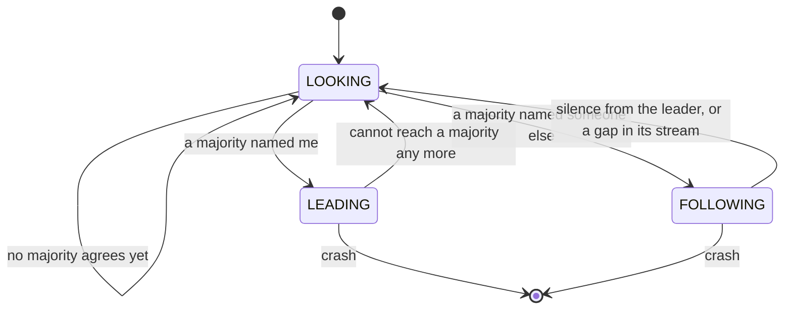
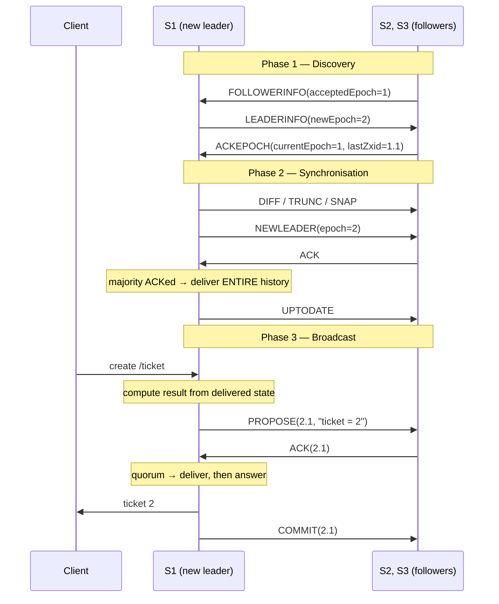
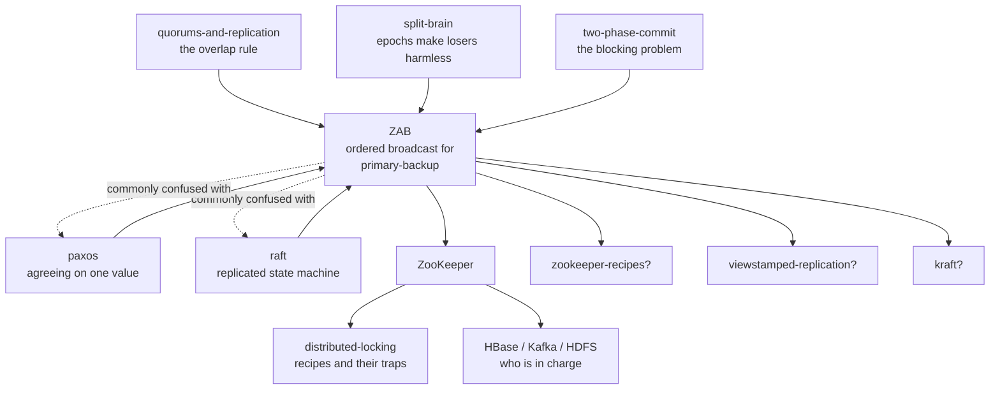

# ZAB — ZooKeeper Atomic Broadcast

### How a group of servers keeps one shared list of changes, and how a new leader takes over without giving two customers the same ticket number

---

> **Interactive simulator for this lab:** **[The Epoch Ledger](https://claude.ai/code/artifact/06a418b4-e42b-4491-9fb6-ef72c3e0d4c3)**
> (also saved beside this file as `visualization.html`, works offline)
>
> Nine predict-then-run scenarios. Start with **1 · One write, from start to finish**,
> then **2 · The primary dies one breath too early**. Sections 9 and 11 tell you exactly
> when to open it.

---

## What you already know, and what this lab adds

You have already done the **[raft](../raft/)** lab, so you know what a replicated log is, what a
term is, why a majority is the magic number, and why a leader that is missing a committed entry
must never be elected. You have done **[paxos](../paxos/)**, **[quorums-and-replication](../quorums-and-replication/)**,
**[split-brain](../split-brain/)** and **[distributed-locking](../distributed-locking/)**.

Several of those labs mentioned ZAB and ZooKeeper's `zxid` in passing and never opened the box:

- `cap-theorem` listed ZooKeeper as a CP system running "Raft/ZAB consensus".
- `split-brain` said "**ZooKeeper** — ZAB, and `zxid` is the epoch", and left it there.
- `distributed-locking` used `zxid` as an example of a fencing token you get for free.
- `paxos` closed with a table saying ZooKeeper uses "ZAB, a Paxos-family protocol with a stronger
  leader and log-order guarantees."

*(Those two words — `zxid` and `epoch` — are quoted here only to show what was left unexplained. Both
get proper definitions in [section 7](#7-the-vocabulary-now-that-you-have-earned-it); nothing before
that point depends on knowing them.)*

This lab is that box, opened. And the single most useful thing in it is **not** "ZAB is like Raft".
It is the opposite:

> **ZAB is not a replicated state machine protocol. It is a primary-backup protocol.**
> Raft replicates *commands* and every server computes the answer itself. ZAB replicates
> *answers* that one server has already computed. That one difference is why ZAB exists,
> why its serial number has two halves, and why a new leader's very first act is to publish
> its predecessor's unfinished business before writing anything of its own.

If you finish this lab able to say that paragraph and explain each clause, you have it.

---

## Table of contents

| # | Section | Layer |
|---|---|---|
| 1 | [Why this exists](#1-why-this-exists) | beginner |
| 2 | [The problem, as a story](#2-the-problem-as-a-story) | beginner |
| 3 | [The obvious fix](#3-the-obvious-fix) | beginner |
| 4 | [Where the obvious fix breaks](#4-where-the-obvious-fix-breaks) | beginner |
| 5 | [What we actually need to guarantee](#5-what-we-actually-need-to-guarantee) | beginner |
| 6 | [The key idea](#6-the-key-idea) | beginner |
| 7 | [The vocabulary, now that you have earned it](#7-the-vocabulary-now-that-you-have-earned-it) | beginner |
| 8 | [Two mental models, and where the nice one lies](#8-two-mental-models-and-where-the-nice-one-lies-to-you) | beginner |
| 9 | [Go and watch it move](#9-go-and-watch-it-move) | beginner |
| 10 | [The mechanism, built one failure at a time](#10-the-mechanism-built-one-failure-at-a-time) | intermediate |
| 11 | [The failure scenarios in full](#11-the-failure-scenarios-in-full) | engineering |
| 12 | [What is guaranteed, what is not, and what it cost](#12-what-is-guaranteed-what-is-not-and-what-it-cost) | engineering |
| 13 | [Production](#13-production) | production |
| 14 | [Exercises](#14-exercises) | — |
| 15 | [Where this sits, and what to learn next](#15-where-this-sits-and-what-to-learn-next) | — |
| 16 | [Glossary](#16-glossary) | — |

---

# BEGINNER MODEL

## 1. Why this exists

Every large system ends up with a small number of facts that **absolutely everyone must agree on**:
which server is currently in charge of customer shard 7, which machines are alive right now, what
today's configuration is, who holds the lock on the nightly billing job.

These facts are tiny — a few kilobytes in total. But if two machines get two different answers, the
damage is not tiny. Two servers both believing they own shard 7 will both write to it. Two schedulers
both believing they hold the billing lock will both charge every customer. The cost of disagreement
here is not a slow page; it is money moving twice.

So people build a small, separate, extremely careful service whose only job is to hold those facts and
never give two different answers. Apache ZooKeeper is the best-known one. HBase uses it to decide
which server owns which region. Kafka used it for years to decide which broker is the controller.
Thousands of in-house systems use it as the place where "who is the leader" lives.

**ZAB is the engine inside ZooKeeper.** It is the part that takes a change, gets it onto enough
machines, and makes sure that when the machine handling changes dies — which it will, in the middle
of something — the replacement carries on from exactly the right place.

---

## 2. The problem, as a story

Forget servers for a moment.

A coffee chain has five shops. All five need to show the **same** ticket queue, because a customer can
order at one shop and collect at another. So there is one **master list** of everything that has
happened, and every shop keeps its own copy of it.

One person — call her the **manager** — is the only one allowed to add to the master list. Everyone
else just copies what she sends. That is deliberate: if five people could write, you would need a way
to reconcile five versions, and there is no version of that story that ends well.

A customer walks in. Here is exactly what the manager does:

1. She looks at her own copy of the list and sees the last ticket issued was **43**.
2. She adds one, getting **44**.
3. She writes down: *"ticket = 44"*, and sends that line to all five shops.
4. When enough shops have written it down, she hands the customer ticket 44.

**Stop and look at step 3, because everything in this lab hangs on it.**

She sends *"ticket = 44"*. She does **not** send *"add one to the ticket number"*.

Why does that matter? Because the shops must be able to write that line down twice, or write it down
in a batch after a power cut, or replay yesterday's whole list from the beginning, and end up in
exactly the same place. A line that says *"add one"* gives a different answer depending on how many
times it is applied and what the state was when it was applied. A line that says *"ticket = 44"* gives
the same answer every time, forever. The manager does the thinking once; the shops do no thinking at
all.

That is the whole design in one sentence: **one brain, many notebooks.**

Now the manager has a heart attack.

She had just written *"ticket = 44"* and sent it out. Two shops had written it down. She had not yet
said "go", and she had not yet handed the customer anything. Then she was gone.

Someone has to take over. And the moment they do, the trouble starts.

---

## 3. The obvious fix

The obvious fix is what any sensible person would do:

> **"If the manager goes quiet, the most senior person present takes over and carries on."**

It is not a stupid idea. It is roughly what a real shop would do. Let us write it down as a rule and
then break it.

**Rule v1.** When the manager has been silent for a while, whoever notices first announces that they
are the manager now, looks at their own copy of the list, and carries on issuing tickets.

---

## 4. Where the obvious fix breaks

It breaks in three completely different ways, and each one teaches you a different thing. Take them
one at a time.

### 4a. Two people take over at once

Shop A and shop B both notice the silence at the same second. Both announce they are the manager.
Both start issuing tickets. Now there are two master lists and no way to merge them, because the lists
are not sets of independent facts — they are ordered instructions where each one was computed from the
one before.

This one you have met before. Your **[split-brain](../split-brain/)** lab was entirely about it, and
its conclusion was blunt: *you cannot stop two machines believing they are in charge; you can only
stop the loser's actions counting.* Your **[raft](../raft/)** lab measured two leaders coexisting
routinely and showed that the fix is not prevention but harmlessness.

So we already know the shape of the answer: **require a majority to agree before anyone may act**, and
**stamp everything with a number that lets the old manager's work be recognised and ignored**.

Good. That is one of three problems solved, and it is the one you already knew. Keep going — the other
two are the ones this lab is actually about.

### 4b. The person who takes over never saw the last few lines

Shop C takes over. But shop C is at the far end of the country on a bad connection, and it never
received *"ticket = 44"*. Shops A and B did.

Shop C looks at its own copy, sees the last ticket was 43, and issues **44** to the next customer.

Meanwhile the customer from the old manager is standing at shop A holding ticket 44.

Two customers, one ticket. And notice that nothing "went wrong" mechanically — every server followed
its rules faithfully. The problem is that **we let the wrong person take over.**

> 🔮 **Predict:** What is the minimum thing we must require of whoever takes over, so this cannot
> happen?
>
> <details><summary>Reveal</summary>
>
> That they hold **everything that any majority already holds**. Not "everything" — nobody can know
> what everything is. Just: whatever a majority of shops already wrote down must be in the new
> manager's copy.
>
> And the way to get that for free is the counting argument you already know from
> **[quorums-and-replication](../quorums-and-replication/)**: if the new manager is chosen by a
> majority, and any two majorities share at least one member, then the group that elects her contains
> at least one shop that has *"ticket = 44"*. So if you additionally insist that the winner is the
> **most complete** copy in that group, the winner cannot possibly be missing it.
>
> That is not luck. It is arithmetic, and it is the same arithmetic that made Raft's up-to-date check
> work. ZAB just pushes it one step further, and section 12 shows exactly how far.
> </details>

### 4c. The person who takes over saw a line nobody else did

Now the mirror image. Shop C takes over, and shop C is the *only* shop that received *"ticket = 44"*
before the manager died. Nobody else has it. No customer was ever handed anything.

Does shop C keep the line or throw it away?

If it keeps it and publishes it, fine — no harm done. But suppose shop C *also* dies before it
publishes, shop D takes over without the line, issues ticket 44 to somebody, and then shop C comes
back holding its own different version of what happened at that position in the list. Now two shops
have two different lists that both look legitimate, and there is no rule that can ever reconcile them,
because both of them are somebody's genuine record.

The only safe answer is uncomfortable at first: **a line that no majority ever confirmed may be
deleted**, and if the new manager does not have it, it *must* be deleted from anyone who does.

That feels like destroying data. It is not, and here is the exact reason: nobody was ever promised
anything about that line. No customer walked away holding ticket 44. Deleting it costs precisely zero
promises. Keeping it costs you the ability to ever agree again.

**This asymmetry is what makes the whole thing affordable:**

| | Promise made? | What must happen |
|---|---|---|
| A majority wrote it down and the customer was told | yes | it can **never** be removed |
| Fewer than a majority wrote it down, nobody was told | no | it may be **freely deleted** |

---

## 5. What we actually need to guarantee

Four promises. Plain English, no jargon. The rest of this lab is the pursuit of these four.

**P1 — One list, everywhere.**
Every shop's copy is the same list, in the same order, with no gaps. Not "eventually similar" — the
same. If shop A's list says the third thing that happened was *"ticket = 44"*, then every shop's third
entry is *"ticket = 44"* or that shop has not got to the third entry yet.

**P2 — Once you are told it happened, it happened.**
If a customer walks away holding ticket 44, no sequence of crashes, network failures or handovers may
ever produce a world in which ticket 44 was not issued.

**P3 — A new manager finishes the old manager's business before starting her own.**
This is the one that is easy to skip and impossible to recover from. A new manager must publish
everything she inherited *and act on it herself* **before** she computes anything new. Otherwise she
computes ticket 44 from a picture of the world that is missing ticket 44.

**P4 — Anything nobody was promised may be deleted, and must be, if it stands in the way of P1.**

Read P3 again. **It is the promise that is unique to this lab.** P1 and P2 are what Raft and Paxos
give you as well. P3 is the one that comes from *"one brain, many notebooks"* — from the fact that
what gets broadcast is an answer somebody computed, not an instruction anybody can compute. Section 12
shows precisely where Paxos fails P3 and why the ZooKeeper authors decided that was a reason to design
something new.

---

## 6. The key idea

Three sentences.

1. **Give every change a two-part serial number: which manager wrote it, and which change of theirs it
   was.** The pair only ever increases, so any two changes anywhere in the world can be put in order by
   comparing two integers, and any change can be recognised as belonging to an older management.

2. **Only the holder of the highest serial number may take over**, and they must be chosen by a
   majority. Because any two majorities share a member, this makes it arithmetically impossible for
   the new manager to be missing anything a majority already had.

3. **The new manager's first act is to make her entire inherited list final — and only then may she
   write anything of her own.** Everyone else is forced to match her list exactly, deleting anything
   she does not have.

Everything else in ZAB is the detail of making those three true when machines die halfway through.

---

## 7. The vocabulary, now that you have earned it

Each of these names something you have already met in the story. Now they get their real names, their
precise meanings, and their connections to the labs you have already done.

### Transaction (txn)

**Plain meaning:** one line on the master list. *"ticket = 44"*.

**Technical meaning:** a record of a state change **as a result, not as a command**. In ZooKeeper, a
client request like `create("/queue/ticket-", ephemeral+sequential)` is turned by the leader into a
transaction that says `create /queue/ticket-0000000044 with czxid=0x100000005, ephemeralOwner=0x...`.
The sequence number, the timestamps, the generated node name — all computed once, by the leader, and
shipped as facts.

**Why the term exists:** to draw a line between *what the client asked for* and *what actually gets
replicated*. They are not the same thing, and conflating them is the single most common mistake people
make when reasoning about ZooKeeper.

**Concrete example:** two clients concurrently call `create("/lock-", sequential)`. The leader turns
them into two different transactions, `create /lock-0000000007` and `create /lock-0000000008`. Every
follower stores those two literal names. No follower ever runs the sequence-number generator.

**Connects to:** this is the exact opposite of a Raft log entry, which holds the *command* and lets
every server compute the result. It is much closer to what **[change-data-capture](../change-data-capture/)**
ships, and to the "store the effect, not the intent" idea in **[event-sourcing](../event-sourcing/)**.
Because transactions are results, **replaying them twice changes nothing** — the same idempotence
property you studied in **[idempotency](../idempotency/)**, and section 13 shows ZooKeeper leaning on
it hard when it restores from a snapshot.

### zxid (ZooKeeper transaction id)

**Plain meaning:** the two-part serial number. Written `1.4` in this lab and in the simulator; written
`0x100000004` in real ZooKeeper logs.

**Technical meaning:** a 64-bit integer. The **top 32 bits are the epoch**; the **bottom 32 bits are a
counter** that starts at zero each time the epoch changes. Because it is one integer, comparing two
zxids is a single comparison, and "which of these two changes came first" never needs any other
information.

**Why the term exists:** because two different questions — *whose change is this?* and *where in the
sequence does it sit?* — have to be answerable at the same time, and packing both into one
monotonically increasing number makes every comparison in the protocol trivial.

**Concrete example:** `1.1, 1.2, 1.3` are the first three changes of the first manager. Her successor's
first change is `2.1` — **not** `1.4`. The counter restarts; the epoch is what moves forward. A server
holding `1.3` and a server holding `2.1` can tell instantly who is behind.

**Connects to:** this is your fencing token from **[distributed-locking](../distributed-locking/)** and
your epoch from **[split-brain](../split-brain/)**, except that here it does double duty — it is both
the authority stamp *and* the position in the log. In Raft those were two separate fields
(`term` and `index`); ZAB welds them into one number. Section 12 works through what that welding buys
and costs.

### Epoch

**Plain meaning:** the chapter number of the ledger. A new chapter starts every time management
changes.

**Technical meaning:** a monotonically increasing integer identifying one period of one primary's
authority. Every transaction that primary creates carries it. Every server refuses messages stamped
with an epoch lower than the highest one it has accepted.

**Why the term exists:** you need a name for "the era in which this change was written" that is
separate from "this change's position", so that a message can be recognised as stale without looking at
its contents at all.

**Concrete example:** server S3 has accepted epoch 2. A proposal arrives stamped epoch 1. S3 refuses
it, in one integer comparison, without knowing or caring what the proposal says.

**Connects to:** it is Raft's **term** and Paxos's **proposal number** — your `split-brain` lab already
listed them as the same idea under different names (*"epoch = term = generation = zxid = mod_revision
= sequencer = incarnation"*). Nothing new here except that in ZAB it lives inside the zxid.

### acceptedEpoch and currentEpoch

**Plain meaning:** two numbers each server writes on the inside cover of its notebook. *"The newest
chapter I have agreed to join"* and *"the chapter I am actually writing in"*.

**Technical meaning:** two separate values, both **persisted to disk before being used**.
`acceptedEpoch` is updated when a server agrees to a would-be leader's proposed new epoch.
`currentEpoch` is updated only once that leader has successfully brought a majority into step. In real
ZooKeeper these are literally two files, `acceptedEpoch` and `currentEpoch`, in the data directory.

**Why the term exists — and why there are two:** this is the detail everyone skips and then gets
confused by. They are different because **agreeing to join a new chapter and having actually joined it
are different states**, and a crash can happen between them. If a server has agreed to epoch 5 but the
epoch-5 leader died before finishing, that server must still refuse epoch-4 messages (so `acceptedEpoch`
must be 5) while still honestly reporting that its data belongs to epoch 3 (so `currentEpoch` must be
3). Collapse them into one number and you either accept messages you should refuse or misreport how
current your data is.

**Concrete example:** S2 has `acceptedEpoch=5, currentEpoch=3`, and its newest change is `3.9`. During
the next election it reports "my data is from chapter 3, at position 9" — that is `currentEpoch` — and
it will refuse anything stamped 4 or lower — that is `acceptedEpoch`.

**Connects to:** the `split-brain` lab's rule that *"the epoch number is persisted to disk before use,
so a restart cannot reissue it"*. ZAB needs two of them for exactly the reason that lab gave for
needing one.

### Proposal, acknowledgement, commit

**Plain meaning:** *"write this down"*, *"written"*, *"it counts now"*.

**Technical meaning:** the three messages of the broadcast phase. The leader sends `PROPOSE(zxid, txn)`;
each follower appends the transaction to its history, **puts it on disk**, and replies `ACK(zxid)`; when
the leader has acknowledgements from a majority *including itself*, it delivers the transaction locally,
answers the client, and sends `COMMIT(zxid)` to everyone.

**Why the terms exist:** because *stored* and *final* are different states and confusing them is a
correctness bug, not a wording problem. A stored-but-uncommitted transaction may still be deleted. A
committed one may not.

**Concrete example:** S5 proposes `1.2 = "ticket 2"`. S1, S2 and S3 store it and acknowledge. That is
three of five, S5 included makes four — past the majority of three. S5 delivers it, tells the customer
"ticket 2 is yours", and broadcasts the commit.

**Connects to:** this is **two-phase commit with the abort branch deleted**. Compare directly with your
**[two-phase-commit](../two-phase-commit/)** lab: there, a participant's "yes" is a promise it cannot
take back and the coordinator's death leaves everyone holding locks forever. Here, "yes" costs the
follower nothing it cannot undo, there is no abort message at all, and the leader's death is survivable
because a majority of yes-votes *is* the decision — no single machine holds it. That is the precise
sense in which quorum-based replication answers 2PC's blocking problem, which is what your 2PC lab said
to come here for.

### Quorum

You know this one. One-line refresher: a **majority** of the servers, `⌊N/2⌋ + 1`. Its whole job is
that **any two of them must share at least one member**, which is why a decision made by one majority
can never be contradicted by another. In a 5-server ZooKeeper ensemble the quorum is 3.

The thing worth re-noticing here, from **[quorums-and-replication](../quorums-and-replication/)**: this
is a **consensus quorum** (it *decides*), not an R+W>N read/write quorum (which merely *intersects*).
ZAB uses it to decide, exactly like Paxos and Raft.

### Leader, follower, observer — and LOOKING, FOLLOWING, LEADING

**Plain meaning:** the manager, the shops, and shops that get all the news but do not get a vote.

**Technical meaning:** every ZooKeeper server is in one of three states. `LOOKING` — it has no leader
and is running an election. `FOLLOWING` — it has a leader and is applying what it sends.
`LEADING` — it is the leader. An **observer** is a fourth kind of member (`OBSERVING`) that receives
everything and serves reads but is not counted in any quorum.

**Why observers exist:** because every extra voting member makes writes slower (more machines to wait
for) while adding read capacity. Observers let you add read capacity and geographic reach without
making the write path wider. Section 13 comes back to this.

**Connects to:** the same three roles as Raft's follower/candidate/leader, with one real difference —
ZAB has no separate "candidate" state, because in ZAB you do not *ask* for votes, you *broadcast* your
opinion and everybody converges on the best one. Section 10 shows how.

### History, and lastZxid

**Plain meaning:** the shop's copy of the list, and the serial number of the last line on it.

**Technical meaning:** the ordered sequence of transactions a server holds, and the zxid of the newest
one. `lastZxid` is the single number a server reports during an election, and it is enough — because
zxids are totally ordered and gap-free within an epoch, one number describes the whole history.

**Concrete example:** S4 reports `lastZxid = 1.3`. That tells everyone it has exactly `1.1, 1.2, 1.3`.
There is no way for it to have `1.1` and `1.3` but not `1.2` — section 10 explains what enforces that.

### Deliver (as opposed to accept)

**Plain meaning:** *"act on it and show it to customers"*, as opposed to *"write it down"*.

**Technical meaning:** applying a transaction to the in-memory data tree so that clients reading from
this server can see it. A server **accepts** a transaction when it stores and acknowledges it; it
**delivers** it when it is told to commit. Delivery is always in zxid order and never skips.

**Why the term exists:** the whole protocol is about the gap between these two, and where crashes fall
inside that gap.

**Connects to:** exactly Raft's *stored* vs *committed/applied* distinction, and the dashed-vs-solid
cells in this lab's simulator.

### Atomic broadcast

**Plain meaning:** "everybody gets every message, and everybody gets them in the same order — or the
system stops rather than break that."

**Technical meaning:** a communication primitive with three classical properties — *integrity* (nothing
is delivered that was not broadcast), *total order* (any two servers that deliver two messages deliver
them in the same order), and *agreement* (if one correct server delivers a message, all correct servers
eventually do).

**Why the term exists:** because it names a **primitive**, not a system. "Consensus" is agreeing on one
value; "atomic broadcast" is agreeing on an unbounded ordered stream of them. They are known to be
equivalent problems — you can build either from the other — but they are different shapes, and ZAB is
deliberately shaped as the second.

### Primary-backup vs replicated state machine

**Plain meaning:** *one brain, many notebooks* versus *many brains all doing the same arithmetic*.

**Technical meaning:** in **primary-backup** replication, one server executes the request and ships the
resulting state change; backups apply it without executing anything. In **replicated state machine**
replication, the log holds the *command*, and every replica executes it deterministically, so all
replicas independently arrive at the same state.

**Why the distinction exists — and why it is the point of this lab:** it decides what your protocol has
to guarantee. A state machine only needs the log to be the same everywhere; each replica can compute
its own state from it whenever it likes. A primary-backup system additionally needs **the primaries
themselves to be ordered**, because each primary computes its changes on top of the previous primary's
changes. Order the log but not the primaries and you get two managers computing ticket 44 from the same
stale picture.

**Concrete example:** Raft replicates `INCREMENT ticket`. Every server runs it and gets 44. ZAB
replicates `ticket = 44`. Only the leader ran anything.

**Connects to:** ZooKeeper needs primary-backup because its transactions carry generated values —
sequential node names, `czxid`s, session owners, timestamps — that must be *identical* on every server
and cannot be recomputed. Section 12 shows what that forces the protocol to add.

### DIFF, TRUNC, SNAP

**Plain meaning:** the three ways a new manager brings a shop into step: *"here are the lines you are
missing"*, *"cross out everything after line N"*, and *"tear it up, here is a fresh copy"*.

**Technical meaning:** the three synchronisation modes a ZooKeeper leader chooses between for each
follower, based on comparing the follower's `lastZxid` with its own. `DIFF` sends the missing
transactions. `TRUNC` orders the follower to discard everything after a given zxid — this is P4 from
section 5 being enforced. `SNAP` sends a complete copy of the data tree, used when the follower is so
far behind that patching would be more expensive than replacing.

**Concrete example:** the leader's newest change is `2.7`. A follower reporting `2.4` gets a DIFF of
`2.5, 2.6, 2.7`. A follower reporting `1.9` — a change from the previous chapter that the leader never
had — gets a TRUNC back to the last change they share, then a DIFF forward. A follower reporting `1.2`
when the leader's log has been trimmed past that point gets a SNAP.

**Connects to:** this is the same repair job as Raft's `nextIndex` back-off, done in one round instead
of by walking backwards, because a zxid comparison answers in one step what Raft's back-off discovers by
probing.

---

## 8. Two mental models, and where the nice one lies to you

### The simple model: the coffee chain

One manager. Five shops. A master list. The manager reads her own copy, computes the answer, writes
the answer down, sends it out, waits until a majority have written it down, and only then tells the
customer. When the manager dies, the shop with the longest list takes over — chosen by a majority —
and its first act is to make every other shop's list identical to its own, adding what they lack and
crossing out what they have that it does not.

### The engineering model

Five servers. Each holds, on disk:

| What it holds | Example | Why it must survive a restart |
|---|---|---|
| `history` — an ordered list of transactions | `1.1="ticket 1", 1.2="ticket 2"` | it *is* the data |
| `lastZxid` — newest transaction it has | `1.2` | it is the server's whole claim in an election |
| `acceptedEpoch` — newest chapter it has agreed to join | `2` | so a restart cannot un-refuse an old leader |
| `currentEpoch` — chapter its data belongs to | `1` | so it reports its position honestly |
| `deliveredUpTo` — how much of the history is final | `1` | so it never shows a client something reversible |

Plus a role (`LOOKING` / `FOLLOWING` / `LEADING`), and, if it is the leader, a set of pending
acknowledgement counts.

Four kinds of message move between them, in four phases, and every one of them carries an epoch that
the receiver checks before doing anything else.

### The mapping

| Story | Protocol |
|---|---|
| the manager | the **leader** (also called the **primary**) |
| a shop | a **follower** |
| the master list | the **history**, a sequence of **transactions** |
| a line on the list | one **transaction** |
| *"ticket = 44"* | a transaction holding a **result**, which is why replaying is safe |
| the serial number on a line | the **zxid** |
| the chapter number | the **epoch** — the top half of the zxid |
| "enough shops have it" | a **quorum** — a majority |
| "write this down" / "written" / "it counts" | `PROPOSE` / `ACK` / `COMMIT` |
| the shop with the longest list takes over | the **highest-zxid** candidate wins the election |
| "cross out everything after line N" | **TRUNC** |
| a shop that gets the news but has no vote | an **observer** |

### Where the analogy breaks

Four places. Each one matters.

**1. Shops can tell the difference between "the manager is dead" and "the phone line is down". Servers
cannot.** This is the whole reason the protocol is hard. A server that stops hearing from the leader
has exactly one piece of information — silence — and silence is produced identically by a dead leader,
a slow leader, and a cut cable. Every timeout in ZAB is a guess, and the protocol is built so that a
*wrong* guess costs availability but never correctness. Your `split-brain` lab made this its central
point; it is just as true here.

**2. In the story, the new manager "takes over". In the protocol, nobody hands anything over.** There
is no moment of transfer. The old leader may still be alive, still believe it is the leader, and still
be sending proposals. It is not stopped; it is *outvoted and then ignored*. Its messages arrive stamped
with an old epoch and are refused, one integer comparison at a time. Nothing ever tells it it has been
replaced — it works that out on its own when it notices it cannot reach a majority any more.

**3. Shops would obviously never delete a line they had written. Servers must.** TRUNC feels wrong the
first time you meet it, because in the human version, tearing a page out of the ledger is what fraud
looks like. In the protocol it is the opposite: it is the only mechanism that gets a divergent server
back into agreement, and it is only ever applied to changes that no majority confirmed and no client
was ever told about. Scenario 8 in the simulator lets you switch it off and watch a server disagree
with everyone else forever.

**4. The manager waits for shops to confirm before telling the customer. A real ZooKeeper *read* skips
all of that.** In the story, every question and every answer goes through the manager. In ZooKeeper,
**writes** go through the leader and are strongly ordered — but **reads are answered by whichever
server the client happens to be connected to, straight out of its memory, with no round trip to
anybody.** That is how one ensemble serves enormous read volumes, and the price is that a read can be
stale. It is not a bug and it is not a corner case; it is the single most surprising thing about
ZooKeeper in production, and section 11.7 and simulator scenario 7 are entirely about it.

---

## 9. Go and watch it move

**[Open the simulator: The Epoch Ledger →](https://claude.ai/code/artifact/06a418b4-e42b-4491-9fb6-ef72c3e0d4c3)**

The picture on screen is laid out the same way as the tables in this document: **each server is a row**,
and **each column is one position in the shared list**, labelled with its zxid. So a disagreement between
servers is literally two different things in one column, and a change of management is a change of colour.

Before you press anything, learn the three visual rules — they are the whole language of the page:

- **Dashed outline** = the server has written the change down but has not been told it counts. It must
  not show it to a client, and it may still be deleted.
- **Solid fill** = delivered. It counts, it is visible to clients, and it can never be removed.
- **Hatched red** = a change that was deleted by TRUNC.

Run these three first, in this order:

| Scenario | What to watch for |
|---|---|
| **1 · One write, from start to finish** | One column fills left to right: dashed on the followers, then solid everywhere. Count the acknowledgements before the customer is told anything — it is 3 of 5, never 5 of 5. |
| **2 · The primary dies one breath too early** | Answer the prediction first. The primary dies between telling the customer and telling the servers. Watch the new primary's **NEWLEADER** step commit the inherited change *before* it accepts anything new. |
| **3 · The primary dies with one witness** | The mirror image. One server holds a change nobody else has, nobody was promised anything, and the change is deleted. Watch the hatched cell appear and note that no guarantee chip turns red. |

Then, when you have read section 10, come back for scenarios **4, 5, 8 and 9** — the four that switch
off one real ZAB rule each and let you watch the specific disaster that rule prevents.

---

**CHECKPOINT — end of the beginner model.**
You can now explain *why* ZAB exists: a system where one machine computes answers and the others copy
them needs its **managers** ordered, not just its **messages**. You know the four promises, the
two-part serial number, and the majority argument that makes a safe handover arithmetic rather than
luck.
*Next: how a handover actually happens, message by message, with real numbers — and the four
refinements that each exist because a simpler version broke.*

---

# INTERMEDIATE MODEL

## 10. The mechanism, built one failure at a time

We are going to build the real protocol by starting with the version a competent engineer would write
first, breaking it, and fixing it. Every "weird" detail in the finished protocol is the scar of one of
these breaks.

Throughout, the cluster is **S1 … S5**, so a quorum is **3**.

### v1 — Whoever notices first takes over

**The rule.** When a follower stops hearing from the leader, it announces itself as leader and carries
on.

**The break.** Section 4a. Two servers announce at the same moment, both start writing, two lists exist.

**The fix, which you already know:** a would-be leader must be chosen by a **majority**. Because two
majorities always share a member, and a server votes once per election round, two servers cannot both
collect one.

### v2 — A majority elects, but it elects anybody

**The rule.** A majority of servers agree on one of them, and that one leads.

**The break.** Section 4b. The majority might pick a server that is missing a change the rest of them
have. That server's list is now the official list, and because **a ZAB leader only ever pushes, never
pulls**, everyone else is forced *down* to it. A committed change is deleted from the entire cluster.

> 🔮 **Predict:** the fix is "elect the most up-to-date server". But *how* up to date does the winner
> have to be, and how does anyone know?
>
> <details><summary>Reveal</summary>
>
> **It has to be the most up-to-date server in the electing majority — and that is automatically
> enough.** Any change that was committed was written down by some majority *M*. The electing group is
> also a majority *E*. `M` and `E` share at least one server, so `E` contains someone holding that
> change. If the winner is the most complete member of `E`, the winner holds it too.
>
> Nobody needs global knowledge. Three servers comparing one number each is sufficient, and that is the
> whole argument.
>
> **You can watch this fail.** Simulator scenario **5 · Electing a server that is behind** switches the
> rule to "lowest-numbered server wins" and lets you watch two committed tickets get hatched out of
> every ledger in the cluster.
> </details>

**The fix.** The vote is a triple — `(currentEpoch, lastZxid, serverId)` — compared in that order, and
the **largest wins**. The server id is only a tie-break so that two equally up-to-date servers cannot
deadlock.

This is a genuinely different election from Raft's, and the difference is worth holding on to:

- **Raft** asks. A candidate sends `RequestVote` and each voter answers yes/no using the rule *"is this
  candidate's log at least as up to date as mine?"* The winner is therefore *sufficiently* up to date,
  not necessarily the most up to date.
- **ZAB** converges. Every server broadcasts its current opinion of who should win; on hearing a better
  one it adopts it and re-broadcasts; when a majority hold the same opinion, that server leads. The
  winner is the **maximum** within the electing group.

Both are safe. ZAB's version buys one thing: because the winner is the maximum, **the leader can never
need data from a follower**, so synchronisation is strictly one-directional. That is what makes ZAB's
recovery a single push per follower instead of a negotiation.

### v3 — The most up-to-date server leads, and starts writing immediately

**The rule.** The winner takes over and issues the next ticket.

**The break.** This is P3 from section 5, and it is the break that ZAB exists for.

Work it through with real numbers.

- S5 is the leader in epoch 1. It has committed `1.1 = "ticket 1"`.
- A customer arrives. S5 computes ticket 2, writes `1.2 = "ticket 2"` into its own history, and
  proposes it. Only S1 receives it before S5 dies. **No customer was told anything.**
- S1 now has the longest history — `1.1, 1.2` — so S1 wins the election.
- Under v3, S1 immediately takes the next customer. It looks at **what it has delivered** — which is
  only `1.1`, because `1.2` was never committed — computes ticket 2, and writes `2.1 = "ticket 2"`.

There are now two transactions in the cluster's history claiming ticket 2, and if both survive, two
customers are holding the same number.

> 🔮 **Predict:** why did S1 not simply look at its whole history, see `1.2`, and issue ticket 3?
>
> <details><summary>Reveal</summary>
>
> Because `1.2` was never committed, and **an uncommitted transaction is not a fact yet**. S1 has no
> right to build on it: at the moment it looks, `1.2` might still be deleted (it would be, if some
> other server without it had won). A primary may only compute on top of things that are settled.
>
> So the answer cannot be "peek at your own uncommitted entries". The answer has to be **"settle them
> first"** — decide, definitively, that they are part of history, and only then compute.
>
> **You can watch this fail.** Simulator scenario **4 · The new primary jumps the gun** switches this
> rule off. Every run ends with two ledger entries claiming the same ticket, and the invariant chip
> *"each answer built on the last"* turns red.
> </details>

**The fix — and it is the heart of ZAB.** Before a new leader may accept a single client request, it
must:

1. establish a new epoch that a majority have agreed to;
2. force every follower's history to be **identical to its own**;
3. get a majority to confirm they have done so;
4. **deliver its entire history** — declaring every inherited transaction final, including the ones its
   predecessor left hanging;
5. *only now* start numbering its own transactions, at `newEpoch.1`.

Step 4 is the one people miss. It is not bookkeeping. It is what makes P3 true: the new primary acts on
everything it inherited *before* it computes anything of its own.

There is a lovely equivalence here, if you have Raft fresh in your mind. Raft has a famously
counter-intuitive rule (the "Figure 8" rule): a leader may **not** commit an entry from a previous term
just because a majority store it; it must first commit an entry of its own term, which in practice
means appending a **no-op** and committing that. That no-op exists to drag the previous term's entries
over the commit line safely.

**ZAB's NEWLEADER round is that no-op — made explicit, mandatory, and moved to the front.** Same job:
make the inherited tail safe under the new authority before anything depends on it. Raft does it
lazily and implicitly; ZAB does it eagerly and by name. ZAB *has* to do it eagerly, because in a
primary-backup system the very next transaction is computed from that state.

### v4 — Everyone is forced to match the leader, but nobody deletes anything

**The rule.** The leader sends each follower whatever it is missing.

**The break.** Section 4c. A follower holding a transaction the leader does not have keeps it. Its
history is now permanently different from everyone else's, and every later change sits at a different
position on that server than on the others.

**The fix.** `TRUNC`. The leader compares each follower's `lastZxid` to its own and, when the follower
holds something it does not, orders the follower to discard everything past the last zxid they share.
Because the leader is guaranteed to hold everything committed, anything being discarded was never
committed, and therefore was never promised to anyone.

**You can watch this fail:** simulator scenario **8 · The change nobody deleted**.

### v5 — Old messages still arrive

**The rule.** Followers apply what the leader sends.

**The break.** The old leader is not dead, just slow, or partitioned, or its messages were sitting in a
network buffer. They arrive after a new epoch has started, and nothing in the *content* of a
transaction says "I am stale".

**The fix.** Every message carries its epoch, and **a server refuses anything stamped below its
`acceptedEpoch`** — one integer comparison, before looking at anything else. This is why `acceptedEpoch`
must reach disk before it is used: a server that restarted and forgot could be talked into accepting an
old primary all over again.

Two honest notes about how this plays out in the real implementation:

- In practice a stale *proposal* usually cannot even be delivered, because a ZooKeeper follower and its
  leader talk over **one TCP connection**, and moving to a new leader means that connection is closed.
  The epoch check's day job is guarding the **recovery handshake** — refusing a would-be leader whose
  proposed epoch is not actually newer.
- That same TCP connection does more work than it looks. Because it is FIFO, a follower can assume that
  proposals arrive **in order and without gaps**. If it ever sees a gap, that does not mean "a message
  was lost" — it means the connection broke, and the correct response is to go back to `LOOKING` and
  re-synchronise from scratch. This is why ZAB needs no per-message repair machinery at all, and it is
  a real assumption you would break if you re-implemented ZAB over UDP. *(The simulator enforces this:
  turn the message-loss dial up and watch followers drop their connection and re-sync rather than
  quietly accept a gap.)*

**You can watch this fail:** simulator scenario **9 · A message from a dead primary arrives late**.

### The finished protocol: four phases



**Phase 0 — Leader election.** Every `LOOKING` server broadcasts its vote
`(currentEpoch, lastZxid, serverId)`; on hearing a better one it adopts and re-broadcasts. When a
majority hold the same vote, and that has stayed true for a short settling period, the winner moves to
`LEADING` and everyone else to `FOLLOWING`. ZooKeeper's implementation is called **Fast Leader Election**;
the settling period is `finalizeWait`, and it exists precisely so that a better vote still in flight is
not missed.

**Phase 1 — Discovery.** Each follower tells the prospective leader its `acceptedEpoch`. Once a
majority have reported, the leader picks `newEpoch = max(reported) + 1` and announces it. Each follower
that accepts it writes `acceptedEpoch = newEpoch` **to disk**, then replies with its `currentEpoch` and
`lastZxid`.

*(In the ZAB paper, Phase 1 also lets the leader adopt a better history if one of the responses turns
out to be more complete than its own. In ZooKeeper's implementation this can never happen, because Fast
Leader Election already picked the maximum — so the implementation skips it. Worth knowing when you
read the paper and find a step the code does not have.)*

**Phase 2 — Synchronisation.** For each follower, the leader compares `lastZxid` against its own and
sends **DIFF**, **TRUNC** or **SNAP**. Then it sends **NEWLEADER**, stamped with the new epoch. A
follower that applies the sync and accepts NEWLEADER writes `currentEpoch = newEpoch` to disk and
acknowledges. When a **majority** have acknowledged NEWLEADER, the leader **delivers its entire
history** and sends **UPTODATE**, which releases every follower to start serving clients again.

**Phase 3 — Broadcast.** Now, and only now, client writes are accepted. For each one: the leader
computes the transaction from its delivered state, stamps it `newEpoch.(++counter)`, appends it,
and proposes. Followers append and acknowledge. On a quorum of acknowledgements the leader delivers it,
answers the client, and broadcasts COMMIT.



### A handover, worked by hand

Concrete numbers. Follow it line by line; every step follows from a rule stated above.

**Starting state.** S5 is leader in epoch 1. Everyone has delivered `1.1 = "ticket 1"`.

| Server | history | delivered | acceptedEpoch | currentEpoch |
|---|---|---|---|---|
| S1 | `1.1` | `1.1` | 1 | 1 |
| S2 | `1.1` | `1.1` | 1 | 1 |
| S3 | `1.1` | `1.1` | 1 | 1 |
| S4 | `1.1` | `1.1` | 1 | 1 |
| S5 *(leader)* | `1.1` | `1.1` | 1 | 1 |

**t=0.** A customer arrives. S5 reads its delivered state (ticket 1), computes 2, appends
`1.2 = "ticket 2"` to its own history, proposes it to all four followers.

**t=2.** S1, S2, S3 store `1.2` and acknowledge. S4's copy is lost in the network.

**t=4.** S5 has acknowledgements from S1, S2, S3 plus itself — four, past the quorum of three. It
delivers `1.2` and **tells the customer ticket 2 is theirs.** It broadcasts COMMIT.

**t=4, one microsecond later.** S5 dies. Nobody received the COMMIT.

State now — and this is the interesting moment:

| Server | history | delivered | note |
|---|---|---|---|
| S1 | `1.1, 1.2` | `1.1` | has it, does not count it yet |
| S2 | `1.1, 1.2` | `1.1` | same |
| S3 | `1.1, 1.2` | `1.1` | same |
| S4 | `1.1` | `1.1` | never got it |
| S5 | *dead* | | the only server that knew it was final |

**A customer is holding ticket 2 and not one live server considers it final.** P2 says it must survive
anyway. Watch how.

**t=17.** The followers time out and go `LOOKING`. Votes broadcast:

- S1: `(epoch 1, zxid 1.2, id 1)`
- S2: `(epoch 1, zxid 1.2, id 2)`
- S3: `(epoch 1, zxid 1.2, id 3)`
- S4: `(epoch 1, zxid 1.1, id 4)`

**t=21.** Compare `(currentEpoch, lastZxid, serverId)`, largest wins. S4 has the highest id but the
*lowest* zxid, and zxid is compared first — so **S4 loses**. Among S1, S2, S3 (all at `1.2`) the id
breaks the tie: **S3 wins**. A majority converge on S3.

*This is the arithmetic from v2 doing its work.* The electing majority had to contain one of the three
servers holding `1.2`, and the winner is the most complete of them — so the winner holds `1.2`. Not
luck.

**t=23.** *Phase 1.* Followers report `acceptedEpoch = 1`. S3 sets `newEpoch = 2` and announces it. S1,
S2, S4 write `acceptedEpoch = 2` to disk and reply with their `lastZxid`.

**t=27.** *Phase 2.* S3 compares:

- S1 reports `1.2` — same as S3 → **DIFF, empty**.
- S2 reports `1.2` → **DIFF, empty**.
- S4 reports `1.1` → **DIFF containing `1.2`**.

S3 sends NEWLEADER(epoch 2). S1, S2, S4 write `currentEpoch = 2` and acknowledge.

**t=31.** S3 has a majority of NEWLEADER acknowledgements. **It delivers its entire history — including
`1.2`.** Ticket 2 is now final again, on the new leadership's authority. UPTODATE goes out; every
follower delivers up to `1.2`.

**The customer's ticket survived a crash that happened between "yours" and anyone else knowing.**

**t=35.** *Phase 3.* The next customer arrives. S3 reads its delivered state — **ticket 2**, because of
what just happened at t=31 — computes 3, and writes `2.1 = "ticket 3"`.

Note the zxid: **`2.1`, not `1.3`.** New chapter, counter restarts.

Final state:

| Server | history | delivered |
|---|---|---|
| S1 | `1.1, 1.2, 2.1` | all |
| S2 | `1.1, 1.2, 2.1` | all |
| S3 *(leader)* | `1.1, 1.2, 2.1` | all |
| S4 | `1.1, 1.2, 2.1` | all |
| S5 | *dead, holding `1.1, 1.2`* | will be TRUNC'd or DIFF'd when it returns |

**Now change one thing** — S5 dies at t=3 instead of t=4, before it had a quorum of acknowledgements
and before the customer was told anything. Everything else plays out identically *except* that no
promise was ever made, so if the election had gone to S4 instead, `1.2` would have been deleted from
S1, S2 and S3 by TRUNC and nobody would have been wronged.

**The same protocol produces both outcomes, and it never needs to know which case it is in.** It does
not ask "was this promised?". It only ever asks "does the new leader have it?" — and the election rule
makes those two questions have the same answer. That equivalence is the elegant part of ZAB.

---

**CHECKPOINT — end of the intermediate model.**
You can now trace a handover message by message, say why the counter restarts at each epoch, explain
why the NEWLEADER round is not bookkeeping, and name the four rules whose removal you just watched
break the system.
*Next: every meaningful way this can fail, what each one costs, and the exact guarantees that survive.*

---

# ENGINEERING MODEL

## 11. The failure scenarios in full

Each one: how to create it, where to watch it, what happens, why, and which promise bends.

### 11.1 Leader crashes after a quorum stored the write but before COMMIT

**Create it:** simulator scenario **2**.
**What happens:** exactly the worked trace above. The write survives.
**Why:** the electing majority must overlap the storing majority, and the winner is the most complete
member of the electing majority — so the winner has it. Its NEWLEADER round makes it final.
**Kept:** P1, P2, P3, P4 — everything.
**Lost:** nothing but time. The cluster is unavailable for writes from the crash until UPTODATE.
**In production:** this is the ordinary case, and it is why "leader elections per minute" is the
ZooKeeper metric that matters. A cluster doing this every few minutes is not broken, it is *thrashing*,
and the cause is nearly always `tickTime`/`syncLimit` tuned tighter than your actual network or your
JVM's GC pauses.

### 11.2 Leader crashes with the write on a minority

**Create it:** simulator scenario **3**.
**What happens:** the new leader may or may not have it. If it does, it becomes final; if not, TRUNC
deletes it from whoever had it.
**Why:** with fewer than a quorum holding it, the electing majority need not contain a holder.
**Kept:** everything. **Lost:** nothing — the client never received a success.
**The important subtlety:** the client got *no answer*, which is not the same as *"it did not happen"*.
Its request may still have been committed by a leader that died a microsecond later. This is the
**uncertain write**, and it is universal — your `quorums-and-replication` lab measured 500 out of 500
"failed" writes being readable afterwards. The only defence is the one from
**[idempotency](../idempotency/)**: make the retry safe, don't try to find out what happened.

### 11.3 Leader is isolated on the minority side of a partition

**Create it:** simulator scenario **6**, or the *Split 2 | 3* button.
**What happens:** the isolated leader can append to its own history but never collects a quorum of
acknowledgements, so it never commits anything and never answers a client. After `syncLimit` ticks of
being unable to reach a majority it **shuts itself down** and returns to `LOOKING`. The majority side
elects a new leader at a higher epoch and carries on. On healing, the old leader's uncommitted tail is
TRUNC'd.
**Kept:** P1 and P2 absolutely.
**Lost:** availability on the minority side — completely, deliberately, by design. Clients there get
timeouts and eventually session expiry.
**In production:** this is the "CP" in ZooKeeper's CP, and it is the reason a 2-node ZooKeeper ensemble
is *worse* than a 1-node one: quorum is 2, so a single failure stops everything. Ensembles are 3, 5 or
7. Your **[pacelc](../pacelc/)** lab's framing applies exactly — ZooKeeper is PC/EC: consistent when
partitioned, latency-optimised when not (which is why reads are local — see 11.7).

### 11.4 Two servers both believe they are leader

**Create it:** partition the cluster while a leader exists and watch the *"two primaries live"* chip
appear.
**What happens:** nothing bad. The stale leader cannot commit (no quorum), its proposals are refused by
anyone who has accepted a higher epoch, and it resigns on its own.
**Kept:** everything.
**Lost:** nothing.
**Why this matters to say out loud:** the sentence *"ZAB guarantees there is only one leader"* is
**false**, in exactly the way your `raft` lab established that *"Raft guarantees one leader"* is false.
The true sentence is: **at most one leader per epoch, and only a leader that a majority has joined can
commit anything.** Two leaders coexisting is normal. It is harmless because the loser's writes cannot
count — the same conclusion your `split-brain` lab reached: *you cannot stop a machine believing; you
can stop its writes counting.*

### 11.5 A follower falls a long way behind

**Create it:** kill a follower, issue several writes, revive it.
**What happens:** on rejoining it reports an old `lastZxid`; the leader sends a **DIFF** if the gap is
small, or a **SNAP** — a complete copy of the data tree — if it is large or the leader has already
trimmed its transaction log past that point.
**Kept:** everything. **Lost:** nothing, but a SNAP is expensive: it serialises the entire tree and
ships it.
**In production:** this is what `initLimit` is for — the number of ticks a follower is allowed for
connecting and synchronising. A big data tree and a tight `initLimit` produces the classic ZooKeeper
failure where a restarted node can never rejoin, times out, restarts, and loops forever.

### 11.6 A follower sees a gap in the leader's stream

**Create it:** turn the message-loss dial up in the simulator.
**What happens:** the follower drops the connection and returns to `LOOKING`, then re-synchronises from
the leader.
**Why:** proposals travel over one FIFO connection, so a gap cannot mean "a message was lost" — it can
only mean the connection is broken. Accepting a proposal with a gap would put two servers' histories out
of alignment permanently.
**Kept:** P1. **Lost:** liveness — the follower is out of service while it re-syncs, and under heavy
loss the cluster can churn.
**The pattern worth carrying:** this is the same shape your `raft` lab measured — *safety never
degrades at any loss rate, liveness degrades smoothly and then collapses*. Election churn is always a
**timing** problem, never a correctness one.

### 11.7 A read returns an old value

**Create it:** simulator scenario **7**.
**What happens:** a client connected to a follower that has not yet received the COMMIT reads the
previous value. No error, no warning.
**Why:** ZooKeeper reads are served **from the local server's memory**, with no coordination at all.
**Kept:** P1 — the server is not making anything up, it is simply behind. **Lost:** linearizability of
reads. ZooKeeper does not promise it and never did.
**What ZooKeeper does promise:** writes are linearizable; each *client* sees its own operations in
order and never goes backwards in time (a client that has seen zxid `2.7` will never be served by a
server behind `2.7` — the session tracks it). Across *different* clients, one may see a write the other
does not, briefly.
**The fix when you need it:** call `sync()` on the path first, then read. `sync()` is queued to the
leader and returns down the same ordered connection, so by the time it returns, the follower has
everything the leader had committed when it was issued.
**In production this is the single most common source of ZooKeeper surprise**, and it is where your
`distributed-locking` lab's warning lands: a lock built on ZooKeeper is only as good as the freshness of
the read that checked it. Use the `zxid`/`czxid` as a fencing token at the resource, exactly as that lab
concluded, rather than trusting a read.

### 11.8 An old proposal arrives after a new epoch has begun

**Create it:** simulator scenario **9**.
**What happens (with the rule on):** the follower refuses it in one comparison and logs a single line.
Nothing else in the cluster notices.
**What happens (with the rule off):** the stale transaction is inserted into the ledger *underneath* a
change that was already final, so a delivered change becomes un-delivered, and two entries end up
claiming the same ticket.
**Kept with the rule on:** everything. **Lost with it off:** P1 and P2 simultaneously.
**Why it matters:** nothing in a transaction's *contents* marks it as stale. The epoch in the zxid is
the only marker, and one integer comparison is the entire defence.

### 11.9 A server is restarted and has forgotten which epoch it accepted

**Create it:** you cannot, in the simulator — it is prevented by construction, which is the point.
**What would happen:** a server that agreed to epoch 5 and then restarted believing it is at epoch 3
could be persuaded to follow an epoch-4 leader that a majority had already moved past, and would accept
its proposals.
**Why the fix is "write it to disk first":** `acceptedEpoch` must be durable **before** the server acts
on it — the same rule as Paxos's promise and the same rule your `split-brain` lab gave for epochs
generally. This is also why ZooKeeper `fsync`s: an acknowledgement that is not durable is a lie, and a
majority of lies is not a quorum.

### 11.10 The whole ensemble loses quorum

**Create it:** kill three of five servers.
**What happens:** no leader can be elected; the cluster refuses all writes and existing sessions expire.
Reads may still be served briefly by servers that have not yet noticed, then they stop too.
**Kept:** P1 and P2 perfectly. **Lost:** everything else.
**In production:** this is the correct behaviour and the reason ZooKeeper is deployed as an odd number
across failure domains. It will not guess, and there is no configuration flag that makes it guess.
Recovery is: bring servers back; their on-disk state is intact; they elect and re-synchronise.

### 11.11 Healing after a partition

**Create it:** *Split 2 | 3*, write on the majority side, then *Heal the network*.
**What happens:** the returning servers find a leader at a higher epoch, join it, and are brought into
step — DIFF for what they lack, TRUNC for anything they wrote alone.
**Kept:** everything. **Lost:** nothing, because the minority side never committed anything to lose.
**Worth noticing:** there is **no merge step anywhere in ZAB**. There is one ledger, and reconciliation
means "become identical to the leader". That is the deep difference from the AP world of
**[crdts](../crdts/)** and **[anti-entropy](../anti-entropy/)**, where both sides' writes are real and
merging is the entire problem. ZAB's minority side has nothing to merge because it was never allowed to
write.

---

## 12. What is guaranteed, what is not, and what it cost

### The invariants, stated precisely

These are ZAB's properties as the paper states them. Every one is now something you have watched.

**Broadcast properties** — what makes it an atomic broadcast at all:

1. **Integrity.** A server delivers a transaction only if some primary broadcast it. Nothing is invented.
2. **Total order.** If a server delivers `a` before `b`, then every server that delivers `b` has already
   delivered `a`. One list, one order.
3. **Agreement.** If one server delivers `a` and another delivers `b`, then one of them eventually
   delivers both. No permanent forks.

**Primary-order properties** — what makes it ZAB rather than generic atomic broadcast:

4. **Local primary order.** If a primary broadcasts `a` and then `b`, every server that delivers `b` has
   already delivered `a`. One primary's own changes never reorder.
5. **Global primary order.** If primary `P1` (epoch 1) broadcasts `a`, and a later primary `P2`
   (epoch 2) broadcasts `b`, then every server that delivers both delivers `a` first. Chapters do not
   interleave.
6. **Primary integrity.** If `P2` broadcasts `b`, and some server delivers a transaction `a` broadcast by
   an earlier primary `P1`, then **`P2` must have delivered `a` before broadcasting `b`.**

Property 6 is the one you built in v3. It is the reason the NEWLEADER round exists, and it is the
property that a plain consensus protocol does not give you.

### Why not just use Paxos? — the honest answer

This is the question the ZAB paper opens with, and the answer is more specific than "ZAB is faster".

Multi-Paxos treats each log position as an **independent instance of agreement**. That has two
consequences that a primary-backup system cannot live with:

**One — a new leader may fill an earlier gap with a different value.** If the previous leader's
proposal for position 26 reached no quorum, a new leader is free to choose *any* value for 26, including
its own new one, while position 27 already holds something the old leader computed *assuming its own
value at 26*. The resulting state is one that no primary ever computed and no client ever asked for.
ZAB forbids this shape entirely: a new primary either keeps the whole prefix or truncates the tail. It
never *substitutes*.

**Two — nothing orders the primaries themselves.** Paxos gives you an ordered log. It does not give you
property 6. A new leader may start proposing before it has delivered what it inherited, which is exactly
the ticket-44 duplication of v3.

So the ZooKeeper authors' position was not "Paxos is wrong". It was: *we would have to bolt so much on
top of Paxos to get primary order, gap-free delivery and the throughput we need that we may as well
design the primitive we actually want.* If that sounds familiar, it is the same reasoning that produced
Raft — and your `paxos` lab's closing line was that Raft *is* "bolt a leader on top", designed on
purpose. ZAB is the other answer to the same closing line, arrived at three years earlier and aimed at
a different requirement.

### ZAB and Raft, side by side

This is the table to keep. You know Raft cold, so this is the cheapest possible route into ZAB.

| | **Raft** | **ZAB** |
|---|---|---|
| What is replicated | the **command** | the **result** (a transaction) |
| Replication model | replicated state machine | primary-backup |
| Authority number | `term` | `epoch` (top 32 bits of the zxid) |
| Position number | `index` | `counter` (bottom 32 bits) |
| Are they one field? | no — two fields | **yes — one 64-bit `zxid`** |
| Counter across a handover | index keeps increasing | **counter restarts at 1** in the new epoch |
| Election style | candidates **ask** for votes | everyone **broadcasts** an opinion and converges |
| Who wins | any candidate at least as up to date as a majority | the **maximum** in the electing majority |
| Can the leader lack data? | no | no — and it is *guaranteed to be the maximum*, so sync is one-directional |
| Committing the inherited tail | implicit: commit a **no-op** of your own term first (Figure 8) | explicit: the **NEWLEADER round**, before any client write |
| Repairing a follower | walk `nextIndex` backwards until logs match | one zxid comparison → **DIFF / TRUNC / SNAP** |
| Deleting a follower's extra entries | yes, on `AppendEntries` mismatch | yes, `TRUNC` |
| Gaps in the log | never | never |
| Reads | not free — needs ReadIndex or a lease | **local and possibly stale by default**; `sync()` to pay for freshness |
| Channel assumption | none — messages may be lost, reordered, duplicated | **FIFO per connection** (TCP), and it leans on it hard |
| Membership change | joint consensus | dynamic reconfiguration (ZooKeeper 3.5+) |
| Papers | *In Search of an Understandable Consensus Algorithm* (2014) | *Zab: High-performance broadcast for primary-backup systems* (2011) |

**The one-sentence separation, if you only keep one line:** *Raft makes every server compute the same
answer; ZAB makes one server compute the answer and everybody else copy it — which is why ZAB has to
order primaries, not just messages.*

### What is explicitly NOT guaranteed

- **Linearizable reads.** By default a read may be stale. Writes are linearizable; reads are not.
- **Cross-client freshness without `sync()`.** Client A's completed write may not be visible to client B
  immediately.
- **Any progress below a quorum.** Deliberate.
- **Byzantine tolerance.** A lying or corrupted server is out of scope entirely.
- **Write scale-out.** More servers means more fault tolerance and **slower writes**, never more write
  throughput. ZooKeeper is a coordination service, not a datastore — the whole tree lives in memory on
  every server and every write goes through one leader. If you need more write throughput, you need a
  different tool, not a bigger ensemble.
- **That a request with no answer did not happen.** See 11.2.

### What it cost

- **Every write costs a majority.** Latency is bounded below by the slowest member of the fastest
  majority, plus an `fsync` on each of them.
- **The minority side of any partition is dead** for writes, by design.
- **Recovery is a full stop.** No client writes are served between a leader's death and UPTODATE.
- **The data must be small.** The whole tree is in memory, and the default per-node limit is about 1 MB.
- **You must accept stale reads or pay for `sync()`.**

### Safety and liveness are independent

Worth stating plainly, because it is the property that makes ZAB operable: **no amount of message loss,
delay, reordering or crashing can break P1 or P2.** Those failures cost you *progress* — elections churn,
writes block, sessions expire. They never cost you *correctness*. Every safety failure you can produce in
this lab's simulator requires you to switch off one of the four rules; none of them can be produced by
the network alone. That asymmetry is what lets you tune ZooKeeper aggressively for latency without ever
risking the data.

---

**CHECKPOINT — end of the engineering model.**
You can now state ZAB's six properties, explain precisely which one Paxos does not provide and why that
mattered enough to design a new protocol, and map every part of ZAB onto the Raft you already knew.
*Next: what the real thing looks like, what this lab left out, and what you actually watch in production.*

---

# PRODUCTION MODEL

## 13. Production

### From this lab's model to the real thing

| This lab | Real ZooKeeper |
|---|---|
| a transaction is `ticket = 44` | a transaction is a serialised record: `create`, `setData`, `delete`, `createSession`, `closeSession`, `multi`, each with the *computed* result |
| the history is an array in memory | an append-only **transaction log** on disk, `fsync`ed before any acknowledgement, plus periodic **snapshots** of the data tree |
| "the ledger" | an in-memory tree of **znodes**, every one of which lives on every server |
| ticks | `tickTime`, default 2000 ms; every other timing is a multiple of it |
| "the follower timed out" | `syncLimit × tickTime` with no response |
| election | **Fast Leader Election** over dedicated TCP ports (the third port in `server.N=host:2888:3888`) |
| `PROPOSE`/`ACK`/`COMMIT` | the same three, over the leader↔follower TCP connection (port 2888) |
| DIFF/TRUNC/SNAP | the same three, by name, in `Learner.syncWithLeader()` |
| a client | a **session**, with a negotiated timeout, ephemeral nodes and watches attached to it |

### The pieces this lab left out, and how ZooKeeper handles each

**Durability.** A follower does not acknowledge a proposal until the transaction is in its log **and
`fsync`ed**. This matters more than it sounds: an acknowledgement that could vanish in a power cut turns
a quorum into a rumour. `forceSync=yes` is the default and turning it off is a way to make ZooKeeper
much faster and no longer correct.

**Snapshots.** The transaction log cannot grow forever, so every `snapCount` transactions (default
100,000, with jitter so servers do not all snapshot at once) ZooKeeper writes a snapshot of the data
tree. These snapshots are **fuzzy** — taken while the tree is still being modified, so they are not a
consistent point-in-time image of anything. That is fine, and the reason it is fine is the thing you
learned in section 7: **transactions are results, so applying them twice is harmless.** Recovery is
"load the fuzzy snapshot, then replay the transaction log over it", and the idempotence makes the
overlap safe. Design decision and correctness argument, in one line.

**Sessions and ephemeral nodes.** A client holds a session with a negotiated timeout (bounded by
`minSessionTimeout` and `maxSessionTimeout`, defaulting to 2× and 20× `tickTime`). Ephemeral znodes are
owned by a session and deleted when it expires. This is the machinery behind every ZooKeeper leader-
election and lock recipe — and the caveat your `distributed-locking` lab already flagged applies:
**the ephemeral node disappearing is not instantaneous, and a client that is frozen rather than dead
still holds its lock until its session actually expires.** Use the `czxid` as a fencing token at the
resource; do not trust the node's existence.

**Watches.** One-shot triggers a client registers on a znode. Ordered with respect to the data — a
client is told "this changed" before it can read the new value — and re-registered on reconnect.

**Observers.** Non-voting members (`peerType=observer`). They receive INFORM messages rather than
participating in the proposal round, so they add read capacity and let you place a ZooKeeper endpoint in
a remote datacentre **without** putting that datacentre's latency into your write path. This is the
right answer to "we need ZooKeeper in three regions" — voting members in one or two low-latency regions,
observers everywhere else.

**Dynamic reconfiguration.** Since 3.5, `reconfig` changes ensemble membership safely at runtime.
Before that, membership changes meant a rolling restart with a real risk of an accidental quorum change.

**Read-only mode.** With `readonlymode.enabled=true`, a server cut off from the quorum can keep serving
**reads** instead of refusing everything. It is off by default because it is a deliberate weakening.

**Request pipelining.** The leader does not wait for one write to finish before proposing the next; it
keeps many in flight and tracks acknowledgements per zxid. Its own successive transactions still see
each other's effects (via an outstanding-changes list), which is why two rapid `create sequential` calls
get different names.

### The zxid rollover — a real operational surprise

The counter is 32 bits. After roughly 4.3 billion transactions **within a single epoch**, it would
overflow. ZooKeeper does not let it: the leader gives up leadership, forcing an election and therefore a
new epoch, and the counter restarts. The cluster is briefly unavailable for writes for no visible
reason. On a busy ensemble that has not had a leader change in a long time, this looks exactly like an
unexplained blip. *(Confirm the exact behaviour for your version — this is one of the details that has
been tuned over releases.)*

### What to monitor

Reach these through the AdminServer (`http://host:8080/commands/...`) or the four-letter words (which
since 3.5 must be enabled explicitly with `4lw.commands.whitelist`).

| Signal | Where | Why it is the one that matters |
|---|---|---|
| **Leader elections per unit time** | `zk_server_state` changes, log lines | The single most important ZooKeeper signal. Elections are normal; *frequent* elections mean your timing is tuned tighter than your reality — usually GC pauses or disk latency, not the network. |
| `zk_outstanding_requests` | `mntr` | Requests accepted and not yet answered. Growing = the leader or the disks are the bottleneck. |
| `zk_avg_latency` / `zk_max_latency` | `mntr` | Max matters more than average; it is usually an `fsync` or a GC pause. |
| `zk_synced_followers` | `mntr` on the leader | How much of your quorum you actually have. If this is exactly at the quorum boundary you are one failure from a full stop. |
| `zk_pending_syncs` | `mntr` | Followers still catching up. |
| `zk_znode_count`, `zk_watch_count`, `zk_approximate_data_size` | `mntr` | The tree is in memory. Growth here is growth in every server's heap. |
| fsync latency / disk queue on `dataLogDir` | the host | The transaction log `fsync` is on the critical path of every write. |
| JVM GC pause duration | the host | A pause longer than `syncLimit × tickTime` is indistinguishable from death, and triggers an election. |

### Tuning, and the one inequality to remember

```
GC pause + fsync latency + network round trip   <   syncLimit × tickTime
```

Everything on the left is your reality; everything on the right is your patience. When the left exceeds
the right, healthy servers are declared dead and the cluster churns through elections. Almost every
"ZooKeeper is unstable" incident is this inequality being violated by something on the left — and the
usual culprit is disk or GC, not the network.

The operational rules that follow from everything above:

- **Give `dataLogDir` its own physical disk.** Not a partition — a disk. It is the fsync path.
- **Odd number of voting members**, spread across failure domains. Three tolerates one failure, five
  tolerates two. Two tolerates *none* and is worse than one.
- **Keep the heap comfortably inside RAM and disable swap.** A swapping ZooKeeper is a dead ZooKeeper
  with extra steps.
- **Do not use it as a datastore.** Small values, few nodes. The 1 MB default per-node limit
  (`jute.maxbuffer`) is a warning, not a target.
- **Configure `autopurge`** (`autopurge.snapRetainCount`, `autopurge.purgeInterval`) or your disk fills
  with old snapshots and logs. Historically the most common ZooKeeper outage of all.

### Where ZAB actually runs

| System | What it uses ZooKeeper (and therefore ZAB) for |
|---|---|
| **HBase** | master election, region-server liveness, the location of `hbase:meta` |
| **Kafka** (pre-KRaft) | controller election, broker registration, topic metadata. KRaft replaced this with **Raft**, not ZAB — a good example of the two protocols being genuinely interchangeable for that job |
| **Hadoop HDFS** | automatic NameNode failover, via the ZKFailoverController |
| **Solr Cloud** | collection state, shard leader election |
| **Apache Curator** | the recipe library — `InterProcessMutex`, `LeaderLatch`, `LeaderSelector` — that most people actually use rather than writing raw ZooKeeper code |
| **Flink, NiFi, Druid, Pulsar (metadata)** | high-availability coordination |

And the family resemblance worth keeping: **etcd** and **Consul** do the same job with **Raft**.
If you are choosing today, the honest summary is that the protocol is rarely the deciding factor — the
client library, the operational maturity in your stack, and the data model (a filesystem-shaped tree
versus a flat keyspace with revisions) matter far more.

---

## 14. Exercises

Work through **[EXERCISES.md](EXERCISES.md)**; answers and worked design discussions are in
**[SOLUTIONS.md](SOLUTIONS.md)**.

Eight rungs, from "say it back in your own words" to "design the coordination layer for three
datacentres". Rungs 3–6 are best done with the simulator open beside you; several of them tell you which
scenario to check yourself against.

---

## 15. Where this sits, and what to learn next



### Commonly confused with this — the one sentence that separates each

- **ZAB vs Raft.** Raft replicates the *command* and every server computes the answer; ZAB replicates
  the *answer* one server already computed — which is why ZAB has to order primaries, not just messages.
- **ZAB vs Paxos.** Paxos agrees on one value per independent instance and permits a new leader to fill
  an earlier gap with a different value; ZAB agrees on an unbroken, never-substituted sequence.
- **ZAB vs two-phase commit.** ZAB's broadcast round *is* 2PC with the abort branch deleted and the
  decision moved from one coordinator to any majority — which is exactly the cure for 2PC's blocking
  problem.
- **epoch vs zxid.** The epoch is the top half of the zxid. Every zxid contains an epoch; not every use
  of the epoch involves a zxid (`acceptedEpoch` is a bare number).
- **acceptedEpoch vs currentEpoch.** "The newest chapter I have agreed to join" versus "the chapter my
  data belongs to". They differ exactly when a leader died mid-recovery.
- **accepted vs delivered.** Written down versus acted on. Accepted things can still be deleted;
  delivered things never can.
- **ZooKeeper vs a database.** ZooKeeper holds small facts everyone must agree on, entirely in memory,
  with every write going through one server. It is not a datastore and does not become one with more
  machines.

### Suggested next commands

```
/learn zookeeper-recipes       # locks, leader election, barriers, queues — and where each recipe bites
/learn viewstamped-replication # the 1988 protocol that got there first; VR's "view" is ZAB's epoch
/learn kraft                   # Kafka's Raft-based replacement for ZooKeeper — the same job, decided differently
/learn flp-impossibility       # why no protocol here can promise to terminate, and what that really means
/learn wal-and-fsync           # the durability layer every one of these protocols assumes
```

---

## 16. Glossary

In order of first appearance.

| Term | One line |
|---|---|
| **primary-backup** | One server computes results; the others copy them without computing anything. |
| **replicated state machine** | Every server runs the same commands in the same order and computes its own result. |
| **transaction (txn)** | One entry in the shared list: a *result* to be recorded, not a command to be run. |
| **zxid** | A 64-bit serial number on every transaction: epoch in the top 32 bits, counter in the bottom 32. |
| **epoch** | The chapter number of one primary's period of authority; increases at every handover. |
| **counter** | The position of a transaction within its epoch; restarts at 1 each new epoch. |
| **acceptedEpoch** | On disk: the newest epoch this server has agreed to join. Used to refuse older messages. |
| **currentEpoch** | On disk: the epoch this server's data actually belongs to. Reported during an election. |
| **history** | The ordered sequence of transactions a server holds. |
| **lastZxid** | The zxid of the newest transaction in a server's history — its entire claim in an election. |
| **PROPOSE** | Leader → followers: "write this transaction down." |
| **ACK** | Follower → leader: "written down and on disk." |
| **COMMIT** | Leader → followers: "it counts now; deliver it." |
| **quorum** | A majority, `⌊N/2⌋+1`. Any two quorums share a member; that is its whole job. |
| **leader / primary** | The one server allowed to create transactions. |
| **follower** | A voting server that stores and delivers what the leader sends. |
| **observer** | A non-voting member: receives everything, serves reads, is never counted in a quorum. |
| **LOOKING / FOLLOWING / LEADING** | The three states a ZooKeeper server can be in (plus OBSERVING). |
| **accept** | To store a transaction and acknowledge it. Reversible. |
| **deliver** | To apply a transaction and show it to clients. Irreversible. |
| **atomic broadcast** | Everyone receives every message in the same order, or the system stops instead. |
| **DIFF** | Sync mode: "here are the transactions you are missing." |
| **TRUNC** | Sync mode: "delete everything after this zxid." Only ever applied to uncommitted transactions. |
| **SNAP** | Sync mode: "you are too far behind — here is the whole data tree." |
| **Fast Leader Election (FLE)** | ZooKeeper's election: broadcast your opinion, adopt better ones, converge on the maximum. |
| **finalizeWait** | The short settling period before a winning tally is acted on, so a better vote in flight is not missed. |
| **NEWLEADER round** | The step where a new primary makes its inherited history final before accepting any client write. |
| **UPTODATE** | The message that releases followers to start serving clients under the new leader. |
| **primary order** | The property that a later primary's transactions are always delivered after, and computed on top of, its predecessors'. |
| **znode** | A node in ZooKeeper's in-memory tree; the unit of data, watches and ACLs. |
| **ephemeral node** | A znode that is deleted when the session that created it expires. |
| **session** | A client's connection-independent identity, with a negotiated timeout. |
| **watch** | A one-shot notification a client registers on a znode. |
| **tickTime** | ZooKeeper's base time unit (default 2000 ms). Every other timeout is a multiple of it. |
| **initLimit / syncLimit** | Ticks allowed for a follower to synchronise / to respond before being declared dead. |
| **fuzzy snapshot** | A snapshot taken while the tree changes; safe only because transactions are idempotent. |
| **sync()** | A client call that forces the connected server to catch up with the leader before the next read. |
